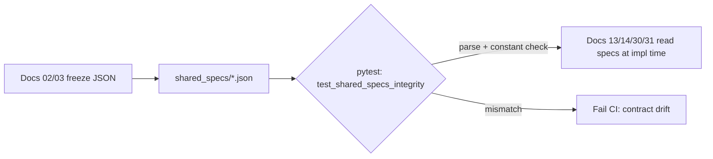

# Doc 01: Monorepo Structure, Shared Schemas & Lint Rules
> Part of PotPilot plan-series · Category A · Session 1 Wave 1.A · Shared

## 1. Purpose & Scope
Delivers the canonical repository skeleton that every later doc builds inside:
- The root folder hierarchy exactly as frozen in `overview.md` Section 3 (create-only scaffolding, no code).
- The root `.gitignore` covering Python, Dart/Flutter, PyInstaller, InnoSetup, and OS noise.
- The `shared_specs/` directory contract: byte-offset JSON source of truth, WS registry JSON, and the Win32 WM code table.
- Repository-wide lint rules: `ruff` for Python 3.11+, `flutter_lints` (via `analysis_options.yaml`) for Dart.

**Out of scope:** wire byte semantics (owned by [02_binary_udp_protocol_spec.md](02_binary_udp_protocol_spec.md) / [03_websocket_json_schema_spec.md](03_websocket_json_schema_spec.md)); `pc_agent/` code and `requirements.txt` ([04_pc_agent_boilerplate_deps.md](04_pc_agent_boilerplate_deps.md)); `mobile_app/` scaffold ([05_flutter_app_boilerplate_deps.md](05_flutter_app_boilerplate_deps.md)); installer artifacts ([27_pc_pyinstaller_build_spec.md](27_pc_pyinstaller_build_spec.md), [28_pc_innosetup_installer_script.md](28_pc_innosetup_installer_script.md)); editing `overview.md` itself.

## 2. File Ownership
**Create-only (owned by this doc):**

| Path | Purpose |
|---|---|
| `.gitignore` | Root ignore rules (see §4.2) |
| `pyproject.toml` | Root ruff configuration for all Python under `pc_agent/` |
| `shared_specs/potplayer_wm_codes.json` | WM code table: container + Win32 base constants seeded here; all command/getter entries and their schemas owned by Doc 09 |
| `shared_specs/` (directory) | Container for the three contract JSON files |
| `docs/` + `docs/micro/` (directories) | Canonical doc home per blueprint; in this repo the series lives flat in `plan-series/` (see §4.6) |

**Reads / touched by other docs (never created or edited here):**

| Path | Owner |
|---|---|
| `shared_specs/udp_packet_layout.json` | [02_binary_udp_protocol_spec.md](02_binary_udp_protocol_spec.md) |
| `shared_specs/ws_command_schema.json` | [03_websocket_json_schema_spec.md](03_websocket_json_schema_spec.md) |
| `mobile_app/analysis_options.yaml` | [05_flutter_app_boilerplate_deps.md](05_flutter_app_boilerplate_deps.md) — must implement §4.4 rules |
| `pc_agent/requirements.txt` | [04_pc_agent_boilerplate_deps.md](04_pc_agent_boilerplate_deps.md) |
| `pc_agent/potpilot_agent.spec`, `pc_agent/installer/setup.iss` | Docs 27 / 28 |

## 3. Public Contract
```python
# pyproject.toml → [tool.ruff] contract (names only; values per §4.4)
target-version: "py311"; line-length: 100
lint.select: ["E", "F", "I", "B", "UP", "ASYNC", "S101-rules-excluded-in-tests"]
```
```yaml
# mobile_app/analysis_options.yaml contract (implemented by Doc 05)
include: package:flutter_lints/flutter.yaml
# plus PotPilot overrides listed in §4.4
```
`shared_specs/potplayer_wm_codes.json` entry shape:
```json
{ "group": "WM_COMMAND | WM_USER | WIN32",
  "name": "PLAY_PAUSE", "value": "0x00000000", "note": "filled by Doc 09" }
```
Path constants used by tests: `SHARED_SPECS = <repo-root>/shared_specs`, `SPEC_FILES = ("udp_packet_layout.json", "ws_command_schema.json", "potplayer_wm_codes.json")`.

## 4. Internal Design
### 4.1 Scaffolding steps
1. Verify repo root (contains `overview.md` sibling or `.git/`); abort if run one level deep.
2. Create directories from the blueprint tree **only if absent**: `shared_specs/`, `pc_agent/` (with subpackages created lazily by owning docs), `mobile_app/` (created by Doc 05), `docs/`, `docs/micro/`.
3. Write `.gitignore` (§4.2), `pyproject.toml` (§4.4), `shared_specs/potplayer_wm_codes.json` (§5.2).
4. Validate all three `shared_specs/*.json` files parse as UTF-8 JSON; run `ruff check` sanity pass.
5. Never overwrite an existing file — report and skip (idempotent re-runs).

### 4.2 `.gitignore` layer table

| Layer | Patterns |
|---|---|
| Python | `.venv/`, `venv/`, `__pycache__/`, `*.pyc`, `.pytest_cache/`, `.ruff_cache/`, `*.egg-info/` |
| Build | `build/`, `dist/`, `*.spec.bak` (note: `pc_agent/installer/potpilot_agent.spec` is **tracked**; `build/` output is not) |
| Flutter/Dart | `.dart_tool/`, `build/`, `*.iml`, `.packages`, `pubspec.lock` tracked for apps? → **tracked** (single-app repo, reproducible CI) |
| InnoSetup | `Output/`, `*.exe` except none — always ignore `PotPilot_Setup.exe` |
| OS/IDE | `.DS_Store`, `Thumbs.db`, `.vscode/` (optional), `*.swp` |
| Secrets | `.env`, `*.token`, anything matching `*secret*` — pairing token lives only in `%APPDATA%\PotPilot\config.json` (Doc 26), never committed |

### 4.3 Shared-spec validation flow


### 4.4 Lint rules (Python — `pyproject.toml`)
1. `target-version = "py311"`, `line-length = 100`.
2. `lint.select = ["E", "F", "I", "B", "UP", "ASYNC"]`; tests may use `S101` asserts via per-file ignore `["pc_agent/tests/*"] = ["S101"]`.
3. Enforce `from __future__ import annotations` not required (3.11 native generics OK); enforce sorted imports (`I`).
4. `ruff format` is the one true formatter; no black/isort co-existence.

### 4.5 Lint rules (Dart — contract handed to Doc 05)
1. Base: `package:flutter_lints/flutter.yaml`.
2. Overrides: `prefer_single_quotes: true`, `always_declare_return_types: true`, `avoid_print: true` (use `debugPrint` in dev only), `lines_longer_than_80_chars: false` (100-char effective, matches Python).
3. `flutter analyze` must exit 0 in CI; no `// ignore:` without a same-line reason comment.

### 4.6 Doc-location convention
The blueprint's `docs/micro/` is realized in this repository as the flat `plan-series/` directory (this file's siblings, `NN_snake_case_title.md`). Relative links between micro-docs (`[02_binary_udp_protocol_spec.md](02_binary_udp_protocol_spec.md)`) assume the flat layout; a future physical move to `docs/micro/` must update link prefixes repo-wide in one atomic commit.

## 5. Protocol & Data Compliance
### 5.1 Frozen constants that must appear verbatim in shared specs

| Constant | Value | Frozen by | File |
|---|---|---|---|
| UDP port | `50505` | overview §4 | `udp_packet_layout.json` (Doc 02) |
| WebSocket port | `50506` | overview §4 | `ws_command_schema.json` (Doc 03) |
| Telemetry interval | `250` ms | overview §4 | `ws_command_schema.json` (Doc 03) |
| mDNS service type | `_potpilot._tcp.local.` | overview §4 | consumed by Doc 16 (recorded here for integrity test) |
| UDP struct format | `<BBhhH>`, 8 bytes | overview §4.1 | `udp_packet_layout.json` (Doc 02) |
| WS envelope keys | `id, type, action, payload, timestamp` | overview §4.2 | `ws_command_schema.json` (Doc 03) |
| Pairing token | persistent 128-bit secret | overview §4 | created by Doc 15, **never** written to shared specs |

### 5.2 `potplayer_wm_codes.json` — seed only; contents owned by Doc 09
This doc seeds the **container** (parseable JSON with the three top-level keys below); Doc 09 is the sole owner of entry schemas and values:
```json
{ "base": { "WM_COMMAND": "0x0111", "WM_USER": "0x0400" },
  "commands": {},
  "getters": {} }
```
| Top-level key | Seeded here | Filled by |
|---|---|---|
| `base` | The two Win32 base window-message constants | Doc 09 (read-only thereafter) |
| `commands` | `{}` | Doc 09 — entries validated per its schema (`message ∈ {WM_COMMAND, WM_USER}`, hex `wparam`/`lparam`, `param`, `mode`, `needs_ack`, `status`) |
| `getters` | `{}` | Doc 09/10 — `WM_USER` telemetry getter ids |

Integrity test here only asserts: file parses, all three keys exist and are objects. Any deeper schema check belongs to Doc 09's `CodeTableError` validation.

### 5.3 Required top-level keys of the sibling spec JSONs (integrity-test contract only)
The integrity test asserts presence of top-level keys; **content is frozen by the owning doc**, never by this doc:

| File | Required top-level keys | Owner |
|---|---|---|
| `udp_packet_layout.json` | `format` (`"<BBhhH>"`), `size` (`8`), `endian` (`"little"`), `packet_types`, `golden_vectors` | [02](02_binary_udp_protocol_spec.md) |
| `ws_command_schema.json` | `envelope`, `types` (4 CMD + telemetry), `close_codes`, `error_codes` | [03](03_websocket_json_schema_spec.md) |

## 6. Dependencies & Integration Points
**Internal:** [02_binary_udp_protocol_spec.md](02_binary_udp_protocol_spec.md) · [03_websocket_json_schema_spec.md](03_websocket_json_schema_spec.md) · [04_pc_agent_boilerplate_deps.md](04_pc_agent_boilerplate_deps.md) · [05_flutter_app_boilerplate_deps.md](05_flutter_app_boilerplate_deps.md) · [09_potplayer_wm_command_dispatcher.md](09_potplayer_wm_command_dispatcher.md) · [26_pc_config_persistence_manager.md](26_pc_config_persistence_manager.md) (config path excluded from git).
**External:** `ruff` (dev, `>=0.7`, lint+format — assumed tooling) · `pytest` (dev, `>=8`, spec tests — assumed) · `flutter_lints` `^4.0.0` (applied by Doc 05 — assumed) · Python `3.11+`, Flutter `3.x` per overview.
**Platform:** Windows filesystem (`%APPDATA%` runtime data is outside repo; ignore rules must not depend on it).

## 7. Edge Cases & Failure Handling
- Directory already exists with files → skip creation, never clobber; log `SKIP <path>`.
- `shared_specs/*.json` malformed (trailing comma, BOM) → integrity test fails with file+line message.
- Spec JSON contains a constant differing from §5.1 table → test fails naming both values (contract drift).
- Windows CRLF → `.gitattributes` not introduced (assumption §10); ruff/dartfmt normalize on write.
- `pyproject.toml` at repo root while only `pc_agent/` is Python → ruff run as `ruff check pc_agent/` to avoid scanning `.venv/` (also excluded via `[tool.ruff] exclude`).
- Flutter build dirs leak into git → verify `.gitignore` covers `.dart_tool/` and `build/`.
- Pairing token accidentally committed → secret patterns in §4.2 plus pre-commit manual review checklist (no git-secrets tooling introduced).

## 8. Acceptance Criteria
- [ ] Tree matches overview §3 exactly; no extra top-level directories exist.
- [ ] `.gitignore` contains every layer listed in §4.2; `git status` clean after `pip install` + `flutter pub get` + builds.
- [ ] `ruff check pc_agent/` exits 0 on scaffolded code; `ruff format --check` exits 0.
- [ ] `shared_specs/potplayer_wm_codes.json` parses with `base`/`commands`/`getters` keys and the two Win32 base constants; no Doc-09 entry rows pre-created.
- [ ] `test_shared_specs_integrity.py` passes and asserts all §5.1 constants.
- [ ] Docs 02/03 are able to create their two JSON files without touching any file owned here (no ownership overlap).
- [ ] Re-running the scaffolder is a no-op (idempotent).

## 9. Test Plan
| File | Asserts |
|---|---|
| `pc_agent/tests/test_shared_specs_integrity.py` | All three spec files exist, parse as UTF-8 JSON, are non-empty objects; §5.1 constants appear with exact values; `potplayer_wm_codes.json` has the three §5.2 container keys; `udp_packet_layout.json`/`ws_command_schema.json` expose the §5.3 top-level keys |
| `pc_agent/tests/test_gitignore_rules.py` | `.gitignore` contains one line per §4.2 layer (string containment), and excludes neither `shared_specs/*.json` nor `pc_agent/**/requirements.txt` |
Manual: create `.venv`, run `pip install ruff`, `ruff check pc_agent/`; run `flutter create` scratch check that `analysis_options.yaml` (Doc 05) lints with zero errors; `git status --porcelain` shows only intended files after a smoke build.

## 10. Assumptions & Open Questions
**Assumptions:** (a) In this repository `plan-series/` is the physical home of the series (flat, per batch instruction) and plays the role blueprint reserves for `docs/micro/`; the blueprint tree is still authoritative for the *runtime* layout. (b) Root `pyproject.toml` hosts ruff — extra standard dev tooling, allowed by batch rules. (c) `pytest` + `ruff` as Python dev tooling; `flutter_lints` for Dart — both recorded as allowed tooling additions. (d) Test roots are `pc_agent/tests/` and `mobile_app/test/` (blueprint silent; standard conventions). (e) `pubspec.lock` is committed; `main.py`/`main.dart` final wiring stays with Session 3. (f) No `.gitattributes` unless EOL churn appears.
**Open questions:** none blocking.
