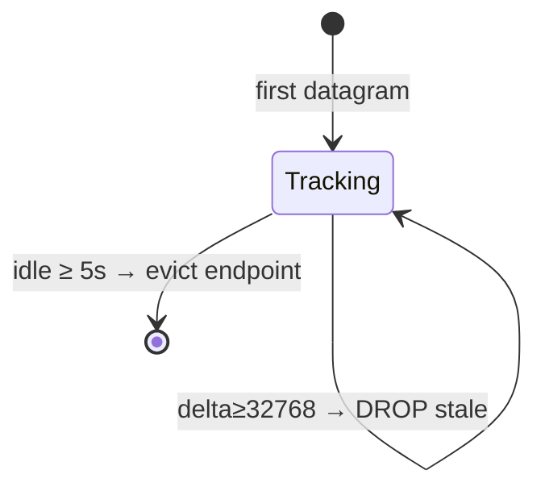

# Doc 02: Binary UDP Protocol Specification (Contract Freeze)
> Part of PotPilot plan-series · Category A · Session 1 Wave 1.A · Shared

> ⛔ **CONTRACT FREEZE.** The wire format below is immutable. Any change invalidates Docs 06–46. Golden vectors in §5.4 are the cross-language conformance oracle for Python (`struct`) and Dart (`ByteData`).

## 1. Purpose & Scope
Locks the 8-byte little-endian UDP datagram used for all high-frequency fire-and-forget input (60–120 Hz trackpad deltas, scroll ticks, mouse buttons, live scrub seeks) on port `50505`. Delivers: frozen byte layout, packet-type registry, auth-byte algorithm, monotonic sequence drop rules, serialization rules for both languages, the machine-readable `udp_packet_layout.json`, and reference codec modules.
**Out of scope:** socket lifecycle, binding, routing threads ([13_pc_asyncio_udp_receiver.md](13_pc_asyncio_udp_receiver.md)); token generation/storage ([15_pc_token_auth_middleware.md](15_pc_token_auth_middleware.md)); gesture/velocity math ([35_flutter_120hz_virtual_trackpad.md](35_flutter_120hz_virtual_trackpad.md)); datagram emission loop ([30_flutter_udp_datagram_sender.md](30_flutter_udp_datagram_sender.md)); mouse event injection ([06_win32_sendinput_mouse_engine.md](06_win32_sendinput_mouse_engine.md)); seek execution ([09_potplayer_wm_command_dispatcher.md](09_potplayer_wm_command_dispatcher.md)).

## 2. File Ownership
**Create-only (owned by this doc):**

| Path | Purpose |
|---|---|
| `shared_specs/udp_packet_layout.json` | Byte-offset source of truth + packet-type registry + golden vectors |
| `pc_agent/network/udp_packet_codec.py` | Python reference pack/unpack — executable conformance spec (stdlib `struct` only) |
| `mobile_app/lib/network/udp_packet_codec.dart` | Dart reference pack/unpack — executable conformance spec (`dart:typed_data` only) |
| `pc_agent/tests/test_udp_packet_codec.py` | Python conformance suite |
| `pc_agent/tests/test_udp_packet_layout_json.py` | JSON-vs-frozen-table integrity suite |
| `mobile_app/test/udp_packet_codec_test.dart` | Dart conformance suite (same golden vectors) |

**Reads / touched by other docs:** `pc_agent/network/udp_server.py` (Doc 13) mirrors the parse/sequence logic inline; `mobile_app/lib/network/udp_sender.dart` (Doc 30) mirrors the packer inline (zero-alloc `ByteData`); both **must pass this doc's golden-vector conformance suites** and may instead import the reference codecs. `pc_agent/core/auth_middleware.py` (Doc 15) implements the XOR checksum defined here. Docs 06/09 consume the routed callbacks from Doc 13. No other doc edits any file owned above.

## 3. Public Contract
Constants (identical names in both languages where portable):
```python
UDP_PORT = 50505
PACKET_FORMAT = "<BBhhH"        # struct format string, little-endian
PACKET_SIZE = 8                 # bytes, fixed
SEQ_MODULO = 65536              # uint16 wrap
SEQ_RESET_TIMEOUT_S = 5.0       # receiver resets tracker after idle
class PacketType(IntEnum):
    MOUSE_MOVE = 0x01; MOUSE_SCROLL = 0x02; MOUSE_BUTTON = 0x03; SCRUB_SEEK = 0x04
class ButtonId(IntEnum): LEFT = 1; RIGHT = 2; MIDDLE = 3
class ButtonState(IntEnum): DOWN = 1; UP = 2; CLICK = 3
```
Python codec (bodies live in the owned codec files):
```python
def pack_packet(packet_type: int, auth_byte: int, arg1: int, arg2: int, seq: int) -> bytes
    """Serialize one 8-byte datagram; raises ValueError on out-of-range fields."""
def unpack_packet(data: bytes) -> tuple[int, int, int, int, int]
    """Parse (packet_type, auth_byte, arg1, arg2, seq); raises PacketError on bad length/type."""
def xor_auth_byte(token_bytes: bytes) -> int
    """Fold a 128-bit (16-byte) pairing token to its 8-bit XOR checksum."""
def split_seek_seconds(target_seconds: int) -> tuple[int, int]
    """Encode seek target as (high, low) int16-safe words; target in [0, 2**31)."""
def join_seek_seconds(high: int, low: int) -> int
    """Reassemble (high, low) words into unsigned target_seconds."""
def to_i16(value: int) -> int
    """Wrap any int into signed int16 two's-complement range (used for low word & producer clamps)."""
def from_i16(value: int) -> int
    """Identity sign-passthrough; receivers mask with 0xFFFF where semantics are unsigned."""
class PacketError(Exception): ...
```
Dart codec mirror (same semantics, `Uint8List` in/out):
```dart
const int udpPort = 50505;
const int packetSize = 8;
Uint8List packPacket({required int packetType, required int authByte,
    required int arg1, required int arg2, required int seq});   // throws ArgumentError
({int packetType, int authByte, int arg1, int arg2, int seq})
    unpackPacket(Uint8List data);                                // throws FormatException
int xorAuthByte(Uint8List tokenBytes);
({int high, int low}) splitSeekSeconds(int targetSeconds);
int joinSeekSeconds(int high, int low);
```

## 4. Internal Design
### 4.1 Serialization algorithm (writer)
1. Validate `packet_type ∈ {0x01..0x04}`, `0 ≤ auth_byte ≤ 255`, `0 ≤ seq ≤ 65535`, and `arg1/arg2` within signed int16 after the packet-type-specific normalization below. Raise/throw on violation — **never silently truncate**.
2. Packet-type normalization: `MOUSE_MOVE`/`MOUSE_SCROLL` — clamp producer deltas to `[-32768, 32767]` upstream (Doc 35/30); codec accepts already-in-range ints. `MOUSE_BUTTON` — `arg1 ∈ {1,2,3}`, `arg2 ∈ {1,2,3}`. `SCRUB_SEEK` — `arg1 = high = (target_seconds >> 16)` (fits int16 because target < 2³¹), `arg2 = low = to_i16(target_seconds & 0xFFFF)`.
3. Pack little-endian: Python `struct.pack(PACKET_FORMAT, …)`; Dart `ByteData(8)..setUint8(0, …)…setInt16(2, arg1, Endian.little)…` then `asUint8List()`.
4. Emit exactly one datagram per packet; never coalesce.

### 4.2 Parse algorithm (receiver)
1. If `len(data) != 8` → drop, increment `malformed_datagrams` counter, log at DEBUG (never raise into the event loop).
2. Unpack little-endian; `PacketError` on any deviation → same drop path.
3. Unknown `packet_type` → drop + counter.
4. Hand `(auth_byte, …)` to Doc 15 verifier **before** sequence bookkeeping; mismatch → drop silently (no oracle for token guessing).
5. Apply sequence gate (§4.3). If accepted → dispatch per §5.3 routing table.

### 4.3 Sequence-drop state machine (per source endpoint)
Receiver keeps `{last_seq, last_seen}` keyed by `(ip, port)`:
1. First packet for endpoint (or idle ≥ `SEQ_RESET_TIMEOUT_S = 5.0 s`) → accept, set `last_seq = seq`.
2. `delta = (seq - last_seq) & 0xFFFF`.
3. `delta == 0` → duplicate → drop.
4. `1 ≤ delta < 32768` → forward (gaps allowed — UDP loss is tolerated by design) → accept, `last_seq = seq`.
5. `delta ≥ 32768` → stale/out-of-order → drop, `last_seq` unchanged.
6. Timer task sweeps idle endpoints every 5 s to bound map size.



### 4.4 Components
- `udp_packet_layout.json` — declarative byte table + type registry + golden vectors (§5.4); single source for both codec test suites.
- Python/Dart codecs — pure functions, zero I/O, zero deps; the only place struct/ByteData knowledge lives.
- Wrappers: Doc 13 (asyncio `datagram_received`), Doc 30 (`RawDatagramSocket.send`), Doc 15 (auth byte source).

## 5. Protocol & Data Compliance
### 5.1 Byte layout (frozen — little-endian, 8 bytes fixed)

| Offset | Size | C / struct | Name | Range | Semantics |
|---|---|---|---|---|---|
| 0 | 1 | `B` | `packet_type` | `0x01`–`0x04` | Registry §5.2 |
| 1 | 1 | `B` | `auth_byte` | `0x00`–`0xFF` | 8-bit XOR checksum of the 16-byte pairing token |
| 2 | 2 | `h` | `arg1` | −32768…32767 | Primary value (type-specific) |
| 4 | 2 | `h` | `arg2` | −32768…32767 | Secondary value (type-specific) |
| 6 | 2 | `H` | `seq` | 0…65535 | Monotonic per-sender counter, wraps at 65535→0 |

### 5.2 Packet-type registry (frozen)

| Type | Name | `arg1` | `arg2` | Notes |
|---|---|---|---|---|
| `0x01` | `MOUSE_MOVE` | `dx` (signed px) | `dy` (signed px) | Relative move; positive X = right, positive Y = down |
| `0x02` | `MOUSE_SCROLL` | `vertical_delta` (signed ticks) | `horizontal_delta` (signed ticks) | Positive = up / right; Doc 06 maps to `MOUSEEVENTF_WHEEL`/`HWHEEL` |
| `0x03` | `MOUSE_BUTTON` | `button_id` `1:L 2:R 3:M` | `state` `1:Down 2:Up 3:Click` | `Click` = synthesized Down+Up (atomic drag-safe) |
| `0x04` | `SCRUB_SEEK` | `target_seconds_high` | `target_seconds_low` | `target = (high << 16) | (low & 0xFFFF)`; low word is two's-complement bit pattern in int16 |

### 5.3 Routing contract (implemented by Doc 13)
`0x01/0x02/0x03 → win32_mouse` (Docs 06) · `0x04 → PotPlayer seek handler` (Doc 09 via `seek_absolute(target_seconds)`). Auth byte check is Doc 15's, executed pre-routing.

### 5.4 Golden vectors (cross-language conformance oracle)
`auth_byte = 0x5A` used throughout (illustrative; real value from Doc 15 token).

| # | Scenario | type | auth | arg1 | arg2 | seq | Hex bytes |
|---|---|---|---|---|---|---|---|
| G1 | Move dx=+10, dy=−5 | 0x01 | 0x5A | 10 | −5 | 1 | `01 5A 0A 00 FB FF 01 00` |
| G2 | Scroll up 3, right −1 | 0x02 | 0x5A | 3 | −1 | 2 | `02 5A 03 00 FF FF 02 00` |
| G3 | Left button Down | 0x03 | 0x5A | 1 | 1 | 3 | `03 5A 01 00 01 00 03 00` |
| G4 | Middle Click | 0x03 | 0x5A | 3 | 3 | 65535 | `03 5A 03 00 03 00 FF FF` |
| G5 | Seek 3661 s (1h 01m 01s) | 0x04 | 0x5A | 0 | 3661 | 10 | `04 5A 00 00 DD 0E 0A 00` |
| G6 | Seek 70000 s (high=1) | 0x04 | 0x5A | 1 | 4464 | 11 | `04 5A 01 00 10 11 0B 00` |
| G7 | Min dx=−32768, dy=+32767 | 0x01 | 0x00 | −32768 | 32767 | 0 | `01 00 00 80 FF 7F 00 00` |

Worked example G5: `3661 = 0x0E2D` → high `0`, low `0x0E2D` `→` `to_i16` identity (3621 < 32768) → `DD 0E`. G6: `70000 = 0x11170` → high `1`, low `0x1170 = 4464` → `10 11`.

## 6. Dependencies & Integration Points
**Internal:** [01_monorepo_structure.md](01_monorepo_structure.md) (shared_specs home, test roots) · [03_websocket_json_schema_spec.md](03_websocket_json_schema_spec.md) (companion contract; scrub bar telemetry flows over WS) · [13_pc_asyncio_udp_receiver.md](13_pc_asyncio_udp_receiver.md) · [15_pc_token_auth_middleware.md](15_pc_token_auth_middleware.md) · [30_flutter_udp_datagram_sender.md](30_flutter_udp_datagram_sender.md) · [35_flutter_120hz_virtual_trackpad.md](35_flutter_120hz_virtual_trackpad.md) · [41_flutter_blind_bed_mode_gestures.md](41_flutter_blind_bed_mode_gestures.md) · [06_win32_sendinput_mouse_engine.md](06_win32_sendinput_mouse_engine.md) · [09_potplayer_wm_command_dispatcher.md](09_potplayer_wm_command_dispatcher.md).
**External:** Python `struct` (stdlib) · Dart `dart:typed_data` (stdlib) · `pytest` (dev) — no runtime third-party deps by design.
**Platform:** IPv4 UDP over LAN Wi-Fi; both codecs are OS-agnostic (no Win32/Android APIs here).

## 7. Edge Cases & Failure Handling
- **Wrong-size datagram** (0, 7, 9+ bytes) → drop + `malformed_datagrams` counter; never raise into asyncio loop.
- **Auth mismatch** → silent drop (anti-oracle); Doc 15 rate-limits per endpoint.
- **Sequence wrap** 65535→0 handled by modulo-65536 delta (§4.3 rule 3/4).
- **Sender restart** (new process, seq back to 0) → receiver evicts endpoint after 5 s idle; immediate restart < 5 s produces dropped packets until wrap distance resolves — acceptable; phone UI resyncs via WS telemetry.
- **Loss > 32767 consecutive packets while streaming** → next packet misclassified stale; mathematically requires 4.5 min of total loss at 120 Hz, and the 5 s idle eviction fires first — treated impossible on healthy LAN.
- **`arg` out of int16 at pack time** → `ValueError`/`ArgumentError` in codec (fail loud in dev); producers (Docs 30/35) clamp deltas per frame to int16.
- **Seek target ≥ 2³¹ seconds** → rejected at `split_seek_seconds` (≈68 years; not representable).
- **Low-word sign aliasing** → receivers of `SCRUB_SEEK` must mask `low & 0xFFFF` (a low word > 32767 appears negative as int16).
- **Non-Wi-Fi jitter / reordering** → stale-drop rule prevents double-apply of old deltas.
- **Token rotation** (Doc 15/26) → all senders recompute `xor_auth_byte`; old-byte packets dropped silently until phone re-pairs.

## 8. Acceptance Criteria
- [ ] `shared_specs/udp_packet_layout.json` contains §5.1/§5.2 tables machine-readably and the seven G1–G7 vectors.
- [ ] Python codec packs/unpacks all G-vectors byte-for-byte; Dart codec does the same — both suites read vectors from the JSON (no duplicated constants in tests).
- [ ] Round-trip property: 10 000 random in-range field tuples survive pack→unpack identically in both languages.
- [ ] `split/join_seek_seconds(3661) == 3661`, `(70000) == 70000`, and a ≥ 2³¹ target raises.
- [ ] Sequence gate unit tests cover: first packet, duplicate, reorder-drop, forward-with-gap accept, wrap-around, 5 s idle reset.
- [ ] `PACKET_SIZE == 8` enforced; `struct.calcsize(PACKET_FORMAT) == 8`.
- [ ] Constants `UDP_PORT = 50505` exist verbatim in both codec modules.

## 9. Test Plan
| File | Asserts |
|---|---|
| `pc_agent/tests/test_udp_packet_codec.py` | G1–G7 pack+unpack, random round-trip property, seek split/join bounds, out-of-range raises, malformed-length raises |
| `pc_agent/tests/test_udp_packet_layout_json.py` | JSON parses; every offset/size/type matches §5.1; type registry matches §5.2; vectors match hex strings |
| `pc_agent/tests/test_sequence_gate.py` | Pure-function mirror of §4.3 rules incl. wrap and timeout cases (Doc 13 reuses this logic) |
| `mobile_app/test/udp_packet_codec_test.dart` | Same G1–G7 vectors + round-trip + ArgumentError on bad input |
Manual (needs Doc 13, Wave 1.B): craft `01 5A 0A 00 FB FF 01 00` with `python -c`/PowerShell `UdpClient`, verify cursor moves 10,−5 px; send twice with same `seq` and verify second is ignored; verify `flutter` side fires at 120 Hz without GC hitches (Doc 30 benchmark).

## 10. Assumptions & Open Questions
**Assumptions:** (a) Token is exactly 16 bytes (128-bit); XOR-fold over all 16 bytes yields `auth_byte` (no CRC/poly option). (b) Sequence tracking is per source `(ip, port)` so multiple phones never share a counter. (c) Gaps are accepted (forward-only gate) because lost input packets are unrecoverable by design; only ordering matters. (d) `SEQ_RESET_TIMEOUT_S = 5.0` balances sender-restart recovery against wrap-window safety. (e) `SCRUB_SEEK` targets whole seconds (telemetry WS scrub bar uses ms — different channel). (f) The codec modules (`udp_packet_codec.py/.dart`) are create-only reference/conformance implementations inside blueprint-listed packages and the Wave 1.A test target; runtime modules (Docs 13/30) mirror the logic inline per their own designs and MUST pass the shared golden-vector suites — import-or-mirror is an implementation detail, the vectors are law. (g) One datagram = one packet; no batching, no compression, no fragmentation (8 bytes never needs it). (h) Receiver-side sanity caps added downstream (e.g. Doc 13's 24 h scrub cap, peer-table limits) are additive filters applied **after** this spec's validation and do not alter the wire format.
**Open questions:** none — all fields, ranges, drop rules and vectors above are frozen.
