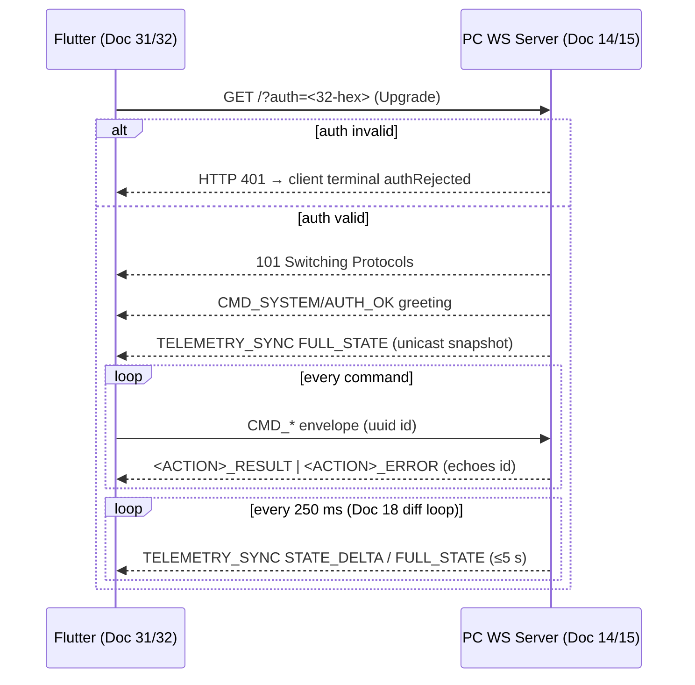

# Doc 03: WebSocket JSON Schema Specification (Contract Freeze)
> Part of PotPilot plan-series · Category A · Session 1 Wave 1.A · Shared

> ⛔ **CONTRACT FREEZE.** Every envelope, action, payload field, reply rule, close code and telemetry field below is immutable. Any change invalidates Docs 14–18 and 31–45.
> **Normative precedence:** this doc is the single wire authority. Where any downstream doc's mirrored example or constant differs (naming, codes, frame shapes), **Doc 03 governs**; the downstream doc is read as non-normative and must be implemented to match here (divergence map in §10).

## 1. Purpose & Scope
Locks the bi-directional WebSocket JSON protocol on port `50506`: guaranteed-delivery command channel (PotPlayer control, key injection, system/power, media library) plus the PC→phone `TELEMETRY_SYNC` broadcast (250 ms cadence). Delivers: the envelope definition, connection-level authentication handshake, exhaustive action registry with payload schemas, reply/error conventions, telemetry payload, close/error codes, `ws_command_schema.json`, and reference codec modules for Python and Dart.
**Out of scope:** server socket lifecycle & action routing internals ([14_pc_websocket_server_router.md](14_pc_websocket_server_router.md)); token generation/validation logic ([15_pc_token_auth_middleware.md](15_pc_token_auth_middleware.md)); diff engine internals ([18_pc_telemetry_broadcast_loop.md](18_pc_telemetry_broadcast_loop.md)); client reconnection/backoff ([31_flutter_websocket_client_reconnect.md](31_flutter_websocket_client_reconnect.md)); UI rendering of telemetry ([33_flutter_telemetry_state_provider.md](33_flutter_telemetry_state_provider.md)).

## 2. File Ownership
**Create-only (owned by this doc):**

| Path | Purpose |
|---|---|
| `shared_specs/ws_command_schema.json` | Machine-readable action registry + envelope + telemetry + codes |
| `pc_agent/network/ws_message_codec.py` | Python envelope build/parse + action/error constants — **reference/conformance implementation** (stdlib `json` only; executable spec for the suites below) |
| `mobile_app/lib/network/ws_message_codec.dart` | Dart envelope build/parse — reference/conformance implementation (`dart:convert` only) |
| `pc_agent/tests/test_ws_message_codec.py` | Envelope + registry conformance suite |
| `pc_agent/tests/test_ws_handshake.py` | Handshake accept/reject behavior (router shim; Doc 14 plugs in real handler later) |
| `mobile_app/test/ws_message_codec_test.dart` | Dart conformance suite |

**Reads / touched by other docs:** Doc 14 routes by `type`/`action` using this registry (it may mirror `parse_envelope` inline — its output must pass this doc's suites); Doc 15 owns the handshake validator behind §4.2; Doc 18 serializes `TELEMETRY_SYNC` frames per §4.3/§5.6; Doc 31/33 decode inbound frames (inline `WsEnvelope` mirrors allowed); Docs 36–45 build outbound commands. Runtime modules may either import the reference codecs or mirror them inline — **both paths must pass the golden conformance suites**; no other doc edits the owned files.

## 3. Public Contract
```python
WS_PORT = 50506
TELEMETRY_INTERVAL_MS = 250
MAX_FRAME_BYTES = 65536
ACTION_STATE_DELTA = "STATE_DELTA"     # TELEMETRY_SYNC action: payload = changed keys only
ACTION_FULL_STATE = "FULL_STATE"       # TELEMETRY_SYNC action: payload = every §5.6 key
FULL_REFRESH_EVERY_TICKS = 20          # emit FULL_STATE at least every 20 ticks (5.0 s)
GREETING_ACTION = "AUTH_OK"            # server→client post-upgrade greeting (§5.7)

class WsType(str, Enum):
    CMD_POTPLAYER = "CMD_POTPLAYER"; CMD_KEY = "CMD_KEY"
    CMD_SYSTEM = "CMD_SYSTEM"; CMD_MEDIA = "CMD_MEDIA"; TELEMETRY_SYNC = "TELEMETRY_SYNC"

class CloseCode(IntEnum): PROTOCOL_ERROR = 4400; UNAUTHORIZED = 4401; HEARTBEAT_TIMEOUT = 4408
class ErrorCode(IntEnum):
    UNKNOWN_ACTION = 4002; INVALID_PAYLOAD = 4003; POTPLAYER_NOT_RUNNING = 4004
    MEDIA_NOT_FOUND = 4005; HARDWARE_UNAVAILABLE = 4006; INTERNAL_ERROR = 4500

@dataclass(frozen=True, slots=True)
class WsMessage: id: str; type: str; action: str; payload: dict; timestamp: int

def build_message(type_: str, action: str, payload: dict, id_: str | None = None) -> WsMessage
    """Compose an envelope; id_ defaults to uuid4(); timestamp = unix seconds."""
def parse_message(raw: str | bytes) -> WsMessage
    """Parse + validate an inbound frame; raises WsSchemaError on any violation."""
def build_result(request: WsMessage, payload: dict | None = None) -> WsMessage
    """Success reply: echoes request id, action = request.action + '_RESULT'."""
def build_error(request: WsMessage, code: int, message: str) -> WsMessage
    """Error reply: echoes request id, action = request.action + '_ERROR'."""
def build_telemetry_delta(changed: dict) -> WsMessage
    """Telemetry frame, action STATE_DELTA, payload = keys changed this tick (§4.3)."""
def build_telemetry_full(state: dict) -> WsMessage
    """Telemetry frame, action FULL_STATE, payload = every §5.6 key (connect/REQUEST_STATE/keepalive)."""
def build_auth_ok() -> WsMessage
    """Post-upgrade greeting frame (CMD_SYSTEM/AUTH_OK, payload {"ok": true}) sent once per connection."""
class WsSchemaError(Exception): code: int; detail: str
```
Dart mirror: same function set (`Uint8List`/`String` in, `WsMessage` class out, `FormatException` on violation); constants as top-level `const`s (`wsPort`, `telemetryIntervalMs`, `closeCodeUnauthorized`, …).

Action constants live in the codecs as exhaustive `Action` classes, e.g. `Action.PLAY_PAUSE = "PLAY_PAUSE"` … mirroring §5.3–§5.5 verbatim.

## 4. Internal Design
### 4.1 Message lifecycle
1. Client opens `ws://<pc-ip>:50506/?auth=<token-hex>` (handshake §4.2).
2. On upgrade success the server immediately sends the `AUTH_OK` greeting (§5.7) followed by one unicast `FULL_STATE` telemetry snapshot to that client.
3. Client sends `WsMessage` (uuid `id`, one of the four `CMD_*` types, action from §5.3–5.5).
4. Server validates envelope → validates payload against the action's schema → dispatches to handler (Doc 14 registry).
5. Server replies **exactly one** frame echoing `id`: `<ACTION>_RESULT` (payload = data or `{"ok": true}`) or `<ACTION>_ERROR` (§5.8).
6. Independently, the 250 ms telemetry loop (§4.3, Doc 18) pushes `STATE_DELTA`/`FULL_STATE` frames to all authenticated clients.
7. `REQUEST_STATE` (§5.5) additionally triggers one unicast `FULL_STATE` snapshot to the requester.

### 4.2 Authentication handshake (connection-level)
- Token is sent as query parameter `auth` = 32 lowercase hex chars (16-byte secret, Doc 15) — the WS envelope types are frozen to five, so auth cannot be an out-of-band frame family; **the token never appears inside any JSON frame**.
- Server `process_request` hook (Doc 14) validates before the upgrade completes: valid → accept; invalid/missing → HTTP `401` (never a 101).
- Success signal to the client: the 101 upgrade **plus** the `AUTH_OK` greeting (§5.7) **plus** the initial `FULL_STATE` snapshot — all within 3 s on a healthy LAN (Docs 31/32 key their pairing state machines on `AUTH_OK`).
- Mid-session revocation (token rotated via Docs 15/26) → server closes with code `4401`, reason `UNAUTHORIZED`; client treats as terminal `authRejected` (re-pair required), not a retryable backoff.
- **No `AUTH`/`AUTH_FAIL` frames exist.** An inbound frame whose action is `AUTH` or `AUTH_FAIL` → `<ACTION>_ERROR 4002`. References in downstream docs to close code `4001` mean `4401`.
- Heartbeat: WS-level ping every `15 s` from client, pong required; server idle-closes after `30 s` silence with `4408`. (Client reconnect/backoff is Doc 31.)



### 4.3 Telemetry cadence (delta model)
Server keeps the full 14-key state dictionary (§5.6; Session-2 providers register keys late — a key is **absent** until its provider exists, Doc 18). Every 250 ms tick:
1. Diff current state vs the last state view sent; non-empty → broadcast one `STATE_DELTA` frame carrying **only the changed keys**.
2. Empty diff and tick index `tick % FULL_REFRESH_EVERY_TICKS == 0` → broadcast one `FULL_STATE` frame carrying **every key** (client resync/keepalive, ≤5.0 s worst case).
3. Otherwise skip entirely (no serialization, no send).
4. On new connection and on `REQUEST_STATE` → immediately unicast one `FULL_STATE` to that client only.
Client merge rules (Doc 33): `FULL_STATE` replaces the whole state; `STATE_DELTA` replaces only present keys and retains absent ones; unknown keys are ignored, never errors. On reconnect the client **clears** merged state and awaits the next `FULL_STATE` before rendering authoritative values.

### 4.4 Components
- `ws_command_schema.json` — registry: envelope spec, per-type action list with payload field specs, telemetry spec, close/error code tables; consumed by tests and both codecs (constants are code-generated manually from it at authoring time, verified by test).
- Codecs — pure functions, no I/O; Doc 14 wires `parse/dispatch/build_*`; Doc 31 pipes inbound strings to `parse_message`.

## 5. Protocol & Data Compliance
### 5.1 Envelope (frozen — applies to every frame, both directions)

| Field | Type | Constraints | Semantics |
|---|---|---|---|
| `id` | string | UUID-4, lowercase hyphenated, 36 chars | Client: correlation id. Server replies echo it. Telemetry/greeting frames use a **fresh uuid4 per frame** — clients route by `type`, never correlate these ids |
| `type` | string | One of `CMD_POTPLAYER, CMD_KEY, CMD_SYSTEM, CMD_MEDIA, TELEMETRY_SYNC` | Domain selector; `TELEMETRY_SYNC` is server→client only |
| `action` | string | `UPPER_SNAKE_CASE`; request = §5.3–5.5 name; reply = name + `_RESULT`/`_ERROR`; telemetry = `STATE_DELTA`\|`FULL_STATE`; greeting = `AUTH_OK` | Operation |
| `payload` | object | `{}` allowed; schema per action (§5.3–5.6) | Parameters/data |
| `timestamp` | int | Unix seconds, PC clock | Server stamps on replies/telemetry; clients stamp requests (drift tolerated, display-only) |

Frames exceeding `MAX_FRAME_BYTES = 65536` → server closes `4400`.

### 5.2 Constants (exact values, used verbatim by both sides)

| Name | Value |
|---|---|
| `WS_PORT` | `50506` |
| `TELEMETRY_INTERVAL_MS` | `250` |
| `MAX_FRAME_BYTES` | `65536` |
| Telemetry actions | `STATE_DELTA` · `FULL_STATE` (telemetry `type` frames use only these two) |
| `FULL_REFRESH_EVERY_TICKS` | `20` (⇒ `FULL_STATE` at least every 5.0 s) |
| Greeting action | `AUTH_OK` (server→client, once per connection) |
| Close codes | `4400` PROTOCOL_ERROR · `4401` UNAUTHORIZED (downstream “4001” = this) · `4408` HEARTBEAT_TIMEOUT |
| Error codes | `4002`–`4006`, `4500` (§5.8) |
| mDNS companion | `_potpilot._tcp.local.` (Doc 16 advertises `ws` port 50506) |

### 5.3 `CMD_POTPLAYER` actions (payload `{}` unless listed)

| Action | Payload | Handler (Doc) |
|---|---|---|
| `PLAY_PAUSE` | `{}` | 09 |
| `PLAY` | `{}` | 09 (used by call auto-pause resume, Doc 44) |
| `PAUSE` | `{}` | 09 (used by incoming-call hook, Doc 44) |
| `SEEK` | `position_ms: int` (≥0, ≤ duration) | 09 — scrub bar (Doc 38) |
| `SEEK_DELTA` | `delta_ms: int` (−120000…120000; deck sends ±5000 / ±30000) | 09 |
| `SET_SPEED` | `multiplier: float` (0.2–4.0, client computes ±0.1 deltas and 1.0 reset) | 09 |
| `FRAME_STEP` | `direction: "FORWARD" \| "BACKWARD"` | 09 |
| `TOGGLE_FULLSCREEN` | `{}` | 09 |
| `CYCLE_ASPECT_RATIO` | `{}` | 09 |
| `SET_VOLUME` | `percent: int` 0–100 (PotPlayer internal volume; blind-mode slide, Doc 41) | 09 |
| `CYCLE_AUDIO` | `{}` | 09 (Doc 39) |
| `CYCLE_SUBS` | `{}` (next subtitle track; Doc 39) | 09 |
| `SET_SUBS` | `enabled: bool` (Doc 39 toggle) | 09 |
| `SUB_SYNC_ADJUST` | `delta_ms: int` (multiple of ±500, clamp ±10000; Doc 39) | 09 |

`_RESULT` payload: `{"ok": true}`. `POTPLAYER_NOT_RUNNING` (4004) on every action when Doc 08 locator reports no window.

### 5.4 `CMD_KEY` actions

| Action | Payload | Notes |
|---|---|---|
| `SEND_KEY` | `vk: int` (1–254, Win32 VK code) | Press+release, Doc 07; full keyboard (Doc 37) |
| `SEND_COMBO` | `vk: int`, `modifiers: string[]` ⊆ `{"CTRL","ALT","SHIFT","WIN"}` (max 4, no dupes) | e.g. Alt+F4, Win+D |
| `SEND_TEXT` | `text: string` (1–4096 chars, any Unicode incl. astral plane) | Sent as UTF-8 JSON; Doc 07 injects per UTF-16 code unit via `KEYEVENTF_UNICODE` |

`_RESULT`: `{"ok": true}`. Unknown VK or empty `text` → 4003.

### 5.5 `CMD_SYSTEM` and `CMD_MEDIA` actions

| Type | Action | Payload | Handler (Doc) |
|---|---|---|---|
| CMD_SYSTEM | `SNAP_TO_PRIMARY_MONITOR` | `{}` | 11 |
| CMD_SYSTEM | `SET_BLACKOUT` | `enabled: bool` | 12 (also tray toggle, Doc 25) |
| CMD_SYSTEM | `SET_BRIGHTNESS` | `percent: int` 0–100 (DDC/CI; Doc 40 slider) | 19 — 4006 if no DDC/CI monitor |
| CMD_SYSTEM | `SET_SYSTEM_VOLUME` | `percent: int` 0–100 (CoreAudio master) | 23 |
| CMD_SYSTEM | `SET_SYSTEM_MUTE` | `muted: bool` | 23 |
| CMD_SYSTEM | `START_SLEEP_TIMER` | `mode: "COUNTDOWN" \| "MOVIE_PROGRESS"`; `target: "SLEEP" \| "HIBERNATE" \| "SHUTDOWN"`; COUNTDOWN ⇒ `minutes: int` 1–720; MOVIE_PROGRESS ⇒ `progress_pct: int` 1–100 (e.g. 99) | 22 (Doc 40 UI) |
| CMD_SYSTEM | `CANCEL_SLEEP_TIMER` | `{}` | 22 |
| CMD_SYSTEM | `REQUEST_STATE` | `{}` → `_RESULT {"ok": true}` **plus** one unicast `FULL_STATE` snapshot to the requester | 18 |
| CMD_MEDIA | `LIST_MEDIA` | `path: string?` (folder root, absolute, must be under a configured movie dir), `query: string?` (case-insensitive substring), `offset: int? ≥0` (default 0), `limit: int?` 1–200 (default 50) | 20 (Doc 45 browser) |
| CMD_MEDIA | `RESCAN_MEDIA` | `{}` → `_RESULT {"ok": true, "queued": true}` | 20 |
| CMD_MEDIA | `LAUNCH_MEDIA` | `path: string` (absolute file inside a configured dir) → launches fullscreen + snaps primary | 21 |

`LIST_MEDIA` `_RESULT` payload:

| Field | Type | Semantics |
|---|---|---|
| `folders` | `string[]` | Sub-folder names under `path` (empty at leaf) |
| `items` | `object[]` | Entries: `name: string`, `path: string`, `size_bytes: int`, `modified_at: int` (unix s), `has_subs: bool` |
| `total` | `int` | Matching entries before paging |
| `offset`, `limit` | `int` | Echoed paging window |

Path outside configured dirs or missing file → 4005 `MEDIA_NOT_FOUND`.

### 5.6 `TELEMETRY_SYNC` payload dictionary (flat; `STATE_DELTA` subset or `FULL_STATE` full — §4.3)
Wire keys are **exactly** the flat names below (authoritative; Doc 18 emits them, Doc 33 merges them). A key is absent from `STATE_DELTA` frames when its value did not change this tick, and absent from all frames until its Session-2 provider registers (Doc 18 registry).

| Key | Type | Semantics | Producer (Doc) |
|---|---|---|---|
| `position_ms` | int | Playback position in ms; `0` when idle/none | 10 |
| `duration_ms` | int | Total duration in ms; `0` when unknown | 10 |
| `is_playing` | bool | Play state | 10 |
| `speed` | float | Playback multiplier 0.2–4.0, default 1.0 | 10 |
| `volume` | int 0–100 | PotPlayer **internal** volume (not Windows master) | 10 |
| `file_title` | string \| null | Basename without extension; null when idle (clients must not invent a `title` alias) | 10/18 |
| `potplayer_found` | bool | `PotPlayer64` HWND alive (Doc 08) | 08 |
| `blackout_active` | bool | Blackout overlays currently shown | 12 |
| `brightness` | int 0–100 \| null | First DDC/CI-capable monitor luminance; null = unsupported/unknown | 19 |
| `sys_volume` | int 0–100 | CoreAudio master volume | 23 |
| `sys_muted` | bool | CoreAudio master mute | 23 |
| `sleep_timer_active` | bool | Countdown/progress timer armed | 22 |
| `sleep_timer_mode` | `"COUNTDOWN"` \| `"MOVIE_PROGRESS"` \| null | Timer mode; null when idle | 22 |
| `sleep_timer_remaining_s` | int \| null | Seconds until fire; null when idle | 22 |

Envelope `timestamp` = broadcast second (unix s). Merge semantics are defined in §4.3; a partially populated frame never erases previously known data, and clients ignore unknown keys for forward compatibility.

### 5.7 Server-initiated frames (no client request)
| Frame | When sent | Shape |
|---|---|---|
| `AUTH_OK` greeting | Exactly once per authenticated connection, immediately after the 101 upgrade, before any telemetry | `type: "CMD_SYSTEM"`, `action: "AUTH_OK"`, `payload: {"ok": true}`, fresh uuid4 `id`; Docs 31/32 key their `connected` transition on it |
| `TELEMETRY_SYNC` | Per §4.3 cadence (unicast snapshot on connect/`REQUEST_STATE`; broadcast `STATE_DELTA`/`FULL_STATE`) | Per §5.6; clients route by `type` only |

### 5.8 Reply & error convention
- Success: `action = <REQUEST_ACTION>_RESULT`, `payload` per action (`{"ok": true}` default), `id` echoed.
- Failure: `action = <REQUEST_ACTION>_ERROR`, `payload = {"code": int, "message": string}`, `id` echoed.

| Code | Name | Trigger |
|---|---|---|
| 4002 | UNKNOWN_ACTION | Action not in registry for that type, or client sent `TELEMETRY_SYNC`/`AUTH`/`AUTH_FAIL` frames |
| 4003 | INVALID_PAYLOAD | Type/range/required-field violation |
| 4004 | POTPLAYER_NOT_RUNNING | No PotPlayer HWND (Doc 08) for `CMD_POTPLAYER` |
| 4005 | MEDIA_NOT_FOUND | Path missing/outside configured roots |
| 4006 | HARDWARE_UNAVAILABLE | DDC/CI/audio endpoint error |
| 4500 | INTERNAL_ERROR | Unhandled handler exception (message sanitized) |

Router-internal signal mapping (Doc 14's `E_*` constants → wire): `E_BAD_JSON`/`E_BAD_ENVELOPE` → close `4400`; `E_UNKNOWN_ACTION` → 4002; `E_UNAUTHORIZED` → close `4401`; `E_HANDLER` → 4500.

## 6. Dependencies & Integration Points
**Internal:** [01_monorepo_structure.md](01_monorepo_structure.md) · [02_binary_udp_protocol_spec.md](02_binary_udp_protocol_spec.md) (companion contract; scrub *targets* arrive over UDP 0x04, *display* state over WS) · [04_pc_agent_boilerplate_deps.md](04_pc_agent_boilerplate_deps.md) · [13_pc_asyncio_udp_receiver.md](13_pc_asyncio_udp_receiver.md) · [14_pc_websocket_server_router.md](14_pc_websocket_server_router.md) · [15_pc_token_auth_middleware.md](15_pc_token_auth_middleware.md) · [16_pc_zeroconf_mdns_broadcaster.md](16_pc_zeroconf_mdns_broadcaster.md) · [18_pc_telemetry_broadcast_loop.md](18_pc_telemetry_broadcast_loop.md) · [31_flutter_websocket_client_reconnect.md](31_flutter_websocket_client_reconnect.md) · [33_flutter_telemetry_state_provider.md](33_flutter_telemetry_state_provider.md) · [36_flutter_custom_potplayer_deck_ui.md](36_flutter_custom_potplayer_deck_ui.md) · [37_flutter_full_pc_keyboard_sheet.md](37_flutter_full_pc_keyboard_sheet.md) · [39_flutter_audio_subtitle_sync_modal.md](39_flutter_audio_subtitle_sync_modal.md) · [40_flutter_multi_monitor_power_sheet.md](40_flutter_multi_monitor_power_sheet.md) · [45_flutter_in_app_movie_library_browser.md](45_flutter_in_app_movie_library_browser.md).
**External:** Python `json`, `uuid`, `dataclasses` (stdlib) · Dart `dart:convert` (stdlib) · `websockets ≥12` (Doc 14 transport) · `pytest` (dev).
**Platform:** none in this doc (pure protocol); handlers bind Win32/Android per their docs.

## 7. Edge Cases & Failure Handling
- Malformed JSON / non-object envelope / missing key / wrong key type → `WsSchemaError` → server closes `4400` (protocol is generated only by our codecs; hand-written frames failing validation indicate a broken client).
- Unknown `type` or `action` → `_ERROR 4002` (connection stays open).
- Payload range/type violations → `_ERROR 4003` with offending field named in `message`.
- Frame > 64 KiB (e.g. absurd `SEND_TEXT`) → close `4400`.
- Client sends `TELEMETRY_SYNC`, `AUTH`, or `AUTH_FAIL` frames → `_ERROR 4002` (direction/registry violation; auth travels only in the connect URL — §4.2).
- Duplicate client `id`s across in-flight requests → replies may interleave; clients must match on their own id map; server does not dedupe (uuid4 collision ≈ 0).
- `timestamp` clock skew > 60 s → ignored for logic; telemetry freshness judged by arrival cadence, not clock.
- Unicode `file_title`/`SEND_TEXT` (emoji, CJK) → UTF-8 JSON, no escaping restrictions beyond valid JSON.
- Connect with missing/rotated token → HTTP 401 at upgrade; client (Doc 31) maps this to **terminal** `authRejected` (no backoff storm — re-pair required). Token rotated while connected → server close `4401` → same client handling.
- Handler crash → caught by Doc 14 router → `_ERROR 4500`, server survives.
- Zero clients connected → telemetry loop still diffs (cheap) but serializes nothing; Doc 18 may idle-pause.
- Client reconnect mid-playback → client clears merged telemetry state, awaits the connect-time `FULL_STATE` (≤ one frame, §4.3) before rendering authoritative values; stale deltas cannot leak because WS is ordered per connection.
- Telemetry key absent (Session-2 provider not yet registered, e.g. `brightness` before Doc 19 boots) → client retains previous/default for that field; absence is not null and not an error.
- PotPlayer exits mid-session → next telemetry carries `potplayer_found=false`, `file_title=null`, `position_ms=0`; `CMD_POTPLAYER` commands return 4004.

## 8. Acceptance Criteria
- [ ] `shared_specs/ws_command_schema.json` contains every action in §5.3–§5.6 with field specs, plus envelope, codes, greeting and telemetry contracts.
- [ ] Python and Dart codecs round-trip all registry actions; constants match the JSON byte-for-byte (test-driven).
- [ ] Reply builders always echo `id` and append `_RESULT`/`_ERROR`; greeting/telemetry frames carry fresh uuid4 ids and are routed by `type`.
- [ ] Handshake test: wrong token → HTTP 401; right token → 101 + `AUTH_OK` greeting + `FULL_STATE` snapshot within 250 ms.
- [ ] Telemetry cadence test with fake clock: changed key → next tick `STATE_DELTA` with only that key; 20 idle ticks → `FULL_STATE`; `REQUEST_STATE` → unicast `FULL_STATE`.
- [ ] Every `CMD_POTPLAYER` action errors with 4004 when locator reports no window (mocked).
- [ ] `LIST_MEDIA` result matches the paging/field contract; invalid path → 4005.
- [ ] No action exists in codecs/JSON that is absent from this doc's tables; §5.6 keys match Doc 18's emitted names exactly.
- [ ] Inbound `AUTH`/`AUTH_FAIL` frames yield `_ERROR 4002` (no in-band auth path exists).

## 9. Test Plan
| File | Asserts |
|---|---|
| `pc_agent/tests/test_ws_message_codec.py` | Envelope build/parse round-trip; all five types; UUID/timestamp stamping; oversized frame raises; reply builders echo id; `build_telemetry_delta/full` stamp `STATE_DELTA`/`FULL_STATE`; action registry == JSON registry |
| `pc_agent/tests/test_ws_handshake.py` | 401 on bad/missing `auth`; 101 + `AUTH_OK` greeting + `FULL_STATE` on good token (Doc 15 validator mocked in Wave 1.A, real in 1.B); inbound `AUTH` frame → 4002 |
| `pc_agent/tests/test_ws_telemetry_cadence.py` | Delta gating with injected fake clock: single changed key → 1-field `STATE_DELTA`; 20 idle ticks → `FULL_STATE`; connect/`REQUEST_STATE` → unicast `FULL_STATE`; merge-replay of a delta+full sequence reproduces server state |
| `mobile_app/test/ws_message_codec_test.dart` | Same round-trip + registry equality against `ws_command_schema.json` fixture; client merge rule: `FULL_STATE` replaces, `STATE_DELTA` merges, unknown keys ignored |
Manual (Wave 1.B+): `curl`/browser cannot speak WS — use `websocat`/`wscat`: connect without `?auth` → refused; with token → observe `AUTH_OK` then `FULL_STATE`; send `{"id":…,"type":"CMD_POTPLAYER","action":"PLAY_PAUSE","payload":{},"timestamp":…}` → observe `_RESULT` and PotPlayer toggles in background.

## 10. Assumptions & Open Questions
**Assumptions:** (a) Auth is a URL query parameter (token never inside frames) because the five envelope types are frozen and no AUTH frame family exists; token appears in QR (Doc 17) and mDNS is unauthenticated by design (LAN threat model). (b) Every command is acked (`_RESULT`/`_ERROR`) — low command rate makes this free and enables deck UI confirmation. (c) Telemetry uses Doc 18's delta model: `STATE_DELTA` carries only changed keys, `FULL_STATE` at least every 20 ticks (5 s) plus on connect/`REQUEST_STATE`; clients merge per §4.3. (d) `SET_SPEED` is absolute-only (client owns ±0.1 arithmetic). (e) `PLAY`/`PAUSE` exist alongside `PLAY_PAUSE` for the call auto-pause hook (Doc 44) which needs direction without toggling. (f) Timestamps are unix **seconds** (overview example), not ms. (g) Heartbeat 15 s/30 s are standard WS hygiene values; UDP channel needs no heartbeat (DatagramProtocol is connectionless). (h) `ws_message_codec.py/.dart` are create-only reference/conformance implementations inside blueprint packages; Docs 14/31 mirror inline and must pass the shared suites. (i) **Divergence map** (downstream mirrors reconciled here; Doc 03 governs): telemetry keys follow Doc 18 (`volume`, `brightness`, `sys_volume`, `sys_muted`, `potplayer_found`, `sleep_timer_*` — not the longer aliases; `file_title` — Doc 33's `title` reading is superseded); close code `4001` (Doc 32) = `4401`; Docs 31/32 `AUTH`-send flow adapts to URL-query + `AUTH_OK` greeting; Doc 14 `E_*` constants map to §5.8 codes.
**Open questions:** none blocking — all values above are frozen; revisit only if Doc 46 E2E proves 250 ms cadence insufficient (would require a new doc revision, not a silent change).
