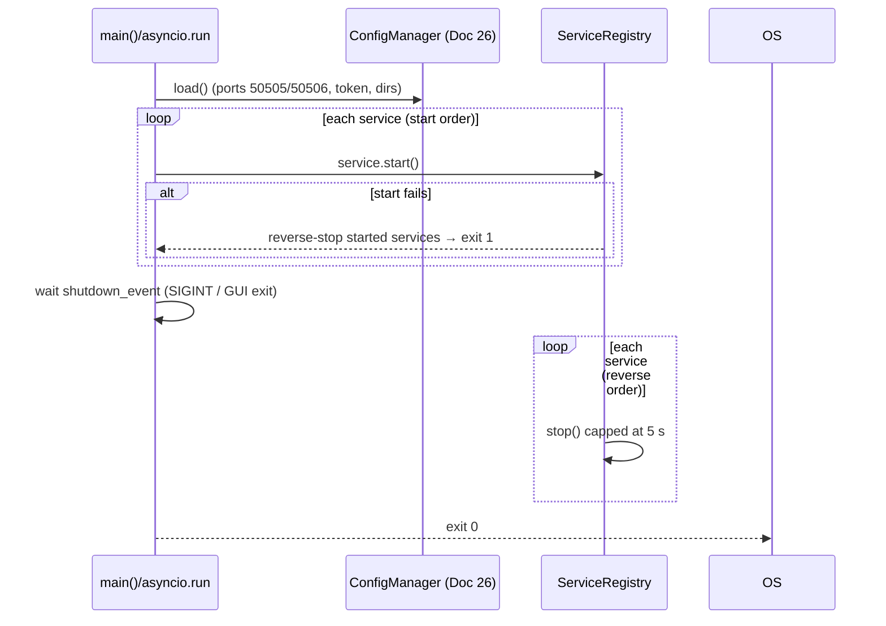

# Doc 04: PC Agent Boilerplate, Dependencies & Async Lifecycle
> Part of PotPilot plan-series · Category A · Session 1 Wave 1.A · PC Agent

## 1. Purpose & Scope
Scaffolds the `pc_agent/` Python package and its async application skeleton:
- `pc_agent/` directory tree with empty `__init__.py` markers for every blueprint subpackage (create-only, so parallel docs never fight over package markers).
- `requirements.txt` with the frozen core dependency set (`pywin32`, `customtkinter`, `pystray`, `websockets`, `zeroconf`, `monitorcontrol`, `qrcode`, `pillow`) plus a dev manifest.
- `main.py` implementing the async application lifecycle: an ordered start/stop registry over `asyncio`, config bootstrap (Doc 26), and clean Windows shutdown semantics. Session 3 (Wave 3.A) later wires the real services into this skeleton.

**Out of scope:** every feature module (Docs 06–26 create their own files); PyInstaller/InnoSetup packaging ([27_pc_pyinstaller_build_spec.md](27_pc_pyinstaller_build_spec.md), [28_pc_innosetup_installer_script.md](28_pc_innosetup_installer_script.md)); CustomTkinter dashboard/tray behavior ([24_pc_customtkinter_dashboard_ui.md](24_pc_customtkinter_dashboard_ui.md), [25_pc_pystray_background_daemon.md](25_pc_pystray_background_daemon.md)); final service wiring (Session 3).

## 2. File Ownership
**Create-only (owned by this doc):**

| Path | Purpose |
|---|---|
| `pc_agent/main.py` | Entry point + async lifecycle (created here; **extended** by Session 3 Wave 3.A wiring — that wave may only add imports/registrations inside the marked `# WIRING (Session 3)` region) |
| `pc_agent/requirements.txt` | Runtime dependency manifest (core 8) |
| `pc_agent/requirements-dev.txt` | Dev/test tooling (`pytest`, `ruff`) |
| `pc_agent/__init__.py`, `pc_agent/core/__init__.py`, `pc_agent/input_engine/__init__.py`, `pc_agent/potplayer/__init__.py`, `pc_agent/display_power/__init__.py`, `pc_agent/media/__init__.py`, `pc_agent/network/__init__.py`, `pc_agent/gui/__init__.py`, `pc_agent/installer/__init__.py` (not needed — data dir) | Package markers; only version-agnostic docstring allowed inside |
| `pc_agent/tests/__init__.py`, `pc_agent/tests/conftest.py` | Test package + shared fixtures (`event_loop_policy`, `free_port`, `fake_token`) |

**Reads / touched by other docs:** `pc_agent/core/config_manager.py` (Doc 26 — same wave/subagent, consumed via `ConfigManager.load()`); `pc_agent/core/auth_middleware.py` (Doc 15); every service module created later by its owning doc; `shared_specs/*` (Docs 01–03). `main.py`'s wiring region belongs to Session 3.

## 3. Public Contract
```python
# pc_agent/main.py
def main() -> None
    """Console/script entry: configure Windows event policy, run run_agent(), map exit code."""
async def run_agent(argv: list[str] | None = None) -> int
    """Boot config, start registered services in order, block until shutdown trigger; return exit code."""
def register_service(service: LifecycleService) -> None
    """Add a service to the startup plan (registration order == start order)."""

class LifecycleService(Protocol):
    """Any long-lived PotPilot component (UDP server, WS server, mDNS, telemetry, tray…)."""
    name: str
    async def start(self) -> None
        """Acquire resources and begin operating; must be idempotent-safe on failure rollback."""
    async def stop(self) -> None
        """Release resources within SHUTDOWN_TIMEOUT_S; must be safe to call after partial start."""

# pc_agent/tests/conftest.py fixtures
fake_token: bytes            # deterministic 16-byte token for auth-related tests
free_port: int               # ephemeral bindable TCP port fixture
```
Config keys consumed (defined by [26_pc_config_persistence_manager.md](26_pc_config_persistence_manager.md); read-only here): `udp_port`, `ws_port`, `auth_token_hex`, `movie_dirs`, `start_minimized`, `run_at_startup`. Lifecycle constants:
```python
SHUTDOWN_TIMEOUT_S = 5.0     # per-service stop budget
AGENT_DISPLAY_NAME = "PotPilot Agent"
```

## 4. Internal Design
### 4.1 Scaffolding steps
1. Verify `plan-series/overview.md` sibling exists (repo root guard); create `pc_agent/` tree from blueprint if absent.
2. Write empty `__init__.py` markers (docstring "PotPilot <subpackage>" only — no imports, to keep lazy-loading possible for heavy Win32 deps).
3. Write `requirements.txt` (§6 table), `requirements-dev.txt`, `main.py` (§4.2), `tests/conftest.py`.
4. Run `ruff check pc_agent/` (config from Doc 01 root `pyproject.toml`) — zero errors required.

### 4.2 Async lifecycle algorithm
1. `main()` — on Windows set `asyncio.WindowsProactorEventLoopPolicy()` (required for subprocess/UDP features), then `raise SystemExit(asyncio.run(run_agent()))`.
2. `run_agent()` loads config via `ConfigManager.load()` (Doc 26; on corrupt/missing file → defaults per Doc 26, ports fixed to 50505/50506).
3. Build the service plan: Wave 1.A registers **zero** services (skeleton boots and idles); Session 3 adds UDP receiver (13), WS server (14), mDNS (16), telemetry loop (18), audio/media services (20/22/23), tray (25), GUI (24) in this order.
4. Start phase: iterate plan, `await service.start()`; on exception → `stop()` all already-started services in **reverse** order, log the failing `service.name`, return exit code 1.
5. Idle phase: `asyncio.TaskGroup`-managed wait on a `shutdown_event: asyncio.Event`; triggers = `KeyboardInterrupt`/SIGINT, Windows console CTRL_CLOSE, or a GUI/tray "Exit" request (Doc 24/25 sets the event through the registry).
6. Stop phase: reverse order, each `stop()` raced against `SHUTDOWN_TIMEOUT_S` via `asyncio.wait_for`; timeout → log + force-cancel task and continue. Return 0.
7. Double Ctrl+C → second signal bypasses the graceful wait and cancels the root task immediately.



### 4.3 Threading model (assumption §10)
`asyncio` owns networking on the main thread. Tkinter/CustomTkinter (Docs 24/12) and `pystray` (Doc 25) require special handling (Tk wants the main thread; pystray wants its own) — those docs define their pump strategy; `main.py` only guarantees: (a) services are plain `LifecycleService`s, (b) any GUI thread communicates with services via `asyncio` thread-safe calls (`loop.call_soon_threadsafe`).

### 4.4 Session-3 service plan (registration order wired by Wave 3.A)
| # | Service constant | Module (Doc) | Bind / resource | Failure rollback impact |
|---|---|---|---|---|
| 1 | `SERVICE_UDP_RECEIVER` | `network/udp_server.py` (13) | UDP `0.0.0.0:50505` | none yet |
| 2 | `SERVICE_WS_SERVER` | `network/ws_server_router.py` (14) | TCP `0.0.0.0:50506` | UDP stops |
| 3 | `SERVICE_MDNS` | `network/mdns_broadcaster.py` (16) | `_potpilot._tcp.local.` | WS+UDP stop |
| 4 | `SERVICE_TELEMETRY` | `network/telemetry_broadcast_loop.py` (18) | 250 ms task | mDNS+WS+UDP stop |
| 5 | `SERVICE_POWER_AUDIO` | `display_power/sleep_power_mgr.py` (22), `audio_endpoint.py` (23) | timers | task stops |
| 6 | `SERVICE_TRAY` | `gui/tray_daemon.py` (25) | pystray thread | …all stop |
| 7 | `SERVICE_GUI` | `gui/dashboard_window.py` (24) | Tk mainloop handoff | …all stop |

### 4.5 Logging contract
Stdlib `logging` only; logger name = dotted module path under `potpilot.`; rotating file `%APPDATA%\PotPilot\logs\agent.log` (1 MB × 5) plus stderr when a console exists; level `INFO` default, `DEBUG` via `--verbose` flag parsed by `run_agent(argv)`; secrets (`auth_token*`) redacted by a dedicated `logging.Filter` installed at boot.

## 5. Protocol & Data Compliance

| Constant | Value | Flow through lifecycle |
|---|---|---|
| `udp_port` default | `50505` | config → Doc 13 `DatagramProtocol` bind |
| `ws_port` default | `50506` | config → Doc 14 `websockets.serve` bind |
| `auth_token_hex` | 32 hex chars (128-bit) | config → Doc 15 middleware; **never logged**; Doc 2 XOR byte derived from it |
| `TELEMETRY_INTERVAL_MS` | `250` | consumed by Doc 18 service, not configured |
| mDNS type | `_potpilot._tcp.local.` | consumed by Doc 16 |
| `SHUTDOWN_TIMEOUT_S` | `5.0` | lifecycle freeze (this doc) |

`main.py` must not hardcode hostnames/IPs and must not print the token. Log format: stdlib `logging`, logger names `potpilot.<module>`.

## 6. Dependencies & Integration Points
### 6.1 `requirements.txt` (runtime — pinned as lower bounds, see §10)

| Package | Constraint | Purpose (used by doc) |
|---|---|---|
| `pywin32` | `>=306` | `win32api`/`win32gui` helpers (Docs 08, 11, 22) |
| `customtkinter` | `>=5.2` | Dark dashboard GUI (Doc 24) |
| `pystray` | `>=0.19` | System tray daemon (Doc 25) |
| `websockets` | `>=12.0` | WS server on 50506 (Doc 14) |
| `zeroconf` | `>=0.131` | mDNS broadcaster (Doc 16) |
| `monitorcontrol` | `>=3.0` | DDC/CI brightness (Doc 19) |
| `qrcode` | `>=7.4` | Pairing QR (Doc 17) |
| `pillow` | `>=10.0` | QR image rendering (Doc 17) |

### 6.2 `requirements-dev.txt`
`pytest>=8.0`, `pytest-asyncio>=0.23`, `ruff>=0.7`.

**Later appends (by owning doc, later wave — same file, no same-wave conflict):** `pycaw` + `comtypes` (Doc 23, CoreAudio).
**Internal docs:** [01_monorepo_structure.md](01_monorepo_structure.md) · [02_binary_udp_protocol_spec.md](02_binary_udp_protocol_spec.md) · [03_websocket_json_schema_spec.md](03_websocket_json_schema_spec.md) · [13_pc_asyncio_udp_receiver.md](13_pc_asyncio_udp_receiver.md) · [14_pc_websocket_server_router.md](14_pc_websocket_server_router.md) · [15_pc_token_auth_middleware.md](15_pc_token_auth_middleware.md) · [16_pc_zeroconf_mdns_broadcaster.md](16_pc_zeroconf_mdns_broadcaster.md) · [18_pc_telemetry_broadcast_loop.md](18_pc_telemetry_broadcast_loop.md) · [24_pc_customtkinter_dashboard_ui.md](24_pc_customtkinter_dashboard_ui.md) · [25_pc_pystray_background_daemon.md](25_pc_pystray_background_daemon.md) · [26_pc_config_persistence_manager.md](26_pc_config_persistence_manager.md).
**Platform:** CPython 3.11+ on Windows 10/11 x64 (uses `asyncio.TaskGroup`, PEP 695-free syntax, `ExceptionGroup` handling); Win32 console signal semantics (CTRL_CLOSE_EVENT has ~5 s OS budget — matches `SHUTDOWN_TIMEOUT_S`).

## 7. Edge Cases & Failure Handling
- **Python < 3.11** → `main()` prints version error to stderr and exits 2 before any import of 3.11-only stdlib.
- **Port 50505/50506 already bound** (stale instance, firewall helper) → Doc 13/14 raise on `start()` → lifecycle rollback, exit 1, log names the port and owning service.
- **Corrupt `%APPDATA%\PotPilot\config.json`** → Doc 26 defaults (contract); lifecycle continues, GUI shows first-run state.
- **Service fails mid-`start()`** → reverse-order stop of started services (no orphan sockets/mDNS records), exit 1.
- **`stop()` exceeds 5 s** → task cancelled, next service still stopped, exit code unaffected (0 on user-initiated shutdown).
- **Import heavy Win32 modules at boot** → forbidden; all service imports happen inside Session 3 wiring region so boot stays < 1 s and PyInstaller hidden-import list (Doc 27) stays explicit.
- **Double Ctrl+C** → immediate hard cancel (§4.2 step 7).
- **Run under PyInstaller `--noconsole`** → `main()` must never assume a console exists; all logging goes to a rotating file under `%APPDATA%\PotPilot\logs\` (path contract: Doc 26 config root).
- **Non-Windows host** → explicit `sys.platform != "win32"` guard → exit 2 with message (project is Windows-only by charter).

## 8. Acceptance Criteria
- [ ] Fresh clone → `python -m venv .venv && pip install -r pc_agent/requirements.txt -r pc_agent/requirements-dev.txt` succeeds on Windows + Python 3.11.
- [ ] `python pc_agent/main.py` boots the empty registry, logs "PotPilot Agent up (no services registered)", idles, exits 0 on Ctrl+C within 2 s.
- [ ] `main.py` on Python 3.10 → exit 2 with clear message; on Linux/macOS → exit 2.
- [ ] Lifecycle unit tests prove start order, reverse stop order, rollback on failure, stop-timeout cancellation.
- [ ] All nine `__init__.py` markers exist and import with zero side effects (`python -c "import pc_agent"` clean).
- [ ] `ruff check pc_agent/` and `ruff format --check pc_agent/` exit 0.
- [ ] No feature-module imports exist yet in `main.py` outside the marked Session-3 wiring region.
- [ ] Token never appears in any log line or exception text.

## 9. Test Plan
| File | Asserts |
|---|---|
| `pc_agent/tests/test_lifecycle.py` | Fake services record `start/stop` call order: start in registration order, stop reverse; failing start triggers rollback; `stop()` timeout (slow fake) gets cancelled and loop continues; `shutdown_event` ends `run_agent` with code 0 |
| `pc_agent/tests/test_main_entry.py` | `main()` exit-code mapping (0/1/2); platform guard rejects non-win32; version guard rejects <3.11 (monkeypatched `sys.version_info`) |
| `pc_agent/tests/test_requirements_manifest.py` | `requirements.txt` contains exactly the eight §6.1 package names with non-empty pins; dev file contains `pytest`, `pytest-asyncio`, `ruff` |
Manual: clean venv install per §8 first bullet; run agent; Ctrl+C; verify `%APPDATA%\PotPilot\` created by Doc 26 bootstrap when integrated (Wave 1.A sibling doc); `python -X dev -m pc_agent.main` shows no ResourceWarning on shutdown.

## 10. Assumptions & Open Questions
**Assumptions:** (a) Dependency versions are **lower-bound pins** (`>=`) — exact pins live in a future lockfile if packaging (Doc 27) needs reproducibility; avoids resolver conflicts with Doc 23's `pycaw`. (b) `pycaw`/`comtypes` are appended to `requirements.txt` by Doc 23 (batch listed only the core 8 for this doc). (c) `pytest`, `pytest-asyncio`, `ruff` are allowed dev-tooling additions (recorded per batch rules). (d) `__init__.py` (not namespace packages) for explicit packaging under PyInstaller. (e) Tk/tray threading strategy is delegated to Docs 24/25; `main.py` stays threading-agnostic apart from `call_soon_threadsafe`. (f) Log dir `%APPDATA%\PotPilot\logs\` rides on Doc 26's config root. (g) Doc 26 ships in the same wave as this doc, so `ConfigManager.load()` is mockable in Wave 1.A tests via the `conftest` fake.
**Open questions:** none blocking; confirm at Session 3 whether PyInstaller wants onefile or onedir (Doc 27 decision, not lifecycle-affecting).
