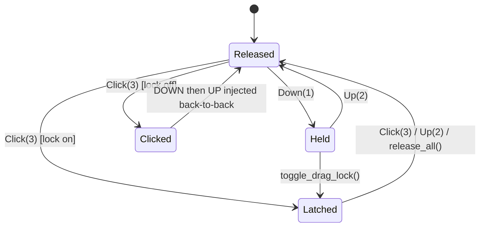

# Doc 06: Win32 SendInput Mouse Engine

> Part of PotPilot plan-series · Category B · Session 1 Wave 1.B · PC Agent

## 1. Purpose & Scope

**Delivers:** `pc_agent/input_engine/win32_mouse.py` — a zero-latency, allocation-light mouse
injection engine that converts validated UDP wire values into hardware-level
`ctypes.windll.user32.SendInput` events: relative cursor movement at 60–120 Hz, left/right/middle
button **Down/Up/Click**, drag locks, and smooth (chunked) wheel scrolling on both axes.

**In scope**
- Handling UDP packet types `0x01` (move), `0x02` (scroll), `0x03` (button) **after** upstream
  length/auth/sequence validation.
- Held-button bookkeeping so natural drags (`Down → move… → Up`) and an optional latched
  drag-lock survive across packets.
- Wheel tick → `WHEEL_DELTA` conversion, sign-correct chunking, horizontal wheel
  (`MOUSEEVENTF_HWHEEL`).
- Hot-path discipline: no sleeps, no buffering, no exceptions — failure counters plus a
  `release_all()` safety hook.

**Out of scope (owned elsewhere)**
- Packet struct parsing, XOR auth, sequence de-duplication → [02](02_binary_udp_protocol_spec.md),
  [13](13_pc_asyncio_udp_receiver.md), [15](15_pc_token_auth_middleware.md).
- Scrub packet `0x04` → routed by [13](13_pc_asyncio_udp_receiver.md) to
  [09](09_potplayer_wm_command_dispatcher.md) `seek_ms()`, never to this engine.
- Absolute cursor warping, cursor visibility/capture, XButtons 4/5, double-click timing,
  velocity/inertia curves → Flutter side [35](35_flutter_120hz_virtual_trackpad.md).
- Keyboard injection → [07_win32_sendinput_keyboard_engine.md](07_win32_sendinput_keyboard_engine.md).

## 2. File Ownership

**Creates (create-only):**
- `pc_agent/input_engine/win32_mouse.py`

**Reads / touches (owned by other docs):**
- `pc_agent/network/udp_server.py` ([13](13_pc_asyncio_udp_receiver.md)) — imports the module-level
  `engine` singleton; calls exactly one method per validated packet.
- `shared_specs/udp_packet_layout.json` ([02](02_binary_udp_protocol_spec.md)) — read-only source of
  truth for the wire fields consumed here.
- `pc_agent/core/config_manager.py` ([26](26_pc_config_persistence_manager.md)) — optional runtime
  overrides; the engine must run on inline defaults when config is absent.

## 3. Public Contract

```python
# pc_agent/input_engine/win32_mouse.py

class MouseEngineConfig:
    """Frozen knobs; inline defaults are the shipped values."""
    wheel_units_per_tick: int = 120   # wheel units per scroll notch (WHEEL_DELTA)
    max_wheel_chunk: int = 120        # max units injected per single INPUT
    max_ticks_per_packet: int = 20    # clamp applied to int16 scroll args
    drag_lock_enabled: bool = False   # opt-in latched drag-lock Click semantics

class MouseEngine:
    def __init__(self, config: MouseEngineConfig | None = None) -> None:
        """Allocate the reusable ctypes INPUT buffer; no Win32 call until first event."""
    def move_relative(self, dx: int, dy: int) -> int:
        """Inject one MOUSEEVENTF_MOVE; returns 1 accepted, 0 no-op/failure."""
    def scroll(self, vertical_ticks: int, horizontal_ticks: int) -> int:
        """Convert wire ticks to wheel units and inject chunked WHEEL/HWHEEL events; returns count."""
    def button(self, button_id: int, state: int) -> int:
        """Apply Down(1)/Up(2)/Click(3) to button 1:L 2:R 3:M; returns injected INPUT count."""
    def toggle_drag_lock(self, button_id: int) -> bool:
        """Latch/unlatch a button as held-down drag lock; returns the new latched state."""
    def release_all(self) -> int:
        """Release every held/latched button; returns count of UP events injected."""
    @property
    def held_buttons(self) -> frozenset[int]:
        """Buttons currently tracked as physically down."""
    @property
    def drag_locked_button(self) -> int | None:
        """Button id currently latched by drag-lock, if any."""
    @property
    def send_failures(self) -> int:
        """Monotonic count of SendInput calls that returned 0."""

engine: MouseEngine
"""Module singleton consumed directly by udp_server.py (Doc 13)."""
```

## 4. Internal Design

1. **INPUT build (single reusable buffer).** One `INPUT` (`type = INPUT_MOUSE`) with an embedded
   `MOUSEINPUT` union member is allocated once and mutated per event; `SendInput(1, buf, 40)` is
   called synchronously — no thread, no queue, no `Sleep` (serialization is the caller's job).

```python
def _send_mouse(self, *, flags: int, dx: int = 0, dy: int = 0, data: int = 0) -> int:
    self._buf.type = INPUT_MOUSE
    self._buf.union.mi = INPUT._MOUSEINPUT(dx, dy, data, flags, 0, 0)
    n = ctypes.windll.user32.SendInput(1, ctypes.byref(self._buf), ctypes.sizeof(INPUT))
    if n != 1:
        self._send_failures += 1          # UIPI / no-interactive-desktop failures
    return n
```

2. **Move (`0x01`).** Clamp `dx, dy` to `[-32767, 32767]`; if both are 0 → no-op (return 0);
   otherwise one `MOUSEEVENTF_MOVE` INPUT. Never coalesce or defer packets (latency budget < 2 ms).
3. **Button (`0x03`).**
   - `state=1 Down`: inject matching `*DOWN` flag; add to `held_buttons` (idempotent if already held).
   - `state=2 Up`: inject matching `*UP` flag; remove from `held_buttons`; clear latch if set.
   - `state=3 Click`: drag-lock **off** → one `*DOWN` INPUT immediately followed by one `*UP` INPUT
     (atomic pair, zero delay); drag-lock **on** and not latched → press + latch (drag begins);
     latch already set on that button → release latch (drag ends).
4. **Scroll (`0x02`).** Per axis: `units = clamp(ticks) * wheel_units_per_tick`; split `units` into
   chunks of `±max_wheel_chunk` preserving sign; inject each chunk as `MOUSEEVENTF_WHEEL` (vertical)
   or `MOUSEEVENTF_HWHEEL` (horizontal) with `mouseData = chunk`. Zero ticks → no-op.
5. **Drag lock.** Opt-in latch (`MouseEngineConfig.drag_lock_enabled` or explicit
   `toggle_drag_lock`): while latched, the button reports held for all subsequent move packets;
   `release_all()` and transport disconnect always clear it.



6. **Failure accounting.** `SendInput` returning `0` (UIPI-blocked elevated target, locked desktop)
   increments `send_failures` and returns 0 — the UDP hot path never raises.
7. **Safety teardown.** `release_all()` injects `*UP` for every held/latched button; called by
   [13](13_pc_asyncio_udp_receiver.md)/[14](14_pc_websocket_server_router.py) on shutdown or client
   disconnect so a mid-drag disconnect can never leave the desktop stuck.

## 5. Protocol & Data Compliance

**Consumed wire fields** (already unpacked from `<BBhhH>` little-endian by Doc 13; this module only
sees `arg1`, `arg2`):

| Packet type | arg1 | arg2 | Engine method |
|---|---|---|---|
| `0x01` move | `dx` (int16) | `dy` (int16) | `move_relative(dx, dy)` |
| `0x02` scroll | vertical ticks (int16) | horizontal ticks (int16) | `scroll(v, h)` |
| `0x03` button | `button_id` 1:L 2:R 3:M | `state` 1:Down 2:Up 3:Click | `button(id, state)` |
| `0x04` scrub | sec_high | sec_low | **not consumed here** → Doc 09 `seek_ms()` |

Auth byte (Byte 1) and sequence (Bytes 6–7) are consumed upstream ([15](15_pc_token_auth_middleware.md),
[13](13_pc_asyncio_udp_receiver.md)); this module never sees them.

**Win32 constants (exact names/values used):**

| Constant | Value | Constant | Value |
|---|---|---|---|
| `INPUT_MOUSE` | `0x0000` | `MOUSEEVENTF_MIDDLEDOWN` | `0x0020` |
| `MOUSEEVENTF_MOVE` | `0x0001` | `MOUSEEVENTF_MIDDLEUP` | `0x0040` |
| `MOUSEEVENTF_LEFTDOWN` | `0x0002` | `MOUSEEVENTF_WHEEL` | `0x0800` |
| `MOUSEEVENTF_LEFTUP` | `0x0004` | `MOUSEEVENTF_HWHEEL` | `0x1000` |
| `MOUSEEVENTF_RIGHTDOWN` | `0x0008` | `WHEEL_DELTA` | `120` |
| `MOUSEEVENTF_RIGHTUP` | `0x0010` | `sizeof(INPUT)` x64 | `40` bytes |

No ports, sockets, or JSON are produced or consumed by this module.

## 6. Dependencies & Integration Points

**Internal:** [02_binary_udp_protocol_spec.md](02_binary_udp_protocol_spec.md) (wire layout),
[13_pc_asyncio_udp_receiver.md](13_pc_asyncio_udp_receiver.md) (sole caller; routes `0x01–0x03`),
[15_pc_token_auth_middleware.md](15_pc_token_auth_middleware.md) (auth gate upstream),
[07_win32_sendinput_keyboard_engine.md](07_win32_sendinput_keyboard_engine.md) (sibling; shares the
release-on-disconnect contract), [04_pc_agent_boilerplate_deps.md](04_pc_agent_boilerplate_deps.md)
(Python 3.11 package baseline), [26_pc_config_persistence_manager.md](26_pc_config_persistence_manager.md)
(optional config source).

**External packages:** none — Python 3.11 stdlib `ctypes` only (no third-party dependency beyond the
Doc 04 `requirements.txt` baseline).

**Win32 APIs:** `user32.dll!SendInput(UINT cInputs, LPINPUT pInputs, int cbSize)`; structs `INPUT`
(discriminated union) and `MOUSEINPUT`; `kernel32.dll!GetLastError` for failure diagnostics only.

## 7. Edge Cases & Failure Handling

- **`dx == dy == 0`** → skipped, returns 0, no syscall.
- **`|dx| or |dy| > 32767`** → clamped to int16 range before injection (defensive; wire already caps).
- **Scroll ticks = 0** → no-op; **`|ticks| > 20`** → clamped to `max_ticks_per_packet` to prevent
  a single datagram from flooding the wheel.
- **Negative scroll** → chunk loop preserves sign (`-360` → `-120, -120, -120`).
- **`Down` while already held / `Up` while not held** → tracked set stays consistent; the `Up` event
  is still injected once (harmless, keeps OS and remote state reconciled).
- **`Click` while a different button is latched** → ignored (returns 0) until the latch is released;
  prevents accidental drag termination from stray taps.
- **`SendInput` returns 0** (UIPI: elevated target window, disconnected/RDP desktop) → increment
  `send_failures`, return 0, log at DEBUG; the packet loop keeps running.
- **Client disconnect / agent shutdown mid-drag** → router calls `engine.release_all()`; no stuck buttons.
- **Out-of-order UDP datagrams** → sequence filtering happens in Doc 13; engine processes in arrival order.
- **Agent running as a service / non-interactive session** → injection lands on the wrong desktop;
  assumption A5 documents that the agent always runs interactively.

## 8. Acceptance Criteria

- [ ] `move_relative(10, -5)` produces exactly 1 `INPUT` with `type=INPUT_MOUSE`,
      `flags=MOUSEEVENTF_MOVE`, `dx=10`, `dy=-5`.
- [ ] `button(1, 3)` produces exactly 2 `INPUT`s (`LEFTDOWN` then `LEFTUP`) with **no** sleep between.
- [ ] `button(1, 1)` → 3 moves → `button(1, 2)` yields `held_buttons == frozenset()` and 4 total INPUTs.
- [ ] Drag-lock mode: first `Click` latches (`drag_locked_button == 1`), moves keep dragging, second
      `Click` releases; `release_all()` clears the latch.
- [ ] `scroll(5, 0)` injects 5 wheel INPUTs of 120 units each (`MOUSEEVENTF_WHEEL`);
      `scroll(0, -2)` injects 2 `MOUSEEVENTF_HWHEEL` INPUTs of `-120`.
- [ ] `ctypes.sizeof(INPUT) == 40` on x64 Python 3.11.
- [ ] Forced `SendInput → 0` mock increments `send_failures` and raises nothing.
- [ ] End-to-end: a phone trackpad flick moves the Windows cursor with no perceptible delay
      (Session 1 milestone: `< 2 ms` serialization + injection).

## 9. Test Plan

**Unit — `pc_agent/tests/test_win32_mouse.py`** (pytest; monkeypatch `ctypes.windll.user32.SendInput`
with a recorder returning `1`):
- `test_move_single_input` — flags/coordinates as in §8.
- `test_click_down_up_pair` and `test_down_up_tracking` — sequence + `held_buttons` state.
- `test_drag_lock_latch_cycle` — latch on/off, stray-click rejection, `release_all` clears.
- `test_scroll_chunking_and_axes` — chunk size ≤ 120, sign preservation, HWHEEL for horizontal,
  tick clamp at 20, zero-tick no-op.
- `test_failure_counter_no_raise` — recorder returns 0 → `send_failures` grows, no exception.
- `test_int16_clamp_and_zero_move` — clamping + zero-delta syscall count == 0.

**Manual (real desktop):**
1. Launch agent + pair phone; drag-select text across two windows (Down → moves → Up) — selection
   never breaks, cursor never teleports.
2. Two-finger phone scroll over a long page — wheel motion is smooth (no giant jumps) in both axes.
3. Kill the WS connection mid-drag — cursor button releases within one disconnect handler cycle.
4. Confirm foreground window is unchanged before/after a burst of 500 moves (`GetForegroundWindow`).

## 10. Assumptions & Open Questions

- **A1:** Wire scroll args are **notches** ("two-finger scroll ticks" per overview §1); engine maps
  1 notch → 120 units. Flutter sends small integer ticks frequently; sub-notch smoothness comes from
  packet frequency, not a fractional residual accumulator (deliberately dropped — no timers).
- **A2:** Drag-lock *latch* semantics are opt-in (`drag_lock_enabled=False` by default); classic
  Down/move/Up drags work regardless.
- **A3:** `Click` is defined as two back-to-back INPUTs without any `Sleep` (true "instant click").
- **A4:** Test path `pc_agent/tests/` + `pytest` are dev-only additions (not in the Doc 04 runtime
  requirements); recorded here as the batch-wide test convention.
- **A5:** The agent runs in the interactive Winlogon session (normal desktop app, per Doc 27
  `--noconsole` PyInstaller bundle), so `SendInput` targets the user's desktop.
- **Open:** none.
