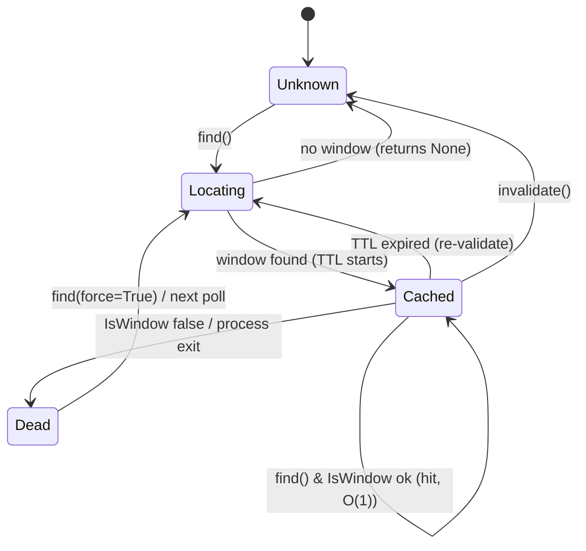

# Doc 08: PotPlayer HWND Locator

> Part of PotPilot plan-series · Category B · Session 1 Wave 1.B · PC Agent

## 1. Purpose & Scope

**Delivers:** `pc_agent/potplayer/hwnd_locator.py` — a focus-neutral window discovery service that
finds the live `PotPlayer64` / `PotPlayer` main window handle (`HWND`), caches it together with its
process id (`PID`), validates the cache cheaply on every use, and monitors process health — without
**ever** stealing window focus or showing/activating anything.

**In scope**
- Class-name-first discovery (`FindWindowW`), with an `EnumWindows` z-order fallback.
- TTL cache so the hot path ([09](09_potplayer_wm_command_dispatcher.md),
  [10](10_potplayer_wm_user_telemetry_poller.md)) costs ~one `IsWindow` syscall per command.
- PID caching + liveness probing (`OpenProcess` / `GetExitCodeProcess`).
- Explicit forbidden-API discipline: no `SetForegroundWindow`, `BringWindowToTop`, `SetFocus`,
  `ShowWindow`, `AttachThreadInput`, ever.

**Out of scope (owned elsewhere)**
- Sending any messages to the window → [09](09_potplayer_wm_command_dispatcher.md),
  [10](10_potplayer_wm_user_telemetry_poller.md).
- Restoring/moving/maximizing the window → [11_multi_monitor_window_snapper.md](11_multi_monitor_window_snapper.md).
- Launching PotPlayer with a file → [21_pc_potplayer_file_launcher.md](21_pc_potplayer_file_launcher.md)
  (uses `wait_for_window()` after spawn).
- WS/UDP transport, auth, ports.

## 2. File Ownership

**Creates (create-only):**
- `pc_agent/potplayer/hwnd_locator.py`

**Reads / touches (owned by other docs):**
- `pc_agent/potplayer/wm_dispatcher.py` ([09](09_potplayer_wm_command_dispatcher.md)) — calls
  `find()` per dispatch.
- `pc_agent/potplayer/telemetry_poller.py` ([10](10_potplayer_wm_user_telemetry_poller.md)) — calls
  `find()` once per 250 ms tick.
- `pc_agent/display_power/monitor_snapper.py` ([11](11_multi_monitor_window_snapper.md)),
  `pc_agent/media/file_launcher.py` ([21](21_pc_potplayer_file_launcher.md)) — additional consumers.
- `pc_agent/core/config_manager.py` ([26](26_pc_config_persistence_manager.md)) — optional
  `potplayer.window_classes` override.

## 3. Public Contract

```python
# pc_agent/potplayer/hwnd_locator.py

WINDOW_CLASSES: tuple[str, ...] = ("PotPlayer64", "PotPlayer")
"""Window class names probed in order; "PotPlayer64" is the shipping 64-bit build."""

class WindowInfo:
    """Immutable snapshot of a located window."""
    hwnd: int; pid: int; class_name: str
    is_minimized: bool; found_at: float   # time.time() seconds

class PotPlayerLocator:
    def __init__(self, cache_ttl_ms: int = 500) -> None:
        """Configure cache TTL; performs no Win32 call at construction."""
    def find(self, *, force: bool = False) -> int | None:
        """Return live HWND (cached, validated) or None; never activates the window."""
    def describe(self) -> WindowInfo | None:
        """Return the cached WindowInfo snapshot, refreshing if stale."""
    def get_pid(self) -> int | None:
        """Return cached PID for the located window, else None."""
    def is_alive(self) -> bool:
        """True if cached HWND passes IsWindow and its process is still active."""
    def invalidate(self) -> None:
        """Drop the cache; next find() re-enumerates (call after a failed message send)."""
    def wait_for_window(self, timeout_ms: int, poll_ms: int = 100) -> int | None:
        """Poll find() until a window appears or timeout elapses; for the file launcher (Doc 21)."""

locator: PotPlayerLocator
"""Module singleton shared by all potplayer/ and display_power/ consumers."""
```

## 4. Internal Design

1. **Cache-first lookup.** `find()` → if cache fresh (age ≤ `cache_ttl_ms`) and `IsWindow(hwnd)` is
   true and `GetClassNameW(hwnd)` still matches a known class → return cached `hwnd` (one syscall).
2. **Primary discovery.** For each name in `WINDOW_CLASSES`: `FindWindowW(name, None)`; first hit
   wins (class name is exact; no title matching — the title varies with the open file).
3. **Fallback discovery.** `EnumWindows` in z-order (front-to-back), keeping the first *visible*
   top-level window whose class name lowercases to `potplayer…`; skip cloaked windows
   (`DwmGetWindowAttribute(DWMWA_CLOAKED)`, best-effort via ctypes, failure → treat as not cloaked).
4. **Foreground sanity (read-only).** If the foreground window (`GetForegroundWindow`, compared by
   PID) *is* a PotPlayer window, prefer it among multiple instances; this never changes focus.
5. **Snapshot & cache.** Store `WindowInfo(hwnd, pid, class, IsIconic(hwnd), now)`; PID comes from
   `win32process.GetWindowThreadProcessId(hwnd)`.
6. **Health monitoring.** `is_alive()` = `IsWindow(hwnd)` **and** `OpenProcess(PROCESS_QUERY_LIMITED_INFORMATION)`
   → `GetExitCodeProcess == STILL_ACTIVE (259)` → handle closed. Used by [10](10_potplayer_wm_user_telemetry_poller.md)
   to decide `healthy=False` and by [09](09_potplayer_wm_command_dispatcher.md) to `invalidate()` +
   retry once when a send fails with `ERROR_INVALID_WINDOW_HANDLE (1400)`.
7. **Miss path.** No window → return `None` (callers surface a structured "PotPlayer not running"
   result; nobody blocks or raises).



## 5. Protocol & Data Compliance

This module produces/consumes **no** wire packets and **no** JSON — it is a pure Win32 service.
Cross-module value contract: `HWND` and `PID` cross module boundaries as plain Python `int`
(JSON-safe for logs/dashboards [24](24_pc_customtkinter_dashboard_ui.md)).

| Symbol | Kind | Meaning |
|---|---|---|
| `WINDOW_CLASSES` | module constant | `("PotPlayer64", "PotPlayer")` probe order |
| `DEFAULT_CACHE_TTL_MS` | module constant | `500` (hot-path syscall budget) |
| `STILL_ACTIVE` | Win32 constant | process exit code `259` |
| `WM_*` messages | — | **not used here** (Docs 09/10 only) |

## 6. Dependencies & Integration Points

**Internal:** [09_potplayer_wm_command_dispatcher.md](09_potplayer_wm_command_dispatcher.md),
[10_potplayer_wm_user_telemetry_poller.md](10_potplayer_wm_user_telemetry_poller.md),
[11_multi_monitor_window_snapper.md](11_multi_monitor_window_snapper.md),
[21_pc_potplayer_file_launcher.md](21_pc_potplayer_file_launcher.md) (consumers),
[26_pc_config_persistence_manager.md](26_pc_config_persistence_manager.md) (optional class-list override),
[04_pc_agent_boilerplate_deps.md](04_pc_agent_boilerplate_deps.md) (dependency baseline).

**External packages:** `pywin32` (version pinned by Doc 04 `requirements.txt`; ≥ 306 assumed for
CPython 3.11) — modules `win32gui`, `win32process`, `win32api`, `win32con`.

**Win32 APIs:** `user32.dll!FindWindowW`, `EnumWindows`, `GetClassNameW`, `IsWindow`,
`IsWindowVisible`, `IsIconic`, `GetForegroundWindow`, `GetWindowThreadProcessId`;
`dwmapi.dll!DwmGetWindowAttribute` (`DWMWA_CLOAKED=14`, best-effort);
`kernel32`/`win32api!OpenProcess` + `win32process!GetExitCodeProcess` (health).

## 7. Edge Cases & Failure Handling

- **PotPlayer not running** → `find()` returns `None`; callers degrade with `no_window` results; the
  poller keeps ticking and recovers automatically when the app starts.
- **Window closed between find and use** → Doc 09's send fails with WinError 1400 → it calls
  `invalidate()` and retries once through this locator.
- **Multiple PotPlayer instances** → prefer the one owning the foreground (read-only check), else
  the front-most in `EnumWindows` z-order (assumption A2).
- **Minimized window** → still a valid `HWND` (`IsIconic=True` snapshot); messages deliver normally;
  Doc 11 decides whether to restore.
- **Cloaked/background-parked window (Win+Tab virtual desktop)** → skipped in the fallback path.
- **Cache hit on a dead-but-recycled handle** → `IsWindow` guard; if the class no longer matches,
  re-locate.
- **Rapid repeated calls** → within TTL the cost is one `IsWindow` (+ optional class check), keeping
  the WS/UDP hot paths under 2 ms.
- **PID liveness probe fails to open the process** (access denied) → treated as alive (window exists);
  never false-negatives on permissions.
- **TTL expiring during a burst** → at most one full re-enumeration per `cache_ttl_ms`.
- **Focus discipline** → forbidden APIs are structurally absent; a regression test asserts their
  names never appear in the module (§9).
- **Unknown future PotPlayer class rename** → config override `potplayer.window_classes`
  ([26](26_pc_config_persistence_manager.md)) without code changes.

## 8. Acceptance Criteria

- [ ] With 64-bit PotPlayer running: `locator.find()` returns a non-zero HWND whose
      `GetClassNameW` is exactly `PotPlayer64`; second call within 500 ms performs ≤ 1 Win32 syscall
      beyond the `IsWindow` guard.
- [ ] `get_pid()` equals the PID reported by Task Manager for `PotPlayer64.exe`.
- [ ] Foreground window handle captured before/after `find()` is **identical** (no focus steal),
      including when PotPlayer is unfocused, minimized, and behind other windows.
- [ ] After closing PotPlayer: `is_alive()` flips to `False` and `find()` returns `None` on the next
      forced call.
- [ ] `wait_for_window(3000)` returns promptly (≈ poll interval) after a manually started PotPlayer.
- [ ] Module source contains none of: `SetForegroundWindow`, `BringWindowToTop`, `SetFocus`,
      `ShowWindow`, `AttachThreadInput`.
- [ ] Enum fallback finds a window even if the exact-class `FindWindowW` is mocked to miss.

## 9. Test Plan

**Unit — `pc_agent/tests/test_hwnd_locator.py`** (pytest; monkeypatch `win32gui.*`,
`win32process.*`, `win32api.*`):
- `test_find_exact_class_first_hit` — `FindWindowW("PotPlayer64")` preferred; fallback order.
- `test_cache_ttl_and_iswindow_guard` — hit within TTL; dead hwnd triggers re-location.
- `test_enum_fallback_zorder_and_visibility` — skips invisible/cloaked entries.
- `test_pid_cache_and_process_health` — STILL_ACTIVE vs. exited process codes.
- `test_invalidate_forces_refresh` and `test_multiple_instances_prefers_foreground_pid`.
- `test_no_focus_stealing_source_guard` — forbidden API names absent from module source.

**Manual (real desktop):**
1. Start PotPlayer, play a file, unfocus it; call `find()` from a REPL and verify (with WinSpy/Spy++)
   that no activation/flash occurs and the foreground app stays put.
2. Minimize PotPlayer → `find()` still returns the same HWND, `describe().is_minimized is True`.
3. Close PotPlayer while the agent runs → within ≤ 1 s the poller logs "window lost", then restart
   PotPlayer → locator re-acquires within one TTL window.

## 10. Assumptions & Open Questions

- **A1:** Class names are `PotPlayer64` (64-bit shipping build, primary target per overview) with
  legacy `PotPlayer` as fallback; the prefix fallback (`potplayer*`) covers rebranded derivatives.
- **A2:** Multi-instance tie-break: foreground-owned instance wins, else front-most z-order.
- **A3:** 500 ms cache TTL balances WS command bursts (no re-enumeration) against fast recovery
  after app restart; overridable via constructor (config key `potplayer.cache_ttl_ms`).
- **A4:** `DWMWA_CLOAKED` is best-effort; failure to load `dwmapi` disables the check only.
- **A5:** `wait_for_window` uses `time.sleep(poll_ms)` and is documented as *blocking* — callers run
  it in a worker thread (Doc 21), never on the asyncio loop.
- **Open:** none.
