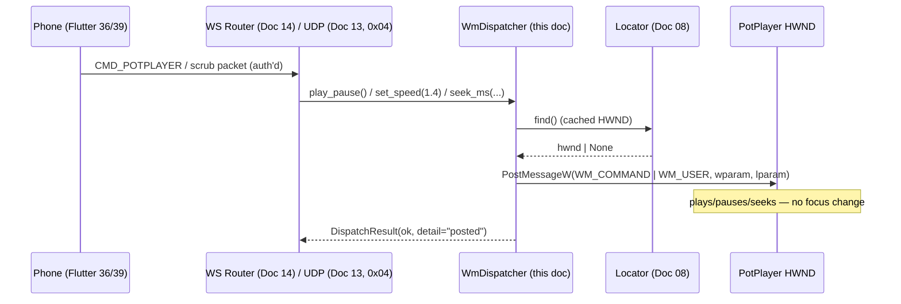

# Doc 09: PotPlayer WM_COMMAND / WM_USER Dispatcher

> Part of PotPilot plan-series · Category B · Session 1 Wave 1.B · PC Agent

## 1. Purpose & Scope

**Delivers:** `pc_agent/potplayer/wm_dispatcher.py` plus the canonical command table
`shared_specs/potplayer_wm_codes.json` (this doc **defines its contents**). Dispatches background
`WM_COMMAND` and `WM_USER` messages straight into PotPlayer's message queue — play/pause, frame
step, speed control (0.2×–4.0×), position seek, PotPlayer volume, fullscreen/aspect toggles,
audio/subtitle track cycling, subtitle on/off and sync (±500 ms) — with **zero focus stealing**
and a non-blocking asyncio hot path.

**In scope**
- Command-table schema + capture methodology for PotPlayer's private command/message IDs.
- Value packing (`wparam`/`lparam`/hi-lo word), clamping (speed 0.2–4.0, delay multiples of 500).
- Fire-and-forget delivery via `PostMessageW`; ack path via `SendMessageTimeoutW` for entries that
  need completion; dead-HWND recovery via [08](08_potplayer_hwnd_locator.md) retry-once.

**Out of scope (owned elsewhere)**
- Telemetry *reads* (position/duration/state/volume/speed getters) →
  [10_potplayer_wm_user_telemetry_poller.md](10_potplayer_wm_user_telemetry_poller.md) (reads the
  same JSON's `getters` section).
- Window discovery/health → [08](08_potplayer_hwnd_locator.md); envelope routing/auth/ports
  (50506) → [03](03_websocket_json_schema_spec.md), [14](14_pc_websocket_server_router.md),
  [15](15_pc_token_auth_middleware.md); UDP unpacking (routes `0x04` here) →
  [13](13_pc_asyncio_udp_receiver.md); on-screen buttons/gradients → Flutter
  [36](36_flutter_custom_potplayer_deck_ui.md), [39](39_flutter_audio_subtitle_sync_modal.md).

## 2. File Ownership

**Creates (create-only):**
- `pc_agent/potplayer/wm_dispatcher.py`
- `shared_specs/potplayer_wm_codes.json` — **source of truth** for all PotPlayer Win32 message IDs
  (Docs 09 & 10 read it; nobody else writes it).

**Reads / touches (owned by other docs):**
- `pc_agent/potplayer/hwnd_locator.py` ([08](08_potplayer_hwnd_locator.md)) — `find()`/`invalidate()`.
- `pc_agent/network/ws_server_router.py` ([14](14_pc_websocket_server_router.md)) — maps
  `CMD_POTPLAYER` actions to the methods in §3.
- `pc_agent/network/udp_server.py` ([13](13_pc_asyncio_udp_receiver.md)) — routes UDP `0x04` scrub
  to `seek_ms()`.
- `pc_agent/potplayer/telemetry_poller.py` ([10](10_potplayer_wm_user_telemetry_poller.md)) — optional
  injected `speed_provider` for the step-based speed fallback (§4.6).

## 3. Public Contract

```python
# pc_agent/potplayer/wm_dispatcher.py

POTPILOT_WM_CODES_PATH: Path = Path("shared_specs/potplayer_wm_codes.json")
SPEED_MIN, SPEED_MAX, SPEED_DEFAULT = 0.2, 4.0, 1.0
SUB_DELAY_STEP_MS = 500
SEND_TIMEOUT_MS = 100            # SendMessageTimeoutW budget, SMTO_ABORTIFHUNG

class CodeTableError(RuntimeError):
    """Raised at construction when the JSON table is missing/invalid."""

class DispatchResult:
    """Immutable outcome of one dispatch."""
    ok: bool; command: str; hwnd: int | None
    detail: str   # "posted" | "acked" | "no_window" | "unknown_command" | "bad_value"
                  # | "timeout" | "code_table_unavailable"

class WmDispatcher:
    def __init__(self, locator: PotPlayerLocator,
                 codes_path: Path | None = None,
                 speed_provider: Callable[[], float] | None = None) -> None:
        """Load and validate the command table; inject locator; speed_provider only for steps-mode."""
    def reload_codes(self) -> None:
        """Hot-reload the JSON table under a lock (used after live ID capture)."""
    def dispatch(self, command: str, *, value: int | None = None) -> DispatchResult:
        """Look up a table entry, clamp/pack value, post to PotPlayer; never raises."""
    def play_pause(self) -> DispatchResult:
        """Toggle playback (PLAY_PAUSE)."""
    def frame_step(self, direction: str = "FORWARD") -> DispatchResult:
        """Step one frame; direction is the frozen "FORWARD" | "BACKWARD" (±1 internally)."""
    def set_speed(self, multiplier: float) -> DispatchResult:
        """Set playback speed; clamps to 0.2–4.0, rounds to 0.1."""
    def step_speed(self, delta: float) -> DispatchResult:
        """Internal relative speed step (clients send absolute `multiplier` per Doc 03 §5.3); uses last known speed state."""
    def cycle_audio_track(self) -> DispatchResult:
        """Cycle audio streams."""
    def cycle_subtitle_track(self) -> DispatchResult:
        """Cycle subtitle tracks."""
    def toggle_subtitles(self) -> DispatchResult:
        """Toggle subtitles on/off."""
    def adjust_subtitle_delay(self, delta_ms: int = SUB_DELAY_STEP_MS) -> DispatchResult:
        """Nudge subtitle sync; rounded to the nearest multiple of ±500 ms."""
    def seek_ms(self, position_ms: int) -> DispatchResult:
        """Absolute seek (UDP 0x04 target_seconds and scrub-bar taps)."""
```

## 4. Internal Design

1. **Table load & validation.** Parse `potplayer_wm_codes.json`; every command entry must have
   `message` ∈ {`WM_COMMAND`, `WM_USER`}, hex-string `wparam`/`lparam`, `param` ∈
   {`null`,`wparam`,`lparam`,`lparam_loword`,`lparam_hiword`}, `mode` ∈ {`direct`,`steps`},
   `needs_ack` bool, `status` ∈ {`verified`,`capture_required`}. Any violation → `CodeTableError`
   at startup (fail fast); at runtime a reloaded-bad table keeps the old one and logs.
2. **Command resolution.** `dispatch(name, value)` → entry lookup with `.get()`; miss →
   `DispatchResult(ok=False, detail="unknown_command")` (never a `KeyError` on the hot path).
3. **Value conditioning.** Speed: `round(clamp(v, 0.2, 4.0), 1)`; delay: round to nearest multiple
   of 500 (half away from zero) then convert to table units; seek: `clamp(ms, 0, 2**31-1)`.
4. **Packing.** Dynamic value is merged into `wparam`/`lparam` per the entry's `param` field:

```python
def _pack(entry: dict, value: int | None) -> tuple[int, int, int]:
    msg = WM_COMMAND if entry["message"] == "WM_COMMAND" else WM_USER
    wparam, lparam = int(entry["wparam"], 0), int(entry["lparam"], 0)
    if value is not None:
        match entry.get("param"):
            case "wparam":        wparam = value
            case "lparam":        lparam = value
            case "lparam_loword": lparam = (lparam & ~0xFFFF) | (value & 0xFFFF)
            case "lparam_hiword": lparam = (lparam & 0xFFFF) | ((value & 0xFFFF) << 16)
    return msg, wparam, lparam
```

5. **Delivery (non-blocking default).** `win32gui.PostMessageW(hwnd, msg, wparam, lparam)` —
   asynchronous, returns instantly, never activates the target. Entries with `"needs_ack": true`
   instead use `ctypes` `user32!SendMessageTimeoutW(hwnd, msg, wparam, lparam,
   SMTO_ABORTIFHUNG|SMTO_BLOCK, SEND_TIMEOUT_MS, &result)` so a hung PotPlayer cannot stall the
   asyncio loop beyond 100 ms.
6. **Speed mode abstraction.** Entries may declare `mode: "direct"` (one parameterized message —
   preferred) or `mode: "steps"` (PotPlayer only exposes increment/decrement commands): the
   dispatcher reads the current multiplier from the injected `speed_provider`
   ([10](10_potplayer_wm_user_telemetry_poller.md) snapshot), computes
   `n = round((target - current) / 0.1)`, and posts `n` step entries with rate-limit 10 ms spacing
   executed in a short-lived worker thread (never on the loop).
7. **Dead-window recovery.** `PostMessage` raising WinError 1400/1400-adjacent invalid-handle →
   `locator.invalidate()`, one immediate retry through fresh `find()`; second failure →
   `detail="no_window"`.



## 5. Protocol & Data Compliance

**Consumed WS envelope** (fields `id`, `timestamp` handled by Doc 14): `type = "CMD_POTPLAYER"` —
action registry frozen in Doc 03 §5.3:

| `action` | `payload` | Dispatcher call |
|---|---|---|
| `PLAY_PAUSE` | `{}` | `play_pause()` |
| `PLAY` | `{}` | `dispatch("PLAY")` |
| `PAUSE` | `{}` | `dispatch("PAUSE")` |
| `SEEK` | `{"position_ms": 8410000}` | `seek_ms(position_ms)` |
| `SEEK_DELTA` | `{"delta_ms": -5000}` | `seek_ms(current + delta_ms)` (current from Doc 10 snapshot; clamp ≥ 0) |
| `SET_SPEED` | `{"multiplier": 1.4}` | `set_speed(multiplier)` |
| `FRAME_STEP` | `{"direction": "FORWARD" \| "BACKWARD"}` | `frame_step(direction)` |
| `TOGGLE_FULLSCREEN` | `{}` | `dispatch("TOGGLE_FULLSCREEN")` |
| `CYCLE_ASPECT_RATIO` | `{}` | `dispatch("CYCLE_ASPECT_RATIO")` |
| `SET_VOLUME` | `{"percent": 42}` | `dispatch("SET_VOLUME", value=percent)` |
| `CYCLE_AUDIO` | `{}` | `cycle_audio_track()` |
| `CYCLE_SUBS` | `{}` | `cycle_subtitle_track()` |
| `SET_SUBS` | `{"enabled": true}` | `dispatch("SET_SUBS", value=enabled)` |
| `SUB_SYNC_ADJUST` | `{"delta_ms": -500}` | `adjust_subtitle_delay(delta_ms)` |

Every action needs one matching `potplayer_wm_codes.json` entry (typed convenience method or
generic `dispatch`); a missing entry yields `unknown_command` — never a wire-side rename.

UDP `0x04` (`arg1 = sec_high`, `arg2 = sec_low`) → `seek_ms((sec_high << 16) | (sec_low & 0xFFFF) * 1000)`
is assembled by Doc 13 and passed here as milliseconds.

**`shared_specs/potplayer_wm_codes.json` — schema defined by this doc** (seed excerpt; every entry
ships with `status: "capture_required"` until live-captured per §9):

```json
{ "schema_version": 1,
  "messages": { "WM_COMMAND": "0x0111", "WM_USER": "0x0400" },
  "commands": {
    "PLAY_PAUSE":          { "message": "WM_COMMAND", "wparam": "0x0", "lparam": "0x0",
                             "param": null, "mode": "direct", "needs_ack": false,
                             "status": "capture_required", "description": "Toggle play/pause" },
    "SET_SPEED":           { "message": "WM_USER", "wparam": "0x0", "lparam": "0x0",
                             "param": "lparam", "value_units": "speed_milli",
                             "mode": "direct", "needs_ack": true,
                             "status": "capture_required", "description": "multiplier x 1000" },
    "SUB_DELAY_DELTA":     { "message": "WM_USER", "param": "lparam",
                             "value_units": "delta_ms", "mode": "direct",
                             "status": "capture_required", "description": "+/-500 ms nudge" } },
  "getters": { } }
```

`getters` is populated here too but **owned in meaning by Doc 10** (position, duration, state,
volume, speed). Message IDs used: the logical names in the tables above; standard Win32
`WM_COMMAND=0x0111` / `WM_USER=0x0400` are fixed; PotPlayer's numeric IDs are table data, not code.

## 6. Dependencies & Integration Points

**Internal:** [08_potplayer_hwnd_locator.md](08_potplayer_hwnd_locator.md) (HWND source),
[10_potplayer_wm_user_telemetry_poller.md](10_potplayer_wm_user_telemetry_poller.md) (shares JSON
table; optional speed provider), [13_pc_asyncio_udp_receiver.md](13_pc_asyncio_udp_receiver.md)
(`0x04` → `seek_ms`), [14_pc_websocket_server_router.md](14_pc_websocket_server_router.md)
(`CMD_POTPLAYER` router), [03_websocket_json_schema_spec.md](03_websocket_json_schema_spec.md)
(envelope truth), [21_pc_potplayer_file_launcher.md](21_pc_potplayer_file_launcher.md) (may fire
`PLAY_PAUSE`/seek after launch).

**External packages:** `pywin32` (`win32gui.PostMessage`, `win32api` error translation); stdlib
`ctypes` for `SendMessageTimeoutW`. No new dependencies.

**Win32 APIs:** `user32.dll!PostMessageW`, `SendMessageTimeoutW`
(`SMTO_ABORTIFHUNG=0x0002`, `SMTO_BLOCK=0x0001`); constants `WM_COMMAND=0x0111`, `WM_USER=0x0400`.

## 7. Edge Cases & Failure Handling

- **PotPlayer not running** → `ok=False, detail="no_window"`; router replies an error envelope.
- **Unknown action/command name** → `unknown_command`, counted; never raises, never `KeyError`.
- **Out-of-range speed** (e.g. 8.0 or 0.05) → clamped to [0.2, 4.0], rounded to 0.1, detail still
  `"posted"`/`"acked"`; float noise (1.39999) rounds to 1.4.
- **Subtitle delay not a multiple of 500** → rounded to nearest multiple, half away from zero
  (e.g. −300 → −500, 700 → 500).
- **Corrupt/missing JSON at startup** → `CodeTableError` (fail fast in Wave 1.A scaffolding);
  corrupt reload at runtime → old table retained, warning logged, service stays up.
- **All entries `capture_required` (pre-capture builds)** → dispatcher still routes; PotPlayer
  ignores unknown IDs harmlessly; `status` gating is a DEBUG log only.
- **Dead HWND (app closed mid-burst)** → invalidate + retry once; then `no_window`.
- **Hung PotPlayer** → `needs_ack` entries return `timeout` after 100 ms; non-ack entries never
  block the loop.
- **`steps`-mode speed without provider** → `bad_value` detail; with provider and window missing
  mid-steps → remaining steps cancelled.
- **Concurrent dispatches** (WS + UDP threads) → `PostMessage` is thread-safe; only `reload_codes`
  takes a `threading.Lock`; a torn read mid-reload is prevented by atomic table swap.
- **Seek value overflow** → clamped to `int32`-positive range; negative targets clamp to 0.
- **Focus discipline** → only `PostMessageW`/`SendMessageTimeoutW` are used; neither activates the
  window.

## 8. Acceptance Criteria

- [ ] Every §5 action maps to exactly one table entry and one dispatch path (typed method or
      generic `dispatch()`; table-driven, no hard-coded hex in code).
- [ ] `set_speed(8.0)` posts the entry's packed value for **4.0×**; `set_speed(0.05)` → **0.2×**;
      `set_speed(1.3999)` → **1.4×**.
- [ ] `adjust_subtitle_delay(-300)` posts `−500`; `adjust_subtitle_delay(700)` posts `500`.
- [ ] With PotPlayer unfocused/behind other windows, `play_pause()` toggles playback and the
      foreground window is unchanged.
- [ ] `seek_ms(8_410_000)` delivers the entry's position message; UDP `0x04` route reaches it with
      `(high<<16|low)` seconds→ms conversion done in Doc 13.
- [ ] Dead-HWND retry: kill PotPlayer between `find()` and post → exactly one retry, then
      `no_window`; no exception escapes to the router.
- [ ] A `needs_ack` dispatch against a mocked-hung window returns within `SEND_TIMEOUT_MS + 20 ms`.
- [ ] JSON validates against the §5 schema; `reload_codes()` is atomic (readers never see a partial
      table).

## 9. Test Plan

**Unit — `pc_agent/tests/test_wm_dispatcher.py`** (pytest; fake `PotPlayerLocator`; monkeypatch
`win32gui.PostMessage` to record `(hwnd, msg, wparam, lparam)`):
- `test_action_table_smoke` — each §5 action produces one correctly-named post from the fixture JSON.
- `test_speed_clamp_and_round` / `test_sub_delay_rounding` — §8 values.
- `test_packing_modes` — `wparam`, `lparam`, `lparam_loword`, `lparam_hiword` merge correctly.
- `test_steps_mode_uses_speed_provider` — `set_speed(1.3)` with provider→1.0 posts 3 step entries.
- `test_no_window_and_retry_once` — locator returns None → `no_window`; dead-hwnd exception →
  invalidate called once → retry.
- `test_corrupt_json_raises_at_init` and `test_reload_keeps_old_table_on_error`.
- `test_needs_ack_timeout` — mocked `SendMessageTimeoutW` returns 0 → `timeout` within budget.
- `test_no_focus_apis` — source guard: no `SetForegroundWindow`/`ShowWindow`/`SetCapture`.

**Manual (real PotPlayer 64-bit, IDs captured per §4.1 note):**
1. Spy++/WinSpy capture session (see §10 A1) fills the JSON; verify each command live: play/pause
   toggles, frame-step advances one frame at a time, speed OSD shows 0.2/1.0/4.0 endpoints, audio
   and subtitle cycling wrap around, ±500 ms subtitle nudge is audible, seek jumps correctly.
2. Run every command with PotPlayer unfocused and a movie playing fullscreen on the bedroom monitor
   — zero focus changes, zero OSD stealing activation.
3. Close PotPlayer mid-session → all methods return `no_window` cleanly; restart → first dispatch
   succeeds (locator re-acquired).

## 10. Assumptions & Open Questions

- **A1:** PotPlayer exposes its control surface as `WM_COMMAND` menu-command IDs and private
  `WM_USER+n` messages, but publishes **no official table**. The JSON schema, command list, packing,
  and the capture workflow are frozen now; concrete hex values are marked `capture_required` and
  filled by the implementation-time capture in §9 (Spy++/WinSpy on menu clicks + shortcut
  round-trips, or a one-shot `WH_CALLWNDPROC` hook script) — values are runtime data, so filling
  them requires **zero** doc or code changes.
- **A2:** `SET_SPEED` is modeled as one parameterized message (`value_units: speed_milli`, i.e.
  multiplier × 1000). If capture shows only step commands exist, the entry flips to
  `mode: "steps"` and Doc 10's snapshot supplies the current speed (design already supports both).
- **A3:** `SUB_DELAY_DELTA` carries `delta_ms` (multiples of ±500) as the dynamic parameter.
- **A4:** `WM_COMMAND=0x0111` / `WM_USER=0x0400` are standard Win32 constants (verified);
  PotPlayer-specific IDs are the only captured data.
- **A5:** §5 consumes Doc 03 §5.3's frozen action registry verbatim (`PLAY_PAUSE` … `SUB_SYNC_ADJUST`);
  the overview's example list is illustrative only — no wire names are invented here.
- **Open:** none (capture is a procedure, not an unknown).
