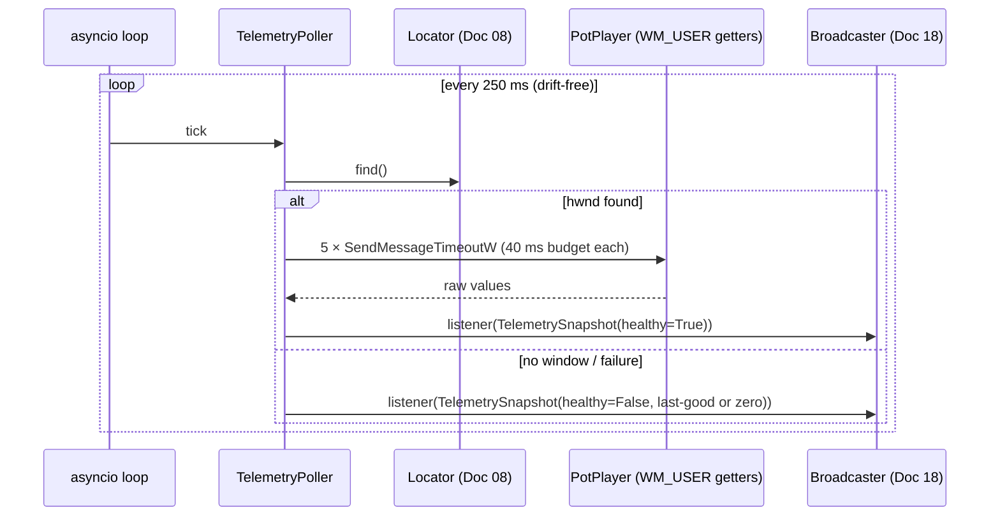

# Doc 10: PotPlayer WM_USER Telemetry Poller

> Part of PotPilot plan-series · Category B · Session 1 Wave 1.B · PC Agent

## 1. Purpose & Scope

**Delivers:** `pc_agent/potplayer/telemetry_poller.py` — an asyncio task that queries PotPlayer via
`WM_USER` getters **every 250 ms** (frozen wire cadence) for current playback position (ms), total
duration (ms), play state, volume, and current speed multiplier; normalizes them into an immutable
`TelemetrySnapshot` and hands each one to subscribed listeners (Doc 18's broadcaster).

**In scope**
- Drift-free 250 ms scheduling on the agent's asyncio loop.
- Blocking-free `SendMessageTimeoutW` queries with a per-query 40 ms budget and hang tolerance.
- Value normalization (sentinels, clamps, speed milli-units → float).
- Degraded-mode policy: window missing / queries failing → `healthy=False` snapshots, automatic
  backoff, automatic recovery.

**Out of scope (owned elsewhere)**
- Diffing snapshots and pushing `TELEMETRY_SYNC` JSON to phones → [18](18_pc_telemetry_broadcast_loop.md).
- WS envelope & payload field names → [03](03_websocket_json_schema_spec.md).
- All *writes* (play/pause, speed set, seek, subtitle delay) → [09](09_potplayer_wm_command_dispatcher.md).
- Window discovery/health → [08](08_potplayer_hwnd_locator.md); the getter ID table lives in the
  shared JSON defined by Doc 09.

## 2. File Ownership

**Creates (create-only):**
- `pc_agent/potplayer/telemetry_poller.py`

**Reads / touches (owned by other docs):**
- `shared_specs/potplayer_wm_codes.json` (`getters` section) — created/defined by
  [09](09_potplayer_wm_command_dispatcher.md); this module reads it only.
- `pc_agent/potplayer/hwnd_locator.py` ([08](08_potplayer_hwnd_locator.md)) — `find()` per tick.
- `pc_agent/network/telemetry_broadcaster.py` ([18](18_pc_telemetry_broadcast_loop.md)) — subscribes
  via `subscribe()`; receives every snapshot.
- `pc_agent/main.py` (Session 3 wiring) — constructs the poller with the shared locator and starts
  it in the application lifecycle.

## 3. Public Contract

```python
# pc_agent/potplayer/telemetry_poller.py

TELEMETRY_INTERVAL_MS: int = 250      # frozen wire cadence (overview §4)
QUERY_TIMEOUT_MS: int = 40            # per-getter SendMessageTimeoutW budget
BACKOFF_INTERVAL_MS: int = 1000       # degraded cadence after repeated failures

class QueryError(RuntimeError):
    """One getter failed to deliver (timeout or invalid HWND)."""

class TelemetrySnapshot:
    """Immutable result of one poll tick."""
    position_ms: int; duration_ms: int
    is_playing: bool; volume: int; speed: float
    healthy: bool          # all five getters delivered this tick
    hwnd: int              # window used (0 when none)
    captured_at: float     # time.time() seconds

class TelemetryPoller:
    def __init__(self, locator: PotPlayerLocator,
                 codes_path: Path | None = None,
                 interval_ms: int = TELEMETRY_INTERVAL_MS) -> None:
        """Load getters table; bind locator; no Win32 call until start()."""
    def start(self) -> None:
        """Spawn the polling task on the running asyncio loop; idempotent."""
    async def stop(self) -> None:
        """Cancel the task and await its teardown."""
    def poll_once(self) -> TelemetrySnapshot:
        """Run one synchronous poll tick and publish it; safe to call from tests."""
    def subscribe(self, listener: Callable[[TelemetrySnapshot], None]) -> Callable[[], None]:
        """Register a snapshot listener; returns an unsubscribe callable."""
    @property
    def latest(self) -> TelemetrySnapshot | None:
        """Most recent snapshot, or None before the first tick."""
    @property
    def running(self) -> bool:
        """True while the asyncio task is alive."""
```

## 4. Internal Design

1. **Drift-free loop.** `deadline = loop.time() + interval`; each iteration ends with
   `await asyncio.sleep(max(0, deadline - loop.time()))`; if the loop was blocked past the deadline
   by more than one interval, **skip** to `now + interval` (no burst catch-up — telemetry is
   latest-value, not a stream).
2. **Window gate.** `hwnd = locator.find()`; `None` → publish a zeroed `healthy=False` snapshot
   (keeps the phone HUD deterministic) and continue ticking.
3. **Getter loop.** Fixed order `GET_POSITION_MS → GET_DURATION_MS → GET_PLAY_STATE → GET_VOLUME →
   GET_SPEED`. Each getter is a `WM_USER` (or table-specified) message resolved from the JSON;
   delivery is the **one blocking Win32 call** of this module:

```python
def _query(self, hwnd: int, entry: dict) -> int:
    out = wintypes.LPARAM(0)
    delivered = ctypes.windll.user32.SendMessageTimeoutW(
        hwnd, int(entry["wparam"], 0), int(entry["lparam"], 0),
        SMTO_ABORTIFHUNG, QUERY_TIMEOUT_MS, ctypes.byref(out))
    if not delivered:
        raise QueryError(f"{entry['name']}: timeout or dead hwnd")
    return int(out.value) & 0xFFFFFFFF    # reply packing resolved per entry["reply"]
```

   *(The actual `msg` value comes from `entry["message"]` resolved against `messages` in the table;
   shown collapsed for brevity.)* Worst case per tick: `5 × 40 ms = 200 ms < 250 ms` cadence.
4. **Normalization** (per getter, table-driven):

| Getter | Raw → normalized |
|---|---|
| `GET_POSITION_MS` | u32 ms; sentinel `0xFFFFFFFF` (no media) → `0`; clamp ≥ 0 |
| `GET_DURATION_MS` | u32 ms; sentinel → `0`; clamp ≥ 0; `duration < position` → keep both, Doc 18 may flag |
| `GET_PLAY_STATE` | table `state_map` e.g. `{0:"stopped",1:"paused",2:"playing"}` → `is_playing = (state==2)` |
| `GET_VOLUME` | percent; clamp `0–100` |
| `GET_SPEED` | milli-units → `/1000.0`, round to 0.1; raw `0` → `1.0` (neutral/unreported) |

5. **Partial failure.** A failed getter aborts the tick's remaining getters (saves the budget),
   reuses the **last good values** for all fields, sets `healthy=False`, increments
   `consecutive_failures`; ≥ 4 consecutive unhealthy ticks → cadence drops to
   `BACKOFF_INTERVAL_MS` until the first healthy tick restores 250 ms.
6. **Publish.** Build frozen `TelemetrySnapshot`, store `latest`, then invoke listeners
   synchronously; listeners **must not block** (> 1 ms) — Doc 18 enqueues for its own async send.
   A listener exception is caught and logged; it never kills the loop.



7. **Teardown.** `stop()` cancels the task; in-flight Win32 call completes within its 40 ms budget
   before cancellation lands (never blocks shutdown longer than that).

## 5. Protocol & Data Compliance

**Cadence:** `TELEMETRY_INTERVAL_MS = 250` — matches the frozen PC→phone telemetry cadence
(overview §4); Doc 18 consumes each snapshot for its `TELEMETRY_SYNC` diff/push on WS **50506**.
This module itself sends **no** network I/O.

**Consumed table** (`shared_specs/potplayer_wm_codes.json`, `getters` section owned by Doc 09):

| Getter key | Reply packing (`entry["reply"]`) | Snapshot field |
|---|---|---|
| `GET_POSITION_MS` | `lparam_u32` | `position_ms` |
| `GET_DURATION_MS` | `lparam_u32` | `duration_ms` |
| `GET_PLAY_STATE` | `lparam_u32` + `state_map` | `is_playing` |
| `GET_VOLUME` | `lparam_u32` | `volume` (0–100) |
| `GET_SPEED` | `lparam_u32` (milli-units) | `speed` (0.2–4.0 display) |

Reply packing modes: `lparam_u32` (masked as in §4.3), `lparam_i32` (sign-extended), `wparam_u32`.
All getter IDs ship `status: "capture_required"` and are filled by Doc 09's capture procedure —
zero code changes when filled.

**Produced contract for Doc 18** (payload field names themselves are frozen by Doc 03; this table is
the snapshot→payload mapping):

| Snapshot field | TELEMETRY_SYNC payload key (proposed) |
|---|---|
| `position_ms` | `position_ms` |
| `duration_ms` | `duration_ms` |
| `is_playing` | `playing` |
| `volume` | `volume` |
| `speed` | `speed` |
| `captured_at` | `timestamp` (envelope level, Doc 03) |

## 6. Dependencies & Integration Points

**Internal:** [08_potplayer_hwnd_locator.md](08_potplayer_hwnd_locator.md) (window source),
[09_potplayer_wm_command_dispatcher.md](09_potplayer_wm_command_dispatcher.md) (defines the shared
JSON `getters`; optional reciprocal use as `speed_provider`), [18_pc_telemetry_broadcast_loop.md](18_pc_telemetry_broadcast_loop.md)
(sole production subscriber), [03_websocket_json_schema_spec.md](03_websocket_json_schema_spec.md)
(`TELEMETRY_SYNC` truth), [14_pc_websocket_server_router.md](14_pc_websocket_server_router.md)
(may call `poll_once()` for on-connect state refresh).

**External packages:** none new — `pywin32` (baseline) + stdlib `ctypes`, `asyncio`, `dataclasses`.

**Win32 APIs:** `user32.dll!SendMessageTimeoutW` (`SMTO_ABORTIFHUNG=0x0002`), constants
`WM_USER=0x0400` (+ table offsets); `wintypes.LPARAM` for the `lpdwResult` out-parameter.

## 7. Edge Cases & Failure Handling

- **PotPlayer closed** → every tick: `healthy=False`, zeroed fields, `hwnd=0`; recovers
  automatically when the locator finds the window again (no restart needed).
- **Window dies mid-tick** → in-flight query fails with `QueryError` → partial-failure path (§4.5);
  locator invalidated by Doc 09/08 validators on the next `find()`.
- **Hung PotPlayer** → each query self-limits to 40 ms; a full failed tick costs ≤ 200 ms; cadence
  degrades after 4 consecutive failures instead of queueing ticks.
- **Position sentinel / no media** → `0xFFFFFFFF` normalizes to position 0, duration 0,
  `is_playing=False`; the snapshot stays healthy (delivery succeeded).
- **Paused playback** → `position_ms` static across ticks is *expected*; Doc 18 suppresses pushes.
- **Volume out of range / speed absurd** → clamped to `0–100` / rounded to 0.1; speed raw `0` → `1.0`
  (assumption A3).
- **Event loop stall** (GUI thread, blocking call elsewhere) → deadline scheme skips missed ticks;
  never two ticks back-to-back faster than one interval.
- **`stop()` during an in-flight query** → cancellation observed after the ≤ 40 ms Win32 return.
- **Two pollers accidentally constructed** → `start()` is idempotent per instance and Doc 24/Session 3
  wiring creates exactly one; a second `start()` logs and no-ops.
- **Listener raises** → caught, logged, loop continues.
- **JSON table missing getters** (pre-capture) → poller starts, publishes `healthy=False` with a
  clear "getters unavailable" log until Doc 09 fills the table.

## 8. Acceptance Criteria

- [ ] Over 10 s of steady state, ticks land within `250 ± 15 ms` of each other (drift-free scheduling).
- [ ] `poll_once()` with a fake table produces a snapshot whose five fields match the normalization
      table exactly (including sentinel → 0 and speed 1450 → 1.5).
- [ ] Killing the fake HWND mid-run yields `healthy=False` snapshots with last-good values, then
      zeroed values after `latest` ages out — no exception escapes the task.
- [ ] 4+ consecutive failures switch cadence to 1000 ms; first healthy tick restores 250 ms.
- [ ] One slow query (mock 40 ms timeout) never pushes a tick past the 250 ms cadence by more than
      the overrun budget (≤ 200 ms worst case, no overlap).
- [ ] Listeners receive every snapshot in order; a raising listener doesn't stop the others.
- [ ] `stop()` returns within 100 ms of the call; `running` flips False.
- [ ] Real check: with a movie playing, Doc 18 clients see position advance ~250 ms per push;
      pause → push stops changing; volume OSD changes on PotPlayer appear within one tick.

## 9. Test Plan

**Unit — `pc_agent/tests/test_telemetry_poller.py`** (pytest + `pytest-asyncio`; fake
`PotPlayerLocator`; monkeypatched `ctypes.windll.user32.SendMessageTimeoutW` returning canned
`lparam` values; fake clock injected via a `now_fn` hook for scheduling tests):
- `test_normalization_table` — position/duration/state/volume/speed mappings incl. sentinels.
- `test_cadence_drift_free` — fake clock: ticks at 250 ms boundaries; stall > 1 interval skips.
- `test_missing_window_zero_snapshot` — `healthy=False`, `hwnd=0`, values zeroed.
- `test_partial_failure_last_good_values` — 3rd getter fails → fields 1–2 kept, `healthy=False`,
  remaining getters skipped.
- `test_backoff_and_recovery` — 4 failures → 1000 ms cadence → success → 250 ms.
- `test_query_budget` — 5 queries × 40 ms mock ≤ 200 ms total; timeout raises `QueryError`.
- `test_subscribe_unsubscribe_and_listener_exception` — ordering, isolation.
- `test_stop_cancellation` — task ends cleanly within budget.

**Manual (real PotPlayer):**
1. Play a file; watch Doc 18's log or a WS client: `position_ms` advances smoothly at 250 ms cadence,
   `speed` reflects PotPlayer's speed OSD after `set_speed` from Doc 09.
2. Close PotPlayer mid-play → telemetry clients receive `healthy=false`/zeroed frames; reopen and
   play → frames recover without agent restart.
3. Drag the PC's volume/mute (Doc 23 interplay) → `volume` getter tracks within one tick.

## 10. Assumptions & Open Questions

- **A1:** All five getters are `WM_USER` messages defined in the shared JSON (single source of truth
  with Doc 09); this module contains **no hard-coded IDs** — same capture procedure as Doc 09 A1.
- **A2:** Replies are 32-bit (u32 mask); ms values for feature films (< 2^31 ms ≈ 24.8 days) fit —
  `lparam_i32` mode exists for signed replies.
- **A3:** Speed raw `0` means "not reported/neutral" → normalized to `1.0×` (display-correct default);
  if live capture proves otherwise, only the normalization table changes.
- **A4:** `GET_PLAY_STATE` `state_map` = `{0: stopped, 1: paused, 2: playing}` pending capture
  confirmation; mapping is table data.
- **A5:** Instance construction happens in `main.py` (Session 3 wiring); tests construct directly —
  no module-level singleton (unlike Docs 06/07/08) because the poller owns an async lifecycle.
- **Open:** none.
