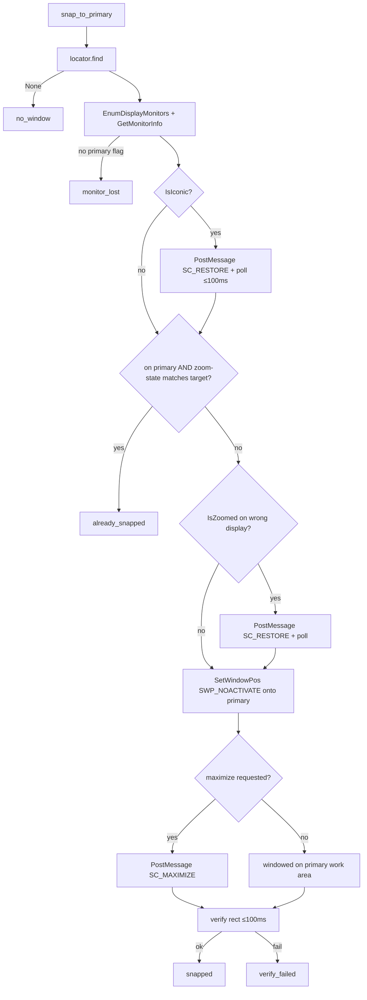

# Doc 11: Multi-Monitor Window Snapper

> Part of PotPilot plan-series · Category B · Session 2 Wave 2.A · PC Agent

## 1. Purpose & Scope

**Delivers:** `pc_agent/display_power/monitor_snapper.py` — enumerates all connected Windows
displays via `win32api.EnumDisplayMonitors`, identifies the **primary bedroom monitor**, and
moves/maximizes the PotPlayer window onto it on command ("Snap PotPlayer to Main Screen" on the
phone), entirely in the background — no focus stealing, idempotent, resilient to monitor hot-plug.

**In scope**
- Monitor enumeration (`MonitorInfo` snapshots: rects, work areas, primary flag).
- Restore-if-minimized / un-maximize-if-on-wrong-display sequencing via no-activate `WM_SYSCOMMAND`
  posts and `SetWindowPos` with `SWP_NOACTIVATE`.
- Idempotency (already-snapped → cheap no-op) and post-move verification.

**Out of scope (owned elsewhere)**
- Blackout overlays on the *non-primary* monitors → [12](12_secondary_monitor_blackout_overlay.md).
- DDC/CI hardware brightness → [19](19_pc_ddcci_monitor_brightness.md).
- HWND discovery/health → [08](08_potplayer_hwnd_locator.md); launching + auto-snap trigger →
  [21](21_pc_potplayer_file_launcher.md) (calls `snap_to_primary()` after spawn).
- WS action routing/ports/auth → [14](14_pc_websocket_server_router.md),
  [03](03_websocket_json_schema_spec.md), [15](15_pc_token_auth_middleware.md); phone sheet →
  [40](40_flutter_multi_monitor_power_sheet.md).

## 2. File Ownership

**Creates (create-only):**
- `pc_agent/display_power/monitor_snapper.py`

**Reads / touches (owned by other docs):**
- `pc_agent/potplayer/hwnd_locator.py` ([08](08_potplayer_hwnd_locator.md)) — `find()` / `invalidate()`.
- `pc_agent/media/file_launcher.py` ([21](21_pc_potplayer_file_launcher.md)) — invokes
  `snap_to_primary()` after launching a file.
- `pc_agent/network/ws_server_router.py` ([14](14_pc_websocket_server_router.md)) — routes the
  `SNAP_TO_PRIMARY_MONITOR` action here.
- `pc_agent/core/config_manager.py` ([26](26_pc_config_persistence_manager.md)) — optional
  `display.target` override (reserved; default `"primary"`).

## 3. Public Contract

```python
# pc_agent/display_power/monitor_snapper.py

MONITOR_TARGET_PRIMARY: str = "primary"
SWP_FLAGS_NO_ACTIVATE: int = 0x0010 | 0x0004 | 0x0040   # SWP_NOACTIVATE|SWP_NOZORDER|SWP_SHOWWINDOW

class MonitorInfo:
    """Immutable snapshot of one display in virtual-desktop coordinates."""
    index: int
    rect: tuple[int, int, int, int]          # (left, top, right, bottom)
    work_rect: tuple[int, int, int, int]     # excludes taskbar
    is_primary: bool

class SnapResult:
    """Immutable outcome of one snap operation."""
    ok: bool; hwnd: int | None; monitor: MonitorInfo | None
    detail: str   # "snapped" | "already_snapped" | "no_window" | "monitor_lost" | "verify_failed"

class MonitorSnapper:
    def __init__(self, locator: PotPlayerLocator) -> None:
        """Bind the shared PotPlayer locator; no Win32 call at construction."""
    def list_monitors(self) -> list[MonitorInfo]:
        """Fresh enumeration of all active displays (never cached across calls)."""
    def primary_monitor(self) -> MonitorInfo | None:
        """The display flagged MONITORINFOF_PRIMARY (the bedroom screen), else None."""
    def is_on_primary(self, hwnd: int, *, tol_px: int = 8) -> bool:
        """True if the window's center lies inside the primary monitor rect (±tol)."""
    def snap_to_primary(self, *, maximize: bool = True) -> SnapResult:
        """Move (and optionally maximize) PotPlayer onto the primary display without focus theft."""
```

## 4. Internal Design

1. **Enumerate fresh per operation.** `win32api.EnumDisplayMonitors()` → for each handle,
   `win32api.GetMonitorInfo(hmon)` → `Monitor`/`Work` rects + `Flags & MONITORINFOF_PRIMARY (1)`.
   No cross-call cache: monitor hot-plug and Windows "make this my main display" changes are picked
   up on the very next command (a full enumeration costs microseconds at button-press frequency).
2. **Locate.** `hwnd = locator.find()`; `None` → `SnapResult(ok=False, detail="no_window")`.
3. **Normalize window state (no focus).**
   - Minimized (`IsIconic`) → `PostMessageW(hwnd, WM_SYSCOMMAND, SC_RESTORE, 0)`, then poll
     `IsIconic` ≤ 100 ms in 10 ms steps before continuing.
   - Maximized on the **wrong** display (`IsZoomed` and not `is_on_primary`) → same `SC_RESTORE`
     path first (avoids `SetWindowPos` against a zoomed window's restored-rect bookkeeping).
4. **Decide.** Already on primary AND (`maximize == IsZoomed(hwnd)`) → `detail="already_snapped"`
   (idempotent, zero syscalls beyond rect reads).
5. **Move.** `win32gui.SetWindowPos(hwnd, 0, x, y, cx, cy, SWP_NOACTIVATE|SWP_NOZORDER)` with
   the target rect = primary `Work` rect when `maximize=False`, primary full `Rect` when
   `maximize=True`. `SWP_NOACTIVATE` guarantees no foreground change.
6. **Maximize.** If `maximize` → `PostMessageW(hwnd, WM_SYSCOMMAND, SC_MAXIMIZE, 0)` (background,
   async; PotPlayer applies it to its own queue). If `maximize=False` and `IsZoomed` →
   `SC_RESTORE` was already done in step 3.
7. **Verify.** After ≤ 100 ms settle window: `IsWindowVisible(hwnd)` and `is_on_primary(hwnd, tol=8)`
   → `ok=True, detail="snapped"`; else `verify_failed` (window manager overrode us — e.g. Windows
   re-placed a fullscreen window).



## 5. Protocol & Data Compliance

This module consumes **no** UDP/WS wire formats directly; it is invoked by
[14](14_pc_websocket_server_router.md) and [21](21_pc_potplayer_file_launcher.md).

**Consumed WS envelope** (routed by Doc 14; `id`/`timestamp` handled there):

| `type` | `action` | `payload` | Handler |
|---|---|---|---|
| `CMD_SYSTEM` | `SNAP_TO_PRIMARY_MONITOR` | `{}` (frozen Doc 03 §5.5; maximize implied) | `snap_to_primary(maximize=True)` |

`CMD_SYSTEM` + `SET_BLACKOUT` (frozen registry) belong to
[12](12_secondary_monitor_blackout_overlay.md); both modules independently enumerate displays with
the same `EnumDisplayMonitors` semantics, so their notion of "primary" always agrees.

**Coordinate space:** all rects are virtual-desktop pixels (negative origins allowed for monitors
left/above the primary); `SetWindowPos` consumes the same space — no conversion anywhere.

**Win32 constants used:** `MONITORINFOF_PRIMARY = 0x1`, `WM_SYSCOMMAND = 0x0112`,
`SC_MAXIMIZE = 0xF030`, `SC_RESTORE = 0xF120`, `SWP_NOACTIVATE = 0x0010`,
`SWP_NOZORDER = 0x0004`, `SWP_NOMOVE = 0x0002`, `SWP_NOSIZE = 0x0001`,
`SWP_SHOWWINDOW = 0x0040`.

## 6. Dependencies & Integration Points

**Internal:** [08_potplayer_hwnd_locator.md](08_potplayer_hwnd_locator.md) (HWND source),
[12_secondary_monitor_blackout_overlay.md](12_secondary_monitor_blackout_overlay.md) (shares the
primary-monitor definition), [21_pc_potplayer_file_launcher.md](21_pc_potplayer_file_launcher.md)
(auto-snap after launch), [14_pc_websocket_server_router.md](14_pc_websocket_server_router.md)
(action routing), [40_flutter_multi_monitor_power_sheet.md](40_flutter_multi_monitor_power_sheet.md)
(phone UI that triggers the action),
[04_pc_agent_boilerplate_deps.md](04_pc_agent_boilerplate_deps.md) (DPI-awareness note, A5).

**External packages:** `pywin32` (baseline) — modules `win32api` (`EnumDisplayMonitors`,
`GetMonitorInfo`), `win32gui` (`SetWindowPos`, `PostMessage`, `GetWindowRect`, `IsZoomed`,
`IsIconic`, `IsWindowVisible`); stdlib `ctypes` only if needed for `GetDpiForWindow` scaling.

**Win32 APIs:** `user32.dll!SetWindowPos`, `PostMessageW`, `GetWindowRect`, `IsZoomed`, `IsIconic`,
`IsWindowVisible`; `win32api.EnumDisplayMonitors` / `GetMonitorInfo` (wrapping
`EnumDisplayMonitors`/`GetMonitorInfoW`).

## 7. Edge Cases & Failure Handling

- **PotPlayer not running** → `no_window`; Doc 14 replies an error envelope; nothing else runs.
- **No monitor flagged primary** (misconfigured driver) → `monitor_lost`; fallback *not* guessed
  (assumption A2: Windows always flags one; if not, the user fixes Display Settings).
- **Single-monitor PC** → enumeration returns one display which *is* primary → `already_snapped`
  (cheap no-op); still valid.
- **Window minimized on secondary** → `SC_RESTORE` lands on the current monitor, then step 5 moves
  it — never left stranded on the dark secondary.
- **Fullscreen video on wrong monitor** → `IsZoomed` path restores first, then snaps; if PotPlayer
  re-enters fullscreen on the primary afterwards, that is its own (user-intended) behavior.
- **Monitor unplugged between enumeration and move** → `SetWindowPos` to a dead rect is remapped by
  Windows onto a live display; verify step re-checks and reports `verify_failed` if the center test
  fails.
- **Primary display changed in Windows Settings mid-session** → next call re-enumerates and targets
  the new primary (no stale state).
- **DPI scaling mismatch across monitors** → rects are physical virtual-desktop pixels from the
  same API family used by `SetWindowPos`; the agent process is per-monitor DPI aware (assumption A5).
- **Focus discipline** → only `SWP_NOACTIVATE` moves and `PostMessage` syscommands; the forbidden
  APIs (`SetForegroundWindow`, `ShowWindow(SW_SHOW)`, `SetFocus`) are structurally absent and
  source-guarded in tests.
- **Snap storms** (double-tap on the phone) → each call is idempotent; second call short-circuits
  at the decision step.
- **hwnd dies mid-operation** → `WinError 1400` → `locator.invalidate()`, return `no_window`
  (one retry is unnecessary here; the phone user can simply tap again).

## 8. Acceptance Criteria

- [ ] `list_monitors()` returns one `MonitorInfo` per active display; exactly one has
      `is_primary=True`; rects are consistent with Windows Display Settings coordinates.
- [ ] With PotPlayer fullscreen on the secondary display, `snap_to_primary()` leaves it maximized
      on the primary **and** `GetForegroundWindow` is unchanged before/after.
- [ ] Second consecutive call returns `detail="already_snapped"` with zero `SetWindowPos` calls.
- [ ] Minimized-on-secondary case ends maximized on primary within ≤ 250 ms of the call.
- [ ] `maximize=False` leaves a correctly positioned *windowed* frame on the primary work area
      (taskbar not covered).
- [ ] Unplugging the secondary monitor mid-run: next snap still succeeds (`ok=True`).
- [ ] `no_window` / `monitor_lost` paths return structured results without raising.
- [ ] Source guard: module contains none of `SetForegroundWindow`, `SetFocus`, `BringWindowToTop`.

## 9. Test Plan

**Unit — `pc_agent/tests/test_monitor_snapper.py`** (pytest; monkeypatch `win32api.EnumDisplayMonitors`,
`win32api.GetMonitorInfo`, and `win32gui.*` with recorders; fake locator):
- `test_enumeration_and_primary_selection` — flags → `primary_monitor()`, negative-origin rects.
- `test_snap_moves_with_noactivate_flags` — recorded `SetWindowPos` uses `SWP_NOACTIVATE`, target =
  primary rect; maximized path posts `SC_MAXIMIZE`.
- `test_idempotent_already_snapped` — on-primary + zoomed → no moves.
- `test_restore_sequences` — minimized → `SC_RESTORE` before move; zoomed-on-wrong-display →
  restore → move → re-maximize ordering asserted from the call log.
- `test_windowed_mode_work_rect` — `maximize=False` targets `Work`, never covers the taskbar.
- `test_no_window_and_verify_failure` — structured results, `invalidate()` called on dead hwnd.
- `test_center_predicate_and_tolerance` — `is_on_primary` math incl. 8 px tolerance.
- `test_no_focus_apis_source_guard`.

**Manual (dual-monitor desktop, PotPlayer playing):**
1. Move PotPlayer to the secondary display; open Notepad as foreground; tap "Snap PotPlayer to Main
   Screen" on the phone → PotPlayer maximizes on the primary bedroom display, Notepad keeps focus.
2. Repeat with PotPlayer minimized and with a fullscreen movie — both land on the primary.
3. Unplug the secondary monitor, snap again — still succeeds; reconnect and snap — targets primary.
4. Combine with Doc 12: blackout the secondary, then snap — the movie appears on the lit primary.

## 10. Assumptions & Open Questions

- **A1:** "Bedroom monitor" == the display Windows flags as primary (`MONITORINFOF_PRIMARY`); the
  user designates it once in Windows Settings — no extra PotPilot config needed. A future
  `display.target` index override is reserved via config ([26](26_pc_config_persistence_manager.md))
  but not required for v1.
- **A2:** At least one monitor carries the primary flag; absence is treated as an OS misconfiguration
  (`monitor_lost`), not silently guessed.
- **A3:** Maximize/restore are delivered as `WM_SYSCOMMAND` posts (non-activating, background-safe)
  rather than `ShowWindow`, preserving the no-focus-steal pillar.
- **A4:** `SNAP_TO_PRIMARY_MONITOR` `{}` is the frozen `CMD_SYSTEM` action name (Doc 03 §5.5, superseding the overview's abbreviated example); the wire payload carries no fields — `maximize` remains an internal parameter (default `True`).
- **A5:** The agent process sets per-monitor DPI awareness (`SetProcessDpiAwareness(2)` /
  `SetProcessDpiAwarenessContext`) during startup wiring (Session 3 `main.py`, coordinated with
  Doc 04) so enumeration and `SetWindowPos` share one coordinate space.
- **Open:** none.
