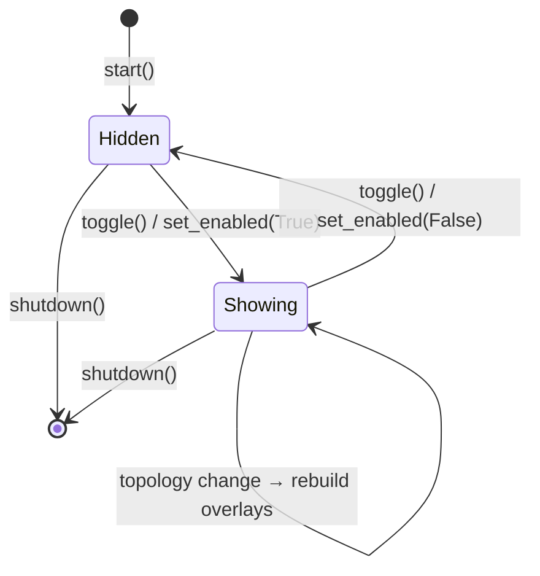

# Doc 12: Secondary Monitor Blackout Overlay

> Part of PotPilot plan-series · Category B · Session 2 Wave 2.A · PC Agent

## 1. Purpose & Scope

**Delivers** `BlackoutOverlayManager`: spawns and toggles borderless, pure-black (`#000000`), always-on-top Tkinter overlay windows across **all non-primary monitors** to eliminate ambient room glare during night viewing. Driven by the WebSocket `SET_BLACKOUT` system command and by the system-tray quick action.

**Out of scope:**
- DDC/CI hardware luminance of the primary display → [19_pc_ddcci_monitor_brightness.md](19_pc_ddcci_monitor_brightness.md)
- Snapping/maximizing the PotPlayer window → [11_multi_monitor_window_snapper.md](11_multi_monitor_window_snapper.md)
- Windows sleep/hibernate/shutdown → [22_pc_sleep_timer_power_manager.md](22_pc_sleep_timer_power_manager.md)
- The Flutter drawer that issues the command → [40_flutter_multi_monitor_power_sheet.md](40_flutter_multi_monitor_power_sheet.md)

## 2. File Ownership

**Owns (create-only):**

| Path | Contents |
|---|---|
| `pc_agent/display_power/blackout_overlay.py` | Entire overlay manager module |
| `pc_agent/tests/test_blackout_overlay.py` | Unit tests (§9) |

**Reads / touches (owned by other docs):**

| Path | Owner | Why |
|---|---|---|
| `pc_agent/display_power/monitor_snapper.py` | [11_multi_monitor_window_snapper.md](11_multi_monitor_window_snapper.md) | Monitor enumeration model (`MonitorInfo`, primary flag) |
| `pc_agent/network/ws_server_router.py` | [14_pc_websocket_server_router.md](14_pc_websocket_server_router.md) | Registers `SET_BLACKOUT` handler |
| `pc_agent/gui/tray_daemon.py` | [25_pc_pystray_background_daemon.md](25_pc_pystray_background_daemon.md) | "Toggle Blackout" tray action |
| `pc_agent/main.py` | [04_pc_agent_boilerplate_deps.md](04_pc_agent_boilerplate_deps.md) | Lifecycle wiring (`start` / `shutdown`) |

## 3. Public Contract

```python
OVERLAY_BG: str = "#000000"        # pure-black fill, fully opaque
PUMP_INTERVAL_MS: int = 33         # command-pump tick (~30 Hz)

class BlackoutOverlayManager:
    def __init__(self, monitor_provider: Callable[[], Sequence[MonitorInfo]], root: tk.Misc | None = None) -> None: ...  # Doc-11 monitor source; optional shared Tk root
    def start(self) -> None: ...                       # create/adopt Tk root + start pump loop; idempotent
    def toggle(self) -> bool: ...                      # flip blackout state; return new enabled flag
    def set_enabled(self, enabled: bool) -> bool: ...  # idempotently show/hide all non-primary overlays; return actual state
    @property
    def is_active(self) -> bool: ...                   # True while overlays are shown
    def refresh_monitors(self) -> None: ...            # rebuild overlays if display topology changed
    def shutdown(self) -> None: ...                    # destroy all overlay windows (+ root if owned); safe twice

def handle_blackout_command(payload: dict) -> dict: ...  # WS action adapter registered by Doc 14; payload shape per Doc 03
```

## 4. Internal Design

**Component breakdown**

1. **Monitor target resolution** — call `monitor_provider()` (Doc 11 `list_monitors()`), drop entries whose `is_primary` flag is set; remaining `MonitorInfo(rect, device)` are overlay targets.
2. **Tk root lifecycle** — `start()` adopts the injected `root` (shared dashboard Tk instance) or creates a hidden `tk.Tk()` owned by the manager; withdraws it; schedules `_pump()` via `after(PUMP_INTERVAL_MS, ...)`.
3. **Thread-safe command queue** — `toggle()` / `set_enabled()` / `refresh_monitors()` may be called from the asyncio thread (WS) or pystray thread; they only push intent into a `queue.Queue`. Tk objects are **never** touched off the Tk thread.
4. **Show path** — for each target monitor, create one `tk.Toplevel(root)`: `overrideredirect(True)`, `geometry(f"{w}x{h}+{x}+{y}")` from the monitor rect, `configure(bg=OVERLAY_BG)`, `attributes("-topmost", True)`; never call `focus_force()`/`lift()` on the root. Registry keyed by monitor device name.
5. **Hide path** — `destroy()` every registered Toplevel, clear the registry.
6. **Pump tick** — drain the queue; compare the current monitor signature `(device, rect, primary)` tuple against the built one; on mismatch, destroy stale overlays and (if active) create missing ones.
7. **Shutdown** — destroy overlays, stop the pump, destroy the root only if the manager owns it.

**Internal structures**

| Structure | Type | Purpose |
|---|---|---|
| `_command_q` | `queue.Queue[OverlayCommand]` | thread-safe intent queue (`SHOW_ALL`, `HIDE_ALL`, `REFRESH`, `SHUTDOWN`) |
| `_built` | `dict[str, tk.Toplevel]` | overlay windows keyed by Doc 11 monitor device name |
| `_signature` | `tuple[MonitorSnapshot, ...]` | last-seen monitor topology for cheap diffing |
| `_desired` | `bool` | coalesced target state — the pump always converges to it |



## 5. Protocol & Data Compliance

Consumes a single WebSocket envelope shape (authoritative schema: [03_websocket_json_schema_spec.md](03_websocket_json_schema_spec.md)):

| Field | Required value | Notes |
|---|---|---|
| `id` | uuid-v4 | echoed in the ack frame by Doc 14 |
| `type` | `"CMD_SYSTEM"` | only type routed to this module |
| `action` | `"SET_BLACKOUT"` | exact frozen token (Doc 03 §5.5) |
| `payload` | `{"enabled": bool}` | required (frozen Doc 03 §5.5); tray quick action bypasses WS via internal `toggle()` |
| `timestamp` | unix seconds | skew-validated by Doc 14 before dispatch |

**Exact constants:** `OVERLAY_BG = "#000000"` (RGB 0,0,0 — verified by pixel sample in §8); `PUMP_INTERVAL_MS = 33`. Overlay geometry comes from Doc 11's `MonitorInfo` rects (virtual-desktop pixels); no wire packets are produced or consumed by this module.

## 6. Dependencies & Integration Points

**Internal:** [11_multi_monitor_window_snapper.md](11_multi_monitor_window_snapper.md) (monitor enumeration) · [14_pc_websocket_server_router.md](14_pc_websocket_server_router.md) (handler registration) · [25_pc_pystray_background_daemon.md](25_pc_pystray_background_daemon.md) (tray action) · [04_pc_agent_boilerplate_deps.md](04_pc_agent_boilerplate_deps.md) (lifecycle + process DPI awareness) · [40_flutter_multi_monitor_power_sheet.md](40_flutter_multi_monitor_power_sheet.md) (remote trigger).

**External:** Tkinter / Tk 8.6 (Python stdlib) — no added packages. **Platform:** Win32 monitor rects arrive pre-resolved via pywin32 inside Doc 11; the process must be Per-Monitor-V2 DPI aware (set by Doc 04 `main.py`) so 150 %/200 % scaled secondaries receive physical-pixel geometry.

## 7. Edge Cases & Failure Handling

- **No non-primary monitors** — `toggle()` returns `False`, logs info, creates zero windows, raises nothing.
- **Monitor unplugged while active** — pump signature diff destroys the orphaned Toplevel; blackout state remains active for surviving monitors.
- **Primary display swapped in Windows settings** — next refresh re-evaluates the primary flag; stale overlay on the new primary is destroyed.
- **Cross-thread call (WS/tray)** — intent is queued; Tk work happens only inside `_pump()` on the Tk thread.
- **Tk init failure (non-interactive session)** — log warning, degrade to no-op: `is_active` stays `False`, commands return `False`.
- **Injected root destroyed by GUI exit** — `shutdown()` flag makes the pump cancel itself; later `TclError`s are swallowed and logged at debug.
- **Fullscreen video on a secondary monitor** — overlay intentionally covers it (documented glare-elimination behavior).
- **Rapid double-toggle** — queue coalesces to the last intent; never spawns duplicate Toplevels.
- **High-DPI secondary** — relies on PMv2 awareness (Doc 04); if absent, overlays misalign — acceptance §8 catches this.
- **Remote Desktop (RDP) session active** — Tk renders on the interactive desktop only; overlays follow the local session's monitor topology; no special handling.
- **Monitor orientation / resolution change** — rects change even when device names don't; the signature includes `rect`, so the pump rebuilds at the new geometry.
- **Screensaver / fullscreen exclusive apps** — topmost attribute reapplies on the next topology rebuild; overlays remain above normal windows by design.

## 8. Acceptance Criteria

- [ ] On a dual-monitor rig, `SET_BLACKOUT {enabled:true}` covers the secondary edge-to-edge in pure black; primary untouched; secondary taskbar hidden.
- [ ] Pixel sample of the overlay returns exactly `RGB(0, 0, 0)`; window style has no border/title bar.
- [ ] Overlay remains above other topmost windows; `GetForegroundWindow()` before/after shows no focus change.
- [ ] Toggle off destroys every overlay; enumerating `tk` toplevels returns the baseline count.
- [ ] 100 rapid toggles → zero orphan windows, zero uncaught `TclError`.
- [ ] Unplug secondary while active → no crash; replug + refresh → overlay reappears at correct rect.
- [ ] Secondary at 150 % DPI → overlay aligns with zero gap/overhang.
- [ ] `pytest pc_agent/tests/test_blackout_overlay.py` passes.

## 9. Test Plan

**`pc_agent/tests/test_blackout_overlay.py`** (stub Tk factory + fake `monitor_provider`, no real windows):
- `test_toggle_state_machine` — Hidden→Showing→Hidden; `is_active` tracks each transition.
- `test_set_enabled_idempotent` — calling `set_enabled(True)` twice creates exactly one window per target monitor.
- `test_skips_primary_monitor` — provider returns 3 monitors (1 primary) → 2 overlay targets.
- `test_topology_diff_destroys_stale` — monitor removed from provider → its Toplevel destroyed, others kept.
- `test_thread_enqueue` — `toggle()` from a foreign thread only enqueues; pump performs the Tk mutation.
- `test_desired_state_coalescing` — SHOW then HIDE queued before one pump tick → final state HIDDEN, zero transient windows.
- `test_root_adoption` — injected root is never destroyed by `shutdown()`; owned root is destroyed exactly once.
- `test_signature_includes_rect` — same device name, changed rect → rebuild triggered (orientation change).
- `test_shutdown_twice_safe` — double `shutdown()` raises nothing.

**Manual (dual monitor, automation impractical):** toggle from the Doc 25 tray menu and from the Doc 40 Flutter drawer; confirm both routes produce identical state; verify glare elimination visually in a dark room; run with PotPlayer fullscreen on the secondary.

## 10. Assumptions & Open Questions

**Assumptions**
1. Tk is owned by whichever surface starts first: Doc 24 dashboard injects its root; headless startup lets this module create its own. All Tk access stays on the main thread (asyncio runs on a worker thread per Doc 04).
2. `payload` is `{"enabled": bool}` — required by the frozen Doc 03 §5.5 registry (no toggle-on-absent on the wire); the tray quick action calls internal `toggle()` directly.
3. Overlays **capture** mouse/keyboard input on secondary monitors (no click-through); glare elimination is the priority.
4. Blackout state is not persisted; every agent launch starts un-blackout.
5. Doc 11 exposes `list_monitors() -> list[MonitorInfo]` with an `is_primary` flag (coordination contract).

**Open questions**
- Should a persisted "auto-blackout on launch" setting be added via [26_pc_config_persistence_manager.md](26_pc_config_persistence_manager.md)? Deferred; not required for this doc's scope.
