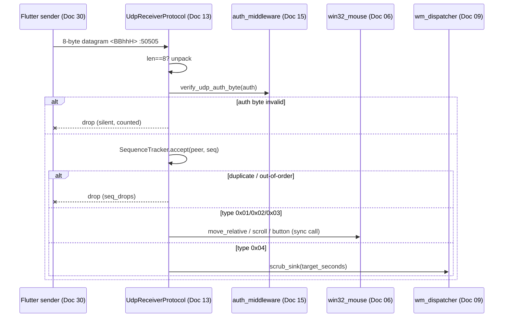

# Doc 13: PC Asyncio UDP Receiver

> Part of PotPilot plan-series · Category C · Session 1 Wave 1.B · PC Agent

## 1. Purpose & Scope

**Delivers** the high-throughput `asyncio.DatagramProtocol` server bound to **UDP port 50505** that receives fixed 8-byte `<BBhhH` packets, verifies the auth byte, drops out-of-order/duplicate sequence numbers, and routes packets with **zero queueing overhead**: mouse types (`0x01`–`0x03`) dispatch straight into `win32_mouse.py`; scrub packets (`0x04`) invoke an injected seek sink backed by the PotPlayer WM dispatcher.

**Out of scope:**
- Binary layout authority (serialization for Python `struct` / Dart `ByteData`) → [02_binary_udp_protocol_spec.md](02_binary_udp_protocol_spec.md)
- Token generation and checksum algorithm → [15_pc_token_auth_middleware.md](15_pc_token_auth_middleware.md)
- WebSocket command path → [14_pc_websocket_server_router.md](14_pc_websocket_server_router.md)
- Dart sender → [30_flutter_udp_datagram_sender.md](30_flutter_udp_datagram_sender.md)

## 2. File Ownership

**Owns (create-only):**

| Path | Contents |
|---|---|
| `pc_agent/network/udp_server.py` | Receiver protocol, sequence tracker, stats |
| `pc_agent/tests/test_udp_receiver.py` | Unit tests (§9) |

**Reads / touches (owned by other docs):**

| Path | Owner | Why |
|---|---|---|
| `pc_agent/input_engine/win32_mouse.py` | [06_win32_sendinput_mouse_engine.md](06_win32_sendinput_mouse_engine.md) | `move_relative` / `scroll` / `button` sinks |
| `pc_agent/core/auth_middleware.py` | [15_pc_token_auth_middleware.md](15_pc_token_auth_middleware.md) | `verify_udp_auth_byte()` |
| `pc_agent/potplayer/wm_dispatcher.py` | [09_potplayer_wm_command_dispatcher.md](09_potplayer_wm_command_dispatcher.md) | Scrub-seek sink (wired in `main.py`) |
| `shared_specs/udp_packet_layout.json` | [02_binary_udp_protocol_spec.md](02_binary_udp_protocol_spec.md) | Byte-offset source of truth mirrored by constants |
| `pc_agent/main.py` | [04_pc_agent_boilerplate_deps.md](04_pc_agent_boilerplate_deps.md) | Server lifecycle + sink injection |

## 3. Public Contract

```python
UDP_HOST: str = "0.0.0.0"
UDP_PORT: int = 50505                    # frozen wire constant
PACKET_FMT: str = "<BBhhH"              # little-endian, fixed 8 bytes
PACKET_SIZE: int = 8
TYPE_MOUSE_MOVE: int = 0x01
TYPE_SCROLL: int = 0x02
TYPE_BUTTON: int = 0x03
TYPE_SCRUB: int = 0x04
RCVBUF_BYTES: int = 1_048_576           # kernel receive buffer for 120Hz bursts
PEER_TIMEOUT_S: int = 300
MAX_PEERS: int = 128

@dataclass(frozen=True, slots=True)
class UdpPacket:
    ptype: int; auth: int; arg1: int; arg2: int; seq: int   # decoded wire fields

@dataclass(slots=True)
class UdpStats:
    received: int; accepted: int; parse_drops: int; auth_failures: int; seq_drops: int; bad_args: int

class MouseEngine(Protocol):             # structural subset of Doc 06
    def move_relative(self, dx: int, dy: int) -> None: ...
    def scroll(self, vertical: int, horizontal: int) -> None: ...
    def button(self, button_id: int, state: int) -> None: ...

def parse_packet(data: bytes) -> UdpPacket | None: ...   # None unless len(data) == 8

class SequenceTracker:
    def accept(self, peer: tuple[str, int], seq: int) -> bool: ...  # wrap-aware duplicate/out-of-order drop
    def prune(self) -> None: ...                                       # evict stale peers

class UdpReceiverProtocol(asyncio.DatagramProtocol):
    def __init__(self, *, auth: "AuthMiddleware", mouse: MouseEngine, scrub_sink: Callable[[int], None] | None = None, stats: UdpStats | None = None) -> None: ...

@dataclass(frozen=True)
class UdpServerHandle:
    async def stop(self) -> None: ...           # close transport, clear peers
    @property
    def stats(self) -> UdpStats: ...

async def start_udp_server(*, auth: "AuthMiddleware", mouse: MouseEngine, scrub_sink: Callable[[int], None] | None = None, host: str = UDP_HOST, port: int = UDP_PORT) -> UdpServerHandle: ...
```

## 4. Internal Design

1. **Socket setup** — create a non-blocking UDP socket, `setsockopt(SOL_SOCKET, SO_RCVBUF, RCVBUF_BYTES)`, then `loop.create_datagram_endpoint(lambda: UdpReceiverProtocol(...), sock=sock)`. Bind failure (port taken) raises `RuntimeError` with a clear message for `main.py`.
2. **`datagram_received` hot path** (executed synchronously on the loop thread — no `await`, no queues, to hold the `< 2 ms` budget):
   1. Length gate: `len(data) != 8` → drop, `parse_drops += 1` (debug log only).
   2. `struct.unpack(PACKET_FMT, data)` → `UdpPacket`.
   3. Auth: `auth.verify_udp_auth_byte(pkt.auth)` → failure drops silently, `auth_failures += 1`, rate-limited warning (≤ 1 log/sec per peer).
   4. Sequence: `tracker.accept(peer, seq)` → drop increments `seq_drops`.
   5. Dispatch by `ptype` (table §5); `bad_args` drops invalid button ids/states.
3. **Sequence algorithm** — per `(ip, port)` peer: first packet accepted; afterwards `delta = (seq - last) & 0xFFFF`; accept iff `1 <= delta <= 0x7FFF`, then store `seq`. This drops duplicates and out-of-order packets while surviving the uint16 wrap at 65535→0.
4. **Scrub reconstruction** — `target_s = ((arg1 & 0xFFFF) << 16) | (arg2 & 0xFFFF)`; reject `> 86_400` (24 h sanity cap); call `scrub_sink(target_s)` (wired by `main.py` to Doc 09's seek handler). **(Round 7, 2026-10-18: the sink now routes through `seek_queue.absolute(target_s * 1000)` — flushes pending deltas first, dispatches immediately, rebases the chain; see the Doc 09 §5 amendment.)** Missing sink → drop with warning counter (graceful partial startup).
5. **Peer bookkeeping** — on each accepted packet touch `last_seen`; `prune()` evicts peers idle `> PEER_TIMEOUT_S` and caps the table at `MAX_PEERS` (oldest first).
6. **Shutdown** — `transport.close()`, clear peer table; `stats` remain readable for the dashboard.



## 5. Protocol & Data Compliance

Frozen wire contract (authority: [02_binary_udp_protocol_spec.md](02_binary_udp_protocol_spec.md); **do not alter**):

| Offset | Size | Type | Name | Notes |
|---|---|---|---|---|
| 0 | 1 | uint8 | `type` | 0x01 move / 0x02 scroll / 0x03 button / 0x04 scrub |
| 1 | 1 | uint8 | `auth` | 8-bit XOR checksum of pairing token — verified by Doc 15 |
| 2 | 2 | int16 LE | `arg1` | dx / vertical / button_id / sec_high |
| 4 | 2 | int16 LE | `arg2` | dy / horizontal / state / sec_low |
| 6 | 2 | uint16 LE | `seq` | monotonic; drops out-of-order/duplicates |

**Dispatch table**

| `type` | `arg1` | `arg2` | Destination |
|---|---|---|---|
| 0x01 | dx | dy | `mouse.move_relative(dx, dy)` |
| 0x02 | vertical | horizontal | `mouse.scroll(vertical, horizontal)` |
| 0x03 | 1:L 2:R 3:M | 1:Down 2:Up 3:Click | `mouse.button(button_id, state)` |
| 0x04 | sec_high | sec_low | `scrub_sink(((arg1 & 0xFFFF) << 16) \| (arg2 & 0xFFFF))` |

**Exact constants:** `UDP_PORT = 50505`, `PACKET_FMT = "<BBhhH"`, `PACKET_SIZE = 8`, `TYPE_* = 0x01..0x04`. No JSON, no telemetry — telemetry egress belongs to [18_pc_telemetry_broadcast_loop.md](18_pc_telemetry_broadcast_loop.md).

## 6. Dependencies & Integration Points

**Internal:** [02_binary_udp_protocol_spec.md](02_binary_udp_protocol_spec.md) (format authority) · [06_win32_sendinput_mouse_engine.md](06_win32_sendinput_mouse_engine.md) (mouse sink) · [09_potplayer_wm_command_dispatcher.md](09_potplayer_wm_command_dispatcher.md) (scrub sink) · [15_pc_token_auth_middleware.md](15_pc_token_auth_middleware.md) (auth byte) · [30_flutter_udp_datagram_sender.md](30_flutter_udp_datagram_sender.md) (wire peer) · [46_e2e_latency_benchmark_and_qa_suite.md](46_e2e_latency_benchmark_and_qa_suite.md) (latency verification).

**External:** none beyond Python 3.11+ stdlib (`asyncio`, `struct`, `socket`, `logging`, `time`). **Platform:** Win32 `SendInput` calls occur inside Doc 06 and are safe to invoke from the asyncio thread.

## 7. Edge Cases & Failure Handling

- **Datagram ≠ 8 bytes** — dropped, counted as `parse_drops`; no log spam (debug level).
- **Wrong auth byte** — dropped silently (no reply — never echo anything to a spoofer); counted; rate-limited warning per peer.
- **Sequence wrap 65535→0** — accepted (`delta` math); any delta `> 0x7FFF` or `0` dropped as stale/duplicate/rewind.
- **Peer churn** — idle peers pruned after 300 s; table capped at 128 → no unbounded memory.
- **Unknown `ptype`** (0x00, 0x05+) — dropped, counted separately from auth failures.
- **Invalid button args** — `button_id ∉ {1,2,3}` or `state ∉ {1,2,3}` → drop + `bad_args`.
- **Port already bound** (second agent instance) — `RuntimeError` propagates to `main.py` for tray/GUI error surface; no silent retry loop.
- **Packet flood** — 1 MiB `SO_RCVBUF` + synchronous dispatch absorbs 120 Hz bursts; kernel overruns are covered by sequence-drop logic.
- **Scrub sink not yet wired** — packets drop with a single aggregated warning; mouse path unaffected (staged startup).
- **Scrub seconds > 24 h** — rejected as corrupt (`bad_args`).
- **Scrub arrives while a delta burst is coalescing (round 7, 2026-10-18)** — `seek_queue.absolute()` flushes the pending deltas first, then dispatches: request order is preserved and the chain rebases to the scrub target (Doc 09 §5).

## 8. Acceptance Criteria

- [ ] `start_udp_server()` binds 0.0.0.0:50505; `stop()` releases it (immediate rebind succeeds).
- [ ] Crafted 0x01 packet with correct auth byte moves the cursor (Session 1 milestone: end-to-end `< 2 ms`).
- [ ] Unit: correct-checksum packets reach the mouse stub; wrong-checksum never do.
- [ ] Unit: duplicated and reordered sequence numbers dropped; 65535→0 wrap accepted.
- [ ] 1000-packet burst at 120 Hz → zero parse failures, no event-loop starvation (Doc 46 latency bench `< 5 ms`).
- [ ] Exactly-8-byte enforcement: 7- and 9-byte datagrams dropped.
- [ ] `stats` counters match injected fault scenarios in tests.

## 9. Test Plan

**`pc_agent/tests/test_udp_receiver.py`** (stub `auth`, `mouse`, `scrub_sink`; no real sockets for logic tests):
- `test_parse_packet_valid_and_invalid` — 8-byte round-trip; 7/9-byte → `None`.
- `test_dispatch_by_type` — each type reaches the correct stub sink with correct args.
- `test_auth_failure_drops` — bad byte → no sink call, `auth_failures` incremented.
- `test_sequence_tracker_wrap` — in-order 65534, 65535, 0, 1 accepted (uint16 wrap); rewind 5→3 and duplicate 7→7 rejected per the §4 table.
- `test_peer_prune_and_cap` — stale eviction and `MAX_PEERS` bound.
- `test_scrub_reconstruction` — high/low words → seconds; > 24 h rejected.

**Manual:** run agent, use a PowerShell/python one-liner `socket.sendto(struct.pack('<BBhhH', 0x01, auth_byte, 25, -15, seq), (pc_ip, 50505))` and watch the cursor; then run the Doc 46 latency benchmark harness.

## 10. Assumptions & Open Questions

**Assumptions**
1. Mouse/scrub handlers are synchronous callables executed on the asyncio thread (SendInput and `SendMessage` are microsecond-scale; a queue would add latency).
2. Scrub semantics: absolute target seconds reconstructed as `(high_word << 16) | low_word`; Doc 02 remains the authority for the exact split.
3. `SO_RCVBUF` of 1 MiB, `MAX_PEERS = 128`, `PEER_TIMEOUT_S = 300` are tunable constants, not wire-contract values.
4. Tests live under `pc_agent/tests/` with `pytest` as a test-only dependency (not shipped in `requirements.txt` runtime set).

**Open questions**
- Should scrub also accept a *relative* nudge mode? Frozen contract defines absolute target seconds only — no change planned; revisit only if Doc 02 evolves.
