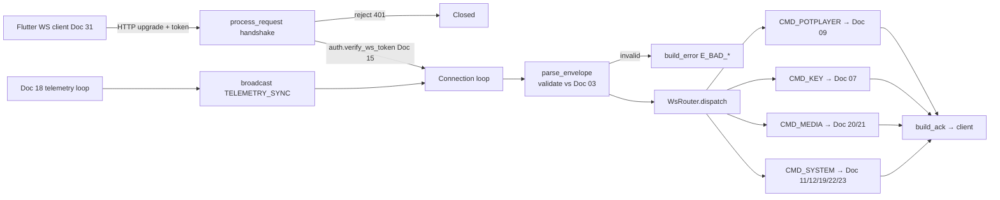

# Doc 14: PC WebSocket Server Router

> Part of PotPilot plan-series · Category C · Session 1 Wave 1.B · PC Agent

## 1. Purpose & Scope

**Delivers** the `websockets` server bound to **TCP port 50506** plus an async **action router**: every inbound JSON envelope is validated, authenticated, and dispatched to registered handlers across four domains — PotPlayer (Doc 09), keyboard (Doc 07), media (Docs 20/21), and system/power (Docs 11/12/19/22/23). Owns the connected-client registry that [18_pc_telemetry_broadcast_loop.md](18_pc_telemetry_broadcast_loop.md) uses to push `TELEMETRY_SYNC` frames.

**Out of scope:**
- JSON schema authority (envelope, handshake, ack/error, telemetry shapes) → [03_websocket_json_schema_spec.md](03_websocket_json_schema_spec.md)
- Token/handshake credential checks → [15_pc_token_auth_middleware.md](15_pc_token_auth_middleware.md)
- Telemetry diffing/scheduling → [18_pc_telemetry_broadcast_loop.md](18_pc_telemetry_broadcast_loop.md)
- Flutter client & reconnect policy → [31_flutter_websocket_client_reconnect.md](31_flutter_websocket_client_reconnect.md)

## 2. File Ownership

**Owns (create-only):**

| Path | Contents |
|---|---|
| `pc_agent/network/ws_server_router.py` | Server, router registry, envelope validation, client registry |
| `pc_agent/tests/test_ws_router.py` | Unit tests (§9) |

**Reads / touches (owned by other docs):**

| Path | Owner | Why |
|---|---|---|
| `pc_agent/core/auth_middleware.py` | [15_pc_token_auth_middleware.md](15_pc_token_auth_middleware.md) | Handshake token verification |
| `pc_agent/potplayer/wm_dispatcher.py` | [09_potplayer_wm_command_dispatcher.md](09_potplayer_wm_command_dispatcher.md) | `CMD_POTPLAYER` handlers |
| `pc_agent/input_engine/win32_keyboard.py` | [07_win32_sendinput_keyboard_engine.md](07_win32_sendinput_keyboard_engine.md) | `CMD_KEY` handlers |
| `pc_agent/media/*.py` | [20](20_pc_local_media_scanner_service.md) / [21](21_pc_potplayer_file_launcher.md) | `CMD_MEDIA` handlers |
| `pc_agent/display_power/*.py` | [11](11_multi_monitor_window_snapper.md) [12](12_secondary_monitor_blackout_overlay.md) [19](19_pc_ddcci_monitor_brightness.md) [22](22_pc_sleep_timer_power_manager.md) [23](23_pc_windows_audio_endpoint_control.md) | `CMD_SYSTEM` handlers |
| `pc_agent/network/telemetry_broadcaster.py` | [18_pc_telemetry_broadcast_loop.md](18_pc_telemetry_broadcast_loop.md) | Uses `broadcast()` / client registry |
| `shared_specs/ws_command_schema.json` | [03_websocket_json_schema_spec.md](03_websocket_json_schema_spec.md) | Contract mirror |
| `pc_agent/main.py` | [04_pc_agent_boilerplate_deps.md](04_pc_agent_boilerplate_deps.md) | Route registration + lifecycle |

## 3. Public Contract

```python
WS_HOST: str = "0.0.0.0"
WS_PORT: int = 50506                                    # frozen wire constant
MSG_TYPES: frozenset[str] = frozenset({"CMD_POTPLAYER", "CMD_KEY", "CMD_SYSTEM", "CMD_MEDIA", "TELEMETRY_SYNC"})

@dataclass(frozen=True, slots=True)
class WsEnvelope:
    id: str; type: str; action: str; payload: dict[str, Any]; timestamp: int

Handler = Callable[["WsSession", WsEnvelope], Awaitable[dict[str, Any]]]

class WsSession:
    id: str                       # uuid per connection
    remote: str                   # "ip:port"
    @property
    def is_authenticated(self) -> bool: ...

class WsRouter:
    def register(self, msg_type: str, action: str, handler: Handler) -> None: ...  # raise on duplicate (type, action)
    def lookup(self, msg_type: str, action: str) -> Handler | None: ...
    async def dispatch(self, session: WsSession, env: WsEnvelope) -> dict[str, Any]: ...

def parse_envelope(raw: str | bytes) -> WsEnvelope: ...        # raises ValueError with machine-readable reason
def build_ack(envelope_id: str, **results: Any) -> dict[str, Any]: ...   # shape per Doc 03
def build_error(envelope_id: str | None, code: str, message: str) -> dict[str, Any]: ...  # shape per Doc 03

class WsServer:
    def __init__(self, *, router: WsRouter, auth: "AuthMiddleware") -> None: ...
    async def start(self) -> None: ...                    # serve on WS_HOST:WS_PORT
    async def stop(self) -> None: ...                     # close all connections, unbind
    async def broadcast(self, message: dict[str, Any]) -> int: ...  # send to all clients; returns delivery count (used by Doc 18)
    @property
    def client_count(self) -> int: ...
```

**Error codes (string constants):** `E_BAD_JSON`, `E_BAD_ENVELOPE`, `E_UNKNOWN_ACTION`, `E_UNAUTHORIZED`, `E_HANDLER` — exact frame shapes owned by Doc 03.

## 4. Internal Design

1. **Startup** — `websockets.serve(handler, WS_HOST, WS_PORT, process_request=_handshake_check)`; handler signature follows the pinned `websockets` major version (see §6).
2. **Handshake gate** — `process_request` extracts the credential per Doc 03's handshake shape and asks `auth.verify_ws_token(...)`; reject → HTTP 401 (or Doc 03's close code) before the connection opens.
3. **Connection lifecycle** — on open: create `WsSession`, add to client registry; loop `async for raw in websocket:` → `parse_envelope` → `router.dispatch` → send ack; on close/error: remove from registry. Handlers are awaited per-message (one task per connection, provided by `websockets`).
4. **Envelope validation** — JSON parse; required keys `id/type/action/payload/timestamp`; `type ∈ MSG_TYPES`; `id` matches uuid-v4 shape; `payload` must be an object. Failure → `build_error` with the parsed `id` when available.
5. **Routing** — exact `(type, action)` key into the registry dict; unknown → `E_UNKNOWN_ACTION`. `TELEMETRY_SYNC` inbound is always rejected (server→client only).
6. **Ack semantics** — handler returns a dict merged into `build_ack`; handler exception → logged, `E_HANDLER` returned, connection stays open.
7. **Broadcast** — `broadcast()` iterates the registry with `asyncio.gather(..., return_exceptions=True)`; per-connection sends are serialized by an `asyncio.Lock` so Doc 18 telemetry never interleaves with a command ack mid-frame.
8. **Shutdown** — close all sessions (code per Doc 03), then close server; `stop()` idempotent.



## 5. Protocol & Data Compliance

Consumed/produced envelope (frozen; authority [03_websocket_json_schema_spec.md](03_websocket_json_schema_spec.md), **do not alter**):

| Field | Type | Inbound | Outbound | Notes |
|---|---|---|---|---|
| `id` | uuid-v4 string | required | echoed | correlates ack/error |
| `type` | enum string | required | as reply type | `CMD_POTPLAYER \| CMD_KEY \| CMD_SYSTEM \| CMD_MEDIA \| TELEMETRY_SYNC` |
| `action` | string | required | n/a | e.g. `PLAY_PAUSE`, `SET_SPEED`, `CYCLE_SUBS`, `SET_BLACKOUT` |
| `payload` | object | required (may be `{}`) | handler results | shape per Doc 03 per action |
| `timestamp` | unix seconds | required | current unix | skew validated per Doc 03 rules |

**Route registry (initial wiring by `main.py`)**

| `type` | Example `action` tokens | Handler domain |
|---|---|---|
| `CMD_POTPLAYER` | `PLAY_PAUSE`, `SET_SPEED`, `CYCLE_SUBS`, frame-step/seek/aspect | [09](09_potplayer_wm_command_dispatcher.md) `wm_dispatcher` |
| `CMD_KEY` | VK combos / Unicode text forward | [07](07_win32_sendinput_keyboard_engine.md) |
| `CMD_MEDIA` | `LIST_MEDIA`, `RESCAN_MEDIA`, `LAUNCH_MEDIA` | [20](20_pc_local_media_scanner_service.md), [21](21_pc_potplayer_file_launcher.md) |
| `CMD_SYSTEM` | `SET_BLACKOUT`, `SNAP_TO_PRIMARY_MONITOR`, `SET_BRIGHTNESS`, sleep timer, `SET_SYSTEM_VOLUME`/`SET_SYSTEM_MUTE` | [11](11_multi_monitor_window_snapper.md) [12](12_secondary_monitor_blackout_overlay.md) [19](19_pc_ddcci_monitor_brightness.md) [22](22_pc_sleep_timer_power_manager.md) [23](23_pc_windows_audio_endpoint_control.md) |
| `TELEMETRY_SYNC` | *(inbound rejected)* | egress only — [18](18_pc_telemetry_broadcast_loop.md) at 250 ms cadence |

**Exact constants:** `WS_PORT = 50506`, `MSG_TYPES`, error-code strings above. Telemetry cadence (250 ms) is Doc 18's concern; this module only carries the frames.

## 6. Dependencies & Integration Points

**Internal:** [03_websocket_json_schema_spec.md](03_websocket_json_schema_spec.md) (envelope/handshake/ack authority) · [15_pc_token_auth_middleware.md](15_pc_token_auth_middleware.md) (credential check) · [18_pc_telemetry_broadcast_loop.md](18_pc_telemetry_broadcast_loop.md) (broadcast consumer) · handler modules [07](07_win32_sendinput_keyboard_engine.md) [09](09_potplayer_wm_command_dispatcher.md) [11](11_multi_monitor_window_snapper.md) [12](12_secondary_monitor_blackout_overlay.md) [19](19_pc_ddcci_monitor_brightness.md) [20](20_pc_local_media_scanner_service.md) [21](21_pc_potplayer_file_launcher.md) [22](22_pc_sleep_timer_power_manager.md) [23](23_pc_windows_audio_endpoint_control.md) · [31_flutter_websocket_client_reconnect.md](31_flutter_websocket_client_reconnect.md) (wire peer) · [04_pc_agent_boilerplate_deps.md](04_pc_agent_boilerplate_deps.md) (async lifecycle).

**External:** `websockets` (pinned `>=13,<15`; single-handler signature, `process_request` hook) — already in the Doc 04 requirements set. **Platform:** none directly; handlers own their Win32 calls.

## 7. Edge Cases & Failure Handling

- **Missing/invalid handshake token** — HTTP 401 at upgrade; no session created; failure counted by Doc 15.
- **Malformed JSON / non-UTF8** — `E_BAD_JSON`; if no `id` recoverable, error frame uses `id: null` per Doc 03.
- **Envelope with unknown `type`/`action`** — `E_UNKNOWN_ACTION`; connection stays open (client typo must not kill the pipe).
- **Inbound `TELEMETRY_SYNC`** — rejected (`E_UNKNOWN_ACTION`); telemetry is server-push only.
- **Handler raises** — logged with envelope id; `E_HANDLER` returned; connection preserved; Doc 12-style no-op handlers return `ok: false` payloads instead of raising.
- **Slow handler** — handlers must never block the loop; long work (media scan) offloads internally and replies asynchronously per Doc 03's deferred-ack rule.
- **Timestamp skew** — envelopes outside Doc 03's allowed skew rejected with `E_BAD_ENVELOPE`.
- **Client vanishes mid-broadcast** — `gather(return_exceptions=True)` swallows send failures; registry cleaned by close handler.
- **Port already bound** — `OSError` at `start()` surfaces to `main.py` for tray/GUI error display; no silent retry.
- **Ping timeout / dead peer** — rely on `websockets` keepalive (ping_interval/ping_timeout defaults); closed sessions removed from registry.

## 8. Acceptance Criteria

- [ ] Server listens on 0.0.0.0:50506; unauthenticated upgrade rejected with 401.
- [ ] Valid envelope for each of the four `CMD_*` types reaches its stubbed handler with parsed `WsEnvelope`; ack returned matches Doc 03 shape and echoes `id`.
- [ ] Unknown action → `E_UNKNOWN_ACTION`; malformed JSON → `E_BAD_JSON`; connection remains usable afterwards.
- [ ] `TELEMETRY_SYNC` sent by the phone is rejected.
- [ ] `broadcast()` reaches every connected client exactly once; delivery count returned; concurrent command acks never corrupt frames.
- [ ] `client_count` reflects open sessions; `stop()` drops all to zero and frees the port.
- [ ] `pytest pc_agent/tests/test_ws_router.py` green.

## 9. Test Plan

**`pc_agent/tests/test_ws_router.py`** (fake connections + stub handlers; no real network for router logic):
- `test_envelope_parse_valid_and_missing_keys` — happy path; each missing key raises `ValueError`.
- `test_register_duplicate_raises` — double registration of `(type, action)` is a programming error.
- `test_dispatch_unknown_action` — returns `E_UNKNOWN_ACTION` frame.
- `test_ack_id_echo` — ack carries the request `id` and handler results.
- `test_handler_exception_maps_to_e_handler` — connection-continues semantics asserted.
- `test_broadcast_counts` — 3 fake clients, 1 with a broken send → returns 2.
- **Integration:** `websockets` client against a real server on an ephemeral port: handshake accept/reject, one `CMD_SYSTEM` round trip, telemetry push delivery.

**Manual:** pair via Doc 32 Flutter flow; press Play/Pause from the deck (Doc 36) while PotPlayer is unfocused; verify ack latency and Doc 38 scrub HUD updates.

## 10. Assumptions & Open Questions

**Assumptions**
1. `websockets` pinned `>=13,<15` (asyncio implementation, single-argument handler). Version recorded as an install-time assumption; Doc 04 requirements line must match.
2. Handshake credential channel (query param / header / first frame) is defined by Doc 03; this module only calls `auth.verify_ws_token(presented_str)`.
3. Initial action-token list per domain is illustrative; Doc 03 owns the exhaustive enum. Registration is data-driven so adding actions needs no router changes.
4. `E_*` code strings are stable identifiers; Doc 03 owns their wire serialization.
5. Handlers are async, loop-safe, and complete in ≪ 250 ms; heavy work (rescan) reports progress via `TELEMETRY_SYNC` state, not blocking replies.

**Open questions**
- Should the server enforce per-IP connection limits (single paired phone vs. multiple remotes)? Deferred to Doc 03/34 multi-device policy.
