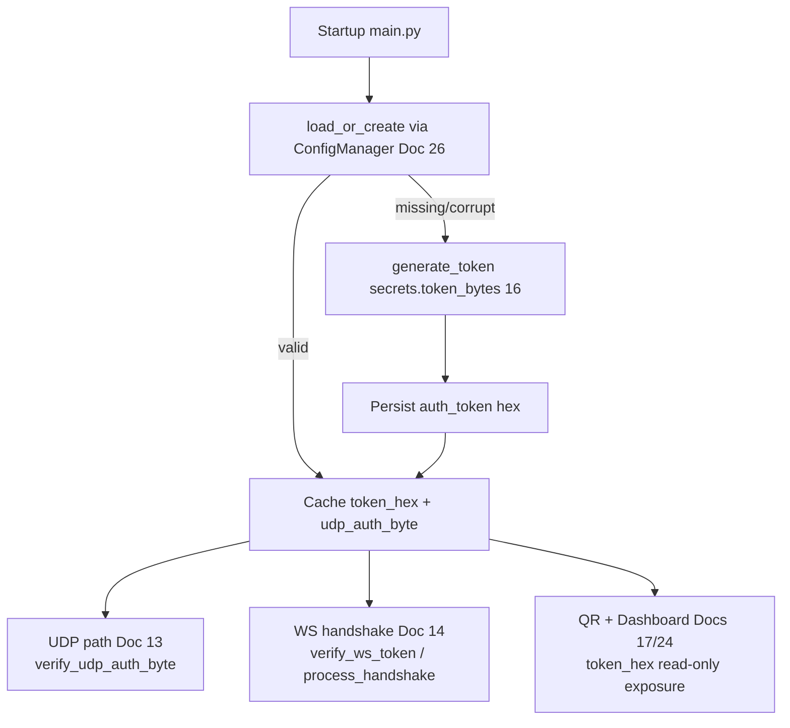

# Doc 15: PC Token Auth Middleware

> Part of PotPilot plan-series · Category C · Session 1 Wave 1.B · PC Agent

## 1. Purpose & Scope

**Delivers** the single authentication source of truth for the PC agent: generates and persists a **128-bit pairing token**, validates WebSocket connection handshakes, and verifies the **1-byte XOR checksum** carried in every UDP packet. All other PC modules consult this middleware; no module re-implements the checksum or token storage.

**Out of scope:**
- Wire-level serialization of the UDP auth byte → [02_binary_udp_protocol_spec.md](02_binary_udp_protocol_spec.md) (checksum definition is frozen there; this module *implements* it)
- WebSocket handshake payload shapes → [03_websocket_json_schema_spec.md](03_websocket_json_schema_spec.md) (this module supplies only `verify_ws_token`)
- Token persistence file format → [26_pc_config_persistence_manager.md](26_pc_config_persistence_manager.md)
- QR/mDNS exposure of the token → [17_pc_qr_connection_payload_gen.md](17_pc_qr_connection_payload_gen.md), [24_pc_customtkinter_dashboard_ui.md](24_pc_customtkinter_dashboard_ui.md)

## 2. File Ownership

**Owns (create-only):**

| Path | Contents |
|---|---|
| `pc_agent/core/auth_middleware.py` | Token lifecycle, checksum, WS verification |
| `pc_agent/tests/test_auth_middleware.py` | Unit tests (§9) |

**Reads / touches (owned by other docs):**

| Path | Owner | Why |
|---|---|---|
| `pc_agent/core/config_manager.py` | [26_pc_config_persistence_manager.md](26_pc_config_persistence_manager.md) | Read/write `auth_token` in `%APPDATA%\PotPilot\config.json` |
| `pc_agent/network/udp_server.py` | [13_pc_asyncio_udp_receiver.md](13_pc_asyncio_udp_receiver.md) | Calls `verify_udp_auth_byte()` per packet |
| `pc_agent/network/ws_server_router.py` | [14_pc_websocket_server_router.md](14_pc_websocket_server_router.md) | Calls `verify_ws_token()` at handshake |
| `pc_agent/core/qr_payload_gen.py` | [17_pc_qr_connection_payload_gen.md](17_pc_qr_connection_payload_gen.md) | Reads `token_hex` for the pairing QR |
| `pc_agent/gui/dashboard_window.py` | [24_pc_customtkinter_dashboard_ui.md](24_pc_customtkinter_dashboard_ui.md) | Displays/regenerates token |
| `shared_specs/udp_packet_layout.json` / `ws_command_schema.json` | [02](02_binary_udp_protocol_spec.md) / [03](03_websocket_json_schema_spec.md) | Frozen definitions this module implements against |

## 3. Public Contract

```python
TOKEN_BYTES: int = 16                 # 128-bit token (frozen)
TOKEN_HEX_LEN: int = 32               # lowercase hex rendering
CONFIG_KEY_TOKEN: str = "auth_token"  # key inside ConfigManager (Doc 26)

def generate_token() -> bytes: ...                       # secrets.token_bytes(TOKEN_BYTES)
def xor_checksum(token: bytes) -> int: ...               # 8-bit XOR fold over all token bytes → 0..255

class AuthMiddleware:
    def __init__(self, config: "ConfigManager") -> None: ...
    def load_or_create(self) -> str: ...                 # return token_hex; generate+persist if missing/invalid
    @property
    def token_hex(self) -> str: ...                      # current lowercase 32-char token
    @property
    def udp_auth_byte(self) -> int: ...                  # cached xor_checksum result
    def verify_udp_auth_byte(self, byte: int) -> bool: ...  # constant-time compare of the 1-byte checksum
    def verify_ws_token(self, presented: str) -> bool: ...  # constant-time compare of full token_hex
    def reload(self) -> str: ...                         # re-read from config (supports manual rotation)

HandshakeDecision = Literal["accept", "reject"]

def extract_handshake_token(request: Any) -> str | None: ...   # pull credential per Doc 03 handshake shape
def process_handshake(request: Any, auth: "AuthMiddleware") -> HandshakeDecision: ...  # extract → verify → accept/reject
```

## 4. Internal Design

1. **Token lifecycle** — `load_or_create()` reads `auth_token` via ConfigManager; valid (32 lowercase-hex chars) ⇒ reuse; missing/corrupt ⇒ `generate_token()`, render lowercase hex, persist through ConfigManager, log "new pairing token generated".
2. **Checksum computation** — XOR-fold every byte of the 16 raw token bytes into one `uint8`:

```python
def xor_checksum(token: bytes) -> int:
    value = 0
    for b in token:
        value ^= b
    return value                       # 0..255, frozen by Doc 02
```

3. **UDP verification** — `verify_udp_auth_byte(byte)` compares against the cached checksum with `hmac.compare_digest` on single-byte `bytes` (constant time). Called on the UDP hot path (Doc 13) — pre-computed once at load, zero allocation per packet beyond the compare.
4. **WS verification** — `verify_ws_token(presented)` normalizes case, then constant-time compares the full 32-char hex string; rejection counters feed rate-limited logging.
5. **Handshake adapter** — `extract_handshake_token` implements Doc 03's chosen channel (query/header/first-frame); `process_handshake` is the thin glue `websockets.process_request` calls (Doc 14). Doc 03 owns the wire shape; this module owns only the decision.
6. **Rotation** — manual only: deleting the config key + `reload()` (or agent restart) generates a fresh token, invalidating paired clients (they re-pair via QR / Doc 32).



## 5. Protocol & Data Compliance

**UDP auth byte (frozen — authority [02_binary_udp_protocol_spec.md](02_binary_udp_protocol_spec.md), do not redefine):**

| Field | Position | Value | Verification here |
|---|---|---|---|
| `auth` | byte 1 of the `<BBhhH` packet | 8-bit XOR checksum of the 128-bit pairing token (static per token) | `verify_udp_auth_byte()` |

**WebSocket handshake:** payload shapes live in [03_websocket_json_schema_spec.md](03_websocket_json_schema_spec.md); this module only supplies `verify_ws_token(presented: str)` and the `process_handshake` decision. No schema is duplicated here.

**Config storage (via Doc 26):**

| Key | Type | Example | Notes |
|---|---|---|---|
| `auth_token` | string | `"9f3c…"` 32 lowercase hex chars | 128-bit token; sole persistent secret |

**Exact constants:** `TOKEN_BYTES = 16`, `TOKEN_HEX_LEN = 32`, `CONFIG_KEY_TOKEN = "auth_token"`. Frozen system constants honored: 128-bit token, UDP 50505/WS 50506 usage sites unchanged.

## 6. Dependencies & Integration Points

**Internal:** [26_pc_config_persistence_manager.md](26_pc_config_persistence_manager.md) (persistence) · [13_pc_asyncio_udp_receiver.md](13_pc_asyncio_udp_receiver.md) (UDP verify consumer) · [14_pc_websocket_server_router.md](14_pc_websocket_server_router.md) (WS verify consumer) · [17_pc_qr_connection_payload_gen.md](17_pc_qr_connection_payload_gen.md) (token exposure) · [24_pc_customtkinter_dashboard_ui.md](24_pc_customtkinter_dashboard_ui.md) (token display/regenerate) · [02](02_binary_udp_protocol_spec.md) / [03](03_websocket_json_schema_spec.md) (frozen contracts).

**External:** Python stdlib only — `secrets`, `hmac`, `logging`. **Platform:** none.

## 7. Edge Cases & Failure Handling

- **Config file missing / first run** — ConfigManager supplies defaults; middleware generates and persists a token; startup continues.
- **Stored token invalid** (wrong length, non-hex, uppercase) — regenerate + overwrite + log warning; paired phones must re-pair (documented).
- **UDP auth mismatch** — returns `False`; caller (Doc 13) drops the packet silently and rate-limits logs. No reply ever echoes the expected byte.
- **WS token mismatch** — returns `False`; Doc 14 rejects the upgrade with HTTP 401/close code per Doc 03.
- **Case differences** — WS token compared case-insensitively (normalize to lowercase first); UDP byte is inherently exact.
- **Config write failure** (locked/readonly `%APPDATA%`) — log error, keep token in memory for the session, surface through Doc 24/25 status; restart will mint a new token (warn user).
- **Concurrent UDP flood with wrong byte** — constant-time compare, no per-packet allocation beyond 1-byte buffer; failure counter with 1 s-per-peer log throttle.
- **Token rotation** — `reload()` re-reads config; cached checksum invalidated; all clients from the previous token rejected immediately.
- **Known weakness (accepted):** the UDP checksum is static per token — a LAN sniffer replaying one captured packet can forge traffic. Mitigated by LAN trust boundary + constant-time compares; per-session challenge is out of scope (frozen contract).

## 8. Acceptance Criteria

- [ ] First run creates a 128-bit (32-hex-char) token persisted under `auth_token`; second run reuses it.
- [ ] `xor_checksum` output equals a hand-computed XOR over the token bytes; same token ⇒ same byte across restarts.
- [ ] `verify_udp_auth_byte` accepts the correct byte and rejects any of the 255 others (unit-verified over all 256 values).
- [ ] `verify_ws_token` accepts exact token, rejects altered/partial/empty strings, compares case-insensitively.
- [ ] Corrupt stored token triggers regeneration + persistence, not a crash.
- [ ] All comparisons use `hmac.compare_digest` (no plain `==` on secrets — grep-verifiable).
- [ ] `pytest pc_agent/tests/test_auth_middleware.py` green.

## 9. Test Plan

**`pc_agent/tests/test_auth_middleware.py`** (in-memory fake ConfigManager):
- `test_load_or_create_generates_once` — first call persists; second call returns the identical token.
- `test_xor_checksum_known_vector` — fixed 16-byte vector vs hand-computed XOR; also property: checksum ∈ 0..255.
- `test_udp_byte_accept_reject_matrix` — all 256 byte values: exactly one accepted.
- `test_ws_token_compare` — exact/lowercase/uppercase accept; truncated/flipped-char reject.
- `test_invalid_stored_token_regenerated` — `"zz"`, 31 chars, empty → new valid token persisted.
- `test_reload_rotates` — change fake config, `reload()` → old UDP byte/WS token now rejected.

**Manual:** pair Flutter app (Doc 32), confirm UDP trackpad + WS commands work; delete `auth_token` from `%APPDATA%\PotPilot\config.json`, restart agent, confirm phone must re-pair via QR.

## 10. Assumptions & Open Questions

**Assumptions**
1. Token is lowercase hex (32 chars) end-to-end; QR (Doc 17) and Flutter cache (Doc 34) store the same string.
2. Persistence is delegated entirely to ConfigManager (Doc 26) under key `auth_token`; no second copy is written anywhere.
3. The handshake credential channel follows Doc 03's final choice; `extract_handshake_token` is the single adapter point if that shape changes.
4. Case-insensitive WS compare is safe (hex alphabet) and improves QR/paste ergonomics.
5. Rotation is manual/out-of-band (delete key + restart); no automatic expiry.

**Open questions**
- Should the dashboard (Doc 24) gain an explicit "Regenerate token" button driving `reload()`? Recommended, decision deferred to Doc 24.
- Future per-session challenge-response over UDP would close the static-checksum replay gap — requires a Doc 02 revision; tracked as a post-v1 idea only.
