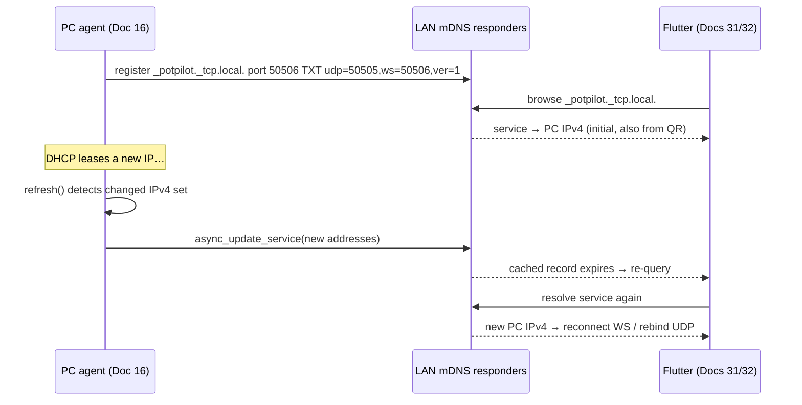

# Doc 16: PC Zeroconf mDNS Broadcaster

> Part of PotPilot plan-series · Category C · Session 1 Wave 1.B · PC Agent

## 1. Purpose & Scope

**Delivers** the mDNS/DNS-SD broadcaster that announces the `_potpilot._tcp.local.` service on the local LAN, advertising the WebSocket control port plus TXT records for the UDP port and protocol version. This lets the Flutter app find the PC **automatically after DHCP reassigns the PC's IP**, without rescanning the QR code.

**Out of scope:**
- QR pairing bootstrap (initial discovery) → [17_pc_qr_connection_payload_gen.md](17_pc_qr_connection_payload_gen.md)
- Flutter-side mDNS listening / fallback resolution → [32_flutter_qr_scanner_mdns_pairing.md](32_flutter_qr_scanner_mdns_pairing.md), [31_flutter_websocket_client_reconnect.md](31_flutter_websocket_client_reconnect.md)
- Service *discovery* of other devices (this PC only announces, never browses)
- IPv6 / wide-area DNS-SD

## 2. File Ownership

**Owns (create-only):**

| Path | Contents |
|---|---|
| `pc_agent/network/mdns_broadcaster.py` | Service registration, IP refresh loop |
| `pc_agent/tests/test_mdns_broadcaster.py` | Unit tests (§9) |

**Reads / touches (owned by other docs):**

| Path | Owner | Why |
|---|---|---|
| `pc_agent/main.py` | [04_pc_agent_boilerplate_deps.md](04_pc_agent_boilerplate_deps.md) | Lifecycle (`start` / `stop`); process DPI/awareness untouched here |
| `pc_agent/network/ws_server_router.py` | [14_pc_websocket_server_router.md](14_pc_websocket_server_router.md) | Advertised port must equal `WS_PORT` |
| `pc_agent/core/qr_payload_gen.py` | [17_pc_qr_connection_payload_gen.md](17_pc_qr_connection_payload_gen.md) | Shares the `collect_lan_ipv4()` helper (single IP-enumeration implementation) |
| `pc_agent/gui/dashboard_window.py` | [24_pc_customtkinter_dashboard_ui.md](24_pc_customtkinter_dashboard_ui.md) | Optional `on_ips_changed` callback → refresh QR image |

## 3. Public Contract

```python
SERVICE_TYPE: str = "_potpilot._tcp.local."   # frozen service type
SERVICE_PORT: int = 50506                     # advertised port = WS control port (frozen)
TXT_UDP: str = "udp"                          # TXT key → "50505"
TXT_WS: str = "ws"                            # TXT key → "50506"
TXT_VERSION: str = "ver"                      # TXT key → "1"
IP_REFRESH_INTERVAL_S: int = 60

def collect_lan_ipv4() -> list[str]: ...      # non-loopback, non-link-local LAN IPv4s, sorted, deduped

class MdnsBroadcaster:
    def __init__(self, *, hostname: str | None = None, udp_port: int = 50505, ws_port: int = 50506,
                 on_ips_changed: Callable[[list[str]], None] | None = None) -> None: ...
    async def start(self) -> None: ...         # register service; begin refresh loop; idempotent
    async def stop(self) -> None: ...          # unregister + close; idempotent
    async def refresh(self) -> bool: ...       # recompute IPs; update_service if changed; True = changed
    @property
    def service_name(self) -> str: ...         # "<hostname>._potpilot._tcp.local."
    @property
    def is_registered(self) -> bool: ...

def sanitize_hostname(name: str) -> str: ...   # DNS-label-safe service instance name (per DNS-SD escaping rules)
```

## 4. Internal Design

1. **IP enumeration** — `collect_lan_ipv4()`: resolve the machine hostname via `socket.getaddrinfo`, drop `127.*`, `169.254.*` (link-local) and `0.0.0.0`; if empty, fall back to UDP-socket probing (`connect(("1.1.1.1", 80))` + `getsockname()`) as a best effort. Sorted + deduped.
2. **Service construction** — `zeroconf.asyncio.AsyncZeroconf` (runs its own engine; integrates with the agent's asyncio loop). Build `ServiceInfo` with `type = SERVICE_TYPE`, `name = sanitize_hostname(hostname) + "._potpilot._tcp.local."`, `port = ws_port` (frozen 50506), `addresses = [IPv4Address(ip) for ip in ips]`, and TXT properties `{"udp": "50505", "ws": "50506", "ver": "1"}`.
3. **Registration** — `async_register_service` on start; a background task refreshes every `IP_REFRESH_INTERVAL_S`.
4. **DHCP change handling** — on each tick recompute `collect_lan_ipv4()`; if the set differs from the registered one, rebuild `ServiceInfo` addresses and `async_update_service` (zeroconf re-announces with new A records, TTLs handled internally). Invoke `on_ips_changed(new_ips)` so the dashboard can re-render the QR (Doc 24/17).
5. **Failure containment** — zeroconf initialization failure (no NIC / service conflict) logs a warning and schedules a retry on the next refresh tick; the agent's UDP/WS servers and QR path keep working (QR lists raw IPs).
6. **Shutdown** — `async_unregister_service`, close the `AsyncZeroconf` instance, cancel the refresh task.



## 5. Protocol & Data Compliance

**mDNS service record (frozen service type; layout owned by this doc):**

| Element | Value | Notes |
|---|---|---|
| Service type | `_potpilot._tcp.local.` | frozen wire constant |
| Instance name | `<sanitized-hostname>._potpilot._tcp.local.` | unique per PC; DNS-SD escaped |
| Port | `50506` | WS control port (frozen) |
| Addresses | 1..n LAN IPv4s | all advertised; client tries each (Doc 31) |

**TXT records:**

| Key | Value | Meaning |
|---|---|---|
| `udp` | `"50505"` | binary UDP input port (frozen) |
| `ws` | `"50506"` | WebSocket port (redundant with port field; explicit for clients) |
| `ver` | `"1"` | pairing/protocol version; bump on breaking wire changes |

TXT values are strings per DNS-SD; keys are lowercase. No token is placed in TXT records — **the secret never touches mDNS** (discovery is unauthenticated by design; auth happens at the WS handshake via [15_pc_token_auth_middleware.md](15_pc_token_auth_middleware.md)).

## 6. Dependencies & Integration Points

**Internal:** [04_pc_agent_boilerplate_deps.md](04_pc_agent_boilerplate_deps.md) (lifecycle) · [14_pc_websocket_server_router.md](14_pc_websocket_server_router.md) (`WS_PORT` source) · [17_pc_qr_connection_payload_gen.md](17_pc_qr_connection_payload_gen.md) (shared `collect_lan_ipv4()`) · [24_pc_customtkinter_dashboard_ui.md](24_pc_customtkinter_dashboard_ui.md) (QR refresh callback) · [31_flutter_websocket_client_reconnect.md](31_flutter_websocket_client_reconnect.md) / [32_flutter_qr_scanner_mdns_pairing.md](32_flutter_qr_scanner_mdns_pairing.md) (wire peers) · [15_pc_token_auth_middleware.md](15_pc_token_auth_middleware.md) (token is *not* exposed here).

**External:** `zeroconf` (pinned `>=0.131`; `zeroconf.asyncio.AsyncZeroconf`) — already in the Doc 04 requirements set. **Platform:** Windows mDNS uses the normal UDP 5353 multicast path; the InnoSetup script ([28](28_pc_innosetup_installer_script.md)) must allow UDP 5353 outbound/inbound on the private profile.

## 7. Edge Cases & Failure Handling

- **No IPv4 yet (cable unplugged)** — register with an empty address set is refused; log + retry next tick; QR path shows "connect PC to LAN" state.
- **DHCP lease change mid-session** — detected within `IP_REFRESH_INTERVAL_S` (60 s worst case); `async_update_service` publishes new addresses; Flutter re-resolves after record TTL expiry.
- **Multiple adapters (Wi-Fi + Ethernet)** — every valid IPv4 advertised simultaneously; client picks a reachable one.
- **Hostname collision** (two "DESKTOP-ABC" PCs) — DNS-SD instance rename with `#2` suffix appended by zeroconf; log the final `service_name`.
- **mDNS blocked on router / AP isolation** — broadcaster stays healthy but nobody resolves it; QR pairing with explicit IPs still works (documented fallback).
- **zeroconf init error** — contained; agent continues; retry at next refresh tick.
- **Shutdown while refresh in flight** — refresh task cancelled; `stop()` unregisters best-effort with try/except.
- **Clock irrelevant** — mDNS uses TTL/counters, no wall-clock dependency.

## 8. Acceptance Criteria

- [ ] `start()` makes the service visible to an mDNS browser (`dns-sd -B _potpilot._tcp.local.` or Flutter Doc 32 listener) within 5 s.
- [ ] Advertised port is 50506; TXT contains exactly `udp=50505`, `ws=50506`, `ver=1`.
- [ ] No token/secret appears in any mDNS record (packet capture or browse output).
- [ ] Simulated IP change (renew DHCP / toggle Wi-Fi) → service re-announces new address within one refresh interval; Flutter reconnects without rescanning the QR.
- [ ] Multi-adapter PC advertises all LAN IPv4s, loopback/link-local excluded.
- [ ] `stop()` removes the service from the network (browser no longer lists it) and frees port 5353 use.
- [ ] `pytest pc_agent/tests/test_mdns_broadcaster.py` green.

## 9. Test Plan

**`pc_agent/tests/test_mdns_broadcaster.py`** (fake zeroconf + monkeypatched `collect_lan_ipv4`):
- `test_service_info_fields` — type/port/TXT/name exactly match §5.
- `test_sanitize_hostname` — spaces/underscores/unicode → valid DNS labels; empty → "potpilot-pc".
- `test_refresh_detects_change` — IP list mutated → `refresh()` returns `True`, `update_service` called once.
- `test_refresh_no_change_silent` — same IPs → returns `False`, no update call.
- `test_collect_lan_ipv4_filters` — fake `getaddrinfo` with loopback/link-local entries → filtered, sorted output.
- `test_init_failure_does_not_raise` — constructor/start failure path logs and retries, never propagates.

**Manual:** on the LAN, browse `_potpilot._tcp.local.` from the phone (Doc 32 debug screen); toggle the PC's Wi-Fi off/on; confirm the app reconnects to the new IP after ≤ 60 s + TTL without re-scanning the QR.

## 10. Assumptions & Open Questions

**Assumptions**
1. `zeroconf>=0.131` provides `zeroconf.asyncio.AsyncZeroconf`; the asyncio loop is the agent's main loop (Doc 04).
2. TXT keys `udp`, `ws`, `ver` are this doc's frozen layout (not mandated by the overview); Flutter side (Doc 32) must read these exact keys.
3. The service port field carries the WS port (50506) because WS is the long-lived control channel needing discovery; UDP clients take the port from TXT.
4. `IP_REFRESH_INTERVAL_S = 60` bounds DHCP-change detection latency; mDNS TTLs are zeroconf defaults.
5. Windows Firewall rule for UDP 5353 is installed by the InnoSetup script (Doc 28), not by this module.

**Open questions**
- Should the service also advertise volume 0/Browse-all on IPv6 link-local for future-proofing? Deferred — v1 is IPv4-only per the QR payload.
