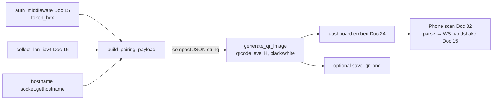

# Doc 17: PC QR Connection Payload Generator

> Part of PotPilot plan-series · Category C · Session 1 Wave 1.B · PC Agent

## 1. Purpose & Scope

**Delivers** the pairing-payload builder and high-contrast QR image renderer: one scan from the Flutter app (`mobile_scanner`) transfers the PC's **LAN IPv4 addresses, UDP/WS ports, hostname, and the 128-bit secret auth token**, enabling instant pairing with zero typing. Consumed by the dashboard (Doc 24) and consumed on the phone by [32_flutter_qr_scanner_mdns_pairing.md](32_flutter_qr_scanner_mdns_pairing.md).

**Out of scope:**
- Where the QR is displayed (dashboard widget layout) → [24_pc_customtkinter_dashboard_ui.md](24_pc_customtkinter_dashboard_ui.md)
- Camera scanning and post-scan handshake on the phone → [32_flutter_qr_scanner_mdns_pairing.md](32_flutter_qr_scanner_mdns_pairing.md)
- Token generation/persistence → [15_pc_token_auth_middleware.md](15_pc_token_auth_middleware.md)
- Ongoing IP-change discovery after pairing → [16_pc_zeroconf_mdns_broadcaster.md](16_pc_zeroconf_mdns_broadcaster.md)

## 2. File Ownership

**Owns (create-only):**

| Path | Contents |
|---|---|
| `pc_agent/core/qr_payload_gen.py` | Payload builder, QR renderer, PNG export helper |
| `pc_agent/tests/test_qr_payload_gen.py` | Unit tests (§9) |

**Reads / touches (owned by other docs):**

| Path | Owner | Why |
|---|---|---|
| `pc_agent/core/auth_middleware.py` | [15_pc_token_auth_middleware.md](15_pc_token_auth_middleware.md) | Reads `token_hex` (read-only exposure) |
| `pc_agent/network/mdns_broadcaster.py` | [16_pc_zeroconf_mdns_broadcaster.md](16_pc_zeroconf_mdns_broadcaster.md) | Imports shared `collect_lan_ipv4()` |
| `pc_agent/network/udp_server.py` / `ws_server_router.py` | [13](13_pc_asyncio_udp_receiver.md) / [14](14_pc_websocket_server_router.md) | Default port constants |
| `pc_agent/gui/dashboard_window.py` | [24_pc_customtkinter_dashboard_ui.md](24_pc_customtkinter_dashboard_ui.md) | Renders the returned `PIL.Image`; re-renders on Doc 16 IP-change callback |

## 3. Public Contract

```python
PAYLOAD_VERSION: int = 1          # "v" field; bump on breaking payload changes
QR_BOX_SIZE: int = 8              # pixels per QR module
QR_BORDER: int = 4                # quiet-zone width in modules (spec minimum)
QR_MODULE_COLOR: str = "#000000"  # pure-black modules
QR_BG_COLOR: str = "#FFFFFF"      # pure-white background (maximum contrast)
DEFAULT_EXPORT_PATH: str = "%APPDATA%\\PotPilot\\pairing_qr.png"   # expanded at runtime

def build_pairing_payload(*, ips: list[str], hostname: str, token_hex: str,
                          udp_port: int = 50505, ws_port: int = 50506) -> str: ...
    # compact, deterministic JSON string with frozen keys {v, host, ips, udp, ws, token}

def generate_qr_image(payload: str) -> "PIL.Image.Image": ...
    # high-contrast QR (error-correction level H) encoding the payload UTF-8 string

def save_qr_png(image: "PIL.Image.Image", path: str | Path | None = None) -> Path: ...
    # write PNG to path (default: expanded DEFAULT_EXPORT_PATH); create parent dirs

def render_pairing_qr(*, auth: "AuthMiddleware", hostname: str | None = None,
                      udp_port: int = 50505, ws_port: int = 50506) -> "PIL.Image.Image": ...
    # convenience: collect_lan_ipv4() + auth.token_hex + build + render (one call for Doc 24)
```

## 4. Internal Design

1. **Payload assembly** — `build_pairing_payload` takes an already-collected IP list (injectable for tests), validates each entry with `ipaddress.IPv4Address`, rejects empty `token_hex` (32 lowercase-hex chars enforced), and serializes with `json.dumps(..., sort_keys=True, separators=(",", ":"))` for a byte-stable payload.
2. **IP collection** — `render_pairing_qr` calls Doc 16's `collect_lan_ipv4()` (single implementation shared repo-wide). Zero IPs is a hard error for the caller (dashboard shows a "connect to LAN" empty state) — the builder itself stays pure.
3. **QR rendering** — `qrcode.QRCode(error_correction=ERROR_CORRECT_H, box_size=QR_BOX_SIZE, border=QR_BORDER)`; add payload; `make_image(fill_color="#000000", back_color="#FFFFFF").convert("RGB")`. Level H (~30 % recovery) survives glare, partial occlusion, and small dashboard renders.
4. **Export** — `save_qr_png` is optional (dashboard embeds the image in-memory); when used, expands `%APPDATA%\PotPilot\` and creates directories. The exported PNG contains the secret token — file inherits user-profile ACLs; never written to a shared/public path.
5. **Refresh policy** — Doc 24 re-invokes `render_pairing_qr` when opened and whenever Doc 16's `on_ips_changed` fires; this module is stateless (no cache, no timers).



## 5. Protocol & Data Compliance

**QR payload layout (frozen for v1; the Flutter parser in Doc 32 must match these exact keys):**

| Key | Type | Example | Meaning |
|---|---|---|---|
| `v` | int | `1` | payload version |
| `host` | string | `"BEDROOM-PC"` | PC hostname (display + records) |
| `ips` | array of string | `["192.168.1.42","10.0.0.7"]` | all LAN IPv4s, sorted; client tries each |
| `udp` | int | `50505` | binary UDP input port (frozen) |
| `ws` | int | `50506` | WebSocket control port (frozen) |
| `token` | string | `"9f3c…"` 32 lowercase hex | 128-bit pairing token (secret) |

**Example (actual on-wire string, compact separators):**

```json
{"host":"BEDROOM-PC","ips":["192.168.1.42"],"token":"9f3c1a7be0d24c8fab5561d3ce77b0aa","udp":50505,"v":1,"ws":50506}
```

**QR encoding parameters:** UTF-8 payload, error-correction **H**, `box_size=8`, `border=4`, modules `#000000` on `#FFFFFF` (maximum camera contrast, compatible with mobile_scanner). mDNS service name is **not** embedded — post-pair discovery is Doc 16's job; the token is embedded because it is the pairing secret by design.

## 6. Dependencies & Integration Points

**Internal:** [15_pc_token_auth_middleware.md](15_pc_token_auth_middleware.md) (token source) · [16_pc_zeroconf_mdns_broadcaster.md](16_pc_zeroconf_mdns_broadcaster.md) (`collect_lan_ipv4()`) · [24_pc_customtkinter_dashboard_ui.md](24_pc_customtkinter_dashboard_ui.md) (display host; refresh trigger) · [32_flutter_qr_scanner_mdns_pairing.md](32_flutter_qr_scanner_mdns_pairing.md) (payload consumer — key contract) · [13](13_pc_asyncio_udp_receiver.md)/[14](14_pc_websocket_server_router.md) (default ports).

**External:** `qrcode` (`>=7.4`, EC level H + PNG backend) and `pillow` (`>=10.0`, image type/conversion) — both already in the Doc 04 requirements set. **Platform:** `%APPDATA%` expansion via `os.path.expandvars` (Windows).

## 7. Edge Cases & Failure Handling

- **No LAN IPv4** — `render_pairing_qr` raises `NoLanAddressError` (custom, exported); dashboard shows "Connect PC to Wi-Fi/Ethernet" empty state instead of a stale QR.
- **Multiple NICs** — all IPv4s listed in `ips`; phone tries each (Doc 31 handles reachability fallback).
- **Token not yet loaded** — `auth.token_hex` triggers `load_or_create()` (Doc 15); never renders an empty/placeholder token.
- **Invalid IP passed to builder** — `ValueError` naming the bad entry (programming error; caught in tests).
- **Hostname with non-ASCII** — payload is UTF-8; QR encodes UTF-8; Dart side decodes UTF-8. (Sanitize control characters.)
- **Huge payload / too many IPs** — payload stays ≪ QR level-H capacity at version ≤ 10; assert `len(payload) < 300` chars defensively.
- **PNG export failure** (readonly dir) — `OSError` propagates; dashboard keeps the in-memory image (export is best-effort).
- **Stale QR after IP change** — this module is stateless; Doc 24 regenerates on the Doc 16 IP-change callback and whenever the dashboard opens.
- **Token rotated** — next render embeds the new token; old QRs are dead by design (Doc 15 rejects old tokens).
- **Screen-screenshot exposure** — accepted risk of QR pairing; rotation via Doc 24/15 mitigates; document in dashboard tooltip.

## 8. Acceptance Criteria

- [ ] `build_pairing_payload` output parses back to identical values; keys exactly `{v, host, ips, udp, ws, token}`; compact deterministic separators.
- [ ] Ports default to 50505/50506 and token is the exact Doc 15 `token_hex`.
- [ ] Generated image is a `PIL.Image` in RGB, pure-black modules on pure-white background; encodable payload scans back with level-H tolerance (manual phone test).
- [ ] A phone running Doc 32 pairs on the **first scan** with no typing; subsequent WS handshake with the embedded token succeeds (Doc 15).
- [ ] `NoLanAddressError` path exercised with zero-IP fixture; no QR produced.
- [ ] `save_qr_png` creates `%APPDATA%\PotPilot\pairing_qr.png` and is byte-identical across two saves of the same payload.
- [ ] `pytest pc_agent/tests/test_qr_payload_gen.py` green.

## 9. Test Plan

**`pc_agent/tests/test_qr_payload_gen.py`** (no camera/network):
- `test_payload_roundtrip` — build → `json.loads` → field-by-field equality; sorted keys, no spaces.
- `test_payload_ports_default_and_override` — frozen defaults honored; explicit ports pass through.
- `test_token_validation` — wrong-length / non-hex token rejected.
- `test_ip_validation` — `"999.1.1.1"` raises `ValueError`; valid IPs preserved in order (sorted by builder).
- `test_qr_image_properties` — image mode `RGB`; corner pixel is background white; payload length guard.
- `test_render_uses_shared_ip_helper` — monkeypatched `collect_lan_ipv4` appears in decoded payload (proves single IP source).
- `test_no_lan_address_raises` — empty IP list → `NoLanAddressError`.

**Manual (device required):** display the dashboard QR on the PC monitor; scan with the Flutter app from ~1 m in a dim bedroom; confirm first-scan pairing; rotate the token, delete the phone's cached pairing (Doc 34), and re-pair from a fresh QR.

## 10. Assumptions & Open Questions

**Assumptions**
1. Payload key set `{v, host, ips, udp, ws, token}` is frozen here as the Doc 32 parser contract (the overview mandates the content — addresses, ports, hostname, token — but not key names); `v` guards future evolution.
2. `qrcode>=7.4` and `pillow>=10.0` satisfy level-H rendering; versions recorded for Doc 04's `requirements.txt`.
3. `%APPDATA%\PotPilot\pairing_qr.png` is the default export path (mirrors Doc 26's config directory); dashboard display is in-memory — the PNG is for debugging/manual sharing.
4. UTF-8 encoding is safe for `mobile_scanner`'s default decoding.
5. mDNS service name is intentionally excluded from the payload to keep it minimal and avoid implying the token is discoverable.

**Open questions**
- Should the payload gain a friendly device alias (user-chosen name) for multi-PC households? Deferred to a potential `v: 2`; not required for v1 pairing.
