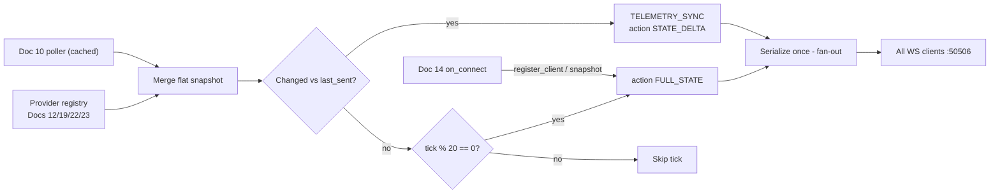

# Doc 18: Telemetry Broadcast Loop
> Part of PotPilot plan-series · Category C · Session 1 Wave 1.B · PC Agent

## 1. Purpose & Scope
**Delivers**
- A single `asyncio` loop that every **250 ms** merges the latest PotPlayer playback telemetry (Doc 10) with optional system-state providers (Docs 12/19/22/23), diffs the merged snapshot against the last frame actually sent, and pushes compact `TELEMETRY_SYNC` JSON envelopes to **all** authenticated WebSocket clients on port `50506`.
- **Delta semantics:** a tick with changes sends only the changed keys (`action: "STATE_DELTA"`); a full frame (`action: "FULL_STATE"`) is forced every 5 s and pushed immediately to every newly registered client.
- A named **provider registry** so Session-2 modules (blackout, DDC/CI brightness, sleep timer, system audio) join the state picture without ever editing this file.

**Out of scope**
- Reading PotPlayer `WM_USER` getters — [10_potplayer_wm_user_telemetry_poller.md](10_potplayer_wm_user_telemetry_poller.md) owns polling and produces the base snapshot.
- WebSocket listening, auth handshake, JSON parsing of inbound commands, client lifecycle — [14_pc_websocket_server_router.md](14_pc_websocket_server_router.md) + [15_pc_token_auth_middleware.md](15_pc_token_auth_middleware.md) own transport/security.
- Computing blackout, brightness, sleep-timer, or system-volume values — Docs 12/19/22/23 own those modules.
- Flutter-side parsing/rendering — Doc 33 (`telemetry_provider.dart`).
- Defining the envelope schema itself — [03_websocket_json_schema_spec.md](03_websocket_json_schema_spec.md).

## 2. File Ownership
**Owns (create-only)**

| Path | Role |
|---|---|
| `pc_agent/network/telemetry_broadcaster.py` | Diff loop, frame builder, client fan-out, provider registry |
| `pc_agent/tests/test_telemetry_broadcaster.py` | Unit tests |

**Reads / touches (owned by other docs)**

| Path | Owner | What we consume |
|---|---|---|
| `pc_agent/potplayer/telemetry_poller.py` | Doc 10 | Base snapshot: position, duration, play state, speed, volume, title, found-flag |
| `pc_agent/network/ws_server_router.py` | Doc 14 | Calls `register_client` / `unregister_client` / `snapshot()` |
| `pc_agent/display_power/blackout_overlay.py` | Doc 12 | `blackout_active` provider (Session 2) |
| `pc_agent/display_power/ddcci_brightness.py` | Doc 19 | `brightness` provider (Session 2) |
| `pc_agent/display_power/sleep_power_mgr.py` | Doc 22 | `sleep_timer_*` providers (Session 2) |
| `pc_agent/display_power/audio_endpoint.py` | Doc 23 | `sys_volume` / `sys_muted` providers (Session 2) |
| `shared_specs/ws_command_schema.json` | Doc 03 | Envelope conformance reference (read-only) |

## 3. Public Contract
```python
TELEMETRY_INTERVAL_MS: int = 250          # frozen cadence
FULL_REFRESH_EVERY_TICKS: int = 20        # 5 s forced FULL_STATE
ACTION_STATE_DELTA: str = "STATE_DELTA"
ACTION_FULL_STATE: str = "FULL_STATE"
TYPE_TELEMETRY: str = "TELEMETRY_SYNC"
SOURCE_BLACKOUT: str = "blackout"; SOURCE_BRIGHTNESS: str = "brightness"
SOURCE_SLEEP: str = "sleep_timer"; SOURCE_AUDIO: str = "audio"

SnapshotProvider = Callable[[], Union[dict[str, Any], Awaitable[dict[str, Any]]]]

class TelemetryBroadcaster:
    def __init__(self, poller: "TelemetryPoller", *, interval_ms: int = TELEMETRY_INTERVAL_MS) -> None:
        """Own the 250 ms diff loop; poller supplies the base PotPlayer snapshot."""
    def register_client(self, ws: "WebSocketServerProtocol") -> None:
        """Add an authenticated WS client and immediately push it a FULL_STATE frame."""
    def unregister_client(self, ws: "WebSocketServerProtocol") -> None:
        """Remove a client; silently tolerant of unknown or dead sockets."""
    def register_source(self, name: str, provider: SnapshotProvider) -> None:
        """Register a named flat-dict snapshot provider merged into every tick."""
    def unregister_source(self, name: str) -> None:
        """Drop a provider; its keys are omitted from subsequent frames."""
    async def start(self) -> None:
        """Spawn the drift-corrected 250 ms loop as a background asyncio task."""
    async def stop(self) -> None:
        """Cancel the loop, flush one final FULL_STATE, and clear clients."""
    def snapshot(self) -> dict[str, Any]:
        """Return the last known full flat state dict (absent sources = absent keys)."""
    def build_frame(self, payload: dict[str, Any], *, action: str) -> str:
        """Serialize one TELEMETRY_SYNC envelope as compact JSON text."""
```

## 4. Internal Design
1. **Tick scheduling** — loop targets `loop.time()` deadlines (`next += 0.250`); if the loop stalls, skip missed deadlines instead of bursting catch-up frames.
2. **Snapshot merge** — call the poller snapshot (sync, already cached by Doc 10), then await each registered provider with a 100 ms per-provider timeout; flatten results into one `dict[str, Any]`.
3. **Diff** — one-level compare against `last_sent`; build `changed = {k: v for k in merged if merged[k] != last_sent.get(k, MISSING)}` plus keys removed by a source (re-sent as `null` only if the provider explicitly returned `None`).
4. **Frame decision** — changed non-empty → `STATE_DELTA`; else if `tick % 20 == 0` → `FULL_STATE`; else skip (no serialization, no I/O).
5. **Fan-out** — serialize once, `await asyncio.gather(...)` over clients with per-client 2 s send timeout; a failing client is unregistered (Doc 14 logs the disconnect).
6. **New client path** — `register_client` builds a `FULL_STATE` from the current merged dict and sends it before the client appears in subsequent fan-outs.



**State held:** `last_sent: dict`, `tick: int`, `clients: set`, `sources: dict[str, SnapshotProvider]`, `last_merged: dict`. No persistence — state is rebuilt from live providers after restart.

## 5. Protocol & Data Compliance
**Produced envelope (exact, per Doc 03 / overview §4.2):**

```json
{"id":"b3f1…-uuid4","type":"TELEMETRY_SYNC","action":"STATE_DELTA","payload":{"position_ms":501234,"is_playing":true},"timestamp":1760500000}
```
- `id` = fresh UUIDv4 per frame · `type` = `"TELEMETRY_SYNC"` always · `action` ∈ {`"STATE_DELTA"`, `"FULL_STATE"`} · `timestamp` = unix seconds (int).
- `payload` is a **flat** object; `STATE_DELTA` carries only keys whose value changed this tick; `FULL_STATE` carries every currently available key.

**Exact payload keys (superset assembled from all providers):**

| Key | Type | Source | Notes |
|---|---|---|---|
| `position_ms` | int | Doc 10 | 0 when idle/none |
| `duration_ms` | int | Doc 10 | 0 when unknown |
| `is_playing` | bool | Doc 10 | |
| `speed` | float | Doc 10 | 0.2–4.0, default 1.0 |
| `volume` | int | Doc 10 | PotPlayer **internal** volume 0–100 |
| `file_title` | string \| null | Doc 10 | basename without extension; null when idle |
| `potplayer_found` | bool | Doc 10/08 | false when `PotPlayer64` HWND missing |
| `blackout_active` | bool | Doc 12 | Session 2; key absent until source registered |
| `brightness` | int \| null | Doc 19 | First DDC-capable monitor 0–100; null = unsupported/unknown |
| `sys_volume` | int | Doc 23 | Master Windows volume 0–100 |
| `sys_muted` | bool | Doc 23 | Master mute state |
| `sleep_timer_active` | bool | Doc 22 | |
| `sleep_timer_mode` | string \| null | Doc 22 | `"COUNTDOWN"` \| `"MOVIE_PROGRESS"` \| null |
| `sleep_timer_remaining_s` | int \| null | Doc 22 | Seconds until fire; null when idle |

**Constants (exact names):** `TELEMETRY_INTERVAL_MS`, `FULL_REFRESH_EVERY_TICKS`, `ACTION_STATE_DELTA`, `ACTION_FULL_STATE`, `TYPE_TELEMETRY`, `SOURCE_BLACKOUT`, `SOURCE_BRIGHTNESS`, `SOURCE_SLEEP`, `SOURCE_AUDIO`, `PROVIDER_TIMEOUT_MS = 100`, `CLIENT_SEND_TIMEOUT_S = 2.0`.

## 6. Dependencies & Integration Points
**Internal**
- [10_potplayer_wm_user_telemetry_poller.md](10_potplayer_wm_user_telemetry_poller.md) — base snapshot source (constructor-injected).
- [14_pc_websocket_server_router.md](14_pc_websocket_server_router.md) — registers/unregisters clients; calls `snapshot()` for the initial frame.
- [15_pc_token_auth_middleware.md](15_pc_token_auth_middleware.md) — only authenticated connections reach us.
- [03_websocket_json_schema_spec.md](03_websocket_json_schema_spec.md) — envelope authority.
- [12_secondary_monitor_blackout_overlay.md](12_secondary_monitor_blackout_overlay.md), [19_pc_ddcci_monitor_brightness.md](19_pc_ddcci_monitor_brightness.md), [22_pc_sleep_timer_power_manager.md](22_pc_sleep_timer_power_manager.md), [23_pc_windows_audio_endpoint_control.md](23_pc_windows_audio_endpoint_control.md) — optional `register_source(...)` providers.
- [33_flutter_telemetry_state_provider.md](33_flutter_telemetry_state_provider.md) — downstream consumer; must handle both actions.

**External** — `websockets` (connection type only, pinned by Doc 04 `requirements.txt`); stdlib `asyncio`, `json`, `uuid`, `time`. No new packages.

**Platform** — none (pure Python loop).

## 7. Edge Cases & Failure Handling
- **No clients connected** — diff still runs (cheap) but serialization/fan-out is skipped; state stays warm for the next connect.
- **Client send raises (dead socket)** — unregister it, never propagate; the loop task must survive any single client failure.
- **Provider raises or exceeds 100 ms** — keep last-good values for that source, log a warning at most once per minute per source; other sources unaffected.
- **Source not registered (Session 1)** — its keys are simply absent from every frame; `FULL_STATE` never contains placeholder `null` for unknown sources.
- **PotPlayer closed** — Doc 10 reports `potplayer_found:false` with zeroed playback keys; one delta frame goes out, then silence until the 5 s `FULL_STATE` refresh.
- **State flapping faster than 250 ms** — sampling semantics: the value at tick time wins; no event queue, no replay guarantee.
- **Event-loop stall** — skip missed deadlines (see §4.1) rather than emitting a burst of stale frames.
- **Non-JSON-safe values (NaN/inf)** — providers must return JSON-safe scalars; broadcaster coerces non-finite floats to `0` defensively.
- **`stop()` during a fan-out** — gather is cancelled cleanly; clients set is cleared after the final flush.

## 8. Acceptance Criteria
- With changing playback, exactly one frame is emitted per 250 ms tick (±10% under a 5-client fake load); with frozen state, frames appear only every 5 s (`FULL_STATE`).
- Every emitted frame parses as the Doc 03 envelope: UUIDv4 `id`, `type == "TELEMETRY_SYNC"`, `action ∈ {STATE_DELTA, FULL_STATE}`, int unix `timestamp`, flat `payload`.
- `STATE_DELTA` payload contains **only** keys that differ from the previously sent frame; a single changed key produces a 1-field payload.
- A client registered mid-stream receives a `FULL_STATE` frame containing all available keys **before** the next tick's fan-out.
- A raising provider does not kill the loop and does not alter other sources' keys.
- Killing a fake client mid-send leaves `clients` clean and subsequent frames undelivered-to-that-client only.
- Keys from Docs 12/19/22/23 never appear before their sources are registered, and appear from the first tick after registration.

## 9. Test Plan
`pc_agent/tests/test_telemetry_broadcaster.py` (pytest, fake clock / `isinstance`-mocked poller, fake `websockets` objects):
- `test_diff_sends_only_changed_keys` — mutate one key → delta payload has exactly that key.
- `test_unchanged_tick_sends_nothing` — identical snapshots → zero frames over 10 ticks.
- `test_full_refresh_every_20_ticks` — unchanged state still yields `FULL_STATE` at tick 20.
- `test_new_client_gets_full_state_immediately` — `register_client` → immediate `FULL_STATE` containing every registered key.
- `test_envelope_shape_matches_ws_schema` — id/type/action/timestamp/payload types per Doc 03.
- `test_provider_exception_keeps_last_good_values` — raising provider → last values re-sent, loop alive.
- `test_missing_provider_keys_omitted` — Session-1 registry (poller only) → 7 keys, no system keys.
- `test_unregister_on_send_failure` — send raises → client removed, no exception escapes.
- `test_cadence_250ms` — fake loop clock: inter-frame gap == 0.250 s ±5%.

**Manual** — run the agent, connect an authenticated WS client (e.g. `websocat ws://<pc>:50506` with Doc 15 handshake); play a video → observe ~4 frames/s advancing `position_ms`; pause → one `STATE_DELTA {is_playing:false}` then silence until the 5 s `FULL_STATE`; disconnect mid-frame → agent log shows unregister, no crash.

## 10. Assumptions & Open Questions
- **A1:** `STATE_DELTA`/`FULL_STATE` are the only `TELEMETRY_SYNC` action values; Doc 33 must branch on exactly these two. (Recorded as assumption — overview fixes `type`, not `action`, for telemetry.)
- **A2:** Diffing is **flat, one level deep**; no nested payload objects ever appear (keeps Doc 33 parsing trivial).
- **A3:** 5 s full refresh is additive liveness insurance on top of the WS-level heartbeat in Doc 31; it does not replace it.
- **A4:** The poller snapshot is treated as read-only and cheap (Doc 10 caches between its own 250 ms queries); the broadcaster never issues Win32 calls itself.
- **A5:** `brightness` source = first DDC-capable monitor as reported by Doc 19 (see Doc 19 A1 for the primary-monitor mapping caveat).
- **Q1 (open):** Should a per-client send backlog be bounded (drop oldest) if one client stalls repeatedly? Initial implementation: 2 s timeout + disconnect on failure; revisit only if field logs show spurious drops on Wi-Fi.
