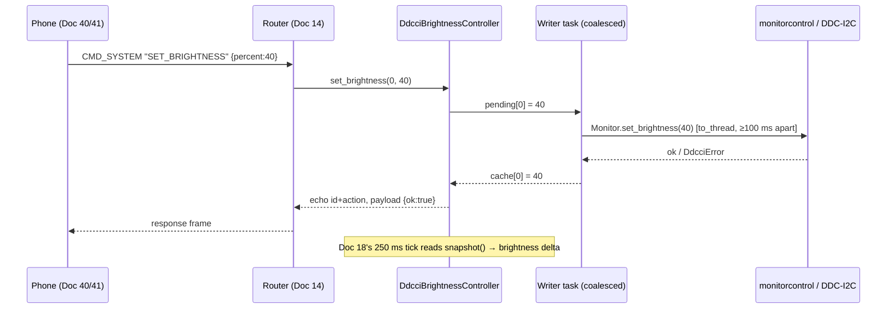

# Doc 19: DDC/CI Monitor Brightness Control
> Part of PotPilot plan-series · Category D · Session 2 Wave 2.A · PC Agent

## 1. Purpose & Scope
**Delivers**
- A wrapper around the `monitorcontrol` library that enumerates physical external monitors and reads/adjusts their **hardware luminance (0%–100%)** over DDC/CI (VCP code `0x10`), driven by the phone's brightness slider (Flutter Docs 40/41) via `CMD_SYSTEM` WebSocket commands.
- Write **coalescing** so a 120 Hz drag on the phone slider cannot flood the slow I2C/DDC bus — only the latest target value per monitor is written, at most once per 100 ms.
- A cached brightness snapshot exposed to Doc 18 so `TELEMETRY_SYNC` can broadcast `brightness` without issuing slow hardware reads every 250 ms.

**Out of scope**
- Software dimming / gamma overlays (no such feature in PotPilot; hardware luminance only).
- Enumerating Win32 displays or moving windows — Docs 11/12 own `EnumDisplayMonitors` and blackout overlays.
- The Flutter slider UI itself — [40_flutter_multi_monitor_power_sheet.md](40_flutter_multi_monitor_power_sheet.md) and [41_flutter_blind_bed_mode_gestures.md](41_flutter_blind_bed_mode_gestures.md) own it. *(Doc 41 removed in round 6, 2026-10-18 — Doc 40 is the only remaining owner.)*
- Persisting a preferred brightness — no config key; current hardware value is the source of truth.

## 2. File Ownership
**Owns (create-only)**

| Path | Role |
|---|---|
| `pc_agent/display_power/ddcci_brightness.py` | Controller, coalescing writer, cache, Doc 18 provider |
| `pc_agent/tests/test_ddcci_brightness.py` | Unit tests |

**Reads / touches (owned by other docs)**

| Path | Owner | What we consume |
|---|---|---|
| `pc_agent/network/ws_server_router.py` | Doc 14 | Dispatches `SET_BRIGHTNESS` here; routes responses |
| `pc_agent/network/telemetry_broadcaster.py` | Doc 18 | Registers `brightness` provider (`snapshot()`) |
| `pc_agent/core/config_manager.py` | Doc 26 | No keys consumed (see §10 A2) |
| `pc_agent/requirements.txt` | Doc 04 | Must contain `monitorcontrol` (already in baseline list) |

## 3. Public Contract
```python
BRIGHTNESS_MIN: int = 0
BRIGHTNESS_MAX: int = 100
WRITE_COALESCE_MS: int = 100
ACT_SET_BRIGHTNESS: str = "SET_BRIGHTNESS"

class DdcciError(Exception):
    code: str  # "E_DDCI_UNSUPPORTED" | "E_MONITOR_NOT_FOUND" | "E_DDCI_IO"

@dataclass(frozen=True, slots=True)
class MonitorInfo:
    index: int          # 0-based position in monitorcontrol enumeration order
    name: str           # human-readable model/description, "" if unavailable
    supported: bool     # DDC/CI write probe succeeded
    value: int | None   # last known luminance 0-100; None if unknown/unsupported

class DdcciBrightnessController:
    def __init__(self, *, write_min_interval_ms: int = WRITE_COALESCE_MS) -> None:
        """Own the monitor cache and the coalescing DDC writer task."""
    async def list_monitors(self, *, refresh: bool = False) -> list[MonitorInfo]:
        """Return cached monitor info, re-probing hardware when refresh=True."""
    async def get_brightness(self, monitor: int = 0, *, refresh: bool = False) -> int:
        """Return luminance 0-100 for one monitor; refresh=True forces a hardware read."""
    async def set_brightness(self, monitor: int, value: int) -> int:
        """Clamp value to 0-100, schedule a coalesced hardware write, return the target."""
    def snapshot(self) -> dict[str, Any]:
        """Flat dict for Doc 18: {'brightness': int | None} (first capable monitor)."""
    async def stop(self) -> None:
        """Flush any pending coalesced write and cancel the writer task."""
```

## 4. Internal Design
1. **Enumeration** — `monitorcontrol.get_monitors()` executed in a worker thread (`asyncio.to_thread`); per-monitor `get_brightness()` probe marks `supported`/`value`. Enumeration results cached until `refresh=True` or a write fails with an I/O error (unplug race).
2. **Read path** — `get_brightness(refresh=False)` returns cache; `refresh=True` performs the slow DDC read in a worker thread. This internal API feeds Doc 18's `brightness` telemetry provider — the phone's only read path (slider warm-start uses telemetry + Doc 34 cache; there is no wire read command).
3. **Write path (coalescing)** — `set_brightness` stores `pending[monitor] = value` (latest wins) and wakes a single writer task. The writer waits `write_min_interval_ms` since the previous physical write to **that** monitor, flushes `pending.pop(monitor)` via `to_thread`, updates the cache, and clears `pending` on failure with an error log.
4. **Error mapping** — `monitorcontrol` exceptions → `DdcciError`: monitor lacking DDC/CI or raising access errors → `E_DDCI_UNSUPPORTED`; unknown index → `E_MONITOR_NOT_FOUND`; transient I2C/timeout failures → `E_DDCI_IO` (cache retained, next command auto-refreshes once).
5. **Doc 18 integration** — controller registers `snapshot()` as source `"brightness"`; `None` until a successful probe.



**State:** `cache: dict[int, MonitorInfo]`, `pending: dict[int, int]`, `last_write_at: dict[int, float]`, `writer_task`. No persistence.

## 5. Protocol & Data Compliance
The single command uses envelope `type: "CMD_SYSTEM"`; responses **echo the request `id` and `action`** with `payload.ok` (see §10 A1).

**Commands (exact action names):**

| Action | Payload (request) | Response payload |
|---|---|---|
| `SET_BRIGHTNESS` | `{"percent": int}` (clamped 0–100) | `{"ok": true}` |

Delta-adjust is client-side: clients compute the absolute target (telemetry/cache base ± delta, clamped) and send `SET_BRIGHTNESS` — no relative or read commands on the wire (frozen registry, Doc 03 §5.5).

Error response payload: `{"ok": false, "error": "E_DDCI_UNSUPPORTED" | "E_MONITOR_NOT_FOUND" | "E_DDCI_IO" | "E_BAD_PAYLOAD", "detail": str}`.

**Produced telemetry key (via Doc 18):** `brightness: int | null` — first DDC-capable monitor's luminance.

**Constants (exact names):** `BRIGHTNESS_MIN`, `BRIGHTNESS_MAX`, `WRITE_COALESCE_MS`, `ACT_SET_BRIGHTNESS`, `ERR_DDCI_UNSUPPORTED = "E_DDCI_UNSUPPORTED"`, `ERR_MONITOR_NOT_FOUND = "E_MONITOR_NOT_FOUND"`, `ERR_DDCI_IO = "E_DDCI_IO"`, `ERR_BAD_PAYLOAD = "E_BAD_PAYLOAD"`. DDC VCP code `0x10` is handled by `monitorcontrol` (not hardcoded here).

## 6. Dependencies & Integration Points
**Internal**
- [14_pc_websocket_server_router.md](14_pc_websocket_server_router.md) — action dispatch + response routing.
- [18_pc_telemetry_broadcast_loop.md](18_pc_telemetry_broadcast_loop.md) — registers `snapshot()` as source `"brightness"`.
- [10_potplayer_wm_user_telemetry_poller.md](10_potplayer_wm_user_telemetry_poller.md) — cross-reference only (telemetry cadence/pipeline shared via Doc 18).
- [40_flutter_multi_monitor_power_sheet.md](40_flutter_multi_monitor_power_sheet.md), [41_flutter_blind_bed_mode_gestures.md](41_flutter_blind_bed_mode_gestures.md) — command senders. *(Doc 41 removed in round 6, 2026-10-18.)*
- [11_multi_monitor_window_snapper.md](11_multi_monitor_window_snapper.md) — sibling module (same directory, independent file; no code coupling).

**External**
- `monitorcontrol` — latest 3.x (baseline dependency in Doc 04 `requirements.txt`) — DDC/CI monitor access.
- stdlib: `asyncio`, `asyncio.to_thread` — off-loop I2C calls.

**Platform** — Windows DDC/CI via the display driver's WMI-MOF DDC/CI interface (through `monitorcontrol`); no direct Win32 calls in this module.

## 7. Edge Cases & Failure Handling
- **No monitor supports DDC/CI** (laptop panel only / MST hub blocked) — every command returns `ok:false, E_DDCI_UNSUPPORTED`; `snapshot()` reports `{"brightness": null}`; Doc 18 broadcasts `brightness:null` once; UI shows slider disabled (Doc 40 renders error toast).
- **Unknown monitor index (internal)** — handler always targets monitor 0 (frozen payload has no `monitor` field); after hot-plug reordering an out-of-range internal index maps to `E_MONITOR_NOT_FOUND`.
- **Bad payload (percent non-int, NaN)** — clamped/coerced where safe (float→int, out-of-range clamped); structurally invalid → `E_BAD_PAYLOAD`.
- **Monitor asleep / I2C timeout during write** — `E_DDCI_IO`, cache keeps last-known value, one automatic re-enumeration is attempted on the next command; never raises out of the router.
- **Monitor unplugged between enumeration and write** — write raises → re-enumerate once → retry write once; if still failing, `E_MONITOR_NOT_FOUND`.
- **Slider spam (120 Hz drag)** — coalescing writer: latest value wins, physical writes ≤ 1 per 100 ms per monitor; intermediate values legitimately skipped.
- **Read during a pending write** — returns the pending target (what the monitor will show), not the stale cache.
- **Agent shutdown with pending write** — `stop()` flushes the last target before cancelling the writer.
- **Permission denied on DDC access** — mapped to `E_DDCI_UNSUPPORTED` (same UX: feature unavailable).

## 8. Acceptance Criteria
- `SET_BRIGHTNESS {percent:40}` makes the physical monitor luminance visibly change to ~40% within 300 ms; internal `get_brightness(refresh=True)` reads back `40 ± 2`.
- `percent: -10` and `percent: 150` clamp to `0` / `100`; client-computed delta-adjust (e.g. 10 − 15) sends `percent:0` (no wrap).
- 30 rapid `SET` commands in 300 ms produce ≤ 4 physical writes and end at the final requested value.
- Unsupported monitor yields `E_DDCI_UNSUPPORTED` and `brightness:null` in `TELEMETRY_SYNC` — no exception reaches the WS router.
- Doc 18 shows a `brightness` delta within one 250 ms tick of a completed write.
- Envelope conformance: responses echo request `id`/`action`; the single action name and payload shape exactly as in §5.

## 9. Test Plan
`pc_agent/tests/test_ddcci_brightness.py` (pytest; `monitorcontrol.get_monitors` and `Monitor` methods monkeypatched — hardware-free):
- `test_set_brightness_clamps_to_bounds` — `-10 → 0`, `150 → 100`, `40 → 40`.
- `test_unsupported_monitor_maps_to_error_code` — raising fake monitor → `DdcciError.code == "E_DDCI_UNSUPPORTED"`.
- `test_unknown_monitor_index_error` — index ≥ len(monitors) → `E_MONITOR_NOT_FOUND`.
- `test_write_coalescing_keeps_latest_value` — 10 sets in a burst → ≤ 2 physical writes, final value correct.
- `test_snapshot_null_until_probed` — before/after probe: `None` → `int`.
- `test_get_during_pending_returns_target` — pending write reflected in `get_brightness`.
- `test_response_envelope_echoes_id_and_action` — router-level shape assertion.

**Manual (hardware required)** — with a DDC-capable external monitor: send `SET_BRIGHTNESS` via `websocat`; confirm on-screen luminance change and OSD if the monitor shows one; drag the Doc 40 slider end-to-end and confirm no bus stall; unplug the monitor mid-session → commands return errors, agent stays up; laptop-only (no external display) → `E_DDCI_UNSUPPORTED` path verified.

## 10. Assumptions & Open Questions
- **A1:** Responses echo the request `id` and `action` with `payload.ok` — a project-wide response convention recorded here and reused by Docs 20–23 (overview fixes the request envelope, not the response form).
- **A2:** No config key for brightness; `ddcci_default_monitor` was considered and rejected — the frozen `SET_BRIGHTNESS {percent}` payload carries no monitor index and always targets the default monitor (telemetry reports the first DDC-capable monitor).
- **A3:** `monitorcontrol` enumeration order is stable within a session; re-enumeration happens on `refresh` and on write failure, so hot-plug order changes are tolerated.
- **A4:** Coalescing skips intermediate slider values by design — DDC/CI cannot honor 120 Hz writes, and final-value accuracy is what matters.
- **A5:** "Primary monitor" mapping (Win32 primary ↔ monitorcontrol index) is not guaranteed; Doc 18's `brightness` key uses the **first DDC-capable** monitor (see Doc 18 A5).
- **Q1 (open):** Some laptops expose an internal panel that `monitorcontrol` can enumerate but not write (firmware-blocked). Probing currently reports `supported:false`; if field reports show false positives, add a write-verify round-trip (write current value, read back) — deliberately deferred to keep startup fast.
