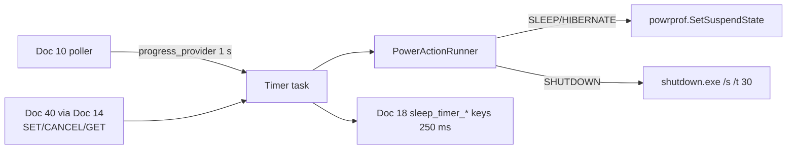

# Doc 22: Sleep Timer & Power Manager
> Part of PotPilot plan-series · Category D · Session 2 Wave 2.A · PC Agent

## 1. Purpose & Scope
**Delivers**
- A countdown sleep-timer engine driven by `CMD_SYSTEM` commands: **"Hibernate/Shutdown in X minutes"** (COUNTDOWN mode) or **"Shutdown when the current movie hits 99% completion"** (MOVIE_PROGRESS mode), with a configurable power action (`SLEEP` | `HIBERNATE` | `SHUTDOWN`).
- Power execution via `ctypes` (`powrprof.dll SetSuspendState`) for sleep/hibernate and `shutdown.exe` for shutdown, with a **30 s grace window** so a late cancel can still abort (`shutdown.exe /a`).
- Live timer state exposed to Doc 18 (`sleep_timer_*` telemetry keys) so the phone's "Fall Asleep" sheet (Doc 40) shows a running countdown.

**Out of scope**
- Windows "Wake timers" / alarm-clock wake-ups — one-way sleep only.
- Per-monitor power, display-off scheduling, or blackout overlays — Docs 11/12.
- Any UI — [40_flutter_multi_monitor_power_sheet.md](40_flutter_multi_monitor_power_sheet.md) owns the "Fall Asleep" drawer.
- Persisting an armed timer across agent restart — timers are session-scoped (see §10 A5).

## 2. File Ownership
**Owns (create-only)**

| Path | Role |
|---|---|
| `pc_agent/display_power/sleep_power_mgr.py` | Timer engine, state machine, power action runner |
| `pc_agent/tests/test_sleep_power_mgr.py` | Unit tests |

**Reads / touches (owned by other docs)**

| Path | Owner | What we consume |
|---|---|---|
| `pc_agent/network/ws_server_router.py` | Doc 14 | Dispatches `START_SLEEP_TIMER` / `CANCEL_SLEEP_TIMER` |
| `pc_agent/network/telemetry_broadcaster.py` | Doc 18 | Registers `snapshot()` as source `"sleep_timer"` |
| `pc_agent/potplayer/telemetry_poller.py` | Doc 10 | Injected `progress_provider` for MOVIE_PROGRESS mode |
| `pc_agent/core/config_manager.py` | Doc 26 | No keys consumed (defaults are module constants) |

## 3. Public Contract
```python
MODE_COUNTDOWN: str = "COUNTDOWN"
MODE_MOVIE_PROGRESS: str = "MOVIE_PROGRESS"
POWER_SLEEP: str = "SLEEP"
POWER_HIBERNATE: str = "HIBERNATE"
POWER_SHUTDOWN: str = "SHUTDOWN"
ACT_START_SLEEP_TIMER: str = "START_SLEEP_TIMER"
ACT_CANCEL_SLEEP_TIMER: str = "CANCEL_SLEEP_TIMER"
PROGRESS_TICK_S: float = 1.0
COUNTDOWN_TICK_S: float = 1.0
DEFAULT_PROGRESS_THRESHOLD_PCT: int = 99
MINUTES_MIN: int = 1
MINUTES_MAX: int = 720
SHUTDOWN_GRACE_S: int = 30

ProgressSample = tuple[int, int, bool]   # (position_ms, duration_ms, is_playing) from Doc 10

@dataclass(frozen=True, slots=True)
class TimerState:
    active: bool
    mode: str | None            # "COUNTDOWN" | "MOVIE_PROGRESS" | None when idle
    power_action: str | None    # "SLEEP" | "HIBERNATE" | "SHUTDOWN" | None
    remaining_s: int | None     # seconds until fire; None when idle (progress mode: None)
    threshold_pct: int | None   # progress mode only

class PowerActionRunner:            # injectable seam for tests
    async def sleep(self) -> None: ...
    async def hibernate(self) -> None: ...
    async def shutdown(self, grace_s: int) -> None: ...
    async def abort_shutdown(self) -> None: ...

class SleepTimerManager:
    def __init__(self, progress_provider: Callable[[], Awaitable[ProgressSample]],
                 runner: PowerActionRunner | None = None) -> None:
        """Own the single timer task and the power action runner."""
    async def arm(self, mode: str, power_action: str, *, minutes: int | None = None,
                  threshold_pct: int | None = None) -> TimerState:
        """Validate and (re)arm a timer; replaces any existing one atomically."""
    async def cancel(self) -> TimerState:
        """Cancel the active timer (and abort a pending shutdown.exe if in grace)."""
    def state(self) -> TimerState:
        """Synchronous current state."""
    def snapshot(self) -> dict[str, Any]:
        """Flat dict for Doc 18: sleep_timer_active, sleep_timer_mode, sleep_timer_remaining_s."""
```

## 4. Internal Design
1. **Single timer task** — exactly one `asyncio.Task` exists per armed timer; `arm()` cancels the previous task first (replace semantics), then creates the new one.
2. **COUNTDOWN mode** — `end_at = loop.time() + minutes*60` (monotonic — immune to wall-clock changes). The task ticks every `COUNTDOWN_TICK_S`, updates `remaining_s = max(0, end_at - now)`, and fires when `remaining_s == 0`.
3. **MOVIE_PROGRESS mode** — every `PROGRESS_TICK_S` call the injected `progress_provider` (Doc 10 poller: `(position_ms, duration_ms, is_playing)`). Fires the first time `duration_ms > 0 and position_ms / duration_ms * 100 >= threshold_pct`. A threshold already exceeded at arm time fires immediately (§10 A4). No playing movie → stays armed indefinitely until cancel/re-arm.
4. **Fire** — transition ARMED → TRIGGERING; dispatch via the runner: `SLEEP` → `SetSuspendState(FALSE, FALSE, FALSE)`; `HIBERNATE` → `SetSuspendState(TRUE, FALSE, FALSE)`, falling back to `shutdown.exe /h` on `ERROR_NOT_SUPPORTED` (hibernation disabled); `SHUTDOWN` → `shutdown.exe /s /t <SHUTDOWN_GRACE_S> /c "PotPilot sleep timer"`.
5. **Cancel** — cancels the task; if a shutdown is inside its grace window, additionally runs `shutdown.exe /a` (best-effort, ignores non-zero exit).
6. **State machine** (below) — `TimerState` is derived from it; the Doc 18 provider reads `snapshot()` each 250 ms tick.

```mermaid
stateDiagram-v2
    [*] --> IDLE
    IDLE --> ARMED: START_SLEEP_TIMER (valid)
    ARMED --> ARMED: START_SLEEP_TIMER (replace: cancel old task, rearm)
    ARMED --> IDLE: CANCEL_SLEEP_TIMER
    ARMED --> TRIGGERING: countdown == 0 / progress >= threshold
    TRIGGERING --> FIRED: power action succeeded
    TRIGGERING --> ERROR: power action failed (logged; last_error set)
    FIRED --> [*]        note: system sleeps/shuts down
    ERROR --> IDLE: next SET or CANCEL
```





**State:** `state: TimerState`, `end_at: float | None`, `task: asyncio.Task | None`, `threshold_pct: int | None`, `last_error: str | None`. No persistence.

## 5. Protocol & Data Compliance
Commands use envelope `type: "CMD_SYSTEM"`; responses echo request `id`/`action` (convention per Doc 19 A1).

**Commands (exact action names):**

| Action | Payload (request) | Response payload |
|---|---|---|
| `START_SLEEP_TIMER` | `{"mode": "COUNTDOWN"\|"MOVIE_PROGRESS", "target": "SLEEP"\|"HIBERNATE"\|"SHUTDOWN", "minutes": int? (COUNTDOWN, 1–720), "progress_pct": int? (MOVIE_PROGRESS, 1–100)}` | `{"ok": true}` |
| `CANCEL_SLEEP_TIMER` | `{}` | `{"ok": true}` (no-op when already idle) |

There is **no read action** — timer state is read via telemetry (`sleep_timer_*` keys) or a `REQUEST_STATE` FULL_STATE snapshot (frozen registry, Doc 03 §5.5). Validation: COUNTDOWN requires `minutes` ∈ [`MINUTES_MIN`, `MINUTES_MAX`] (1–720); MOVIE_PROGRESS requires `progress_pct` ∈ 1–100 (default `DEFAULT_PROGRESS_THRESHOLD_PCT = 99`) and rejects `minutes`. Violations → `{"ok": false, "error": "E_BAD_PAYLOAD", "detail": str}`. Wire `target`/`progress_pct` map to the internal `power_action`/`threshold_pct` fields.

**Telemetry keys (via Doc 18, exact):** `sleep_timer_active: bool`, `sleep_timer_mode: "COUNTDOWN"|"MOVIE_PROGRESS"|null`, `sleep_timer_remaining_s: int|null` (countdown seconds; `null` in progress mode and when idle).

**Constants (exact names):** `MODE_COUNTDOWN`, `MODE_MOVIE_PROGRESS`, `POWER_SLEEP`, `POWER_HIBERNATE`, `POWER_SHUTDOWN`, `ACT_START_SLEEP_TIMER`, `ACT_CANCEL_SLEEP_TIMER`, `PROGRESS_TICK_S`, `COUNTDOWN_TICK_S`, `DEFAULT_PROGRESS_THRESHOLD_PCT`, `MINUTES_MIN`, `MINUTES_MAX`, `SHUTDOWN_GRACE_S`, `WIN_POWRPROF_DLL = "powrprof.dll"`, `WIN_SHUTDOWN_EXE = "shutdown.exe"`, `ERR_BAD_PAYLOAD = "E_BAD_PAYLOAD"`.

## 6. Dependencies & Integration Points
**Internal**
- [10_potplayer_wm_user_telemetry_poller.md](10_potplayer_wm_user_telemetry_poller.md) — injected `progress_provider` (position/duration/is_playing).
- [14_pc_websocket_server_router.md](14_pc_websocket_server_router.md) — command dispatch.
- [18_pc_telemetry_broadcast_loop.md](18_pc_telemetry_broadcast_loop.md) — registers `snapshot()` as source `"sleep_timer"`.
- [40_flutter_multi_monitor_power_sheet.md](40_flutter_multi_monitor_power_sheet.md) — "Fall Asleep" timer UI (sender + countdown renderer).
- [23_pc_windows_audio_endpoint_control.md](23_pc_windows_audio_endpoint_control.md) — sibling in `display_power/`; no coupling (volume ≠ power).

**External** — stdlib: `asyncio`, `ctypes`, `subprocess`. Platform: `powrprof.dll` (`SetSuspendState`), `shutdown.exe` (`/s /t /c /a`, `/h`). No new packages.

**Platform** — Windows 10/11 power management; hibernation must be enabled (`powercfg /h`) for `HIBERNATE` (runtime fallback specced in §7).

## 7. Edge Cases & Failure Handling
- **Timer canceled before expiry** — task cancelled; no power event; telemetry reports idle; one `sleep_timer_*` delta goes to Doc 18.
- **Cancel during the shutdown grace window** — `shutdown.exe /a` issued best-effort (exit code ignored); system stays up if Windows honors the abort.
- **Re-arm while armed** — old task cancelled, new timer starts; no double-fire possible (single task invariant).
- **MOVIE_PROGRESS with no playing movie / paused** — polls but never fires until position crosses threshold; remains armed (user cancels).
- **`duration_ms == 0` or `file_title is null`** — treated as "no movie": skip tick, never divide by zero.
- **Threshold already exceeded when armed** — fires immediately on first poll (documented behavior, §10 A4).
- **Manual seek past 99% (remote scrub)** — next 1 s poll sees the crossing and fires; intended ("hits 99%" = reaches, not necessarily plays through).
- **Wall clock changed/NTP jump during countdown** — monotonic `loop.time()` deadline is unaffected.
- **Hibernation disabled on the machine** — `SetSuspendState(TRUE,…)` fails → fallback `shutdown.exe /h`; if that also fails, state → `ERROR` with `last_error`, agent log warning; no crash.
- **`shutdown.exe` unavailable/late** — spawn failure → `ERROR` state; partial shutdown (already accepted by Windows) can still be aborted via CANCEL.
- **Agent exits while armed** — timer dies with the process (no persistence); the OS is untouched (except a possibly pending `shutdown.exe /t 30`, which the user can cancel in a console; documented limitation §10 A5).
- **Bad payload (minutes:0, unknown mode)** — `E_BAD_PAYLOAD` with detail; no state change.

## 8. Acceptance Criteria
- `START_SLEEP_TIMER {mode:COUNTDOWN, target:SHUTDOWN, minutes:1}` → telemetry `sleep_timer_remaining_s` ≈ 60, decreasing; at 0, `shutdown.exe /s /t 30 …` is spawned with exactly those args.
- `CANCEL_SLEEP_TIMER` at remaining 10 s → no power action fires; `shutdown.exe /a` was issued when a shutdown was in grace.
- Re-arm during an active timer replaces it: only the new deadline can ever fire (verified with a fake clock).
- MOVIE_PROGRESS with `progress_pct:99` fires within 1 tick after a fake poller crosses 99% (`99000/100000 ms`); never fires with `duration_ms=0`.
- `snapshot()` yields exactly the 3 Doc 18 keys with correct types; Doc 18 shows `sleep_timer_active:true` within 250 ms of arming.
- `SetSuspendState` receives `(TRUE/FALSE, FALSE, FALSE)` per §4.4 (verified via mocked `ctypes.windll`).
- Minutes bounds enforced: `0` and `721` rejected with `E_BAD_PAYLOAD` (frozen 1–720).
- All state-machine transitions in §4 match observed states in tests.

## 9. Test Plan
`pc_agent/tests/test_sleep_power_mgr.py` (pytest; fake monotonic clock via patched `loop.time`; injected `PowerActionRunner` recording calls):
- `test_countdown_fires_at_zero` — 1-minute countdown with accelerated clock → runner.shutdown called once with `grace_s == SHUTDOWN_GRACE_S`.
- `test_cancel_prevents_fire` — cancel at t=30 s → no runner call after t=60 s.
- `test_rearm_replaces_existing_timer` — arm 10 min, re-arm 2 min → only the 2-minute fire occurs.
- `test_progress_fires_at_threshold_crossing` — poller returns (98999,100000,true) then (99000,100000,true) → fires on second poll.
- `test_progress_ignores_zero_duration` — (0,0,false) repeatedly → stays armed.
- `test_progress_fires_immediately_when_already_past` — arm with (99500,100000,true) → fires on first poll.
- `test_hibernate_fallback_to_shutdown_h` — runner raising on hibernate → `shutdown.exe /h` path attempted.
- `test_shutdown_command_args` — argv exactly `[shutdown.exe, /s, /t, 30, /c, "PotPilot sleep timer"]`.
- `test_cancel_uses_abort_in_grace` — cancel while shutdown pending → `abort_shutdown` called.
- `test_state_machine_transitions` — IDLE→ARMED→TRIGGERING→FIRED and ARMED→IDLE per the diagram.
- `test_bad_payload_rejected` — minutes=0 / unknown mode → `E_BAD_PAYLOAD`, state unchanged.

**Manual (power state required, VM recommended)** — arm 1-minute HIBERNATE → PC hibernates at 0 (any key wakes); arm SHUTDOWN then cancel at :10 → PC stays up; MOVIE_PROGRESS SHUTDOWN on a real movie, seek to 98% and play → PC schedules shutdown at 99%; disable hibernation (`powercfg /h off`) → fallback path observed in logs.

## 10. Assumptions & Open Questions
- **A1:** `SLEEP` | `HIBERNATE` | `SHUTDOWN` covers the catalog's "Hibernate/Shutdown" wording; `SLEEP` added as the lightest option (cheap, same machinery).
- **A2:** `SHUTDOWN_GRACE_S = 30` balances "instant effect" against "cancelable" — the phone's cancel button must land within the window; countdown-zero feedback is Doc 40's concern.
- **A3:** Countdown uses monotonic time, so "remaining_s" is authoritative even across NTP jumps.
- **A4:** "Shutdown when movie hits 99%" fires on **reaching** the threshold (including via seek), not only on playing through to it — matches remote-control expectations.
- **A5:** Timers are session-scoped: agent restart loses an armed timer. Persisting armed timers in config was rejected as a foot-gun (surprise shutdown after a crash/restart).
- **A6:** One shared timer slot (not a list) — the bedroom use case is "one bedtime timer"; the API replaces on re-arm.
- **Q1 (open):** Should a small audible/OSD "good night" cue fire 30 s before SHUTDOWN? Deferred to a Session-3 UX pass (would reuse Doc 09's OSD message command, no new dependency).
