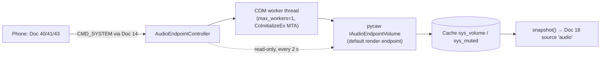

# Doc 23: Windows Audio Endpoint Control
> Part of PotPilot plan-series · Category D · Session 2 Wave 2.A · PC Agent

## 1. Purpose & Scope
**Delivers**
- Master **Windows system volume** and **mute** control via CoreAudio (`pycaw`): the OS-level endpoint volume that the taskbar speaker slider shows — driven by `CMD_SYSTEM` commands from the phone (Doc 40 sheet, Doc 41 blind-mode gestures, Doc 43 volume-button hijack).
- Deliberately **independent of PotPlayer's internal volume mixer** — Doc 10 telemetry reports PotPlayer `volume`; this module reports `sys_volume`/`sys_muted`; the two never write to each other.
- A cached, JSON-safe snapshot for Doc 18's `TELEMETRY_SYNC` so the phone OSD shows live master volume without extra round-trips.

**Out of scope**
- Per-application session volume (Spotify vs. browser) — master endpoint only.
- Changing the default audio **device** (speakers ↔ headphones ↔ HDMI) — out of scope entirely.
- PotPlayer's internal volume — Doc 09/10 own it (`CMD_POTPLAYER` SET_VOLUME).
- Android volume — Doc 43 hijacks the phone's buttons and forwards computed absolute targets here (or to Doc 09's `SET_VOLUME` when PotPlayer is open).

## 2. File Ownership
**Owns (create-only)**

| Path | Role |
|---|---|
| `pc_agent/display_power/audio_endpoint.py` | CoreAudio controller, COM worker, Doc 18 provider |
| `pc_agent/tests/test_audio_endpoint.py` | Unit tests |

**Reads / touches (owned by other docs)**

| Path | Owner | What we consume |
|---|---|---|
| `pc_agent/network/ws_server_router.py` | Doc 14 | Dispatches `SET_SYSTEM_VOLUME`, `SET_SYSTEM_MUTE` |
| `pc_agent/network/telemetry_broadcaster.py` | Doc 18 | Registers `snapshot()` as source `"audio"` |
| `pc_agent/potplayer/telemetry_poller.py` | Doc 10 | Cross-reference only (PotPlayer `volume` stays separate) |
| `pc_agent/requirements.txt` | Doc 04 | Must add `pycaw` + `comtypes` (see §10 A1) |

## 3. Public Contract
```python
VOLUME_MIN_PCT: int = 0
VOLUME_MAX_PCT: int = 100
ACT_SET_SYSTEM_VOLUME: str = "SET_SYSTEM_VOLUME"
ACT_SET_SYSTEM_MUTE: str = "SET_SYSTEM_MUTE"

class AudioEndpointError(Exception):
    code: str  # "E_NO_ENDPOINT" | "E_COREAUDIO" | "E_BAD_PAYLOAD"

class AudioEndpointController:
    def __init__(self) -> None:
        """Own the single COM worker thread and the cached endpoint handle."""
    async def get_volume(self) -> int:
        """Fresh master endpoint volume, rounded 0-100."""
    async def set_volume(self, value: int) -> int:
        """Clamp to 0-100, write master scalar, return the applied value."""
    async def adjust_volume(self, delta: int) -> int:
        """Apply a relative change to the current value, clamped, return applied."""
    async def get_mute(self) -> bool:
        """Fresh master mute state."""
    async def set_mute(self, muted: bool) -> bool:
        """Set master mute explicitly, return the applied state."""
    async def toggle_mute(self) -> bool:
        """Invert current mute state, return the new state."""
    def snapshot(self) -> dict[str, Any]:
        """Flat dict for Doc 18: {'sys_volume': int, 'sys_muted': bool}."""
    async def stop(self) -> None:
        """Shut the COM worker down cleanly."""
```

**Internal seam:** all pycaw/comtypes calls run inside a dedicated single-thread worker (`ThreadPoolExecutor(max_workers=1)`) that calls `comtypes.CoInitializeEx(COINIT_MULTITHREADED)` once on first use — COM apartment correctness without touching the asyncio thread.

## 4. Internal Design
1. **Endpoint resolution (lazy)** — `AudioUtilities.GetSpeakers()` → `.Activate(IAudioEndpointVolume._iid_, CLSCTX_ALL, None)` → `comtypes.cast(..., IAudioEndpointVolume)`. Cached until a call fails with a device-gone/`RPC` error; on such failure, re-resolve once, then retry the operation once (covers HDMI unplug / default-device change).
2. **Percentage mapping** — CoreAudio master scalar is `0.0–1.0`. Out: `round(scalar * 100)`. In: `clamp(pct, 0, 100) / 100.0`. Round-half-up so 99 → 0.99 → 99.
3. **Write path** — `set_volume`/`adjust_volume`/`set_mute`/`toggle_mute` run the COM call in the worker, then update the local cache; every command returns the **applied** (post-clamp) value. `adjust` = `set(current + delta)` with the current value freshly read (no drift from concurrent external changes).
4. **Error mapping** — no audio endpoint (headless RDP, all devices disabled) → `E_NO_ENDPOINT`; other COM failures after one retry → `E_COREAUDIO`; never propagate raw `COMError` to the router.
5. **Doc 18 integration** — `snapshot()` returns the cache (updated on every command); Doc 18's 250 ms poll of the source is cheap (no COM call in `snapshot()`); external mixer changes (user at PC) are picked up by a low-frequency background refresh (every 2 s, §10 A3) that only reads, and only emits a telemetry delta if the value changed.



**State:** cache `{sys_volume: int, sys_muted: bool}`, `endpoint: IAudioEndpointVolume | None`, worker future pool. No persistence — the OS is the source of truth.

## 5. Protocol & Data Compliance
Commands use envelope `type: "CMD_SYSTEM"`; responses echo request `id`/`action` (convention per Doc 19 A1).

**Commands (exact action names):**

| Action | Payload (request) | Success response payload |
|---|---|---|
| `SET_SYSTEM_VOLUME` | `{"percent": int}` (clamped 0–100) | `{"ok": true}` |
| `SET_SYSTEM_MUTE` | `{"muted": bool}` | `{"ok": true}` |

Deltas are client-side: clients compute the absolute target (base ± step, clamped) and send `SET_SYSTEM_VOLUME`; mute toggle = client flips telemetry `sys_muted` and sends `SET_SYSTEM_MUTE` (frozen registry, Doc 03 §5.5 — internal helpers `adjust_volume`/`toggle_mute` remain for local callers).

Error payload: `{"ok": false, "error": "E_NO_ENDPOINT" | "E_COREAUDIO" | "E_BAD_PAYLOAD", "detail": str}`.

**Telemetry keys (via Doc 18, exact):** `sys_volume: int` (0–100), `sys_muted: bool`. Distinct from Doc 10's PotPlayer-internal `volume` key — both may appear in the same frame; consumers must not conflate them.

**Constants (exact names):** `VOLUME_MIN_PCT`, `VOLUME_MAX_PCT`, `ACT_SET_SYSTEM_VOLUME`, `ACT_SET_SYSTEM_MUTE`, `ERR_NO_ENDPOINT = "E_NO_ENDPOINT"`, `ERR_COREAUDIO = "E_COREAUDIO"`, `ERR_BAD_PAYLOAD = "E_BAD_PAYLOAD"`, `REFRESH_INTERVAL_S = 2.0`.

## 6. Dependencies & Integration Points
**Internal**
- [14_pc_websocket_server_router.md](14_pc_websocket_server_router.md) — command dispatch + response routing.
- [18_pc_telemetry_broadcast_loop.md](18_pc_telemetry_broadcast_loop.md) — registers `snapshot()` as source `"audio"`.
- [10_potplayer_wm_user_telemetry_poller.md](10_potplayer_wm_user_telemetry_poller.md) — cross-reference: PotPlayer `volume` telemetry is separate by design.
- [09_potplayer_wm_command_dispatcher.md](09_potplayer_wm_command_dispatcher.md) — cross-reference: PotPlayer-internal volume commands live there, not here.
- [43_flutter_hardware_volume_button_hijack.md](43_flutter_hardware_volume_button_hijack.md), [40_flutter_multi_monitor_power_sheet.md](40_flutter_multi_monitor_power_sheet.md), [41_flutter_blind_bed_mode_gestures.md](41_flutter_blind_bed_mode_gestures.md) — command senders.
- [04_pc_agent_boilerplate_deps.md](04_pc_agent_boilerplate_deps.md) — requirements.txt must include this module's two packages.

**External**
- `pycaw` (≈0.10.x) — Python CoreAudio wrapper (`AudioUtilities`, `IAudioEndpointVolume`).
- `comtypes` (≈1.4.x) — COM interop required by pycaw (`CoInitializeEx`, `cast`).
- Platform: Windows CoreAudio API (MMDevice) — default render endpoint master channel.

**Platform notes** — works on Windows 10/11 with any active render endpoint; no elevation required; RDP sessions control the RDP audio endpoint (expected behavior).

## 7. Edge Cases & Failure Handling
- **No audio device / endpoint missing** — first call raises on resolve → `E_NO_ENDPOINT`; `snapshot()` keeps last values; Doc 18 emits a delta once (documented in Doc 18 error policy).
- **Default device changes (HDMI plugged in, BT headset connected)** — next COM call fails or returns device-gone → lazy re-resolve + one retry; new endpoint controlled transparently.
- **COM apartment conflicts** — worker always initializes MTA itself; `RPC_E_CHANGED_MODE` is tolerated (another lib already inited the thread) as long as calls succeed.
- **Rapid slider drags** — each command is a cheap scalar write (< 5 ms); no coalescing needed (unlike DDC); the worker serializes them, last write wins naturally.
- **Clamping** — `percent: 137 → 100`, `percent: -5 → 0`; internal `adjust_volume` clamps the same way (`+20` at 90 → 100, `−30` at 10 → 0). Never throws on out-of-range ints.
- **Rounding** — 99% → 0.99 → read back 99 (no visible ±1 drift after round-trips).
- **Mute vs. volume independence** — `SET_SYSTEM_VOLUME {"percent":0}` does **not** set mute; `SET_SYSTEM_MUTE {"muted":false}` does not restore volume (CoreAudio semantics).
- **External mixer change while idle** — 2 s read-only refresh updates cache; only changed values produce telemetry deltas.
- **Bad payload (missing/non-int percent, non-bool muted)** — coerced where safe (float→int, truthy→bool); structurally invalid → `E_BAD_PAYLOAD`.
- **Agent shutdown** — `stop()` shuts the worker; no dangling COM references.

## 8. Acceptance Criteria
- `SET_SYSTEM_VOLUME {"percent":40}` → Windows taskbar slider moves to 40; response `{"ok":true}`; next telemetry `sys_volume` agrees.
- Client-side deltas compute absolutes: base 40 + 5 → `{"percent":45}`; 98 + 5 → `{"percent":100}` (handler clamps); 3 − 5 → `{"percent":0}`.
- `SET_SYSTEM_MUTE` is idempotent; mute toggle = client flips telemetry `sys_muted` and sends `SET_SYSTEM_MUTE {muted: !current}`.
- Changing master volume does **not** change PotPlayer's `volume` telemetry key (independence verified while a video plays).
- Doc 18 shows a `sys_volume` delta within 250 ms of a `SET_SYSTEM_VOLUME`, and `sys_muted` deltas on mute changes.
- With all audio devices disabled, commands return `E_NO_ENDPOINT`; the agent and WS router stay up.
- Round-trip fidelity: pct→scalar→pct preserves the value for every 0–100 input (unit-verified).
- Both action names and payload shapes match §5 exactly.

## 9. Test Plan
`pc_agent/tests/test_audio_endpoint.py` (pytest; fake pycaw endpoint object + monkeypatched `AudioUtilities.GetSpeakers`; no real audio hardware):
- `test_percentage_to_scalar_mapping` — 0→0.0, 50→0.5, 99→0.99, 100→1.0 and back.
- `test_set_volume_clamps` — `-5→0`, `137→100`, `40→40`.
- `test_adjust_volume_relative_bounds` — delta applied to fresh read; clamped both ends.
- `test_set_mute_idempotent_and_toggle_flips` — internal `set_mute` idempotent on repeat; `toggle_mute` helper inverts (wire exposes only `SET_SYSTEM_MUTE`).
- `test_snapshot_keys_sys_volume_sys_muted` — exactly those two keys, correct types, no COM call inside `snapshot()`.
- `test_endpoint_reresolve_after_error` — first call raises device-gone → re-resolve → retry succeeds.
- `test_no_endpoint_maps_to_error_code` — resolve raises → `E_NO_ENDPOINT` (not raw COMError).
- `test_worker_serializes_calls` — overlapping async calls hit the fake endpoint strictly sequentially.
- `test_refresh_updates_cache_only_on_change` — external value change picked up; unchanged reads emit nothing to the diff consumer.

**Manual (real audio hardware)** — run the agent; send `SET_SYSTEM_VOLUME {"percent":40}` via `websocat` → taskbar slider + audible level change; send `SET_SYSTEM_MUTE {"muted":true}`/`{"muted":false}` → icon reflects state; change volume at the PC keyboard → within ~2 s the phone HUD (Doc 38) reflects it; disable all audio devices in Device Manager → `E_NO_ENDPOINT`, agent survives; unplug/replug a USB headset mid-session → next command controls the new default device.

## 10. Assumptions & Open Questions
- **A1:** `pycaw` and `comtypes` are **additions** to Doc 04's baseline `requirements.txt` (which lists only pywin32, customtkinter, pystray, websockets, zeroconf, monitorcontrol, qrcode, pillow). Pins to record: `pycaw>=0.10,<1`, `comtypes>=1.4,<2`. Doc 04 owns the file; this module owns the requirement.
- **A2:** "Master Windows volume" = the default render endpoint's master channel — exactly what the taskbar slider controls; no per-session mixing.
- **A3:** A 2 s read-only refresh reconciles external mixer changes; 250 ms COM polling was rejected (needless Win32 chatter for a rarely-touched value).
- **A4:** `sys_volume`/`sys_muted` are the telemetry key names (fixed in Doc 18 §5); PotPlayer's internal `volume` keeps its separate key — the phone HUD must label them distinctly (Doc 38 concern).
- **A5:** Windows "absolute volume" Bluetooth mode is handled transparently by CoreAudio; no special-casing.
- **Q1 (resolved in Doc 43):** Doc 43's hijack targets PotPlayer-internal `SET_VOLUME` when telemetry `potplayer_found` is true, master `SET_SYSTEM_VOLUME` (this module) otherwise — both commands exist; step defaults to ±5 %.
