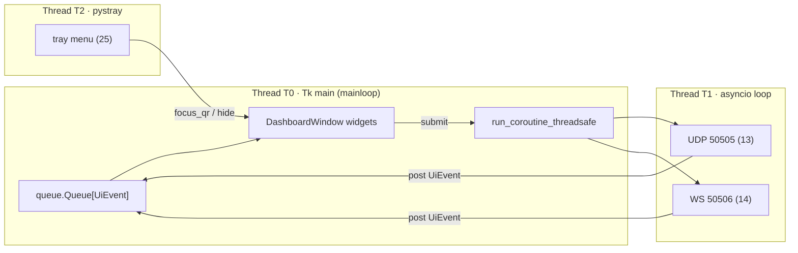

# Doc 24: CustomTkinter Dark Dashboard Window

> Part of PotPilot plan-series · Category E · Session 2 Wave 2.B · PC Agent

## 1. Purpose & Scope

Builds the single desktop control surface for the PotPilot PC agent: a modern dark-mode `CustomTkinter` window that shows the pairing QR code, a live connection status badge, the connected phone's IP, and the watched-movie folder pickers. It also serves as the target of the tray daemon's "Show QR" action and the place where GUI-close is converted into "minimize to tray".

Delivered:
- Dark appearance bootstrap (`appearance_mode="Dark"`, crimson/amber accent hints matching the Flutter palette).
- QR panel that renders the image produced by the Doc 17 generator and refreshes it on IP change / timer.
- Status badge state machine: `STARTING → IDLE → CONNECTED(ip) | ERROR`.
- Watched-folder picker list (add/remove directories) persisted through the Doc 26 config manager and forwarded to the Doc 20 scanner.
- Thread-safe `post()` event queue so the asyncio backend and tray thread can update widgets safely.

Out of scope:
- QR payload field format (owned by [17_pc_qr_connection_payload_gen.md](17_pc_qr_connection_payload_gen.md)).
- Tray menu/icon lifecycle (owned by [25_pc_pystray_background_daemon.md](25_pc_pystray_background_daemon.md)).
- Config file schema/registry writes (owned by [26_pc_config_persistence_manager.md](26_pc_config_persistence_manager.md)).
- Blackout overlay rendering (Doc 12), server internals (Docs 13/14), scanner indexing (Doc 20).

## 2. File Ownership

**Creates (create-only):**
- `pc_agent/gui/dashboard_window.py` — `DashboardWindow` and all widget/model classes below.

**Reads / touches (owned by other docs):**
- `pc_agent/core/config_manager.py` — reads `movie_dirs`, `udp_port`, `ws_port`; writes `movie_dirs` changes ([26](26_pc_config_persistence_manager.md)).
- `pc_agent/core/qr_payload_gen.py` — injected `qr_image_factory` callable; field format owned by [17](17_pc_qr_connection_payload_gen.md).
- `pc_agent/gui/tray_daemon.py` — receives `hide()`/`focus_qr()` calls from the tray ([25](25_pc_pystray_background_daemon.md)).
- `pc_agent/main.py` — wiring injects `submit` (asyncio dispatcher) and pushes `UiEvent`s; owned by Session 3 master wiring.
- `pc_agent/media/library_scanner.py` — notified after folder-list changes ([20](20_pc_local_media_scanner_service.md)).

## 3. Public Contract

```python
UI_POLL_MS: int = 100                 # queue drain interval on the Tk thread

class BadgeState(enum.Enum):
    STARTING = "starting"             # servers binding, no client expected yet
    IDLE = "idle"                     # servers up, no phone connected
    CONNECTED = "connected"           # >=1 authenticated WS client
    ERROR = "error"                   # port bind / fatal backend failure

@dataclass(frozen=True)
class ConnectionInfo:
    state: BadgeState
    device_ip: str | None             # primary connected phone IP, else None
    client_count: int
    detail: str                       # short human message for ERROR/tooltip

@dataclass(frozen=True)
class UiEvent:
    kind: str                         # "connection" | "qr_refresh" | "notice" | "folders"
    connection: ConnectionInfo | None = None
    message: str | None = None

class DashboardWindow:
    def __init__(self, config, qr_image_factory, submit) -> None:
        """config: ConfigManager (26); qr_image_factory: () -> CTkImage (17); submit: (Awaitable) -> concurrent.futures.Future."""
    def run(self) -> None:            # blocks in customtkinter mainloop (Tk thread)
    def post(self, event: UiEvent) -> None:   # thread-safe: enqueue from any thread
    def show(self) -> None:           # deiconify + lift + focus
    def focus_qr(self) -> None:       # "Show QR" tray target: show() and raise QR panel
    def hide(self) -> None:           # withdraw() to tray; mainloop keeps running
    def close(self) -> None:          # destroy() during coordinated Exit
    def set_folders(self, paths: list[str]) -> None:  # refresh picker model + persist
```

Widget-model helpers (same file, package-private but testable): `FolderRowModel`, `render_badge(info: ConnectionInfo) -> BadgeSpec`, `coalesce(pending: UiEvent, incoming: UiEvent) -> UiEvent`.

## 4. Internal Design

1. Startup: `ctk.set_appearance_mode("Dark")`; construct `CTk` root (fixed min size ~960×640), title `PotPilot`.
2. Layout is a 2-column grid: left = QR panel (`CTkLabel` hosting `CTkImage` at 260×260 + host/IP/port caption), right = stacked cards (Status, Watched Folders, Quick Info).
3. Status card renders badge from `ConnectionInfo`: color/state mapping in Section 5 table; shows `device_ip` and `client_count` when `CONNECTED`.
4. Folders card: `CTkScrollableFrame` of rows (path + "Remove"), "Add Folder…" button → `filedialog.askdirectory`; every change calls `config.update(movie_dirs=...)` then invokes the injected rescan callback (wired to Doc 20 scanner).
5. Event pump: a `queue.Queue[UiEvent]` is drained every `UI_POLL_MS` via `root.after`; `connection` events replace any pending connection event (last-write-wins coalescing) so 250 ms telemetry churn never floods Tk.
6. QR refresh policy: refresh on first `show()`, on injected `qr_refresh` events (mDNS/IP change from Doc 16), and every 300 s; factory failures render an inline "No network" placeholder with a Retry button.
7. Close protocol: `WM_DELETE_WINDOW` → if `minimize_to_tray` is true and tray is alive → `hide()`; otherwise show a confirm dialog and exit via the injected shutdown callback.
8. Backend calls from the GUI (folder rescan, manual QR regen) are marshalled with the injected `submit()` (`asyncio.run_coroutine_threadsafe`), never by touching asyncio objects directly.

Layout wireframe (fixed min 960×640, resizable with grid weights):

| Region | Widget | Content |
|---|---|---|
| Header | `CTkFrame` | app title "PotPilot", version label, status badge (right-aligned) |
| Left column | `CTkFrame` | QR panel: `CTkLabel` image (260×260), caption lines host/UDP/WS, "Refresh QR" button |
| Right column top | `CTkFrame` ("Connection" card) | connected device IP, client count, mDNS hostname, detail line |
| Right column bottom | `CTkFrame` ("Watched Folders" card) | scrollable folder rows + "Add Folder…" button |
| Footer | `CTkLabel` | config path hint (`%APPDATA%\PotPilot\config.json`) and "minimizes to tray" note |

UiEvent kinds and payloads:

| `kind` | `connection` | `message` | Emitted by |
|---|---|---|---|
| `connection` | required | — | WS server connect/disconnect, bind failures ([14](14_pc_websocket_server_router.md) via `main.py`) |
| `qr_refresh` | optional | — | mDNS/IP change ([16](16_pc_zeroconf_mdns_broadcaster.md)), manual refresh |
| `notice` | — | transient toast/banner text | config reset (26), scanner rescan started (20) |
| `folders` | — | — | external `movie_dirs` change (rare; keeps picker in sync) |



State machine (badge): `STARTING` → `IDLE` once both sockets report bound; `IDLE ↔ CONNECTED` on WS connect/disconnect with client IP; any bind failure → `ERROR` (window stays usable); `ERROR → STARTING` only via backend restart event.

Threading rules: Tk widgets touched only on T0; `post()` is the sole cross-thread entry; `ConfigManager` is internally locked (Doc 26); the tray thread calls only `show/focus_qr/hide` which internally schedule on T0 via `root.after(0, ...)`.

## 5. Protocol & Data Compliance

QR payload / WS handshake interaction (Doc 24 renders and observes only — it never defines fields):

| Step | Actor | Data | Contract owner |
|---|---|---|---|
| 1 | PC builds payload: LAN IPv4(s), UDP `50505`, WS `50506`, hostname, 128-bit token (hex from config) | QR JSON | [17](17_pc_qr_connection_payload_gen.md) + [26](26_pc_config_persistence_manager.md) |
| 2 | Dashboard renders high-contrast QR image | `CTkImage` | this doc |
| 3 | Phone scans (`mobile_scanner`) and parses | QR JSON | [32](32_flutter_qr_scanner_mdns_pairing.md) |
| 4 | Phone opens WS to `ws_port`, performs token auth handshake | WS envelope `{"id","type","action","payload","timestamp"}` | [03](03_websocket_json_schema_spec.md), [15](15_pc_token_auth_middleware.md) |
| 5 | Server accepts → `UiEvent(kind="connection", CONNECTED, device_ip)` updates badge | — | [14](14_pc_websocket_server_router.md) |
| 6 | Phone UDP datagrams carry Byte 1 = 8-bit XOR checksum of token | 8-byte `<BBhhH>` | [02](02_binary_udp_protocol_spec.md), [15](15_pc_token_auth_middleware.md) |

Badge rendering table:

| `BadgeState` | Fill | Text | Caption |
|---|---|---|---|
| `STARTING` | `#3A3A3E` | `#D6CEC9` | "Starting…" |
| `IDLE` | `#5E1F27` (dim crimson) | `#D6CEC9` | "Waiting for phone" |
| `CONNECTED` | `#6E5016` (dim amber) | `#F0E6DC` | "Connected · {device_ip} · {n} device(s)" |
| `ERROR` | `#A63240` (crimson) | `#FFF3EE` | `detail` text |

Ports/caption values (`udp_port`, `ws_port`) are read from ConfigManager only — defaults frozen at `50505`/`50506` per the wire contract; the GUI displays them but never overrides the socket layer.

## 6. Dependencies & Integration Points

**Internal:** [26_pc_config_persistence_manager.md](26_pc_config_persistence_manager.md) (settings), [17_pc_qr_connection_payload_gen.md](17_pc_qr_connection_payload_gen.md) (QR image factory), [25_pc_pystray_background_daemon.md](25_pc_pystray_background_daemon.md) (hide/show/focus_qr callers), [14_pc_websocket_server_router.md](14_pc_websocket_server_router.md) + [16_pc_zeroconf_mdns_broadcaster.md](16_pc_zeroconf_mdns_broadcaster.md) (connection/IP events via `main.py`), [20_pc_local_media_scanner_service.md](20_pc_local_media_scanner_service.md) (rescan trigger), [12_secondary_monitor_blackout_overlay.md](12_secondary_monitor_blackout_overlay.md) (status line only), [04_pc_agent_boilerplate_deps.md](04_pc_agent_boilerplate_deps.md) (requirements).

**External:** `customtkinter` (≥5.2, pinned in Doc 04) — widgets/themes; `pillow`/`PIL.ImageTk` — QR image → `CTkImage`; stdlib `tkinter.filedialog`, `queue`, `asyncio.run_coroutine_threadsafe`.

**Platform:** Windows DPI awareness set once at process start (`SetProcessDpiAwareness` via ctypes in `main.py` wiring) so the QR stays crisp on 150% scaling.

## 7. Edge Cases & Failure Handling

- `config.json` corrupt/missing → ConfigManager regenerates defaults (Doc 26); dashboard opens with empty folder list and a transient "Settings reset" notice.
- QR factory raises (no LAN IP, Wi-Fi down, PIL error) → placeholder panel + Retry button; auto-retry on next refresh tick.
- Port bind failure → backend posts `ERROR` with detail (e.g., "UDP 50505 unavailable"); folder pickers and config editing keep working.
- Both sockets down and tray unavailable → close button shows confirm dialog before true exit (never silently strand the process).
- Event flood (connect/disconnect flapping) → connection events coalesced last-write-wins per drain tick; badge animates at most 10 Hz.
- Folder removed on disk → row renders dimmed with "missing" tag but stays in `movie_dirs` until the user removes it (preserves hot-plugged drive letters).
- Duplicate folder added → ignored with a notice; paths normalized (`expanduser`/`expandvars`, trailing separator stripped) before persist.
- Tk called from wrong thread → forbidden by construction; debug builds assert `threading.current_thread() is main_thread` inside widget mutators.
- Window closed while `minimize_to_tray=false` and tray icon dead → full exit through injected shutdown callback.
- Laptop lid/dock undock while open → QR regenerates on mDNS/IP event; stale QR never shown after lease change.
- Monitor DPI change (drag between 100%/150% monitors) → `ctk` rescales on `WM_DPICHANGED`; QR re-renders at new scale on next refresh.
- First run before any pairing → badge stays `IDLE` with "Waiting for phone"; QR is the only actionable affordance (no empty-state error).

## 8. Acceptance Criteria

- [ ] Window opens in dark mode with no white flashes; background matches `#1E1E1E`-family CustomTkinter dark palette (not OS-forced light).
- [ ] QR panel renders a scannable image; scanning with the Flutter app (Doc 32) pairs within one shot and badge flips to `CONNECTED` showing the phone's IP.
- [ ] IP refresh event (lease change) regenerates QR without reopening the window.
- [ ] Badge states transition per Section 4 table; `ERROR` appears when 50505 is occupied by another process.
- [ ] Add/remove folder persists to `%APPDATA%\PotPilot\config.json` → `movie_dirs` and triggers a scanner rescan; values are unique and normalized.
- [ ] Closing the window hides it (tray keeps running) when `minimize_to_tray` is true; tray "Show QR" restores and focuses the QR panel.
- [ ] `post()` called from the asyncio thread never raises `RuntimeError: main thread is not in main loop`.
- [ ] No widget mutation occurs outside the Tk thread (verified by debug assertion test).

## 9. Test Plan

Unit tests (headless; no real Tk root — model layer only):
- `pc_agent/tests/gui/test_dashboard_events.py` — `post()` enqueues; drain dispatches to correct handlers; connection events coalesce last-write-wins; unknown `kind` ignored with warning.
- `pc_agent/tests/gui/test_badge_render.py` — each `BadgeState` maps to the exact fill/text colors in Section 5; `CONNECTED` caption includes IP and count; `ERROR` shows `detail`.
- `pc_agent/tests/gui/test_folder_picker_model.py` — add/remove/dedupe/normalization; persist calls `ConfigManager.update(movie_dirs=...)` exactly once per change; missing-path flag set correctly.

Manual verification (automation impractical):
1. Run `python main.py` with a real phone on LAN → pair via QR, confirm badge + IP, kill phone Wi-Fi → badge returns to `IDLE` within 2 s.
2. Occupy port 50505 (`powershell` listener), start agent → `ERROR` badge, GUI responsive.
3. Close window → process alive with tray icon; "Show QR" restores window at QR panel.
4. Add a folder containing `.mkv` files → appears in Doc 45 movie browser after rescan.
5. Minimize via taskbar vs close button → close hides to tray; minimize leaves normal taskbar behavior (both paths exercised).
6. `python -m pytest pc_agent/tests/gui` green; Windows at 150% DPI: QR scans first try.

## 10. Assumptions & Open Questions

- Assumed a `queue.Queue` + `root.after(100)` pump (rather than threading into Tk) as the canonical GUI↔asyncio bridge; Doc 25 must reuse the same thread model.
- Assumed `minimize_to_tray` config key (default `true`) exists in Doc 26; confirmed as an extra key there.
- Assumed QR auto-refresh interval of 300 s plus event-driven refresh; exact interval not dictated by the overview.
- Assumed window chrome colors stay with CustomTkinter's dark theme; accent tinting uses the Doc 29 crimson/amber hexes for visual consistency (cosmetic only).
- Open: should the Status card surface mDNS service health (Doc 16) as a separate chip? Deferred — badge detail string can carry it later.
