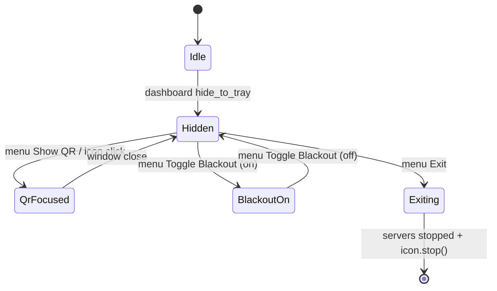

# Doc 25: pystray System-Tray Background Daemon

> Part of PotPilot plan-series · Category E · Session 2 Wave 2.B · PC Agent

## 1. Purpose & Scope

Integrates `pystray` so that closing (or minimizing) the CustomTkinter dashboard does not kill the PotPilot agent: the process retreats to the Windows System Tray with a persistent icon and quick actions — **"Show QR"**, **"Toggle Blackout"**, **"Run on Startup"** (checkable), and **"Exit"**. The tray is the process-lifetime anchor: sockets, mDNS, and telemetry keep running while the GUI is hidden.

Delivered:
- `TrayDaemon` running the pystray icon on its own daemon thread with a lazy-rebuilt menu.
- Callback wiring for the four menu actions (blackout/startup/QR/exit cross into other modules via injected callables — no logic duplication).
- Connection-aware icon title/tooltip and best-effort balloon notifications ("Connected · 192.168.1.24").
- Graceful, time-boxed exit sequence coordinated with `main.py`.

Out of scope:
- QR generation/rendering (reuses [17](17_pc_qr_connection_payload_gen.md) through [24](24_pc_customtkinter_dashboard_ui.md)'s `focus_qr()`).
- Blackout overlay implementation (owned by [12](12_secondary_monitor_blackout_overlay.md)); tray only triggers it.
- Registry mechanics (owned by [26](26_pc_config_persistence_manager.md)); tray only toggles the setting.
- Packaging of icon assets (owned by [27](27_pc_pyinstaller_build_spec.md)).

## 2. File Ownership

**Creates (create-only):**
- `pc_agent/gui/tray_daemon.py` — `TrayDaemon`, `TrayState`, `build_menu_spec()`.

**Reads / touches (owned by other docs):**
- `pc_agent/gui/dashboard_window.py` — calls `show()`, `focus_qr()`, `hide()`, `close()` ([24](24_pc_customtkinter_dashboard_ui.md)).
- `pc_agent/core/config_manager.py` — reads/writes `run_on_startup`, reads `minimize_to_tray` ([26](26_pc_config_persistence_manager.md)).
- `pc_agent/display_power/blackout_overlay.py` — toggle target via injected callable ([12](12_secondary_monitor_blackout_overlay.md)).
- `pc_agent/main.py` — constructs `TrayDaemon` with injected callbacks, owns the shutdown coordinator (Session 3 wiring).
- `pc_agent/installer/potpilot_agent.spec` — icon asset bundled as a runtime data file ([27](27_pc_pyinstaller_build_spec.md)).

## 3. Public Contract

```python
TRAY_ICON_TITLE: str = "PotPilot"          # Shell tooltip base
STARTUP_MENU_LABEL: str = "Run on Startup"

@dataclass(frozen=True)
class TrayActions:
    show_qr: Callable[[], None]            # raise dashboard QR panel (main wraps with root.after)
    toggle_blackout: Callable[[], bool]    # flips Doc 12 overlay; returns new active state
    toggle_startup: Callable[[], bool]     # flips HKCU Run entry via ConfigManager; returns new state
    exit_app: Callable[[], None]           # requests coordinated shutdown (main.py)

class TrayDaemon:
    def __init__(self, config, actions: TrayActions, icon_factory: Callable[[], "PIL.Image.Image"]) -> None:
        """config: ConfigManager (26); icon_factory: 32x32 tray icon, fallback glyph if asset missing."""
    def start(self) -> None:               # spawn daemon thread running icon.run() (blocking loop)
    def stop(self, timeout_s: float = 3.0) -> None:  # icon.stop() + join; safe to call twice
    def set_connection(self, connected: bool, device_ip: str | None) -> None:  # update tooltip/title (thread-safe)
    def notify(self, title: str, message: str) -> None:  # balloon notification, best-effort, no-op on failure
    @property
    def alive(self) -> bool                # True while the icon thread runs (24 uses it for close-decision)

def build_menu_spec(state: TrayState) -> list[TrayMenuEntry]:  # pure planner: labels, checkable flags, separators
def fallback_icon(size: int = 32) -> "PIL.Image.Image":  # PIL-drawn crimson rounded square with "P" glyph
```

`TrayMenuEntry` (frozen dataclass): `label: str`, `action_id: str | None` (`"show_qr" | "blackout" | "startup" | "exit"`), `checked: Callable[[], bool] | None`, `enabled: Callable[[], bool] | None`, `is_separator: bool`.

## 4. Internal Design

1. `start()` creates a daemon thread `T2` that calls `icon.run()`; on Windows pystray needs its own message pump, so T2 owns a hidden message-window — never the Tk thread.
2. Menu is declared with **lazy callables**: `checked=lambda: self._state.startup_enabled`, so the shell repaints correct check marks after each toggle without rebuilding the `Menu` object.
3. `TrayState` is a small mutable holder guarded by `threading.Lock`; `set_connection`/toggle callbacks write it; pystray menu lambdas read it.
4. Menu action dispatch (arrives on T2):
   - **Show QR** → `actions.show_qr()` → dashboard `focus_qr()` scheduled on Tk thread.
   - **Toggle Blackout** → `actions.toggle_blackout()` → Doc 12 overlay toggle; state mirrored into `TrayState.blackout_active` and a balloon confirms.
   - **Run on Startup** → `actions.toggle_startup()` → ConfigManager syncs `HKCU\...\Run\PotPilot`; on `StartupRegistrationError` the check mark reverts and an error balloon is shown.
   - **Exit** → `actions.exit_app()` → main's shutdown coordinator: stop UDP/WS/mDNS/telemetry (Docs 13/14/16/18), `dashboard.close()`, then `icon.stop()`; watchdog forces `os._exit(0)` after 5 s if a thread hangs.
5. Left-click / double-click activation on the icon is bound to the same `show_qr` path (bedroom convenience).
6. First minimize-to-tray triggers one balloon: "PotPilot is still running — use the tray icon"; guarded by a `minimize_to_tray` config read so silent-startup users are not nagged.

Menu tree (exact order rendered by `Menu(...)`):

```
Show QR
Toggle Blackout            (checked ← TrayState.blackout_active)
────────────────────
Run on Startup             (checked ← config.run_on_startup)
────────────────────
Exit
```

Shutdown sequence (coordinated by `main.py`, executed T0/T1/T2 together):

| Phase | Owner | Action | Deadline |
|---|---|---|---|
| 1 Request | T2 | `exit_app()` → set `exiting` flag, disable menu items | immediate |
| 2 Stop net | T1 | cancel WS/UDP/mDNS/telemetry tasks, close sockets (13/14/16/18) | ≤ 2 s |
| 3 Stop GUI | T0 | `dashboard.close()` → `root.destroy()` (kills Tk overlays from Doc 12 too) | ≤ 1 s |
| 4 Stop tray | T2 | `icon.stop()` → message pump exits, icon removed from tray | ≤ 1 s |
| 5 Watchdog | any | `os._exit(0)` if process still alive at t=5 s | 5 s hard cap |



Threading model (shared with Doc 24 — single canonical model): `T0` = Tk mainloop, `T1` = asyncio loop thread, `T2` = pystray message pump. T2 may call only the injected action callables and `TrayDaemon`-internal state; anything touching Tk must hop via the dashboard's scheduling; anything touching asyncio must go through `submit()` (`run_coroutine_threadsafe`) wrapped by `main.py` inside the action lambdas.

## 5. Protocol & Data Compliance

Menu → target mapping (no wire traffic is invented by the tray):

| Menu item | Checked source | Invokes | Wire/OS effect | Contract owner |
|---|---|---|---|---|
| Show QR | — | `dashboard.focus_qr()` | re-render QR of LAN IPv4 + UDP `50505` + WS `50506` + token (QR JSON format frozen in Doc 17) | [17](17_pc_qr_connection_payload_gen.md) |
| Toggle Blackout | `TrayState.blackout_active` | Doc 12 overlay toggle | local Tk overlay windows on non-primary monitors; phone-side equivalent is WS `CMD_SYSTEM` / `SET_BLACKOUT {enabled}` (envelope frozen in Doc 03 §5.5) | [12](12_secondary_monitor_blackout_overlay.md), [03](03_websocket_json_schema_spec.md) |
| Run on Startup | `config.run_on_startup` | `ConfigManager.set_startup_enabled()` | `HKCU\Software\Microsoft\Windows\CurrentVersion\Run\PotPilot` = `"<exe>" --minimized` (REG_SZ) | [26](26_pc_config_persistence_manager.md) |
| Exit | — | shutdown coordinator | stops listeners on `50505/50506`, mDNS `_potpilot._tcp.local.`, exits ≤ 5 s | [13](13_pc_asyncio_udp_receiver.md), [14](14_pc_websocket_server_router.md), [16](16_pc_zeroconf_mdns_broadcaster.md) |

Connection awareness: `set_connection(True, "192.168.1.24")` sets the Shell tooltip to `PotPilot · 192.168.1.24` and optionally swaps the icon badge (crimson dot when idle, amber dot when connected) — colors aligned with Doc 29 accents but owned here as 32×32 PIL pixels.

## 6. Dependencies & Integration Points

**Internal:** [24_pc_customtkinter_dashboard_ui.md](24_pc_customtkinter_dashboard_ui.md) (`focus_qr`/`hide`/`close`), [26_pc_config_persistence_manager.md](26_pc_config_persistence_manager.md) (`run_on_startup`, `minimize_to_tray`, `StartupRegistrationError`), [12_secondary_monitor_blackout_overlay.md](12_secondary_monitor_blackout_overlay.md) (toggle callable), [17_pc_qr_connection_payload_gen.md](17_pc_qr_connection_payload_gen.md) (indirect via dashboard), [04_pc_agent_boilerplate_deps.md](04_pc_agent_boilerplate_deps.md) (`pystray` in requirements), [27_pc_pyinstaller_build_spec.md](27_pc_pyinstaller_build_spec.md) (bundles `pystray._win32` + icon assets).

**External:** `pystray` (≈0.19, pinned in Doc 04) — `Icon`, `Menu`, `MenuItem`; `pillow` — icon image construction; stdlib `threading`.

**Platform APIs:** Explorer tray (`Shell_NotifyIcon` behind pystray), Windows balloon notifications (`NotifyIcon` balloons via pystray `notify`), startup registry key via ConfigManager (not touched directly here).

## 7. Edge Cases & Failure Handling

- pystray backend unavailable / `Icon.run()` raises → log warning, set `alive=False`; agent continues windowed-only; Doc 24 close-button then confirms true exit.
- Icon asset missing (dev run, partial install) → `fallback_icon()` PIL glyph; never crash on missing file.
- Balloon unsupported or suppressed by Focus Assist → `notify()` swallows errors (best-effort semantics).
- "Run on Startup" denied (group policy/registry locked) → `StartupRegistrationError` caught on T2: check mark reverts, error balloon "Could not update startup entry", no crash.
- Rapid double-clicks on Toggle Blackout/Startup → 300 ms debounce inside `TrayDaemon` dispatch; extra clicks dropped.
- Exit clicked while blackout overlays visible → overlays are Tk windows of the same process; shutdown coordinator destroys the Tk root first (Docs 12/24), so no orphan all-black windows remain.
- Phone disconnects while hidden → tooltip resets to `PotPilot`; no balloon spam (state change only).
- `stop()` called twice or before `start()` → idempotent no-op.
- Hung thread at Exit → 5 s watchdog calls `os._exit(0)`; process never lingers in Task Manager.
- Explorer restart (shell crash) → pystray re-registers the icon on Windows ≥ 10; if not, `alive` probe at next `set_connection` restarts the icon thread once.
- User toggles Run on Startup from the dashboard ([24](24_pc_customtkinter_dashboard_ui.md)) while tray menu open → `TrayState` refreshed on next menu open; pystray re-queries `checked` lazily so no stale check mark.
- Multiple tray instances (user double-launched exe) → second instance detects single-instance guard in `main.py` and exits (guard owned by Session 3 wiring; assumption §10).
- 4K display icon scaling → icon provided at 32×32; Explorer down-scales; fallback glyph drawn at 32 natively.

## 8. Acceptance Criteria

- [ ] Closing the dashboard leaves `PotPilotAgent` running with a tray icon; UDP 50505 and WS 50506 still answer (verified with Doc 46 probe).
- [ ] "Show QR" raises the dashboard with the QR panel focused (< 300 ms).
- [ ] "Toggle Blackout" flips secondary-monitor overlays and shows correct balloon/state.
- [ ] "Run on Startup" check mark mirrors `HKCU\...\Run\PotPilot`; reboot (or `explorer` logon) auto-starts the agent minimized.
- [ ] "Exit" terminates the process in ≤ 5 s with sockets released (port reusable immediately).
- [ ] Tooltip shows connected phone IP while paired, base title otherwise.
- [ ] Icon thread is a daemon and never blocks the Tk or asyncio threads.
- [ ] Menu renders in the exact order of the tree above; check marks reflect live config/tray state without restarting.
- [ ] Balloon on first tray-minimize appears once per session (not on every hide/show cycle).
- [ ] No pystray/Tk interop crashes during 1-hour soak with connect/disconnect churn.

## 9. Test Plan

Unit tests (no real shell required):
- `pc_agent/tests/gui/test_tray_menu_spec.py` — `build_menu_spec()` yields exactly the four actions + one separator, correct labels/order, `Run on Startup` marked checkable.
- `pc_agent/tests/gui/test_tray_state.py` — toggle reducers update `startup_enabled`/`blackout_active` atomically; debounce drops clicks inside 300 ms window; connection updates rewrite tooltip text.
- `pc_agent/tests/gui/test_tray_daemon_lifecycle.py` — with a stubbed `pystray.Icon`: `start()` spawns one thread, `stop()` joins it, double `stop()` safe, `alive` transitions correct, action lambdas fire exactly once per click.

Manual verification (tray/Explorer behavior is not automatable headlessly):
1. Start agent → icon appears; hover tooltip; left-click → dashboard QR panel.
2. Close dashboard → balloon "still running"; phone still controls PotPlayer (send Play/Pause from Doc 36 UI).
3. Toggle Blackout on/off with two monitors → overlays follow.
4. Enable Run on Startup → verify `reg query HKCU\...\Run`; sign out/in → agent auto-starts hidden.
5. Exit → process gone within 5 s (`tasklist` check); restart cleanly.
6. Restart `explorer.exe` (kill + relaunch) → icon returns without agent restart.
7. Open the menu while a phone is connected → tooltip/labels show the live IP/state.

## 10. Assumptions & Open Questions

- Assumed pystray's Windows backend is used (single-OS product); `Icon.run()` on a daemon thread is the supported pattern — no GTK/macOS branches.
- Assumed the `--minimized` CLI flag is honored by `main.py` (Session 3 wiring) so startup launches straight to tray.
- Assumed balloon notifications are acceptable UX and never carry secrets (no token in any balloon/tooltip).
- Assumed a single-instance guard lives in `main.py` (Session 3 wiring); `TrayDaemon` does not enforce it itself.
- Assumed the icon asset path is provided by Doc 27 bundling; a PIL fallback covers dev runs.
- Open: whether the tray icon should expose a "Rescan Library" item in a future revision — intentionally excluded to keep the four-action menu frozen for v1.
