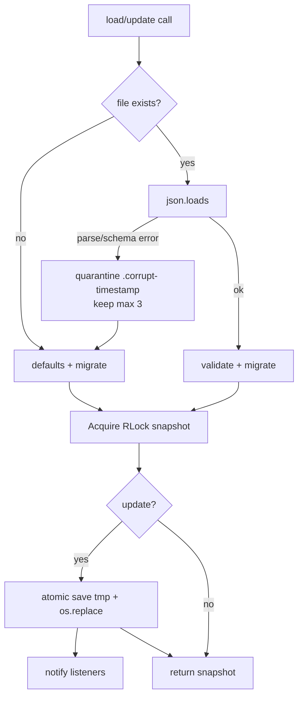

# Doc 26: PC Config Persistence Manager

> Part of PotPilot plan-series · Category E · Session 1 Wave 1.A · PC Agent

## 1. Purpose & Scope

Owns every user-editable setting of the PC agent and persists them in `%APPDATA%\PotPilot\config.json`: UDP/WS ports, the 128-bit pairing token, watched movie directories, the minimize-to-tray preference, and the mirrored "Run on Startup" flag whose physical truth is the registry value `HKCU\Software\Microsoft\Windows\CurrentVersion\Run\PotPilot`. It is the **single source of truth** for ports/token/dirs — all other modules read settings through it, never by parsing JSON themselves.

Delivered:
- Thread-safe `ConfigManager` singleton with atomic writes, schema versioning, validation/clamping, and corrupt-file recovery.
- Create-once auth-token storage hook (generation algorithm itself belongs to Doc 15).
- Registry sync for the startup flag (`winreg`, per-user, no admin rights).

Out of scope:
- Token generation/XOR logic ([15](15_pc_token_auth_middleware.md)); QR payload format ([17](17_pc_qr_connection_payload_gen.md)); any UI ([24](24_pc_customtkinter_dashboard_ui.md)/[25](25_pc_pystray_background_daemon.md)); installer-time seeding ([28](28_pc_innosetup_installer_script.md)); settings display.

## 2. File Ownership

**Creates (create-only):**
- `pc_agent/core/config_manager.py` — `AppConfig`, `ConfigManager`, `ConfigError`, `StartupRegistrationError`.

**Reads / touches (owned by other docs):**
- `%APPDATA%\PotPilot\config.json` (and `.tmp`/`.corrupt-*` siblings) — data file owned by this doc.
- Registry key `HKCU\Software\Microsoft\Windows\CurrentVersion\Run`, value `PotPilot` — written/deleted only by this doc.
- Consumers (read-only through the public API): [13](13_pc_asyncio_udp_receiver.md)/[14](14_pc_websocket_server_router.md) (ports), [15](15_pc_token_auth_middleware.md) (token), [16](16_pc_zeroconf_mdns_broadcaster.md) (hostname/ports), [17](17_pc_qr_connection_payload_gen.md) (all), [20](20_pc_local_media_scanner_service.md) (`movie_dirs`), [24](24_pc_customtkinter_dashboard_ui.md)/[25](25_pc_pystray_background_daemon.md) (GUI flags), [27](27_pc_pyinstaller_build_spec.md)/[28](28_pc_innosetup_installer_script.md) (runtime path expectations).

## 3. Public Contract

```python
CONFIG_DIR_NAME: str = "PotPilot"          # %APPDATA%\PotPilot\
CONFIG_FILE_NAME: str = "config.json"
CURRENT_SCHEMA_VERSION: int = 1
RUN_REGISTRY_KEY: str = r"Software\Microsoft\Windows\CurrentVersion\Run"
RUN_VALUE_NAME: str = "PotPilot"

class ConfigError(Exception): ...               # invalid/unreadable config surface
class StartupRegistrationError(Exception): ...  # registry write/delete denied

@dataclass
class AppConfig:
    schema_version: int
    udp_port: int                    # default 50505 (frozen wire contract)
    ws_port: int                     # default 50506 (frozen wire contract)
    auth_token: str                  # 32 lowercase hex chars = 128-bit pairing token
    movie_dirs: list[str]            # absolute, unique, order preserved
    run_on_startup: bool             # intent flag; mirrored to HKCU Run value
    minimize_to_tray: bool           # close-button behavior (Docs 24/25)

class ConfigManager:
    @classmethod
    def instance(cls) -> "ConfigManager": ...   # process-wide singleton (lazy)
    def config_path(self) -> Path: ...          # %APPDATA%\PotPilot\config.json
    def load(self) -> AppConfig: ...            # read-or-create defaults; validates + migrates
    def save(self) -> None: ...                 # atomic write of current snapshot
    def get(self) -> AppConfig: ...             # thread-safe snapshot copy (frozen semantics)
    def update(self, **changes: Any) -> AppConfig: ...  # validate, persist, notify listeners
    def subscribe(self, callback: Callable[[AppConfig], None]) -> None: ...  # same-thread change hook
    def ensure_auth_token(self, generator: Callable[[], str]) -> str:
        """Return stored token, else call generator() once, persist, and return it (generator owned by Doc 15)."""
    def is_startup_enabled(self) -> bool: ...   # ground truth: presence of HKCU Run value "PotPilot"
    def set_startup_enabled(self, enabled: bool, exe_path: Path) -> None:
        """Write/delete HKCU Run value `PotPilot` = `"<exe>" --minimized`, then persist run_on_startup; raises StartupRegistrationError on OSError."""
    def resync_startup(self) -> None:
        """Best-effort boot pass: if run_on_startup is true but the HKCU Run value is missing, rewrite it (no-op otherwise)."""
```

## 4. Internal Design

1. **Path resolution:** `Path(os.environ["APPDATA"]) / "PotPilot" / "config.json"`; missing `APPDATA` (rare service context) falls back to `Path.home() / "AppData/Roaming/PotPilot"`. Directory created with `mkdir(parents=True, exist_ok=True)` on first save.
2. **Load:** if file absent → `AppConfig()` defaults (no write until first `save`/`update`). If present → `json.loads`; on `JSONDecodeError`/`KeyError`/`TypeError` → move original to `config.json.corrupt-<YYYYmmdd-HHMMSS>` (keep at most 3 backups, prune older) and fall back to defaults with a logged warning.
3. **Migration:** `schema_version` older than `CURRENT_SCHEMA_VERSION` runs ordered migration hooks `v1→v2…` (none yet); newer-than-known versions are accepted read-only with a warning (forward-compatible keys preserved on save via a raw `extra` dict).
4. **Validation** (applied to defaults, loaded data, and `update()`): ports clamped to `1024–65535`, must differ; `auth_token` must match `^[0-9a-f]{32}$` else treated as absent (regenerated on next `ensure_auth_token`); `movie_dirs` entries expanded (`expanduser`/`expandvars`), made absolute, deduped case-insensitively, empty strings dropped; bools coerced with `bool()` semantics rejected for non-bool types (raise `ConfigError`).
5. **Atomic save:** serialize pretty JSON (2-space, sorted keys, trailing newline) to `config.json.tmp` in the same directory, `flush()` + `os.fsync()`, then `os.replace(tmp, path)` — readers never observe partial files.
6. **Concurrency:** one `threading.RLock` guards load/save/update/registry-sync; `get()` returns a deep copy so callers cannot mutate shared state; `update()` fires listeners synchronously on the calling thread after persistence succeeds.
7. **Startup registry sync:** `is_startup_enabled()` = value exists (`winreg.QueryValueEx`, miss → False). `set_startup_enabled(True, exe)` → `winreg.CreateKeyEx(HKCU, RUN_REGISTRY_KEY)` + `SetValueEx(Run_Value_Name, 0, REG_SZ, f'"{exe}" --minimized')`; `False` → `DeleteValue` ignoring `FileNotFoundError`. Any other `OSError` → raise `StartupRegistrationError` and roll the in-memory `run_on_startup` back to the registry's actual state. The `run_on_startup` JSON field mirrors the registry but the registry is ground truth on conflict.
8. **Bootstrap order in `main.py`:** `ConfigManager.instance().load()` runs first, then `ensure_auth_token(...)` (Doc 15 generator), then socket servers bind to the validated ports — no module may read the JSON file before this point.

Representative on-disk shape (illustrative; this doc never writes these literal token bytes):

```json
{
  "auth_token": "<32-hex, generated once by Doc 15>",
  "movie_dirs": ["D:\\Movies", "E:\\Series"],
  "minimize_to_tray": true,
  "run_on_startup": false,
  "schema_version": 1,
  "udp_port": 50505,
  "ws_port": 50506
}
```



## 5. Protocol & Data Compliance

`config.json` field table (exact schema v1):

| Key | Type | Default | Validation | Frozen-contract role |
|---|---|---|---|---|
| `schema_version` | int | `1` | `>= 1` | migration dispatch |
| `udp_port` | int | `50505` | 1024–65535, ≠ `ws_port` | UDP binary channel port (overview §4.1); Doc 17 embeds the effective value in the QR payload |
| `ws_port` | int | `50506` | 1024–65535, ≠ `udp_port` | WebSocket envelope port (overview §4.2); embedded in QR payload |
| `auth_token` | str | `""` | `^[0-9a-f]{32}$` or empty | 128-bit pairing token; feeds UDP Byte-1 XOR checksum and WS handshake (Docs 15/17) |
| `movie_dirs` | list[str] | `[]` | unique absolute paths | watched folders for Doc 20 scanner |
| `run_on_startup` | bool | `false` | strict bool | mirrors HKCU Run value (see below) |
| `minimize_to_tray` | bool | `true` | strict bool | close-behavior for Docs 24/25 |

Startup registry binding:

| Aspect | Value |
|---|---|
| Hive | `HKEY_CURRENT_USER` |
| Key | `Software\Microsoft\Windows\CurrentVersion\Run` |
| Value name | `PotPilot` (REG_SZ) |
| Data | `"<absolute PotPilotAgent.exe path>" --minimized` (quoted path, space-safe) |
| Sync rule | `set_startup_enabled()` writes registry first, then persists `run_on_startup`; mismatch at boot resolved in favor of registry |

Telemetry cadence (`250 ms`), mDNS service type (`_potpilot._tcp.local.`), and the envelope schema stay **code constants** in their owning modules (Docs 10/16/18, 03) — deliberately not configurable here to prevent wire-contract drift.

## 6. Dependencies & Integration Points

**Internal:** [15_pc_token_auth_middleware.md](15_pc_token_auth_middleware.md) (provides `generator` to `ensure_auth_token`), [17_pc_qr_connection_payload_gen.md](17_pc_qr_connection_payload_gen.md) (reads ports/token), [13_pc_asyncio_udp_receiver.md](13_pc_asyncio_udp_receiver.md) / [14_pc_websocket_server_router.md](14_pc_websocket_server_router.md) (bind ports), [20_pc_local_media_scanner_service.md](20_pc_local_media_scanner_service.md) (`movie_dirs`), [25_pc_pystray_background_daemon.md](25_pc_pystray_background_daemon.md) (startup toggle), [24_pc_customtkinter_dashboard_ui.md](24_pc_customtkinter_dashboard_ui.md) (folder edits), [27_pc_pyinstaller_build_spec.md](27_pc_pyinstaller_build_spec.md) / [28_pc_innosetup_installer_script.md](28_pc_innosetup_installer_script.md) (config lives in `%APPDATA%`, outside `{app}`, so uninstall keeps user data), [04_pc_agent_boilerplate_deps.md](04_pc_agent_boilerplate_deps.md).

**External:** Python 3.11+ stdlib only — `json`, `os`, `pathlib`, `threading`, `re`, `dataclasses`, `winreg` (Windows-only; imported lazily so unit tests can monkeypatch).

**Platform:** NTUSER registry hive (per-user, no elevation); `%APPDATA%` roaming profile.

## 7. Edge Cases & Failure Handling

- `config.json` corrupt (truncated/garbage) → quarantined to `.corrupt-<ts>`, defaults loaded, warning logged; agent still boots and can pair.
- Unknown extra JSON keys → preserved in an `extra` dict and re-serialized (forward compatibility).
- `config.json` newer `schema_version` → load best-effort, do not downgrade the file, log warning.
- Token invalid format (hand-edited) → treated as absent; next `ensure_auth_token` generates a fresh one and the old phone must re-pair (QR regenerates).
- Ports equal or out of range → clamped/rejected with `ConfigError` on explicit `update`; defaults never collide.
- Concurrent `update()` from GUI + asyncio threads → RLock serializes; last write wins; file always valid JSON.
- Crash mid-save → `os.replace` atomicity leaves the previous good file intact; stale `.tmp` overwritten next save.
- `%APPDATA%` unwritable (policy) → `ConfigError` at first save; caller (main) shows tray/GUI error and continues in-memory-only for the session.
- Two ConfigManager instances created by mistake → prevented: `instance()` is the only supported constructor; direct `__init__` discouraged by convention + docstring.
- Token regenerated while a phone is mid-handshake → the in-flight WS handshake fails auth (Doc 15) and the phone rescans the refreshed QR; no partial session is left.
- Movie dir on a disconnected network drive → path kept in config; Doc 20 scanner reports it unindexable rather than dropping it here.
- JSON containing a port as a string ("50505") → coerced via `int()` with validation; non-numeric raises `ConfigError`.
- Huge/absurd `movie_dirs` list (hundreds) → persisted as-is (no cap); UI/scroll handles volume, scanner owns performance.
- Registry write denied (locked policy) → `StartupRegistrationError`; in-memory flag rolled back; Docs 24/25 surface a notice.
- Registry value deleted externally while `run_on_startup=true` → next `is_startup_enabled()` reports False; a `resync_startup()` startup pass rewrites it once (assumption in Section 10).
- `APPDATA` missing → Roaming fallback path used; path exposed via `config_path()` for diagnostics.

## 8. Acceptance Criteria

- [ ] Fresh run creates no file until first mutation; first `update()` produces valid, pretty-printed `config.json` at `%APPDATA%\PotPilot\config.json`.
- [ ] Defaults contain exactly the keys in Section 5 with values `50505`, `50506`, `""`, `[]`, `false`, `true`, `schema_version=1`.
- [ ] Corrupt file → `.corrupt-*` backup exists (≤ 3 retained), defaults active, process does not crash.
- [ ] `auth_token` round-trips: `ensure_auth_token` generates once, persists, and returns the same value on subsequent calls.
- [ ] `set_startup_enabled(True, exe)` creates `HKCU\...\Run\PotPilot` REG_SZ with quoted path + `--minimized`; `False` removes it; both visible via `reg query`.
- [ ] Atomicity: killing the process mid-write never leaves a truncated `config.json` (tmp + replace).
- [ ] 8 concurrent threads calling `update()` → final file parses and contains one of the written snapshots.
- [ ] Only this module references `winreg` / writes `config.json` (grep-enforced in review).
- [ ] `main.py` bootstrap reads config before any socket binds; ports used by Docs 13/14 match the validated values.
- [ ] After `set_startup_enabled(True, ...)`, `reg query HKCU\Software\Microsoft\Windows\CurrentVersion\Run /v PotPilot` shows the quoted path + `--minimized`.

## 9. Test Plan

Unit tests (run on Windows; `winreg` monkeypatched where needed):
- `pc_agent/tests/core/test_config_defaults.py` — missing file → defaults; `config_path()` ends `PotPilot\config.json`; no file created on read-only `load()`.
- `pc_agent/tests/core/test_config_corrupt_recovery.py` — garbage bytes → quarantine backup created, defaults returned, backup count pruned to 3.
- `pc_agent/tests/core/test_config_validation.py` — port clamps (99/70000), equal-port rejection, token regex, movie dir normalization/dedup, strict bool checks.
- `pc_agent/tests/core/test_config_atomic_save.py` — save produces sorted pretty JSON + trailing newline; simulated failure before `os.replace` leaves original intact.
- `pc_agent/tests/core/test_config_token_hook.py` — `ensure_auth_token` calls generator exactly once across threads; stored token reused thereafter.
- `pc_agent/tests/core/test_startup_registry.py` — with a fake `winreg` module: create/delete value, quoted-data format, `StartupRegistrationError` on `OSError`, rollback of `run_on_startup`.
- `pc_agent/tests/core/test_config_threads.py` — concurrent `update()`/`get()` stress: file always parses, no exceptions.

Manual verification: edit token by hand → agent regenerates and QR changes; lock `%APPDATA%\PotPilot` with another process → error surfaces in dashboard without crashing sockets.

## 10. Assumptions & Open Questions

- Assumed the extra keys `minimize_to_tray` (Docs 24/25) and `schema_version` beyond the overview's ports/token/dirs/startup list; recorded here as deliberate extensions.
- Assumed startup value data includes `--minimized`; `main.py` (Session 3 wiring) must accept the flag.
- Assumed token **generation** stays in Doc 15; this manager only enforces format and storage, avoiding two generators.
- Assumed quarantine-prune count of 3 and pretty-printed JSON for human debugging.
- Assumed a best-effort `resync_startup()` on boot (rewrite HKCU Run if flag true but value missing); not a roadmap requirement — can be dropped.
- Open: whether a Settings-Export/import feature (copy `config.json` between machines) is desired post-v1 — intentionally out of scope.
