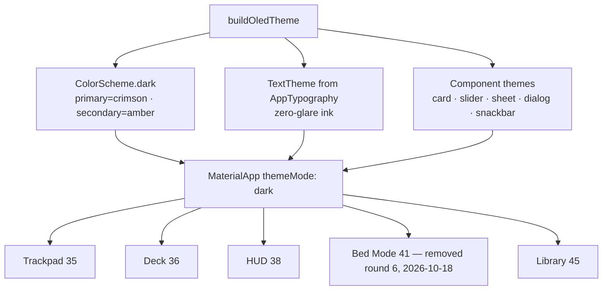

# Doc 29: Flutter OLED Theme & Design System

> Part of PotPilot plan-series · Category F · Session 1 Wave 1.A · Flutter App

## 1. Purpose & Scope

Implements the single dark-only Material 3 theme powering the entire bedroom remote: a pure `#000000` AMOLED scaffold background, a dim crimson/amber night-vision accent palette, and zero-glare typography tokens (no pure-white text, no high-luminance fills). Every Flutter screen (Docs 35–45) consumes these tokens instead of hardcoding colors, so the whole app stays pitch-black, glare-free, and consistent.

Delivered:
- `AppColors` (exact hex tokens), `AppTypography` (text styles), `buildOledTheme()` returning a complete `ThemeData`.
- Semantic aliasing (accent = amber for active/playback, crimson for record/error/dangerous).
- System UI chrome styling (black status/navigation bars) and zero-shadow surface rules.

Out of scope:
- Screen layouts/components ([35](35_flutter_120hz_virtual_trackpad.md)–[45](45_flutter_in_app_movie_library_browser.md)); light theme (product is dark-only); font asset licensing (system fonts only in v1); haptic patterns ([42](42_flutter_haptic_feedback_engine.md)).

## 2. File Ownership

**Creates (create-only):**
- `mobile_app/lib/core/theme/oled_theme.dart` — `AppColors`, `AppTypography`, `AppMotion` (durations), `buildOledTheme()`.

**Reads / touches (owned by other docs):**
- `mobile_app/pubspec.yaml` — no new deps; theme uses bundled `material.dart` ([05](05_flutter_app_boilerplate_deps.md)).
- `mobile_app/lib/main.dart` — wires `MaterialApp(theme: buildOledTheme(), themeMode: ThemeMode.dark)` (Session 3 master shell).
- Consumers importing tokens: [33](33_flutter_telemetry_state_provider.md), [35](35_flutter_120hz_virtual_trackpad.md), [36](36_flutter_custom_potplayer_deck_ui.md), [38](38_flutter_live_scrub_bar_speed_hud.md), [41](41_flutter_blind_bed_mode_gestures.md), [45](45_flutter_in_app_movie_library_browser.md).

## 3. Public Contract

```dart
/// Pure-black OLED palette + dim crimson/amber night-vision accents (exact hex frozen below).
abstract final class AppColors {
  static const Color background   = Color(0xFF000000); // scaffold / sheet background
  static const Color surface      = Color(0xFF0A0A0B); // cards, decks
  static const Color surfaceHigh  = Color(0xFF141416); // modals, inputs, HUD chips
  static const Color outline      = Color(0xFF2A2A2E); // hairline borders/dividers
  static const Color crimson      = Color(0xFFB23A48); // primary accent (record/danger)
  static const Color crimsonDim   = Color(0xFF6B2029); // pressed / disabled accent
  static const Color amber        = Color(0xFFC8922F); // secondary accent (active/status)
  static const Color amberDim     = Color(0xFF6E5016); // inactive badge fill
  static const Color textPrimary  = Color(0xFFD6CEC9); // main copy — never pure white
  static const Color textSecondary= Color(0xFF9C938E); // supporting copy
  static const Color textTertiary = Color(0xFF6A625E); // hints, timestamps
  static const Color onAccent     = Color(0xFFF3EFEA); // label on crimson/amber fills
  static const Color scrim        = Color(0x99000000); // 60% black overlay
}

abstract final class AppTypography { /* TextStyle getters: display, title, body, bodySmall, label, timecode */ }
abstract final class AppMotion     { static const Duration fast = Duration(milliseconds: 120); static const Duration normal = Duration(milliseconds: 200); }

/// Builds the complete dark-only Material 3 theme for the PotPilot remote.
ThemeData buildOledTheme();
```

`AppTypography` getters (fontFamily: platform default, i.e. Roboto on Android; `timecode` uses `fontFamilyFallback: ['Roboto Mono', 'monospace']`): `display` (28/1.2, w500), `title` (20/1.3, w600), `body` (16/1.5, w400), `bodySmall` (14/1.5, w400), `label` (12/1.4, w500, letterSpacing 0.6, uppercase), `timecode` (24/1.1, w500, tabular).

## 4. Internal Design

1. Define all tokens as `static const` in `AppColors`/`AppTypography` — compile-time constants enable const-constructor widgets and golden tests.
2. `buildOledTheme()` assembles `ThemeData(brightness: Brightness.dark, useMaterial3: true, ...)` wiring: `scaffoldBackgroundColor: AppColors.background`, a `ColorScheme.dark` remapped to the tokens (primary=crimson, secondary=amber, surface=AppColors.surface, outline=AppColors.outline, error=crimson, onPrimary/onSecondary=onAccent), the `TextTheme` from `AppTypography`, and themed component slots.
3. Zero-glare rules encoded in the theme: `elevation: 0` everywhere (no gray shadow halos on black), surfaces differentiated by 1-pt `outline` borders instead of shadows; `dividerTheme`, `cardTheme`, `bottomSheetTheme` (drag-handle amber), `sliderTheme` (amber thumb/track, dim inactive), `snackBarTheme` (surfaceHigh + textPrimary), `dialogTheme`.
4. Semantic aliases: playback/connected states draw amber; errors/record/destructive draw crimson; anything inert draws `amberDim`/`textTertiary`. Screens must not invent new hex values.
5. System chrome: `AnnotatedRegion<SystemUiOverlayStyle>` values (or `SystemChrome.setSystemUIOverlayStyle` at startup) with `systemNavigationBarColor: AppColors.background`, `statusBarColor: Colors.transparent` over black — no white bars.
6. Accessibility: theme respects `MediaQuery` text-scale by using `TextStyle` without hard constraints; min interactive targets left to components.
7. Night-vision discipline: luminance ceiling enforced — no token above `0xF3EFEA`; test in §9 fails the build if a pure-white or near-white constant is introduced.

Component theme slots wired inside `buildOledTheme()`:

| Theme slot | Key tokens used | Rationale |
|---|---|---|
| `cardTheme` | `surface` fill, `outline` 1-pt border, elevation 0 | cards float over true black via hairline, not shadow |
| `bottomSheetTheme` | `surfaceHigh` fill, amber drag handle, `showDragHandle: true` | sheets legible on pure black |
| `sliderTheme` | amber active track/thumb, `amberDim` inactive track | scrub/volume sliders read as warm beacon |
| `dialogTheme` | `surfaceHigh` fill, `outline` border, `textPrimary` title | no default M3 surface tint leaks |
| `snackBarTheme` | `surfaceHigh` fill, `textPrimary` content, crimson action | error/action affordance without glare |
| `dividerTheme` | `outline` color, 1 pt | near-invisible structure |
| `floatingActionButtonTheme` | crimson fill, `onAccent` icon | primary action (Play/Pause in deck) |



## 5. Protocol & Data Compliance

Color token table (exact hex — the single source of truth for the app; mirrors the PC-side badge hexes in Doc 24 where shared):

| Token | Hex | Role | Luminance intent |
|---|---|---|---|
| `background` | `#000000` | scaffold, sheets, nav/status bars | true black — AMOLED pixel-off |
| `surface` | `#0A0A0B` | cards, deck panels | imperceptible lift |
| `surfaceHigh` | `#141416` | modals, HUD chips, inputs | subtle elevation via color, not shadow |
| `outline` | `#2A2A2E` | 1-pt borders/dividers | visible only up close |
| `crimson` | `#B23A48` | primary accent, errors, record | dim — preserves dark adaptation |
| `crimsonDim` | `#6B2029` | pressed/destructive-disabled | barely-lit |
| `amber` | `#C8922F` | active status, playback, scrubber | dim warm beacon |
| `amberDim` | `#6E5016` | idle/connected badge fill | off-state glow |
| `textPrimary` | `#D6CEC9` | main text/icons | warm off-white ≈12:1 on black, no glare |
| `textSecondary` | `#9C938E` | supporting text | ≈7:1 |
| `textTertiary` | `#6A625E` | hints, timestamps | ≈4:1, decorative use |
| `onAccent` | `#F3EFEA` | text on crimson/amber fills | ≈5:1 on crimson |
| `scrim` | `#99000000` | modal backdrop | 60% black |

Compliance rules (no wire impact — the theme is presentation-only):
- Never `Color(0xFFFFFFFF)` / `Colors.white` in app code (lint + test).
- Theme is dark-only: `MaterialApp` ships `themeMode: ThemeMode.dark` with only `theme:` set (no `light:`); `brightness` of `ThemeData.colorScheme.brightness == Brightness.dark`.
- The 250 ms telemetry cadence, `50505/50506` ports, and JSON envelope are untouched by theming; HUD/scrub widgets (Docs 33/38) map state → these tokens only.

## 6. Dependencies & Integration Points

**Internal:** [05_flutter_app_boilerplate_deps.md](05_flutter_app_boilerplate_deps.md) (`pubspec.yaml`, no extra packages — catalog was 7 in round 6 incl. round-6 `screen_brightness`; **back to 6 after the round-7 removal, 2026-10-18 — the OS now owns screen brightness**), [33_flutter_telemetry_state_provider.md](33_flutter_telemetry_state_provider.md) (state → token mapping), [35](35_flutter_120hz_virtual_trackpad.md)/[36](36_flutter_custom_potplayer_deck_ui.md)/[38](38_flutter_live_scrub_bar_speed_hud.md)/[41](41_flutter_blind_bed_mode_gestures.md)/[45](45_flutter_in_app_movie_library_browser.md) (token consumers), [42_flutter_haptic_feedback_engine.md](42_flutter_haptic_feedback_engine.md) (shares `AppMotion` durations optionally).

**External:** Flutter 3.x SDK — `dart:ui` (`Color`), `package:flutter/material.dart` (`ThemeData`, `ColorScheme`, `TextTheme`, component theme data classes); `package:flutter/services.dart` (`SystemUiOverlayStyle`). No pub dependencies added.

**Platform APIs:** Android system bars via `SystemUiOverlayStyle`; AMOLED power savings are hardware behavior (pure-black pixels off) — no API needed.

## 7. Edge Cases & Failure Handling

- Developer hardcodes `Colors.white` → caught by §9 grep-style test + code review; theme cannot enforce at compile time, so the test is the gate.
- LCD phones (non-AMOLED) → black background still renders correctly; no contrast regression (tokens already ≥4:1 on black).
- Very low screen brightness → `textPrimary`/`amber` chosen readable at min brightness; `textTertiary` restricted to non-essential hints.
- OS "extra dim"/night-mode overlays → theme unaffected (system-level).
- Large accessibility text scale → text styles use relative sizes; components (35–45) must not clip — flagged in their docs, theme stays scale-neutral.
- Backdrop/scrim over pure black is invisible → sheets/dialogs rely on `surfaceHigh` fill + `outline` border, not scrim contrast alone.
- Golden-test flakiness from anti-aliasing on near-black → tests assert token values and theme fields, not pixel diffs, unless pinned to one font scale.
- Future light-theme request → out of scope by design; adding one later must not weaken the dark-only contract for this product.

## 8. Acceptance Criteria

- [ ] `buildOledTheme().scaffoldBackgroundColor == const Color(0xFF000000)`.
- [ ] All colors referenced by Docs 33–45 come from `AppColors` (repo grep finds no `0xFFFFFFFF`/`Colors.white` in `mobile_app/lib/`).
- [ ] `colorScheme.brightness == Brightness.dark`; `colorScheme.primary == AppColors.crimson`; `secondary == AppColors.amber`.
- [ ] Text styles use only `textPrimary/Secondary/Tertiary/onAccent` — zero pure-white glyphs anywhere.
- [ ] Status/navigation bars render black (or transparent over black) on a real AMOLED device.
- [ ] Card/sheet elevation is 0 with `outline` hairlines; no gray shadow halos on the black background.
- [ ] `flutter analyze` reports zero issues for `oled_theme.dart` and its consumers.
- [ ] Night-vision spot check in a dark room: opening any screen causes no glare flash (manual, §9).

## 9. Test Plan

Unit/widget tests (run with `flutter test`):
- `mobile_app/test/theme/oled_theme_test.dart` —
  - `scaffoldBackgroundColor` is exactly `#000000`;
  - every `AppColors` constant is not pure white and has WCAG contrast ≥ 7:1 for `textPrimary` and ≥ 4.5:1 for `textSecondary` on `background` (computed in-test from hex);
  - `buildOledTheme()` returns dark brightness, expected `ColorScheme` primary/secondary/error, zero default elevation on card/snackbar themes.
- `mobile_app/test/theme/oled_theme_golden_test.dart` (optional) — a 1×1 sample card golden at fixed text-scale to lock the surface/border look.

Manual verification (device behavior impractical to automate):
1. `flutter analyze` → clean.
2. Launch on an AMOLED phone at night: background is true black (pixels off), badges read as dim amber/crimson, no white flash on splash → first frame (set `ThemeData` on `MaterialApp` and a black `FlutterView` background).
3. Confirm system bars dark on Android 12+ with edge-to-edge.
4. Cross-check a Doc 36 deck screen and Doc 38 scrub HUD: no color outside the token table appears (visual pass + repo search for `0xFFFFFFFF`).

## 10. Assumptions & Open Questions

- Assumed Material 3 (`useMaterial3: true`) with the platform default font (Roboto); no bundled font file in v1 — `timecode` falls back to `Roboto Mono`/monospace if present.
- Assumed specific hex values above (dim crimson `#B23A48`, amber `#C8922F`, warm off-white `#D6CEC9`) as the "dim crimson/amber" night-vision palette; exact shades are a recorded choice, adjustable centrally without touching consumer docs.
- Assumed `AppMotion` durations (120/200 ms) suffice for UI transitions; haptic timing remains Doc 42's domain.
- Assumed dark-only theming is acceptable (overview mandates AMOLED pitch-black UI); no `ThemeMode.system` fallback.
- Open: whether a "lowest-brightness" extra-dim toggle (further dimming accents) should ship in a future revision — excluded from v1 tokens.
