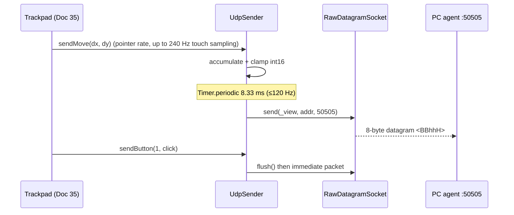

# Doc 30: Flutter UDP Datagram Sender

> Part of PotPilot plan-series · Category F · Session 1 Wave 1.B (Subagent 5) · Flutter App

## 1. Purpose & Scope

**Delivers**
- A process-wide `UdpSender` singleton wrapping Dart's `RawDatagramSocket`, firing fire-and-forget datagrams to the PC agent on UDP **50505**.
- A zero-allocation emission pipeline for the four packet types frozen in [02_binary_udp_protocol_spec.md](02_binary_udp_protocol_spec.md): all byte-level packing, the auth-byte XOR fold, and the seek high/low split **delegate to Doc 02's Dart codec** (`udp_packet_codec.dart`); this file adds a conformance-locked reuse fast path so packing never allocates on the hot path.
- A 120 Hz move-delta pipeline: pointer deltas accumulate in a reused accumulator and flush at most once per 8.33 ms, capping type-`0x01` traffic at 120 datagrams/s while keeping the hot path allocation-free (zero GC jitter).
- Per-session auth byte (8-bit XOR checksum of the 128-bit pairing token) and a monotonic `uint16` sequence counter.

**Out of scope**
- PC-side unpack/routing ([13_pc_asyncio_udp_receiver.md](13_pc_asyncio_udp_receiver.md)) and XOR verification ([15_pc_token_auth_middleware.md](15_pc_token_auth_middleware.md)).
- Gesture semantics, velocity curves, and gesture state machines ([35_flutter_120hz_virtual_trackpad.md](35_flutter_120hz_virtual_trackpad.md)).
- Delivery guarantees, retries, ACKs — UDP is lossy by design; guaranteed commands ride WebSocket ([31_flutter_websocket_client_reconnect.md](31_flutter_websocket_client_reconnect.md)).
- Network-interface selection, VPN detection, OS permission prompts.

## 2. File Ownership

**Creates (owned, create-only)**
| Path | Content |
|---|---|
| `mobile_app/lib/network/udp_sender.dart` | `UdpSender` singleton, packer, coalescer, constants |
| `mobile_app/test/network/udp_sender_test.dart` | Unit tests (this doc's §9) |

**Reads / touches (owned elsewhere)**
| Path | Owner | Why |
|---|---|---|
| `mobile_app/lib/core/storage/connection_cache.dart` | Doc 34 | Reads active host IPv4, WS/UDP ports, `tokenHex` fed into `configure()` |
| `mobile_app/lib/network/udp_packet_codec.dart` | Doc 02 | `packPacket`/`xorAuthByte`/`splitSeekSeconds` — byte-level single source of truth; imported, never edited |
| `shared_specs/udp_packet_layout.json` | Doc 01/02 | Byte-offset source of truth + golden vectors consumed by tests |
| `plan-series/02_binary_udp_protocol_spec.md` | Doc 02 | Packet layout mirror (never redefined here) |

No other file may import private members of `udp_sender.dart`.

## 3. Public Contract

```dart
/// Fixed UDP destination port for the PC agent input stream (frozen contract).
const int kUdpDefaultPort = 50505;
/// Hard cap on mouse-move datagrams emitted per second.
const int kMaxMovePacketsPerSecond = 120;
/// Fixed packet size in bytes — mirrors codec `packetSize` (Doc 02).
const int kUdpPacketSize = 8;

/// Packet type byte (Byte 0) values — mirror of 02_binary_udp_protocol_spec.md.
abstract final class UdpPacketType {
  static const int mouseMove = 0x01; // arg1=dx, arg2=dy
  static const int scroll    = 0x02; // arg1=vertical, arg2=horizontal
  static const int button    = 0x03; // arg1=buttonId, arg2=state
  static const int scrub     = 0x04; // arg1=secHigh, arg2=secLow
}
abstract final class MouseButton   { static const int left = 1, right = 2, middle = 3; }
abstract final class ButtonAction  { static const int down = 1, up = 2, click = 3; }

/// Fire-and-forget UDP sender singleton for PotPilot input datagrams.
class UdpSender {
  static UdpSender get instance;
  /// Binds the socket to [host]:[port] (defaults 50505) and derives the auth byte from 32-hex [tokenHex].
  Future<void> configure({required String host, required String tokenHex, int port = kUdpDefaultPort});
  /// True once configured and socket open; false after [close] or fatal socket error.
  bool get isReady;
  /// Current sequence counter (inspection/tests only).
  int get sequence;
  /// Queues relative cursor delta; coalesced and flushed at ≤120 Hz.
  void sendMove(int dx, int dy);
  /// Flushes pending move first, then sends one scroll datagram immediately.
  void sendScroll(int verticalDelta, int horizontalDelta);
  /// Flushes pending move first, then sends one button datagram (Down/Up/Click).
  void sendButton(int buttonId, int action);
  /// Flushes pending move first, then seeks to an absolute target in seconds.
  void sendScrub(int targetSeconds);
  /// Forces an immediate flush of accumulated move deltas (no-op when idle).
  void flush();
  /// Cancels timers and closes the socket; sender becomes !isReady.
  Future<void> close();
}
```

## 4. Internal Design

**Component breakdown** — one file, four private collaborators:
1. **`_Packer`** — a single pre-allocated `ByteData(packetSize)` plus a single `Uint8List` view over it, both created once in `configure()`; every packet is written into and sent from these same objects. Range checks, the auth fold, and seek splitting come from the Doc 02 codec; the reuse fast path is **pinned to the codec by conformance tests** (no per-packet allocation, no contract fork).
2. **`_Coalescer`** — `_pendingDx/_pendingDy` int accumulators + one lazily started `Timer.periodic(8333µs)`. Timer starts on the first non-zero `sendMove`, cancels itself when both accumulators drain.
3. **`_Seq`** — `int _seq`, incremented after every successful `socket.send`, wrapped with `_seq = (_seq + 1) & 0xFFFF` so wrap at 65535 is explicit and deterministic.
4. **`_Auth`** — `int _authByte` computed once per `configure()` from the pairing token.

**Pack algorithm (tricky logic, kept ≤25 lines):**

```dart
late final ByteData _buf = ByteData(packetSize);       // codec const (Doc 02)
late final Uint8List _view = _buf.buffer.asUint8List(0, packetSize);

// Fast path — equivalence with codec packPacket() is asserted by test, not promised.
Uint8List _pack(int type, int arg1, int arg2) {
  _buf.setUint8(0, type);
  _buf.setUint8(1, _authByte);
  // Endian.host must NOT be used — wire is always little-endian.
  _buf.setInt16(2, arg1, Endian.little);
  _buf.setInt16(4, arg2, Endian.little);
  _buf.setUint16(6, _seq, Endian.little);
  return _view; // same backing bytes every call; send() copies before return
}
```

Conformance is a test, not a convention: `expect(_pack(...), packPacket(...))` across **every** golden vector in `udp_packet_layout.json`, so the fast path can never drift from the frozen codec.

**Steps**
1. `configure(host, tokenHex, port)` → validate `RegExp('^[0-9a-f]{32}$')` on token (uppercase input lowercased — canonical form per Docs 03/15/17) → `_authByte = xorAuthByte(tokenBytes)` from the Doc 02 codec (XOR fold over the 16 decoded token bytes) → resolve `InternetAddress` **once** (cached) → `RawDatagramSocket.connect(...)` → `_seq = 0`, `_isReady = true`.
2. `sendMove(dx, dy)` → return early if `!_isReady` (silent drop, `_dropped++`) → clamp each to `[-32768, 32767]` → add into accumulators → if adding would overflow `int16`, flush first → start flush timer if not running.
3. Flush tick → pack `UdpPacketType.mouseMove` with `(accDx, accDy)` → `socket.send(_view, _addr, _port)` → zero accumulators → `_seq++` → stop timer if drained.
4. `sendScroll / sendButton / sendScrub` → call `flush()` **first** so temporal ordering (move-then-click) is preserved on the wire → pack immediately (these types are unthrottled; only moves are rate-capped).
5. `sendScrub(seconds)` → `final s = splitSeekSeconds(seconds)` from the codec (validates target ∈ [0, 2³¹)) → `arg1 = s.high = seconds >> 16`, `arg2 = s.low` (two's-complement int16 bit pattern; PC recombines `(high << 16) | (low & 0xFFFF)` per 02); negatives clamped to 0 before the call.
6. Every `socket.send` wrapped in `try/on SocketException` → count `_ioErrors`, mark `!_isReady` after 32 consecutive failures (caller may re-`configure`).



## 5. Protocol & Data Compliance

**Packet layout — mirror of `02_binary_udp_protocol_spec.md` (authoritative; do not fork):**

| Byte(s) | Dart access | Type | Meaning |
|---|---|---|---|
| 0 | `setUint8(0, …)` | `uint8` | Packet type: `0x01` move / `0x02` scroll / `0x03` button / `0x04` scrub |
| 1 | `setUint8(1, …)` | `uint8` | Auth byte = 8-bit XOR checksum of pairing token |
| 2–3 | `setInt16(2, …)` | `int16` LE | Arg 1 (`dx`, scroll-V, button id, scrub sec-high) |
| 4–5 | `setInt16(4, …)` | `int16` LE | Arg 2 (`dy`, scroll-H, button state, scrub sec-low) |
| 6–7 | `setUint16(6, …)` | `uint16` LE | Sequence number, monotonic, wraps 65535 → 0 |

**Exact constants:** `kUdpDefaultPort = 50505` (= codec `udpPort`), `kMaxMovePacketsPerSecond = 120`, `kUdpPacketSize = 8` (= codec `packetSize`), `UdpPacketType.{mouseMove,scroll,button,scrub}`, `MouseButton.{left,right,middle}`, `ButtonAction.{down,up,click}` — all mirroring the Doc 02 registry; never redefined.

**Byte order:** `Endian.little` everywhere — `Endian.host` is forbidden (PC is little-endian today; contract must not depend on host).

**Fields consumed from Doc 34 cache:** `PcHostRecord.ipv4s[0]`, `PcHostRecord.udpPort` (must equal 50505 unless overridden), `PcHostRecord.tokenHex`.

## 6. Dependencies & Integration Points

**Internal**
- [02_binary_udp_protocol_spec.md](02_binary_udp_protocol_spec.md) — byte layout, sequence-drop semantics, and the owned Dart codec `mobile_app/lib/network/udp_packet_codec.dart` (`packPacket`, `xorAuthByte`, `splitSeekSeconds`, `joinSeekSeconds`) that this file imports for auth folding, seek splitting, and fast-path conformance.
- [13_pc_asyncio_udp_receiver.md](13_pc_asyncio_udp_receiver.md) — peer: unpacks, drops out-of-order/old sequences.
- [15_pc_token_auth_middleware.md](15_pc_token_auth_middleware.md) — peer: must compute the identical XOR auth byte.
- [34_flutter_local_storage_connection_cache.md](34_flutter_local_storage_connection_cache.md) — supplies host/port/token at `configure()`.
- [35_flutter_120hz_virtual_trackpad.md](35_flutter_120hz_virtual_trackpad.md) — sole production caller of `sendMove/sendScroll/sendButton`.
- [31_flutter_websocket_client_reconnect.md](31_flutter_websocket_client_reconnect.md) — parallel transport; `configure()` timing is driven by pairing (Doc 32). **(Plus the round-6 `UdpRebindWatcher` on every WS `connected` transition — see the §7 correction, 2026-10-18.)**

**External packages:** none beyond `dart:io`. `shared_preferences` (catalog of [05_flutter_app_boilerplate_deps.md](05_flutter_app_boilerplate_deps.md)) is used only indirectly via Doc 34.

## 7. Edge Cases & Failure Handling

- **Sequence wrap at 65535:** explicit `_seq = (_seq + 1) & 0xFFFF`; receiver accepts wrap-around ordering (see 02); no reset mid-session.
- **`configure()` never called / host invalid:** every `send*` silently drops and increments `_dropped`; no throw from gesture code.
- **Token malformed (≠32 hex chars):** `configure()` throws `ArgumentError` synchronously — pairing layer (Doc 32) validates before persisting.
- **Wi-Fi drop mid-session:** `send()` raises `SocketException` → error swallowed, counted; after 32 consecutive errors `isReady=false`; next successful `configure()` (triggered by reconnect flow) rebinds. No packet retries ever. **(Correction — round 6, 2026-10-18: no "reconnect flow" re-`configure()` existed when this was written; the SessionGate now subscribes to `WsClient.instance.stateChanges` and re-runs the idempotent `UdpSender.configure()` on every WS `connected` transition via `UdpRebindWatcher` (`mobile_app/lib/network/udp_rebind.dart`), serialized through a future tail — that is the actual rebind path, and it fixes live-scrub previews dying permanently after any blip.)**
- **int16 overflow of accumulated deltas:** accumulator flushed before adding when `|acc + d| > 32767`, so a flick is split into consecutive packets rather than wrapped/truncated.
- **Pointer events faster than 120 Hz (240 Hz touch panels):** coalescing guarantees ≤120 move packets/s while summing all deltas — no input is lost, only batched.
- **Buffer reuse race:** `RawDatagramSocket.send` copies synchronously; verified by test asserting two back-to-back sends with different payloads arrive intact. If a future SDK changes this, tests fail loudly.
- **Scrub seconds ≥ 2^31:** clamped to `0x7FFFFFFF` before split (astronomically beyond any media length).
- **App backgrounded:** Android may suspend the isolate; sender state remains valid — resume behavior belongs to the app shell (Doc 05), not this file.
- **Port mismatch after agent config change:** `configure()` uses `PcHostRecord.udpPort`; mDNS refresh (Doc 32) rewrites the record, requiring re-`configure()`.

## 8. Acceptance Criteria

- [ ] Golden-vector test: `(type=0x01, auth, dx=100, dy=-50, seq=7)` serializes to the exact 8 bytes computed independently by Python `struct.pack('<BBhhH', …)`.
- [ ] `Endian.little` used for bytes 2–7; no `Endian.host` reference anywhere in `udp_sender.dart` (grep-clean).
- [ ] Sustained 1000-pointer-event burst → measured datagram rate ≤ 120 packets/s; summed deltas equal summed input deltas.
- [ ] Steady-state memory profile flat over 60 s of continuous moves (zero per-packet allocations; verified via DevTools allocation tracker).
- [ ] Sequence increments by exactly 1 per emitted datagram and wraps 65535 → 0 correctly.
- [ ] Auth byte equals the XOR fold computed by `15_pc_token_auth_middleware.py` for the same token (cross-checked vector).
- [ ] Click packets are never emitted before the pending move packet that preceded them (ordering test).
- [ ] On-device: moving a finger on the phone moves the Windows cursor with no visible stutter at 120 Hz.

## 9. Test Plan

**Automated** (`flutter test`)
- `mobile_app/test/network/udp_sender_test.dart`
  - **Golden pack vectors** — asserts exact byte arrays vs the `udp_packet_layout.json` golden table (identical to Python `struct.pack('<BBhhH', …)`); includes Doc 02's G6 seek vector: `sendScrub(70000)` at seq 11 with auth 0x5A → `04 5A 01 00 10 11 0B 00`.
  - **Fast-path ↔ codec equivalence** — `_pack(type, auth, a1, a2, seq)` byte-equals `packPacket(...)` for every golden vector and 1000 random in-range fields.
  - **Little-endian assertion** — multi-byte values byte-swapped relative to big-endian expectation.
  - **Coalescing** — 50 `sendMove` calls inside one 8.33 ms fake-async window produce exactly 1 datagram whose args equal the sum.
  - **Rate cap** — fake-async clock advanced 1 s → ≤120 move datagrams observed.
  - **Sequence wrap** — inject `_seq = 65535`, next send carries `0xFFFF`, following carries `0x0000`.
  - **int16 clamp/split** — `sendMove(40000, 0)` splits into two in-range packets, totals preserved.
  - **Scrub split** — `sendScrub(70000)` → `(high=1, low=4464)`; `joinSeekSeconds(high, low)` (codec) recombines to 70000.
  - **Unconfigured drop** — calls before `configure()` emit nothing and don't throw.
  - **Buffer-reuse safety** — two consecutive sends with different payloads captured from a local `RawDatagramSocket` listener arrive with distinct correct bytes.
- `mobile_app/test/network/udp_sender_socket_integration_test.dart` — real loopback socket to `127.0.0.1:<ephemeral>`; asserts received length is always 8.

**Manual**
1. Run PC agent, pair the phone, drag across the trackpad (Doc 35 surface) → Windows cursor tracks smoothly.
2. Toggle airplane mode mid-drag → app does not crash; re-enable → cursor works after reconnect (no manual restart).

## 10. Assumptions & Open Questions

- **Auth fold** — resolved: `xorAuthByte` (Doc 02 codec, mirrored by Doc 15) folds the **16 raw bytes** of the 128-bit token; token validated as 32 hex chars, stored lowercase (canonical per Docs 03/15/17).
- **Sequence starts at 0** on each `configure()`; the PC receiver treats seq as per-session (Doc 13/15 own reset handshake semantics).
- **`RawDatagramSocket.send` copies synchronously** (assumption, verified by the reuse test above).
- **Scrub split** — resolved: codec `splitSeekSeconds`/`joinSeekSeconds` own the (high, low) encoding; this file never splits inline.
- **Move-only rate cap:** scroll/button/scrub are event-driven and unthrottled; their burst rate is bounded by human gesture rates (safe for the Doc 13 receiver).
- **Failure policy:** no local retransmission ever; 32-consecutive-error circuit breaker threshold is a tuning value, adjust freely.
