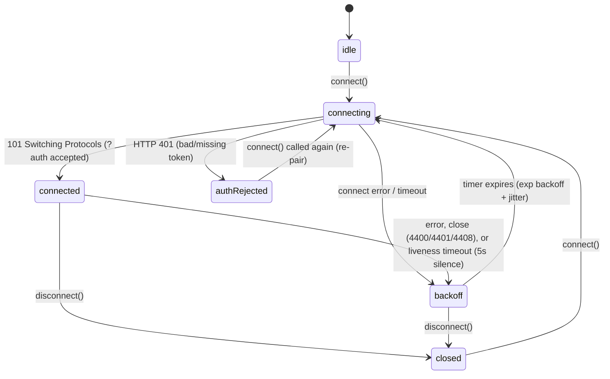

# Doc 31: Flutter WebSocket Client with Reconnect

> Part of PotPilot plan-series · Category F · Session 1 Wave 1.B (Subagent 5) · Flutter App

## 1. Purpose & Scope

**Delivers**
- A resilient `WsClient` singleton connecting to the PC agent's WebSocket server on TCP **50506** using the frozen JSON envelope of [03_websocket_json_schema_spec.md](03_websocket_json_schema_spec.md) (that doc is authoritative; all frame build/parse goes through its owned Dart codec `ws_message_codec.dart`) plus the **connection-level token handshake** `?auth=<32-hex>` (03 §4.2 — HTTP 401 rejects before upgrade; no AUTH frame exists because the five envelope types are frozen).
- Exponential backoff auto-reconnection with jitter, protocol-level heartbeat ping/pong liveness detection, and **mDNS IP fallback** resolution when the cached IP stops answering.
- A typed `WsEnvelope` decode layer and broadcast streams (`envelopes`, `stateChanges`) consumed by feature docs (telemetry, deck, keyboard, media, power).

**Out of scope**
- PC-side server/router ([14_pc_websocket_server_router.md](14_pc_websocket_server_router.md)) and auth validation ([15_pc_token_auth_middleware.md](15_pc_token_auth_middleware.md)).
- The pairing UI and mDNS **browsing implementation** — the resolver is owned by [32_flutter_qr_scanner_mdns_pairing.md](32_flutter_qr_scanner_mdns_pairing.md); this doc only consumes its contract.
- Parsing `TELEMETRY_SYNC` into state ([33_flutter_telemetry_state_provider.md](33_flutter_telemetry_state_provider.md)).
- Guaranteed at-least-once delivery semantics for commands (bounded best-effort queue only).

## 2. File Ownership

**Creates (owned, create-only)**
| Path | Content |
|---|---|
| `mobile_app/lib/network/ws_client.dart` | `WsClient`, `WsEnvelope`, state machine, backoff, heartbeat, queue |
| `mobile_app/test/network/ws_client_test.dart` | Unit/integration tests (§9) |

**Reads / touches (owned elsewhere)**
| Path | Owner | Why |
|---|---|---|
| `mobile_app/lib/network/ws_message_codec.dart` | Doc 03 | `WsMessage`, `parseMessage`/`buildMessage`, close-code constants — imported, never edited |
| `mobile_app/lib/network/pairing_scanner.dart` | Doc 32 | Imports `MdnsAgentResolver.instance` for IP fallback + live IP change stream |
| `mobile_app/lib/core/storage/connection_cache.dart` | Doc 34 | Reads active host/token; writes refreshed IP after successful mDNS fallback |
| `shared_specs/ws_command_schema.json` | Doc 01/03 | Envelope contract consumed by tests |
| `mobile_app/lib/network/telemetry_provider.dart` | Doc 33 | Downstream listener on `envelopes` (read-only) |

## 3. Public Contract

```dart
/// Fixed TCP port of the PC agent WebSocket server (frozen contract).
const int kWsDefaultPort = 50506;
/// Service type browsed during mDNS fallback (frozen contract).
const String kMdnsServiceType = '_potpilot._tcp.local.';

enum WsConnectionState { idle, connecting, connected, backoff, authRejected, closed }

/// Envelope type is owned by Doc 03's Dart codec (`ws_message_codec.dart`);
/// Doc 31 streams the codec's `WsMessage` (id/type/action/payload/timestamp).
typedef WsEnvelope = WsMessage; // re-export for consumers

/// Resilient PotPilot WebSocket client (singleton, auto-reconnecting).
class WsClient {
  static WsClient get instance;
  /// Test/DI seam: overrides mDNS lookup (defaults to MdnsAgentResolver from Doc 32).
  WsClient({Future<String?> Function()? mdnsLookup, double Function()? jitterSource});
  /// Broadcast stream of every successfully decoded envelope from the PC.
  Stream<WsEnvelope> get envelopes;
  /// Broadcast stream of connection-state transitions.
  Stream<WsConnectionState> get stateChanges;
  WsConnectionState get state;
  /// Opens ws://host:port/?auth=<tokenHex> (port defaults 50506); HTTP 401 ⇒ authRejected; keeps retrying until [disconnect].
  Future<void> connect({required String host, required String tokenHex, int port = kWsDefaultPort});
  /// Sends a CMD_* envelope; queues (capacity 32) while reconnecting, drops oldest on overflow.
  Future<void> send(String type, String action, [Map<String, dynamic> payload = const {}]);
  /// Terminal disconnect: cancels backoff/heartbeat, closes socket, state → closed.
  Future<void> disconnect();
  /// Pure backoff calculator exposed for unit tests: attempt ≥1 → delay.
  static Duration computeBackoff(int attempt, double jitter01);
}
```

## 4. Internal Design

**Connection state machine**



**Reconnect algorithm (numbered)**
1. `connect()` records endpoint (`host`, `port`, `tokenHex`) and enters `connecting`.
2. `WebSocket.connect('ws://$host:$port/?auth=$tokenHex')` with a 5 s connect timeout → on success wrap in `IOWebSocketChannel`, set `webSocket.pingInterval = kPingInterval` (client WS-level ping every 15 s per 03 §4.2; pongs handled by the Dart runtime — no JSON invented).
3. Auth is **connection-level**: the token rides the upgrade URL (`?auth=<32-hex>`, 03 §4.2). An HTTP 401 (status surfaced in the connect exception) ⇒ `authRejected` (terminal until caller retries); any other connect error ⇒ `backoff`.
4. On 101 upgrade → `connected`, reset `attempt = 0`, flush the bounded outbound queue in FIFO order, emit `stateChanges`. Success is confirmed by the server's initial `TELEMETRY_SYNC` snapshot (sent on every connect, 03 §4.2); its arrival arms the liveness watchdog.
5. Pump the inbound stream through the codec: `parseMessage(raw)` → `WsMessage` → push to `envelopes`; `FormatException` (malformed frame) → count + drop, never throw.
6. **Liveness watchdog:** a resettable timer of `kLivenessTimeout = 8 s`; any inbound frame (active deltas; `FULL_STATE` at most every 5.0 s when idle — the old 5 s raced that cadence and reconnected healthy idle links, 2026-10-17 fix) resets it; expiry ⇒ treat as dead link → force close → `backoff`. This is what actually detects half-open TCP after AP roaming.
7. `backoff` → `Duration = clamp(kBackoffInitial × kBackoffMultiplier^(attempt−1), ≤ kBackoffMax)` ± `kJitterRatio` jitter → timer → `attempt++` → `connecting`.

```dart
// Pure, testable backoff core (jitter01 in [0,1) injected for deterministic tests).
static Duration computeBackoff(int attempt, double jitter01) {
  final double exp = kBackoffInitial.inMilliseconds * pow(kBackoffMultiplier, attempt - 1);
  final double capped = exp.clamp(0, kBackoffMax.inMilliseconds).toDouble();
  final double jitter = 1.0 + kJitterRatio * (jitter01 * 2 - 1);
  return Duration(milliseconds: (capped * jitter).round());
}
```

8. **mDNS IP fallback:** when `attempt` reaches `kMdnsFallbackAfter = 3` consecutive failures **on the same IP**, call the injected `mdnsLookup()` (defaults to `MdnsAgentResolver.instance.resolveHost()`); if a different IP is returned → update endpoint, persist it into Doc 34's active `PcHostRecord`, resume backoff from `attempt = 1` with the new IP. If lookup fails → continue normal backoff. Additionally subscribe to `MdnsAgentResolver.instance.watchAgents()` while connected: a changed IP for the paired host triggers an immediate controlled reconnect to the new IP.
9. **Outbound queue:** `send()` while not `connected` enqueues into a 32-slot ring; overflow drops the **oldest** entry (telemetry-adjacent staleness beats unbounded growth). Frames are built via codec `buildMessage(type, action, payload)`, which stamps the UUIDv4 `id` and unix-seconds `timestamp` per 03 §5.1.
10. **Lifecycle:** `disconnect()` cancels backoff timer, watchdog, and ping; closes channel; subsequent `connect()` is a fresh session.

## 5. Protocol & Data Compliance

**Envelope — mirror of `03_websocket_json_schema_spec.md` (authoritative):**

| Field | Type | Producer | Meaning |
|---|---|---|---|
| `id` | string (UUIDv4) | client / PC | Correlation id, generated per frame |
| `type` | string | both | One of `CMD_POTPLAYER`, `CMD_KEY`, `CMD_SYSTEM`, `CMD_MEDIA`, `TELEMETRY_SYNC` |
| `action` | string | both | e.g. `PLAY_PAUSE`, `SET_SPEED`, `SET_BLACKOUT`, `AUTH` |
| `payload` | object | both | Type-specific data; `{}` when empty |
| `timestamp` | int (unix s) | both | Sender wall clock at emit time |

**Handshake (mirrors 03 §4.2 — connection-level, no in-band frame):**

| Step | Detail |
|---|---|
| upgrade request | `GET /?auth=<32-lowercase-hex>` on `ws://<ip>:50506` — token from Doc 34 cache / QR (Doc 17) |
| invalid/missing token | server answers HTTP **401** (never 101) → client `authRejected`, no auto-retry |
| valid token | server answers **101 Switching Protocols**; first inbound frame = initial `TELEMETRY_SYNC` snapshot |
| mid-session revocation | server closes **4401** UNAUTHORIZED → `authRejected` |
| heartbeat | client WS ping every **15 s**; server idle-closes **4408** after 30 s silence |
| command acks | every `CMD_*` gets exactly one `<ACTION>_RESULT` / `<ACTION>_ERROR` echoing `id` (03 §5.7) — consumers (Docs 36–45) await them; Doc 31 only streams them |
| frames > 65536 B | server closes **4400** PROTOCOL_ERROR → client treats as fatal-for-session → `backoff` |

**Exact constants:** `kWsDefaultPort = 50506` (= codec `wsPort`); `kMdnsServiceType = '_potpilot._tcp.local.'`; `kBackoffInitial = 500 ms`; `kBackoffMultiplier = 2.0`; `kBackoffMax = 15 s`; `kJitterRatio = 0.20`; `kPingInterval = 15 s` (03 §4.2 client ping; server idle-closes after 30 s with `4408`); `kLivenessTimeout = 8 s` (covers the 5.0 s `FULL_STATE` refresh cadence with jitter margin; the pre-fix 5 s exactly equaled it and flapped, 2026-10-17); `kConnectTimeout = 5 s`; `kMdnsFallbackAfter = 3`; `kSendQueueCapacity = 32`. Close codes per 03: `4400` PROTOCOL_ERROR · `4401` UNAUTHORIZED · `4408` HEARTBEAT_TIMEOUT.

**TELEMETRY_SYNC:** this doc only validates it is a decodable envelope and forwards it; payload key parsing is Doc 33's §5.

## 6. Dependencies & Integration Points

**Internal**
- [03_websocket_json_schema_spec.md](03_websocket_json_schema_spec.md) — envelope + `?auth=` handshake authority; also owns `mobile_app/lib/network/ws_message_codec.dart` (`WsMessage`, `parseMessage`, `buildMessage`, close-code constants) which this file imports for every codec operation.
- [14_pc_websocket_server_router.md](14_pc_websocket_server_router.md) / [15_pc_token_auth_middleware.md](15_pc_token_auth_middleware.md) — server-side peers.
- [16_pc_zeroconf_mdns_broadcaster.md](16_pc_zeroconf_mdns_broadcaster.md) — advertises `_potpilot._tcp.local.` consumed via Doc 32's resolver.
- [32_flutter_qr_scanner_mdns_pairing.md](32_flutter_qr_scanner_mdns_pairing.md) — provides `MdnsAgentResolver` (`resolveHost`, `watchAgents`) and calls `connect()` after pairing.
- [33_flutter_telemetry_state_provider.md](33_flutter_telemetry_state_provider.md) — primary consumer of `envelopes` (filters `TELEMETRY_SYNC`).
- [34_flutter_local_storage_connection_cache.md](34_flutter_local_storage_connection_cache.md) — endpoint source of truth; receives refreshed IP.

**External packages (from [05_flutter_app_boilerplate_deps.md](05_flutter_app_boilerplate_deps.md) catalog)**
| Package | Purpose here |
|---|---|
| `web_socket_channel` | `IOWebSocketChannel` client transport |
| `flutter_riverpod` | Providers exposing `WsClient` streams to the widget tree (thin wrapper) |

`dart:io` supplies `WebSocket.pingInterval` for heartbeat; `dart:math` `Random.secure` supplies jitter + UUIDv4 randomness (no `uuid` package exists in the catalog — generated in-file).

## 7. Edge Cases & Failure Handling

- **Wi-Fi drop mid-session:** socket error/complete → `backoff` within one tick; outbound `send()` calls queue (≤32) and flush after re-AUTH — user's Play/Pause is not lost.
- **AP roam / DHCP reassigns PC IP:** cached-IP attempts fail ×3 → mDNS fallback resolves new IP → cache updated → traffic resumes; total outage bounded by 3 failures + one 3 s mDNS lookup.
- **Token rejected (HTTP 401 before upgrade, or 4401 close mid-session):** enter `authRejected`, **stop** retrying (avoids lockout spam), surface event so UI can route back to scanner (Doc 32).
- **Backoff storm after PC reboot:** jitter (±20%) spreads reconnect attempts; delay capped at 15 s — retry forever until `disconnect()` (never gives up in `backoff`).
- **Server restarts cleanly (TCP FIN while connected):** stream completion → `backoff` starting at `attempt = 1` (500 ms ± jitter) — fast recovery without hammering.
- **Silent half-open connection (no FIN):** liveness watchdog fires after 5 s without frames (server keepalive is ≤2 s silence per 03 §4.3) → force reconnect; the client's own 15 s pings concurrently keep the server's 30 s idle-close (`4408`) happy in the other direction.
- **Malformed/partial JSON frame:** dropped, `_malformedFrames++`, stream kept alive; never tears down the connection for one bad frame.
- **Clock skew:** outgoing `timestamp` uses local epoch; incoming timestamps are displayed/parsed by consumers, never used to gate liveness (frame *arrival* gates it).
- **Queue overflow:** oldest queued command dropped (ring buffer); queue flushed strictly FIFO post-AUTH to preserve order.
- **`connect()` called while already connecting:** second call is a no-op returning the in-flight future (single-flight guard).
- **mDNS also unavailable:** resolver returns `null` → keep backoffing at the capped 15 s cadence indefinitely.
- **App backgrounded (Android suspends socket):** on resume the dead socket errors/lapses → watchdog/backoff recover automatically; callers may also proactively invoke `connect()` on `resumed` (shell wiring, Doc 05).

## 8. Acceptance Criteria

- [ ] Envelope produced by `send()` byte-for-byte validates against `shared_specs/ws_command_schema.json`.
- [ ] Upgrade URL provably carries `?auth=<32-hex token>` on every fresh connection (test server records request URIs); first inbound frame is the initial `TELEMETRY_SYNC` snapshot.
- [ ] Observed reconnect delays follow `500 ms → 1 s → 2 s → 4 s → 8 s → 15 s (cap)` within ±20 % jitter; reset to 500 ms after a successful upgrade.
- [ ] Killing the PC server mid-session: client re-establishes ≤ backoff delay after server returns; queued command delivered post-reconnect.
- [ ] Blocking traffic without closing TCP: liveness timeout triggers reconnect at ~5 s of silence (no crash, state cycles `connected → backoff → connected`).
- [ ] After 3 failed attempts on stale IP, exactly one mDNS lookup is attempted; a changed IP is persisted to Doc 34 and used for subsequent attempts.
- [ ] HTTP 401 (and mid-session 4401) yield `authRejected` and **zero** further automatic attempts until `connect()` is re-invoked.
- [ ] `flutter analyze` clean; no unhandled async exceptions from any stream during a 10-minute soak with the server flapping.

## 9. Test Plan

**Automated** (`flutter test`)
- `mobile_app/test/network/ws_client_test.dart`
  - **Backoff math (pure):** `computeBackoff` across attempts 1–10 with fixed `jitter01` → exact expected delays, cap at 15 s, jitter bounds ±20 %.
  - **State machine:** local `dart:io` WebSocket test server; asserts full transition sequence `idle→connecting→connected` and `connected→backoff→…` after forced close, with fake timers.
  - **Handshake URL:** server records the upgrade request URI; asserts `/?auth=<32-hex token>` with the correct lowercase token; asserts the first inbound frame is a `TELEMETRY_SYNC` snapshot.
  - **Auth rejection:** upgrade answered with HTTP 401 → final state `authRejected`, no scheduled reconnect remains pending; a mid-session `4401` close has the same terminal effect.
  - **Liveness watchdog:** server connects, then stays silent > 5 s (fake clock) → client reconnects; server sending frames every 250 ms → no reconnect.
  - **Queue & overflow:** 40 `send()` while down → exactly 32 survive, oldest 8 dropped, FIFO flushed after reconnect.
  - **mDNS fallback:** inject `mdnsLookup` stub returning a new IP after 3 failures → assert IP swap, cache write call, and attempt reset.
  - **Malformed frame:** server sends `{"broken` → `envelopes` skips it; connection stays `connected`.
- `mobile_app/test/network/ws_envelope_test.dart` — encode/decode parity with `shared_specs/ws_command_schema.json` golden frames.

**Manual**
1. Pair phone → toggle PC Wi-Fi off 10 s → on → deck recovers automatically, telemetry resumes ≤ 20 s (worst-case backoff cap).
2. Change PC's DHCP lease (new IP) → phone reconnects via mDNS without re-scanning the QR.
3. Re-pair with a wrong/old token from a stale cache → UI shows auth failure instead of silent retry loop.

## 10. Assumptions & Open Questions

- **Handshake** — resolved: the token rides the upgrade URL (`?auth=`, 03 §4.2); no AUTH frame exists because the five envelope types are frozen.
- **Heartbeat mechanism:** client WS-level ping via `WebSocket.pingInterval = 15 s` (03 §4.2 contract value) + app-level liveness via inbound frame cadence — no synthetic JSON ping type is introduced into the frozen envelope.
- **Timing constants** (500 ms base, 15 s cap, 5 s liveness, 5 s connect, 32 queue slots) are tuning defaults chosen here; ping 15 s / server idle 30 s / telemetry keepalive ≤2 s are contract values from 03.
- **UUIDv4 + timestamp stamping** delegated to Doc 03's codec `buildMessage` — no `uuid` package exists in the frozen Doc 05 pubspec, and none is invented.
- **`ws_client.dart` depends on `pairing_scanner.dart` (Doc 32) for mDNS** — deliberately inverted vs. intuition to keep one mDNS implementation; the lookup seam (`mdnsLookup` ctor param) exists so this dependency is mockable in tests and the file compiles standalone.
- **No reconnect on `authRejected`** is a safety choice (avoid hammering); a future "re-pair silently with cached token" flow would need orchestrator approval.
