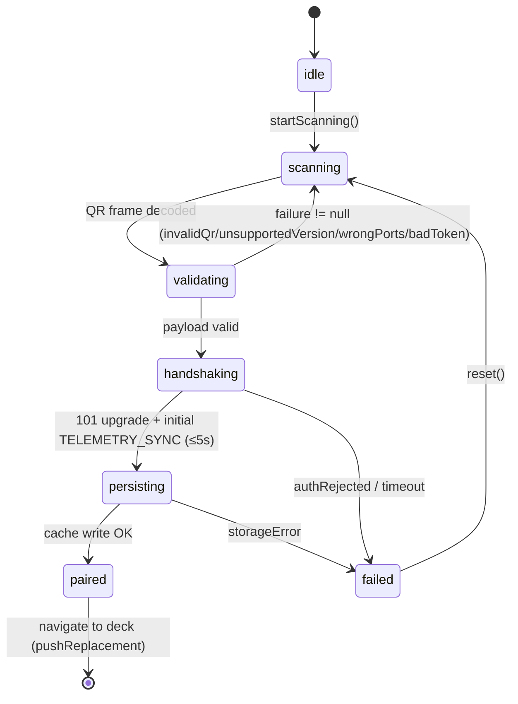

# Doc 32: Flutter QR Scanner & mDNS Pairing

> Part of PotPilot plan-series · Category F · Session 1 Wave 1.B (Subagent 6) · Flutter App

## 1. Purpose & Scope

**Delivers**
- The onboarding flow: a full-screen QR scanner (`mobile_scanner`) that decodes the PC agent's pairing payload (produced by [17_pc_qr_connection_payload_gen.md](17_pc_qr_connection_payload_gen.md)), validates it against the frozen wire contract, performs the WebSocket AUTH handshake, persists the paired PC via Doc 34, and **transitions directly to the controller deck** — no intermediate confirmation screens.
- A single mDNS subsystem for the whole app: browsing `_potpilot._tcp.local.` (advertised by [16_pc_zeroconf_mdns_broadcaster.md](16_pc_zeroconf_mdns_broadcaster.md)) exposing (a) one-shot IP resolution used by [31_flutter_websocket_client_reconnect.md](31_flutter_websocket_client_reconnect.md) as fallback and (b) a live stream of IP/port changes that refreshes the cache and forces reconnects.

**Out of scope**
- QR image *generation* and payload authoring (Doc 17 — payload schema mirrored, not defined, here).
- mDNS *advertising* (Doc 16, Python `zeroconf`).
- The deck UI itself ([36_flutter_custom_potplayer_deck_ui.md](36_flutter_custom_potplayer_deck_ui.md)) and navigation shell/route table ([05_flutter_app_boilerplate_deps.md](05_flutter_app_boilerplate_deps.md)).
- Token storage internals ([34_flutter_local_storage_connection_cache.md](34_flutter_local_storage_connection_cache.md)) and WS transport internals (Doc 31 — consumed as a black box).

## 2. File Ownership

**Creates (owned, create-only)**
| Path | Content |
|---|---|
| `mobile_app/lib/network/pairing_scanner.dart` | `PairingController`, `PairingScannerScreen`, `PairingPayload` parse/validate, `MdnsAgentResolver` |
| `mobile_app/test/network/pairing_scanner_test.dart` | Payload validation + pairing state machine tests |
| `mobile_app/test/network/mdns_resolver_test.dart` | Resolver contract tests (fake backend) |

**Reads / touches (owned elsewhere)**
| Path | Owner | Why |
|---|---|---|
| `mobile_app/lib/network/ws_client.dart` | Doc 31 | Calls `connect()/disconnect()` for handshake; consumes `stateChanges`/`authRejected` |
| `mobile_app/lib/core/storage/connection_cache.dart` | Doc 34 | Persists/updates `PcHostRecord`, reads active host for auto-reconnect |
| `mobile_app/lib/network/telemetry_provider.dart` | Doc 33 | Notified after pairing so telemetry binds to the new session |
| `mobile_app/lib/main.dart` + shell routes | Doc 05 / Session 3 Wave 3.A | `pushReplacement` into the deck route after success |
| Camera permission declarations | Doc 05 (`AndroidManifest`) | `mobile_scanner` requirement — read-only here |

## 3. Public Contract

```dart
/// Service type browsed/validated during pairing (frozen contract).
const String kMdnsServiceType = '_potpilot._tcp.local.';
/// Frozen ports a valid QR payload must advertise.
const int kUdpPort = 50505;
const int kWsPort = 50506;

/// Decoded, immutable QR pairing payload — keys frozen by Doc 17 §5:
/// {"v":1,"host":"…","ips":["…"],"udp":50505,"ws":50506,"token":"<32 hex>"}
class PcPairingPayload {
  final int version;          // from "v"; must equal 1
  final String hostname;      // from "host"
  final List<String> ipv4s;   // from "ips"
  final int udpPort;          // from "udp" (must equal 50505)
  final int wsPort;           // from "ws"  (must equal 50506)
  final String tokenHex;      // from "token"; 32 lowercase hex = 128-bit
  static PcPairingPayload? tryParse(String raw); // null on malformed JSON
  PairingFailure? validate();                    // null when contract-compliant
}

enum PairingPhase { idle, scanning, validating, handshaking, persisting, paired, failed }
enum PairingFailure { cameraDenied, invalidQr, unsupportedVersion, wrongPorts, badToken,
                      noReachableHost, authRejected, handshakeTimeout, storageError }

/// Immutable snapshot of the pairing flow, emitted on every transition.
@immutable
class PairingState {
  final PairingPhase phase; final PairingFailure? failure;
  final PcHostRecord? pairedHost; final int attempt;
}

/// Drives scan → validate → handshake → persist → navigate; one instance per app run.
class PairingController {
  Stream<PairingState> get states; PairingState get state;
  Future<void> startScanning();     // camera preview + QR decode loop
  void stopScanning();
  /// Validates [raw] and runs the full pairing sequence; fails fast into state.failed.
  Future<void> pairFromQr(String raw);
  /// Re-pairs from a cached record (auto-connect at app start); same state machine.
  Future<void> pairFromCache(PcHostRecord host);
  void reset();                     // back to idle/scanning after a failure
}

/// Single mDNS implementation for the app: one-shot resolve + live change stream.
class MdnsAgentResolver {
  static MdnsAgentResolver get instance;
  /// Resolves the paired PC's current IPv4 from `_potpilot._tcp.local.`; null on timeout.
  Future<String?> resolveHost({Duration timeout = const Duration(seconds: 3)});
  /// Live advertisements (initial browse results + changes) for all PotPilot agents.
  Stream<MdnsAgentInfo> watchAgents();
  Future<void> start();  // begins browse (idempotent)
  Future<void> stop();
}

/// One discovered/updated agent advertisement.
@immutable
class MdnsAgentInfo {
  final String serviceName; final String hostname;
  final String ipv4; final int udpPort; final int wsPort;
}
```

## 4. Internal Design

**Pairing state machine**



**Algorithm steps**
1. `startScanning()` → request camera permission (denied ⇒ `failed/cameraDenied` with retry affordance) → start `mobile_scanner` with QR-only barcode formats; each decoded barcode is fed once to `pairFromQr` (re-entrancy guarded by `state.phase`).
2. `pairFromQr(raw)` → `PcPairingPayload.tryParse` (tolerates raw JSON or a `potpilot://pair?…` wrapper containing the same JSON — parse both, Doc 17 owns the final encoding) → on null: `failed/invalidQr`, return to `scanning`.
3. `validate()` in order: (a) `version == 1` → else `unsupportedVersion` (QR from a future agent the app cannot trust); (b) `udpPort == 50505` and `wsPort == 50506` → else `wrongPorts` (frozen contract; QR from a foreign/misconfigured device); (c) `tokenHex` matches `^[0-9a-f]{32}$` after lowercasing (uppercase input accepted and normalized) → else `badToken`; (d) ≥1 syntactically valid IPv4 → else `noReachableHost`.
4. `handshaking` → preference order for target IP: last-known cache IP → QR `ips` (first that opens within `kConnectTimeout`) → mDNS `resolveHost()`. Call `WsClient.instance.connect(host, tokenHex)` — the token rides the upgrade URL as `?auth=<32-hex>` (Doc 31 / 03 §4.2) — and await `stateChanges` reaching `connected` (101 upgrade; initial `TELEMETRY_SYNC` snapshot confirms the pipe) or `authRejected` (HTTP 401) within `kConnectTimeout` ⇒ `failed/authRejected` or `failed/handshakeTimeout`.
5. `persisting` → build `PcHostRecord{hostname (from `host`), ipv4s (union QR `ips` + resolved), ports, tokenHex, lastConnectedAt=now}` → `ConnectionCache.saveHost` + `setActiveHost` → notify `TelemetryNotifier` (bind) → `paired`.
6. Navigate: hand control to the Doc 05 shell's deck tab (`AppTab` index 0 via the shell's public `setTab` — `pushReplacement`-equivalent semantics, so Back cannot return to the scanner); controller keeps `watchAgents()` running for the session lifetime.
7. **Live mDNS updates:** on `MdnsAgentInfo` whose `serviceName`/`hostname` matches the active record and whose `ipv4` differs → rewrite `PcHostRecord.ipv4s` in cache → emit on an internal `ipChanged` stream that `WsClient` (Doc 31) subscribes to → controlled reconnect to the new IP. Port fields from TXT records only update the record if they match the frozen ports (PC ports are contract-fixed).

**QR content mirror (frozen by Doc 17 §5; consumed, not defined):** compact JSON `{"host":"BEDROOM-PC","ips":["192.168.1.42"],"token":"<32 lowercase hex>","udp":50505,"v":1,"ws":50506}` — `tryParse` maps exactly these six keys into `PcPairingPayload`; any other shape ⇒ `invalidQr`.

## 5. Protocol & Data Compliance

**Fields consumed:**

| Source | Field | Constraint (frozen) |
|---|---|---|
| QR payload (Doc 17 §5) | `v` | must equal **1** (payload version) → else `unsupportedVersion` |
| QR payload | `host` | PC hostname — record identity + display |
| QR payload | `ips` | ≥1 dotted-quad LAN IPv4; client tries each in order |
| QR payload | `udp` | must equal **50505** |
| QR payload | `ws` | must equal **50506** |
| QR payload | `token` | exactly **32 lowercase hex** = **128-bit pairing token**; its XOR fold is the UDP auth byte (Docs 15/30) and its `?auth=` form authenticates WS (Doc 31) |
| mDNS (Doc 16) | service type | **`_potpilot._tcp.local.`** |
| mDNS | SRV port | 50506 (WS control port) |
| mDNS | TXT `udp`/`ws`/`ver` | strings `"50505"` / `"50506"` / `"1"`; **no token ever in mDNS** (Doc 16) |
| WS handshake | upgrade URL | `ws://<ip>:50506/?auth=<token>` → HTTP 401 or 101 (03 §4.2, via Doc 31) |

**Exact constants:** `kMdnsServiceType = '_potpilot._tcp.local.'`, `kUdpPort = 50505`, `kWsPort = 50506`, `kTokenHexRegex = ^[0-9a-f]{32}$` (lowercase canonical; uppercase input lowercased), `kMdnsResolveTimeout = 3 s`, `kConnectTimeout = 5 s` (Doc 31).

No wire packet is authored here — UDP stays Doc 30, WS frames stay Doc 31.

## 6. Dependencies & Integration Points

**Internal**
- [31_flutter_websocket_client_reconnect.md](31_flutter_websocket_client_reconnect.md) — handshake transport; exports the `resolveHost/watchAgents` contract this doc implements (the **only** mDNS implementation in the app).
- [34_flutter_local_storage_connection_cache.md](34_flutter_local_storage_connection_cache.md) — `PcHostRecord` persistence, active-host selection.
- [33_flutter_telemetry_state_provider.md](33_flutter_telemetry_state_provider.md) — bound to the fresh session after `persisting`.
- [30_flutter_udp_datagram_sender.md](30_flutter_udp_datagram_sender.md) — `UdpSender.configure(host, tokenHex)` is invoked at `paired` (or by the deck on entry) using the persisted record.
- [16_pc_zeroconf_mdns_broadcaster.md](16_pc_zeroconf_mdns_broadcaster.md) / [17_pc_qr_connection_payload_gen.md](17_pc_qr_connection_payload_gen.md) — server-side peers mirrored here.
- [05_flutter_app_boilerplate_deps.md](05_flutter_app_boilerplate_deps.md) — deck route constant + `AndroidManifest` camera permission.

**External packages (from [05_flutter_app_boilerplate_deps.md](05_flutter_app_boilerplate_deps.md) catalog)**
| Package | Purpose here |
|---|---|
| `mobile_scanner` | Camera preview + QR decode loop |
| `flutter_riverpod` | `pairingProvider` (StateNotifier wrapping `PairingController`) |
| `shared_preferences` | via Doc 34 only |

**mDNS (deliberately no package):** the Doc 05 pubspec is frozen to six runtime deps ("no other runtime deps" acceptance), so the mDNS browser is implemented **in-file** over `dart:io` (`RawDatagramSocket` multicast to `224.0.0.251:5353`, parsing only the DNS-SD subset PTR `_potpilot._tcp.local.` + SRV + TXT + A) and the Android `MulticastLock` is acquired via a small MethodChannel into `WifiManager` (the `CHANGE_WIFI_MULTICAST_STATE` manifest permission is already owned by Doc 05). Design notes in §10.

## 7. Edge Cases & Failure Handling

- **Camera permission denied / no camera device:** `failed/cameraDenied`; UI shows rationale + "Open settings", **and** the mDNS/manual path stays usable per Doc 05's shell contract: discover the agent via `watchAgents()`, then let the user paste the 32-hex token manually — mDNS never carries the secret (Doc 16), so a no-camera pairing is mDNS discovery + manual token entry.
- **QR from wrong PC (foreign app / wrong product):** fails `tryParse` or port check → `invalidQr`/`wrongPorts` → auto-return to scanning with a short toast; scan loop continues.
- **QR from a correct-but-misconfigured agent (non-standard ports):** rejected `wrongPorts` — ports are frozen; user must fix agent config (Doc 26) rather than silently forking the contract.
- **Token mismatch (stale/corrupt token):** upgrade answered HTTP 401 (or mid-session `4401` close) → `failed/authRejected`; **no** cache write happens (persisting only follows a successful 101 + initial `TELEMETRY_SYNC`), previous cache untouched.
- **No reachable host (QR IPs stale, PC on another subnet):** each candidate tried once with timeout → fall back to mDNS `resolveHost()` → if still null: `failed/noReachableHost`, stay in scanning (user can rescan).
- **Handshake timeout** (TCP black hole): `failed/handshakeTimeout`, WsClient disconnected, retry allowed via `reset()`.
- **Cache storage write failure:** `failed/storageError`; connection torn down cleanly (no half-paired state — record write is the commit point).
- **Re-scan of an already-paired PC:** same `hostname` ⇒ merge/overwrite the existing record (token rotation handled), `lastConnectedAt` updated — never duplicated rows.
- **mDNS finds multiple agents:** live stream carries all; only the record matching active `hostname`/`serviceName` may trigger IP-change reconnects; others ignored.
- **Wi-Fi drop during pairing:** any step may throw → mapped to `handshakeTimeout`/`noReachableHost`; controller fully restartable via `reset()`.
- **Double QR frames in one scan burst:** re-entrancy guard — while `phase ∉ {scanning, idle}` further decoded frames are ignored.
- **IP changes mid-session (DHCP):** live mDNS update → cache rewrite → WsClient controlled reconnect; UI keeps last telemetry (Doc 33 marks `isConnected=false` during the gap).
- **Android process death:** next cold start reads active record via `pairFromCache()` — no camera needed unless the record was cleared.

## 8. Acceptance Criteria

- [ ] Scanning a Doc 17 QR on-device lands on the controller deck in **one** scan: no taps between camera open and deck.
- [ ] Payload validation rejects: bad JSON, `udpPort=50506`, `wsPort=8080`, token of 31/33 hex chars — each with the correct `PairingFailure`.
- [ ] The HTTP-401 (`authRejected`) path never writes to the connection cache (assert cache unchanged in test).
- [ ] Successful pairing results in exactly one `PcHostRecord` with ports 50505/50506 and the scanned token; scanner is no longer on the back stack (`canPop == false` at deck).
- [ ] `resolveHost()` returns the PC's current IPv4 within 3 s while `zeroconf` advertises it; returns `null` within 3 s when the PC is off.
- [ ] Simulated DHCP change (mock `MdnsAgentInfo` with new IP) updates the cache **and** triggers exactly one WsClient reconnect to the new IP.
- [ ] Cold start with a cached record auto-connects without camera involvement.
- [ ] `flutter analyze` clean; permission-denied path renders the rationale UI in a widget test.

## 9. Test Plan

**Automated** (`flutter test`)
- `mobile_app/test/network/pairing_scanner_test.dart`
  - **tryParse:** Doc 17's exact on-wire example (`{"host":"BEDROOM-PC","ips":["192.168.1.42"],"token":"9f3c1a7be0d24c8fab5561d3ce77b0aa","udp":50505,"v":1,"ws":50506}`) → correct payload; truncated JSON / non-JSON / missing key / wrong value types → null.
  - **validate matrix:** table-driven cases (`v: 2` → unsupportedVersion; ports 50506/8080 → wrongPorts; token 31/33 hex or non-hex → badToken; uppercase token accepted+lowercased; empty/invalid IPv4 list → noReachableHost).
  - **State machine happy path:** fake `WsClient` emitting `connected` → phases `[scanning, validating, handshaking, persisting, paired]` in order; fake cache records `saveHost/setActiveHost` calls.
  - **Auth rejection:** fake `authRejected` → ends `failed/authRejected`, cache write count 0.
  - **Re-scan merge:** pairing same hostname twice ⇒ cache contains 1 record, token = latest.
  - **Re-entrancy:** two `pairFromQr` calls in the same tick ⇒ second ignored.
- `mobile_app/test/network/mdns_resolver_test.dart`
  - `resolveHost` timeout → `null` (fake backend + fake async).
  - `watchAgents` emits on add/change, filtered to `_potpilot._tcp.local.`; port mismatch (TXT ≠ 50505/50506) marks info untrusted.
- `mobile_app/test/network/pairing_scanner_screen_test.dart` — widget: permission-denied shows rationale + manual-token path; `paired` phase invokes the shell's `setTab(deck)` callback (spy asserts deck selected exactly once).

**Manual**
1. Install APK, scan PC dashboard QR (Doc 24) → deck appears immediately; restart app → auto-connects (no camera).
2. Power off PC → scan shows "no reachable host"; power on → rescan succeeds.
3. Hold PC's Ethernet cable out for 30 s (new DHCP IP) → within ~20 s the app reconnects without re-scanning.

## 10. Assumptions & Open Questions

- **QR payload keys** — resolved: frozen by Doc 17 §5 (`v`, `host`, `ips`, `udp`, `ws`, `token`); `tryParse` maps exactly those six keys, and `v != 1` ⇒ `unsupportedVersion`.
- **mDNS implementation:** hand-rolled minimal DNS-SD browse over `dart:io` raw multicast sockets + a `MulticastLock` MethodChannel — chosen because Doc 05 froze the pubspec to six runtime deps (`nsd`/`multicast_dns` may not be added). Only the PTR/SRV/TXT/A subset for `_potpilot._tcp.local.` is parsed; unknown records are ignored, never crashing the listener.
- **TXT keys** `udp`/`ws`/`ver` confirmed against Doc 16; missing TXT ⇒ trust the frozen ports 50505/50506; `ver` mismatch is logged and the record still used for IP discovery only.
- **Manual token entry** (paste 32-hex) is the no-camera pairing fallback — the secret cannot come from mDNS (Doc 16 forbids it), so Doc 05's "mDNS/manual path" is realized as mDNS discovery + manual token.
- **Deck transition** assumed to be the Doc 05 shell's deck destination (`AppTab` index 0): pairing completes by calling the shell's public `setTab` for the deck, then `reset()` is available for re-pair; final wiring happens in Session 3 Wave 3.A.
- **Pairing is single-active-PC:** the cache may hold multiple records (Doc 34), but this flow activates exactly one; multi-host switching UI is out of scope (future doc if ever needed).
- **`pairFromQr` prefers QR IPs over mDNS** (faster; multicast is frequently blocked on cheap APs); mDNS is the fallback — order chosen for latency, reversible.
