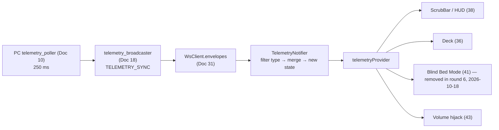

# Doc 33: Flutter Telemetry State Provider

> Part of PotPilot plan-series · Category F · Session 1 Wave 1.B (Subagent 6) · Flutter App

## 1. Purpose & Scope

**Delivers**
- The Riverpod `TelemetryNotifier` + immutable `TelemetryState` that turn the PC agent's `TELEMETRY_SYNC` WebSocket frames (250 ms cadence, `action ∈ {STATE_DELTA, FULL_STATE}`, emitted by [18_pc_telemetry_broadcast_loop.md](18_pc_telemetry_broadcast_loop.md), schema frozen by [03_websocket_json_schema_spec.md](03_websocket_json_schema_spec.md) §5.6) into reactive, type-safe UI state: **timestamp, position, duration, speed, PotPlayer volume, file title, play state, connection flag**, plus an untouched `extras` map of the remaining snapshot keys for Session-2 consumers.
- Defensive parsing (never throws, never regresses on malformed frames) and connection-aware `isConnected` derived from `WsClient` state.
- The single `telemetryProvider` consumed by the scrub bar/HUD, deck, blind-mode canvas, and library surfaces.

**Out of scope**
- Transport, reconnection, and envelope decode ([31_flutter_websocket_client_reconnect.md](31_flutter_websocket_client_reconnect.md) — this doc subscribes to already-decoded `WsEnvelope`s).
- Any outbound command (`CMD_*`) — telemetry is read-only; commands are issued by feature docs.
- UI rendering/layout of scrub bar, OSD badges ([38_flutter_live_scrub_speed_hud.md](38_flutter_live_scrub_speed_hud.md)) — they select from this state.
- Polling the PC directly — the only source is WS `TELEMETRY_SYNC` (fixed 250 ms cadence).

## 2. File Ownership

**Creates (owned, create-only)**
| Path | Content |
|---|---|
| `mobile_app/lib/network/telemetry_provider.dart` | `TelemetryState`, `TelemetryNotifier`, `telemetryProvider`, payload parsing |
| `mobile_app/test/network/telemetry_provider_test.dart` | Parse/merge/state tests |

**Reads / touches (owned elsewhere)**
| Path | Owner | Why |
|---|---|---|
| `mobile_app/lib/network/ws_client.dart` | Doc 31 | Subscribes to `envelopes` (filters `TELEMETRY_SYNC`) and `stateChanges` |
| `shared_specs/ws_command_schema.json` | Doc 01/03 | TELEMETRY_SYNC frame contract consumed by tests |
| Consumer widgets (deck 36, HUD 38, ~~bed mode 41~~ *(removed round 6, 2026-10-18)*, volume hijack 43) | other docs | Read `telemetryProvider` only — no writes |

No other file may construct `TelemetryState` or call `handleEnvelope`.

## 3. Public Contract

```dart
/// Canonical TELEMETRY_SYNC payload keys — frozen by 03 §5.6 (Doc 18 emits identical names).
abstract final class TelemetryKeys {
  static const String positionMs = 'position_ms';
  static const String durationMs = 'duration_ms';
  static const String isPlaying  = 'is_playing';
  static const String speed      = 'speed';
  static const String potPlayerVolume = 'volume';
  static const String fileTitle  = 'file_title';                    // string | null
}

/// Immutable snapshot of PotPlayer + session telemetry; rebuilt (never mutated) per frame.
@immutable
class TelemetryState {
  final int timestamp;            // unix seconds of the last accepted frame
  final int positionMs;           // playback position (normalized ≥ 0)
  final int durationMs;           // total duration (0 = unknown/none)
  final bool isPlaying;
  final double speed;             // 0.2x – 4.0x
  final int potPlayerVolume;      // PotPlayer internal mixer 0–100
  final String? fileTitle;        // basename w/o extension; null = idle
  final Map<String, Object?> extras; // pass-through keys (brightness, blackout, sleep_timer_*, …)
  final bool isConnected;          // WS session alive (false ⇒ values are last-known)

  const TelemetryState({required this.timestamp, ...});
  static const TelemetryState initial;
  double get progress;              // 0..1, 0 when durationMs == 0
  String get positionLabel;         // "HH:MM:SS" ("--:--:--" when none)
  String get durationLabel;         // "HH:MM:SS"
  TelemetryState copyWith({...});   // used only by the notifier emit step
}

/// Parses TELEMETRY_SYNC envelopes into TelemetryState (Riverpod StateNotifier).
class TelemetryNotifier extends StateNotifier<TelemetryState> {
  TelemetryNotifier(this._ws, {TelemetryState initial = TelemetryState.initial});
  /// Subscribes to WsClient envelopes + stateChanges; called by the provider body.
  void bind();
  /// Handles ONE decoded envelope; non-telemetry envelopes are ignored (cheap filter).
  void handleEnvelope(WsEnvelope envelope);
  /// Sets isConnected=false on WS loss, keeping last-known telemetry values.
  void markDisconnected();
  @override void dispose(); // cancels both subscriptions
}

/// The app-wide telemetry source of truth (autoDispose: false).
final telemetryProvider = StateNotifierProvider<TelemetryNotifier, TelemetryState>(...);
```

## 4. Internal Design

**Data flow**



**Parsing algorithm (per incoming envelope)**
1. Cheap guard: `envelope.type != 'TELEMETRY_SYNC'` → return (no state churn from `CMD_*` acks or any other frame type).
2. **Action-aware snapshot maintenance:** `action == 'FULL_STATE'` → `_snapshot = Map.of(payload)` (whole-state replace); `action == 'STATE_DELTA'` → `_snapshot.addAll(payload)` (changed keys only); unknown action → treat as `FULL_STATE` (defensive). Explicit `null` values are *values*, not absence (`file_title: null` = idle) and must be applied, never "fall back".
3. **Field extraction** from `_snapshot` — single canonical key names: 03 §5.6 and Doc 18 agree on every wire key (e.g. `volume`); no alias fallback.
4. **Merge rule:** key absent from `_snapshot` → keep previous state field; key present (including `null`) → apply with the normalization below.
5. **Normalization/clamps:** `position_ms`/`duration_ms` of `-1` (03 "none") and any negative → `0`; `speed` accepted only in `[0.2, 4.0]` (NaN/`null` → previous); `potPlayerVolume` clamped to `[0, 100]`; `file_title` whitespace-only string → keep previous.
6. `timestamp` = `envelope.timestamp` (unix s, from the frozen envelope) if `≥ 1`, else local epoch seconds.
7. `isConnected` = `true` (receiving telemetry implies a live pipe); `extras` = `_snapshot` minus the core keys, passed through untouched for Session-2 consumers (brightness/blackout/sleep-timer surfaces, Docs 12/19/22/23/40).
8. Emit **one** new immutable `TelemetryState` via `state = next` only if `next != state` (equality via `==`/`hashCode` on all fields) — no redundant rebuilds for identical frames.
9. `stateChanges` subscription: any transition to `backoff/authRejected/closed` → `copyWith(isConnected: false)` once (values retained for greyed-out UI); transition to `connected` does **not** force `isConnected=true` — only an actual `TELEMETRY_SYNC` frame does.
10. Frame-order safety: WS is ordered, but after reconnect a frame with `timestamp < state.timestamp` may arrive from a rewound PC clock → accept position/volume (they're authoritative live reads) but never move `timestamp` backwards.

## 5. Protocol & Data Compliance

**Frame consumed** — envelope per `03_websocket_json_schema_spec.md` with `type == "TELEMETRY_SYNC"` (authoritative; not redefined):

| Envelope field | Use here |
|---|---|
| `timestamp` (unix s) | becomes `TelemetryState.timestamp` |
| `type` | must equal `TELEMETRY_SYNC` (exact string) |
| `payload` | source of all state fields below |
| `id`, `action` | ignored (accepted & discarded) |

**`TELEMETRY_SYNC` payload** — frozen by **03 §5.6** (authoritative); Doc 18 emits the identical flat key set:

| Key (03 canonical) | Dart type | Semantics | Maps to |
|---|---|---|---|
| `position_ms` | int | current position; **−1 = none → normalized 0** | `positionMs` |
| `duration_ms` | int | total duration; **−1 = none → 0** | `durationMs` |
| `is_playing` | bool | play state | `isPlaying` |
| `speed` | double | multiplier 0.2–4.0, 2 decimals | `speed` |
| `volume` | int 0–100 | PotPlayer internal volume | `potPlayerVolume` |
| `file_title` | string \| null | basename w/o extension; `null` = idle | `fileTitle` |
| `potplayer_found` | bool | process/window alive | `extras` |
| `sys_volume` | int 0–100 | CoreAudio master | `extras` |
| `sys_muted` | bool | master mute | `extras` |
| `brightness` | int 0–100 \| null | DDC/CI luminance | `extras` |
| `blackout_active` | bool | blackout overlays shown | `extras` |
| `sleep_timer_active` | bool | timer armed | `extras` |
| `sleep_timer_mode` | string \| null | `"COUNTDOWN"` \| `"MOVIE_PROGRESS"`; null = idle | `extras` |
| `sleep_timer_remaining_s` | int \| null | seconds until fire; null = idle | `extras` |

**Frame envelope:** `type = "TELEMETRY_SYNC"` is server→client only (03; a client sending it gets `_ERROR 4002`); `action` ∈ `STATE_DELTA` (changed keys only) / `FULL_STATE` (every key) per Doc 18 — **this client handles both** (18 §6 mandates it); `timestamp` = unix seconds; `id` = fresh uuid4 (Doc 03 §5.7); this consumer ignores `id`.

**Exact constants:** `TelemetryKeys.*` (canonical core set above), `kTelemetryCadence = Duration(milliseconds: 250)` (= codec `telemetryIntervalMs`, exported for consumers/UI tick alignment), `TelemetryState.initial` (all-zero, `isConnected=false`, `fileTitle=null`, empty `extras`).

**Produce:** nothing on the wire — this module's only output is the in-memory `TelemetryState`.

## 6. Dependencies & Integration Points

**Internal**
- [31_flutter_websocket_client_reconnect.md](31_flutter_websocket_client_reconnect.md) — source streams (`envelopes`, `stateChanges`); this doc is the telemetry consumer Doc 31's §2 promises.
- [03_websocket_json_schema_spec.md](03_websocket_json_schema_spec.md) — frame + payload schema authority (§5.6); envelopes arrive already parsed via its codec `ws_message_codec.dart`, streamed by Doc 31.
- [18_pc_telemetry_broadcast_loop.md](18_pc_telemetry_broadcast_loop.md) / [10_potplayer_wm_user_telemetry_poller.md](10_potplayer_wm_user_telemetry_poller.md) — producers of the values parsed here.
- [36_flutter_custom_potplayer_deck_ui.md](36_flutter_custom_potplayer_deck_ui.md), [38_flutter_live_scrub_bar_speed_hud.md](38_flutter_live_scrub_bar_speed_hud.md), [41_flutter_blind_bed_mode_gestures.md](41_flutter_blind_bed_mode_gestures.md), [43_flutter_hardware_volume_button_hijack.md](43_flutter_hardware_volume_button_hijack.md) — downstream read-only consumers.
- [32_flutter_qr_scanner_mdns_pairing.md](32_flutter_qr_scanner_mdns_pairing.md) — triggers `bind()` timing after pairing completes.

**External packages (from [05_flutter_app_boilerplate_deps.md](05_flutter_app_boilerplate_deps.md) catalog)**
| Package | Purpose here |
|---|---|
| `flutter_riverpod` | `StateNotifierProvider` wiring + fine-grained `select` rebuilds |

No other package; parsing is hand-rolled `num`/`bool`/`String` coercion (no codegen).

## 7. Edge Cases & Failure Handling

- **Wi-Fi drop mid-playback:** WsClient → `backoff` ⇒ `markDisconnected()` once: `isConnected=false`, all playback fields retained (HUDs grey out, values persist for resume).
- **Malformed payload (wrong types, unexpected nulls on non-nullable keys):** per-field fallback to previous value; frame never throws; counter `parseErrors` increments for debug overlay. `null` is *not* malformed where 03 declares it legal (`file_title: null` idle, `brightness: null` unsupported) — those are applied.
- **`STATE_DELTA` carrying only a subset of keys:** merged into `_snapshot`; never treated as whole-state — a delta must not erase fields it omits (Doc 18 semantics).
- **Missing keys entirely:** same per-field merge — partial frames tolerated (forward-compatible with 03 evolving).
- **`file_title` whitespace-only:** keep previous title (PC-side mid-switch flicker must not blank the deck label); explicit `null` clears to idle.
- **`potPlayerVolume` out of range (−5, 150):** clamped to `[0, 100]` (wire key `volume`).
- **`position_ms = -1` (03 "none"):** normalized to 0; `progress` = 0; labels render `--:--:--` deterministically.
- **`speed` out of range (0, 5.0, NaN, null):** keep previous speed; never emit NaN into UI.
- **`positionMs > durationMs` or `durationMs == 0`:** `progress` returns 0 (unknown) or caps at 1.0; scrub bar renders deterministically, no divide-by-zero.
- **Clock rollback after PC restart:** timestamp never decreases (monotonic guard); telemetry fields still accepted.
- **Duplicate/replayed frame (same timestamp):** equality check suppresses the no-op state emission → zero wasted rebuilds.
- **Out-of-order envelope types:** `CMD_*` frames pass through untouched to other listeners; notifier's filter is O(1).
- **Rapid connect/disconnect flapping:** `isConnected` writes are idempotent (`copyWith` only when value differs), preventing rebuild storms.
- **Provider disposed at app teardown:** both stream subscriptions cancelled in `dispose()`; no callbacks into a dead notifier.
- **Reconnect gap larger than 250 ms:** expected — first frame after reconnect re-enables `isConnected=true`; UI shows continuous state with one grey-out dip.

## 8. Acceptance Criteria

- [ ] A golden `FULL_STATE` frame (03 §5.6 / `shared_specs/ws_command_schema.json`) maps to exactly the expected `TelemetryState` values, including `extras` pass-through.
- [ ] A `STATE_DELTA` carrying only `{is_playing: false}` changes exactly one field and preserves all others (merge semantics verified against a pre-filled `_snapshot`).
- [ ] Each malformed-payload case (string `position_ms`, `speed: 9.9`, array `file_title`, explicit `null` on `speed`) leaves the prior value intact and increments `parseErrors` — zero thrown exceptions; a legal `file_title: null` clears the title to idle.
- [ ] `state` object identity changes **only** when a field actually changes (identical frame twice ⇒ same instance observed by listeners).
- [ ] WS loss sets `isConnected=false` while preserving all playback fields; reconnect + first frame restores `true`.
- [ ] `progress`, `positionLabel`, `durationLabel` format correctly: `3661000 ms → "01:01:01"`, `durationMs=0 → progress 0`.
- [ ] 10-minute soak at 250 ms cadence: exactly ~2400 accepted frames, no unbounded memory growth (single retained `TelemetryState`).
- [ ] `flutter analyze` clean; `telemetryProvider` never disposed during normal navigation (`autoDispose: false`).

## 9. Test Plan

**Automated** (`flutter test`)
- `mobile_app/test/network/telemetry_provider_test.dart`
  - **Golden FULL_STATE parse:** complete 03 §5.6 payload → expected state incl. timestamp, labels, progress, `extras` pass-through.
  - **Filter:** `CMD_POTPLAYER` envelope (and a `<ACTION>_RESULT` ack) → no state change (same instance).
  - **STATE_DELTA merge:** delta `{is_playing: false}` on a pre-filled snapshot → single-field change; then a `FULL_STATE` replaces `_snapshot` wholesale (a key absent from the new full frame is gone from `extras`).
  - **Normalization matrix:** `position_ms: -1 → 0`; `volume: 150 → 100`; `speed: 9.9 → previous`; `speed: double.nan → previous`; `file_title: " " → previous`; `file_title: null → null`.
  - **Equality suppression:** feed the identical frame twice → `state` identity unchanged (listener called once).
  - **Connection transitions:** fake `stateChanges`: `connected → backoff` ⇒ `isConnected=false` once; re-connect + frame ⇒ `true`; values byte-identical throughout.
  - **Progress edge cases:** `durationMs=0`, `positionMs>durationMs`.
  - **Dispose:** after `dispose()`, pushing an envelope throws nothing and mutates nothing.
- `mobile_app/test/network/telemetry_golden_frames_test.dart` — loads golden JSON frames from `shared_specs/ws_command_schema.json` examples; asserts parse output (contract regression guard shared with Doc 31's envelope test).

**Manual**
1. Play a movie in PotPlayer → deck/HUD update within ~250 ms of play, pause, seek, speed change, volume change, and file switch (title swaps live).
2. Toggle PC Wi-Fi → UI greys out with last values; restore → live values resume without app restart.
3. Play a file with a non-ASCII title (e.g. CJK) → title renders unmodified.

## 10. Assumptions & Open Questions

- **Core key names — RESOLVED:** Doc 03 §5.6 and Doc 18 use identical wire key names (`volume`, `brightness`, `sys_volume`, `sys_muted`, `potplayer_found`, flat `sleep_timer_*`, `file_title`, …) — no reconciliation needed; this client reads them directly and parks the remaining 03 keys in `extras` (pass-through preserved).
- **`FULL_STATE` vs `STATE_DELTA`:** 03 §4.3 describes whole snapshots while 18 defines deltas — the client is action-aware (replace vs merge), which is correct under both readings and explicitly mandated by 18 §6.
- **Telemetry `id` — RESOLVED:** fresh uuid4 on both sides (03 §5.7/§8); ignored by this consumer.
- **`flutter_riverpod` 2.x `StateNotifierProvider`** assumed (Doc 05 pins `flutter_riverpod ^2.5.1`); if v3 `Notifier` is chosen later, migration is mechanical — same state shape.
- **`autoDispose: false`** chosen because telemetry is app-lifetime; if memory profiling later disagrees, the switch is localized to the provider declaration.
- **`-1 → 0` normalization** happens at the client so UI math never guards negatives; raw snapshot values remain available via `extras` if ever needed.
- **No interpolation/forecast** between 250 ms frames (e.g. smooth position ticking) — consumers own any local animation; this doc publishes raw authoritative snapshots only.
