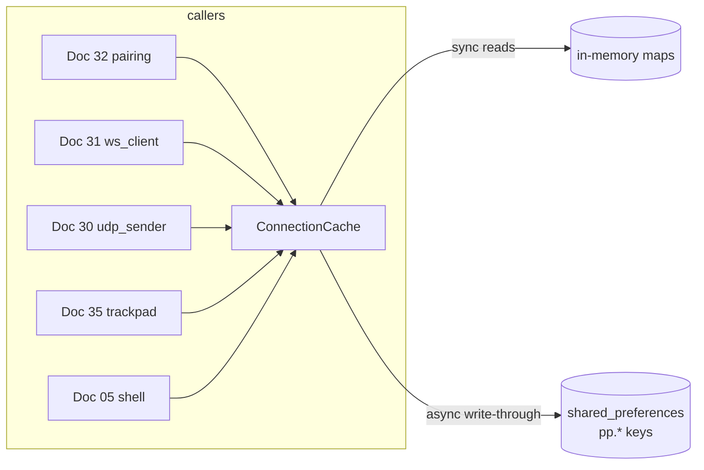

# Doc 34: Flutter Local Storage — Connection Cache

> Part of PotPilot plan-series · Category F · Session 1 Wave 1.B (Subagent 6; config area also feeds Wave 1.A) · Flutter App

## 1. Purpose & Scope

**Delivers**
- A typed, versioned persistence layer (`ConnectionCache`) over `shared_preferences` that stores: **paired PC host records** (IP list, ports, hostname), the **128-bit auth token per host**, the **trackpad sensitivity profile** (sensitivity + acceleration curve parameters), and the **preferred startup tab**.
- Synchronous in-memory reads (UI- and hot-path-friendly) with write-through async persistence, JSON-schema-versioned keys, and corruption-tolerant loading.

**Out of scope**
- The pairing *flow* that writes records ([32_flutter_qr_scanner_mdns_pairing.md](32_flutter_qr_scanner_mdns_pairing.md)) and the consumers that read settings ([30_flutter_udp_datagram_sender.md](30_flutter_udp_datagram_sender.md) ports/token, [31_flutter_websocket_client_reconnect.md](31_flutter_websocket_client_reconnect.md) host, [35_flutter_120hz_virtual_trackpad.md](35_flutter_120hz_virtual_trackpad.md) profile, Doc 05 shell tab).
- PC-side config ([26_pc_config_persistence_manager.md](26_pc_config_persistence_manager.md) — `%APPDATA%\PotPilot\config.json`; this doc is the phone-side counterpart only).
- Secrets storage via Android Keystore/EncryptedSharedPreferences — plaintext-in-sandbox assumed (§10).
- Movie library index, telemetry history, or any bulk data.

## 2. File Ownership

**Creates (owned, create-only)**
| Path | Content |
|---|---|
| `mobile_app/lib/core/storage/connection_cache.dart` | `PcHostRecord`, `TrackpadProfile`, `ConnectionCache`, key constants |
| `mobile_app/test/core/storage/connection_cache_test.dart` | Persistence + migration + corruption tests |

**Reads / touches (owned elsewhere)**
| Path | Owner | Why |
|---|---|---|
| `mobile_app/pubspec.yaml` | Doc 05 | Declares `shared_preferences` dependency (catalog) |
| `SharedPreferences` instance (injected) | Flutter runtime / tests | The only backing store; tests inject a mock |

No other file may access `SharedPreferences` keys owned by this doc (prefix `pp.` is reserved).

## 3. Public Contract

```dart
/// Key constants — reserved 'pp.' namespace; no other module may read/write them directly.
abstract final class CacheKeys {
  static const String hostsV1 = 'pp.hosts.v1';
  static const String activeHostId = 'pp.active_host_id';
  static const String trackpadProfileV1 = 'pp.trackpad.profile.v1';
  static const String startupTab = 'pp.startup_tab';
}

/// Persisted record of one paired PC (JSON round-trippable, schema v1).
@immutable
class PcHostRecord {
  final String id;            // stable: sha1(hostname) short-hash
  final String hostname;      // PC NetBIOS name
  final List<String> ipv4s;   // known LAN IPv4s (QR + mDNS updates, most-recent first)
  final int udpPort;          // frozen 50505
  final int wsPort;           // frozen 50506
  final String tokenHex;      // 128-bit pairing token, 32 hex chars; canonical lowercase (Docs 03/15/17)
  final DateTime lastConnectedAt;
  Map<String, dynamic> toJson(); static PcHostRecord fromJson(Map<String, dynamic> json);
  PcHostRecord copyWith({...});
}

/// Trackpad feel parameters consumed by Doc 35's velocity/scroll math.
@immutable
class TrackpadProfile {
  final double sensitivity;          // 0.2–3.0, linear gain on cursor deltas
  final double accelerationGain;     // 1.0–4.0, extra gain at high velocity
  final double accelerationThreshold;// px/ms where acceleration kicks in
  final double scrollMultiplier;     // 0.2–3.0, gain on two-finger scroll
  static const TrackpadProfile defaults;
  Map<String, dynamic> toJson(); static TrackpadProfile fromJson(Map<String, dynamic> json);
}

/// Write-through async cache with synchronous in-memory reads (singleton).
class ConnectionCache {
  static ConnectionCache get instance;
  /// Loads persisted state into memory; MUST be awaited once at app start (main()).
  Future<void> init({SharedPreferences? injected});
  bool get isReady;
  // -- hosts --
  List<PcHostRecord> get hosts;              // sorted by lastConnectedAt desc, ≤ kMaxHosts
  PcHostRecord? get activeHost;
  Future<void> saveHost(PcHostRecord host);  // upsert by id; enforces LRU cap; trims ip list
  Future<void> updateHostIps(String id, List<String> ipv4s);
  Future<void> setActiveHost(String id);
  Future<void> removeHost(String id);        // clears activeHost if it pointed here
  // -- trackpad --
  TrackpadProfile get trackpadProfile;       // defaults until persisted
  Future<void> saveTrackpadProfile(TrackpadProfile profile); // validates ranges
  // -- shell --
  String get startupTab;                     // one of kStartupTabIds
  Future<void> saveStartupTab(String tabId); // validated against kStartupTabIds
  Future<void> clearAll();                   // wipe pp.* namespace (un-pair everything)
}

/// Known startup tab ids owned by the Doc 05 navigation shell.
const List<String> kStartupTabIds = ['deck', 'trackpad', 'bed', 'library'];
/// Defensive cap: only the most-recently-connected hosts are retained.
const int kMaxHosts = 5;
```

## 4. Internal Design

**Component breakdown**
1. **Key/namespace manager** — single reserved prefix `pp.`; all keys funneled through `CacheKeys`; schema suffix (`.v1`) enables future migrations without key collisions.
2. **Serializer** — JSON-encode on write, `fromJson` with defensive `try` per record on read.
3. **Write-through store** — `init()` reads all keys once into final fields; every `save*` mutates memory first, then `prefs.setString(key, json)`; persistence failures are surfaced as returned `Future` errors but memory stays consistent (next successful write self-heals).
4. **LRU guard** — `saveHost` sorts by `lastConnectedAt`, keeps `kMaxHosts = 5`, drops the oldest; per-record `ipv4s` trimmed to `kMaxIpsPerHost = 4` most-recent.



**Load algorithm (init)**
1. `prefs.getString(hostsV1)` → `jsonDecode` → `List` → per-entry `PcHostRecord.fromJson` in `try`; corrupt entries skipped, count logged — the remaining records survive.
2. `activeHostId` → resolve against loaded hosts; dangling id ⇒ `activeHost = null`.
3. `trackpadProfileV1` → `TrackpadProfile.fromJson` with **field-level** fallback to `defaults` (missing/garbage field ⇒ default for that field only).
4. `startupTab` → validated against `kStartupTabIds`; invalid ⇒ `'deck'`.
5. `isReady = true`; subsequent calls before `init()` throw `StateError` (fail-fast, not silent-null).

**Migration hook:** `CacheKeys` carry `.v1`; a private `_migrations` map (version→`Future<void> Function(SharedPreferences)`) runs sequentially at init when higher versions appear. Only v1 exists now; the hook keeps future renames one-file changes.

## 5. Protocol & Data Compliance

**Storage keys & schemas (phone-side contract):**

| Key | Format | Schema (v1) |
|---|---|---|
| `pp.hosts.v1` | JSON array | `[{"id","hostname","ipv4s":["…"],"udpPort":50505,"wsPort":50506,"tokenHex":"<32hex>","lastConnectedAt":"<ISO8601>"}]` |
| `pp.active_host_id` | string | id of the active record or `""` |
| `pp.trackpad.profile.v1` | JSON object | `{"sensitivity":1.0,"accelerationGain":2.0,"accelerationThreshold":0.8,"scrollMultiplier":1.0}` |
| `pp.startup_tab` | string | one of `deck`, `trackpad`, `bed`, `library` |

**Frozen-contract invariants enforced on write:** `udpPort` must equal **50505**, `wsPort` must equal **50506**, `tokenHex` must match `^[0-9a-fA-F]{32}$` and is stored **lowercased** (canonical form per Docs 03/15/17) — violations throw `ArgumentError` at the API boundary (catches misuse by future docs; ports are not user-tunable).

**Cross-module data:** `tokenHex` stored here is the same 128-bit token whose XOR fold becomes the UDP auth byte (Docs 15/30) and the WS `AUTH` secret (Doc 31) — one source, no duplication.

## 6. Dependencies & Integration Points

**Internal**
- [32_flutter_qr_scanner_mdns_pairing.md](32_flutter_qr_scanner_mdns_pairing.md) — writes `PcHostRecord`s, reads active host for auto-connect; mDNS updates call `updateHostIps`.
- [31_flutter_websocket_client_reconnect.md](31_flutter_websocket_client_reconnect.md) — reads host/port/token; persists refreshed IP after mDNS fallback.
- [30_flutter_udp_datagram_sender.md](30_flutter_udp_datagram_sender.md) — reads `udpPort`/`tokenHex`/IPv4 for `configure()`.
- [35_flutter_120hz_virtual_trackpad.md](35_flutter_120hz_virtual_trackpad.md) — reads `trackpadProfile` at construction; settings UI (if any) writes via `saveTrackpadProfile`.
- [05_flutter_app_boilerplate_deps.md](05_flutter_app_boilerplate_deps.md) — reads `startupTab` at boot for the initial tab; shell's tab-settings UI writes it.
- [26_pc_config_persistence_manager.md](26_pc_config_persistence_manager.md) — conceptual counterpart (agent-side settings); no shared code.

**External packages (from [05_flutter_app_boilerplate_deps.md](05_flutter_app_boilerplate_deps.md) catalog)**
| Package | Purpose here |
|---|---|
| `shared_preferences` | Key-value backing store (injected for tests) |

## 7. Edge Cases & Failure Handling

- **`init()` never awaited (cold-start race):** every accessor throws a clear `StateError("ConnectionCache.init() not completed")` — callers cannot silently read nulls; the Doc 05 shell must await init before building nav.
- **Corrupted `pp.hosts.v1` JSON:** decode failure ⇒ skip that record set; individual `fromJson` failure skips only that record; a fully unreadable value is overwritten on the next successful `saveHost` (self-heal), never crashes startup.
- **Dangling `active_host_id`** (record removed manually): `activeHost` resolves to null → pairing flow (Doc 32) re-prompts.
- **Token rotation (re-pair same PC):** `saveHost` upserts by `id` (hostname-derived) — old token replaced atomically with the record; no duplicate rows, no stale token left behind.
- **LRU cap overflow (6th PC paired):** oldest `lastConnectedAt` record silently dropped; if it was active, active falls back to the newest — pairing flow re-establishes as needed.
- **`ipv4s` growth (DHCP churn):** trimmed to 4 most-recent, newest first — Doc 31/32 always try freshest first.
- **`saveTrackpadProfile` out-of-range values:** each field validated against its §3 range; violation ⇒ `ArgumentError`; partial UI sliders cannot poison the velocity math.
- **`saveStartupTab('bogus')`:** rejected against `kStartupTabIds`; persisted garbage from older builds falls back to `'deck'` on load.
- **`shared_preferences` write failure (disk full/race):** future completes with error; in-memory state already updated so the session continues; retry happens on the next write.
- **Concurrent writes:** single-isolate by design (Dart UI isolate only); `save*` methods are serialized by the prefs API — no locking needed; documented invariant: no background-isolate writers.
- **Un-pair / privacy:** `clearAll()` removes exactly the `pp.` namespace (never other app prefs) → all hosts, token, profile, tab reset to defaults.
- **Version bump in future:** `.v1` keys persist alongside `.v2`; migration runs once; old keys deleted post-migration (hook in §4).

## 8. Acceptance Criteria

- [ ] `init()` → `saveHost(r)` → fresh `ConnectionCache` (new `init` on same prefs) → `hosts` contains `r` with identical fields (JSON round-trip parity, incl. `DateTime`).
- [ ] `tokenHex` round-trips byte-identically; a 31-char token throws `ArgumentError` at `saveHost`.
- [ ] Saving `udpPort: 50507` throws `ArgumentError` — frozen ports are not storable.
- [ ] 6 hosts saved in order of increasing `lastConnectedAt` ⇒ `hosts.length == 5`, oldest absent, sorted desc.
- [ ] Corrupting `pp.hosts.v1` with `"not json"` ⇒ `init` succeeds, `hosts.isEmpty`, no exception.
- [ ] Removing the active host ⇒ `activeHost == null`, `removeHost` future completes, prefs updated.
- [ ] `trackpadProfile` defaults returned before any save; after `saveTrackpadProfile`, new instance reads the saved values; out-of-range field throws.
- [ ] Invalid `pp.startup_tab` value loads as `'deck'`; `saveStartupTab('bogus')` throws.
- [ ] All accessor calls before `init()` completes throw `StateError` (test with a never-completing prefs mock).
- [ ] `flutter test` for this file runs with an injected mock `SharedPreferences` — no platform channels.

## 9. Test Plan

**Automated** (`flutter test`)
- `mobile_app/test/core/storage/connection_cache_test.dart`
  - **Round-trip:** hosts list + profile + tab → save → re-`init` → deep-equal.
  - **Upsert semantics:** `saveHost` twice with same hostname id ⇒ one record, latest token/`lastConnectedAt`.
  - **LRU cap:** 6 saves ⇒ 5 kept, correct eviction.
  - **IP trim:** 6 IPs saved ⇒ 4 kept, newest first.
  - **Corruption matrix:** hosts = garbage JSON; hosts = JSON with one bad entry + two good; profile = `{"sensitivity":"x"}` ⇒ per-field defaults; tab = `"home"` ⇒ `'deck'`.
  - **Validation:** bad token, wrong port, out-of-range profile field, unknown tab id each throw `ArgumentError`; uppercase-hex token is accepted and persisted lowercased (canonical).
  - **pre-init guard:** accessors throw `StateError` before `init` completes.
  - **`clearAll`:** after wipe, all getters return empty/defaults; unrelated mock keys survive.
  - **`activeHostId` dangling:** points at removed id ⇒ `activeHost == null` and id cleared on next write.
- `mobile_app/test/core/storage/cache_schema_v1_test.dart` — golden JSON literal for `PcHostRecord` v1 & `TrackpadProfile` v1 (schema regression lock).

**Manual**
1. Pair, force-close app, relaunch → auto-connects without rescanning (record + token survived).
2. Pair a second PC → oldest of 6 evicted after pairing five more; active switches sensibly.
3. Adjust trackpad sliders (UI from Doc 35 shell), relaunch → feel identical.

## 10. Assumptions & Open Questions

- **`shared_preferences` as the store** (catalog-mandated) stores the token as **plaintext inside the app's private sandbox** — acceptable for a LAN-only pairing secret; migrating to Android Keystore/encrypted prefs is a future hardening item, not in scope here.
- **`kMaxHosts = 5`, `kMaxIpsPerHost = 4`, default trackpad numbers, tab ids** (`deck/trackpad/bed/library` matching the Doc 05/Wave 3.A tab set) are defaults chosen here — tuning values, no contract impact.
- **`id = short hash of hostname`** assumed stable identity (PC rename ⇒ treated as a new PC, old record evictable manually). If Doc 16/17 expose a persistent machine GUID later, swap the id source in one place.
- **`lastConnectedAt` in ISO-8601 string** (locale-proof) rather than epoch int — chosen for debuggability of raw prefs.
- **No settings UI owned here** — persistence API only; whatever UI edits the profile/tab (Doc 35 shell settings or Doc 05) calls this API.
