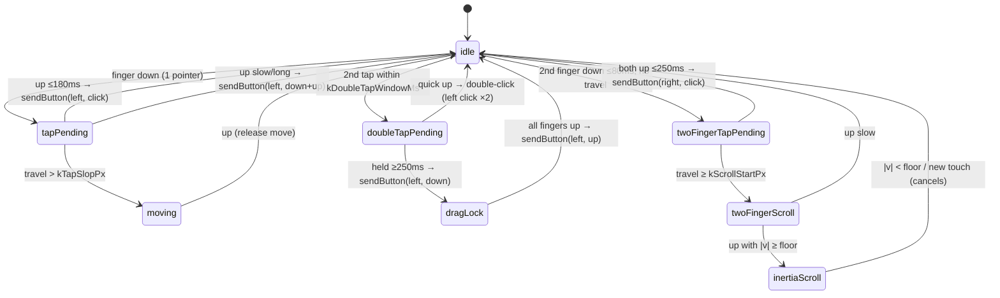

# Doc 35: Flutter 120Hz Virtual Trackpad

> Part of PotPilot plan-series · Category G · Session 2 Wave 2.A (Subagent 3) · Flutter App

## 1. Purpose & Scope

**Delivers**
- `virtual_trackpad.dart`: a full-screen, multi-touch virtual trackpad surface emitting **relative** input to the PC via [30_flutter_udp_datagram_sender.md](30_flutter_udp_datagram_sender.md) — the primary bedroom mouse.
- Gesture set: **velocity-accelerated cursor movement** (120 Hz packet budget), **tap-to-click**, **double-tap-and-hold drag lock**, **two-finger-tap right-click**, **two-finger inertia scrolling**, each with distinct haptic ticks delegated to [42_flutter_haptic_feedback_engine.md](42_flutter_haptic_feedback_engine.md).
- Gesture state machine with explicit timings, tuned from `TrackpadProfile` (Doc 34) — sensitivity, acceleration gain/threshold, scroll multiplier.

**Out of scope**
- Bed-mode eyes-free gestures ([41_flutter_blind_bed_mode_gestures.md](41_flutter_blind_bed_mode_gestures.md)) — different canvas, different semantics.
- Scrubbing HUD/timeline ([38_flutter_live_scrub_bar_speed_hud.md](38_flutter_live_scrub_speed_hud.md)); middle-click/keyboard ([37_flutter_full_pc_keyboard_sheet.md](37_flutter_full_pc_keyboard_sheet.md)).
- OS cursor rendering and the PC-side wheel/click injection ([06_win32_sendinput_mouse_engine.md](06_win32_sendinput_mouse_engine.md)) — this widget only emits wire packets.
- Packet packing, rate limiting, sequencing ([30_flutter_udp_datagram_sender.md](30_flutter_udp_datagram_sender.md) — consumed as a black box), and haptic pattern design (Doc 42).
- On-screen visual cursor trail/animation chrome — minimal AMOLED surface only (theme tokens from Doc 29 if restyled later).

## 2. File Ownership

**Creates (owned, create-only)**
| Path | Content |
|---|---|
| `mobile_app/lib/features/trackpad/virtual_trackpad.dart` | `VirtualTrackpad` widget, gesture engine, velocity/scroll math |
| `mobile_app/test/features/trackpad/virtual_trackpad_test.dart` | Gesture → packet emission tests (widget-level, fake sender) |
| `mobile_app/test/features/trackpad/velocity_model_test.dart` | Pure math tests for accel/scroll/inertia |

**Reads / touches (owned elsewhere)**
| Path | Owner | Why |
|---|---|---|
| `mobile_app/lib/network/udp_sender.dart` | Doc 30 | Sole outbound dependency — `sendMove/sendScroll/sendButton` |
| `mobile_app/lib/core/storage/connection_cache.dart` | Doc 34 | Reads `trackpadProfile` at mount; optional live rebuild on profile change |
| `mobile_app/lib/core/haptics/haptic_engine.dart` | Doc 42 | Fire-and-forget tick callbacks (injected; no-op default) |
| `mobile_app/lib/core/theme/oled_theme.dart` | Doc 29 | Surface colors read-only (if tokens are exposed; else plain black) |

## 3. Public Contract

```dart
/// Pure velocity/scroll math — unit-testable without widgets.
@immutable
class VelocityModel {
  VelocityModel.fromProfile(TrackpadProfile profile);
  /// Applies sensitivity + velocity acceleration to a raw pointer delta (px).
  double amplify(double deltaPx, double velocityPxMs);
  /// Converts accumulated finger travel (px) into wheel units for arg1 of a scroll packet.
  int scrollUnits(double deltaPx);
  /// True while inertia should keep emitting (velocity above floor).
  bool inertiaActive(double velocityPxMs);
  /// Per-frame friction: v' = v × kFriction per 16 ms tick.
  double decay(double velocityPxMs);
}

/// Gesture phases of the trackpad surface (see §4 state machine).
enum TrackpadPhase { idle, tapPending, doubleTapPending, moving, dragLock,
                     twoFingerScroll, twoFingerTapPending, inertiaScroll }

/// Multi-touch virtual trackpad surface (120 Hz packet budget).
class VirtualTrackpad extends StatefulWidget {
  const VirtualTrackpad({super.key, required this.sender, this.profile, this.haptics});
  final UdpSender sender;                 // injected (Doc 30)
  final TrackpadProfile? profile;         // null ⇒ ConnectionCache defaults
  final HapticHooks? haptics;             // injected (Doc 42); null ⇒ silent
}

/// Lightweight haptic seam owned in this file; backed by Doc 42 at composition root.
class HapticHooks {
  final void Function() tapClick;        // light tick on tap-to-click
  final void Function() dragStart;       // firm tick on drag lock engage
  final void Function() dragEnd;
  final void Function() rightClick;      // two-finger right-click tick
  final void Function(double intensity)? scrollTick; // per scroll burst edge
}
```

**Tunable constants (exact names, tunable values):**

| Constant | Value | Meaning |
|---|---|---|
| `kTapMaxDuration` | 180 ms | press shorter ⇒ tap candidate |
| `kTapSlopPx` | 10 | movement above ⇒ not a tap |
| `kDoubleTapWindowMs` | 300 | second tap must start within this |
| `kDoubleTapHoldMs` | 250 | hold this long after 2nd tap ⇒ drag lock |
| `kTwoFingerTapMaxMs` | 250 | max simultaneous-down time for right-click |
| `kTwoFingerStartWindowMs` | 80 | max gap between 1st and 2nd finger down |
| `kTwoFingerFusionPx` | 30 | min distance between the two pointers |
| `kScrollStartPx` | 8 | travel in 2-finger mode before scroll engages |
| `kScrollMinDelta` | 1 | smallest delta that produces a packet |
| `kInertiaMinVelocity` | 0.05 px/ms | inertia floor |
| `kInertiaFriction` | 0.94 | velocity multiplier per 16 ms tick |
| `kMaxVelocity` | 6.0 px/ms | EMA velocity clamp |

## 4. Internal Design

**Gesture state machine** (single `Listener` on raw pointer events — no competing gesture arenas):



**Algorithms (numbered)**
1. **Pointer pipeline:** raw `Listener.onPointerDown/Move/Up/Cancel` events (device-local delta available; fallback: compute from positions) feed the engine; a `Map<int, _Finger>` tracks per-pointer position, down-time, travel accumulator, start point.
2. **Velocity estimation:** EMA of per-event speed: `v = α·|delta|/dt + (1−α)·v` with `α = 0.4`, clamp `kMaxVelocity`; velocity resets 150 ms after motion stops.
3. **Cursor movement:** per move event, `dxFinal = VelocityModel.amplify(dx, v)` → `sender.sendMove(round(dxFinal), …)`; **Doc 30's coalescer is the 120 Hz budget** — this widget may emit at touch-sampling rate (60–240 Hz) and trusts the sender to sum & cap; negative and positive axes independent; drag lock moves identically (button already down).
4. **Amplification curve:** linear zone `|v| ≤ threshold` → gain = `sensitivity`; beyond threshold, gain grows linearly toward `sensitivity × accelerationGain` at `kMaxVelocity`; result clamped to int16 per axis by the sender.
5. **Tap recognition:** up within `kTapMaxDuration` and `|travel| ≤ kTapSlopPx` → `sendButton(left, click)` + light haptic. Slow/long release = deliberate `down + up` (so a "press and hold" reaches the PC as a hold).
6. **Double-tap-and-hold:** second `tapPending` down within `kDoubleTapWindowMs` of the previous tap → `doubleTapPending`; if it survives `kDoubleTapHoldMs` without >`kTapSlopPx` travel → `sendButton(left, down)` (drag start), phase `dragLock`, suppress tap semantics for the rest of the touch; **all fingers up** → `sendButton(left, up)`. A quick second release = ordinary double-click (two `click` packets).
7. **Two-finger fusion:** second pointer down within `kTwoFingerStartWindowMs`, within `kTwoFingerFusionPx` of the first ⇒ fused two-finger mode (all single-finger tap/drag recognition suspended).
8. **Two-finger tap:** fused pair released within `kTwoFingerTapMaxMs` with combined travel ≤ `kTapSlopPx` ⇒ `sendButton(right, click)` + haptic.
9. **Two-finger scroll:** fused pair's summed |Δy| ≥ `kScrollStartPx` ⇒ `twoFingerScroll`; every event converts summed `Δy/Δx` through `scrollUnits()` (sensitivity already applied) and calls `sender.sendScroll(units, 0)`; emit at most once per frame (`kScrollMinDelta` floor avoids wheel spam); vertical primary, horizontal supported.
10. **Inertia:** on two-finger lift with `|v| ≥ kInertiaMinVelocity`, keep a `Ticker` at 60 Hz emitting `sendScroll(decayedDelta)` where `Δ = v·16ms·scrollMultiplier`, each tick `v = decay(v)` (`× kInertiaFriction`); terminate on floor, new pointer down (cancel), or phase change; haptic scroll-tick fires on direction edges only.
11. **Hot-path hygiene:** no per-event allocations in `onPointerMove` — `_Finger` slots reused, math on fields; rounding via `round()` on cached doubles; no string/format work anywhere in the movement path (zero GC jitter requirement pairs with Doc 30's allocation-free packer).
12. **Cancellation:** `onPointerCancel`, app lifecycle pause, or `sender.close()` ⇒ abort current phase (emit pending `left up` if in drag lock), return to `idle`.

## 5. Protocol & Data Compliance

**Datagrams produced (via Doc 30's API only — layout mirrored from `02_binary_udp_protocol_spec.md`):**

| Gesture | Type byte | arg1 | arg2 | Rate |
|---|---|---|---|---|
| Move / drag move | `0x01` mouse move | `dx` int16 | `dy` int16 | ≤ 120/s (sender-capped) |
| Two-finger / inertia scroll | `0x02` scroll | vertical wheel **ticks** int16 | horizontal ticks int16 (0 when unused) | ≤ 60/s + inertia |
| Tap left / drag press / release | `0x03` button | `1` (left) | `3` click / `1` down / `2` up | event-driven |
| Right-click | `0x03` button | `2` (right) | `3` click | event-driven |

- Scroll args are **wheel ticks** (1 tick ≈ one notch); Doc 06 converts each tick to `wheel_units_per_tick = 120` (`WHEEL_DELTA`) and chunks large values (`max_wheel_chunk = 120`) — `VelocityModel.scrollUnits()` owns the finger-px → tick conversion.
- Middle button (`3`) is **never** emitted by this widget (reserved for future surfaces).
- Every packet carries Doc 30's auth byte + sequence — this widget must not (and cannot) touch them.
- No WebSocket traffic originates here; no new wire concepts introduced.

## 6. Dependencies & Integration Points

**Internal**
- [30_flutter_udp_datagram_sender.md](30_flutter_udp_datagram_sender.md) — the only transport; relies on its coalescer/rate cap/int16 clamping.
- [34_flutter_local_storage_connection_cache.md](34_flutter_local_storage_connection_cache.md) — `TrackpadProfile` source (`sensitivity`, `accelerationGain`, `accelerationThreshold`, `scrollMultiplier`).
- [42_flutter_haptic_feedback_engine.md](42_flutter_haptic_feedback_engine.md) — patterns behind `HapticHooks` (composition root wires real engine; tests inject spies/no-ops).
- [06_win32_sendinput_mouse_engine.md](06_win32_sendinput_mouse_engine.md) — peer: interprets these packets as relative mouse input / wheel ticks.
- [29_flutter_oled_theme_design_system.md](29_flutter_oled_theme_design_system.md) — surface styling (read-only).
- [41_flutter_blind_bed_mode_gestures.md](41_flutter_blind_bed_mode_gestures.md) — sibling canvas; must not share gesture recognizers (distinct state machines by design).

**External packages (from [05_flutter_app_boilerplate_deps.md](05_flutter_app_boilerplate_deps.md) catalog)**
| Package | Purpose here |
|---|---|
| `flutter_riverpod` | Reads `trackpadProfile` reactively from the cache provider |
| `vibration` | Via Doc 42's engine only — this file never imports it directly |

Gesture plumbing is pure `dart:ui`/Flutter (`Listener`, `Ticker`, `PointerEvent`) — no extra packages.

## 7. Edge Cases & Failure Handling

- **Pointer cancel (notification shade, incoming call, rotation):** abort phase; if `dragLock` was engaged emit `left up` first — the PC never ends up with a stuck button.
- **Second finger lands mid-drag:** drag lock keeps priority; two-finger fusion only starts from `idle/tapPending` (documented rule — prevents accidental right-clicks while dragging).
- **First finger lifts while second stays (two-finger scroll in flight):** continue with single remaining finger as plain move after cancelling inertia — no phantom scroll.
- **Inertia interrupted by new touch:** ticker cancelled in the same frame; velocity discarded (no scroll resume).
- **Wi-Fi drop / `sender.isReady == false`:** Doc 30 silently drops packets; the surface keeps tracking locally (no jank, no exceptions); gestures resume when the sender reconnects.
- **Sequence of down/up across reconnect:** `dragLock` state persists locally; on reconnect the `up` still maps to a valid button packet (auth byte refreshed by Doc 30 `configure`).
- **Velocity spikes (stylus lift glitch, palm contact):** EMA + `kMaxVelocity` clamp absorb single-event outliers; travel slop prevents accidental taps from palms (large-area contact ignored via `kTwoFingerFusionPx` sanity).
- **Two-finger tap with slightly staggered lifts:** measured by *both-down* window and combined travel — staggered lifts ≤ `kTwoFingerTapMaxMs` still count; above it degrades to scroll-then-tap noise → treated as scroll (no right-click).
- **int16 saturation on flicks:** sender splits overflow; velocity math stays in double until rounding.
- **Profile changed at runtime (settings):** widget reads `TrackpadProfile` from the Riverpod cache provider — next gesture uses new values; `VelocityModel` rebuilt on change notification.
- **Screen-off/background mid-gesture:** lifecycle pause hook emits pending `up`, cancels ticker, resets to `idle`.
- **Very slow drift (< `kScrollMinDelta` per event):** suppressed — prevents constant 1-unit wheel packets during micro-adjustments.

## 8. Acceptance Criteria

- [ ] Finger drag on a 120 Hz device: DevTools shows ≤120 `0x01` datagrams/s while summed deltas equal summed pointer deltas (Doc 30 tests compose with this one).
- [ ] Slow drag beyond `accelerationThreshold` visibly accelerates the PC cursor; gain curve unit test matches `VelocityModel` math exactly.
- [ ] Quick tap ⇒ exactly **one** `(left, action=Click)` packet (the PC synthesizes press/release); an aborted 20 px drag produces zero button packets.
- [ ] Double-tap-hold → drag: exactly one `(left, down)` at lock engage, move packets during drag, exactly one `(left, up)` on release — never two `down`s.
- [ ] Two-finger tap ⇒ exactly one `(right, click)`; a 2-finger 50 px slide ⇒ zero clicks, N scroll packets.
- [ ] Inertia: a fast two-finger flick keeps emitting decaying scroll packets after lift, stops within ~1.5 s, and cancels instantly on new touch.
- [ ] Right-click on the PC opens a context menu; tap-click moves-and-clicks; drag moves a desktop icon — all verified on device against the real agent.
- [ ] Gesture recognizer test suite passes with **all** packets captured by a fake `UdpSender` (no real sockets in tests).
- [ ] `flutter analyze` clean; no allocation growth in a 60 s continuous-drag DevTools profile.

## 9. Test Plan

**Automated** (`flutter test`)
- `mobile_app/test/features/trackpad/velocity_model_test.dart` (pure math)
  - Linear zone: `|v| ≤ threshold` ⇒ gain == sensitivity.
  - Acceleration zone: gain rises monotonically, bounded by `sensitivity × accelerationGain`.
  - `scrollUnits` scaling vs profile multiplier; `decay` chain matches `kInertiaFriction^n`; `inertiaActive` floor boundary.
- `mobile_app/test/features/trackpad/virtual_trackpad_test.dart` (widget + fake `UdpSender` recording calls + fake `HapticHooks` spies + fake async `Ticker`)
  - **Tap** — down/up within 180 ms ⇒ one `sendButton(1, 3)`.
  - **Drag-abort** — down, move 40 px, up ⇒ zero button packets, ≥1 `sendMove`.
  - **Double-tap-hold drag** — sequence produces `down` … `up` exactly once; quick double-tap produces two clicks and no down/up pair.
  - **Right-click** — two-finger tap ⇒ `sendButton(2, 3)` once; no left-click leakage.
  - **Scroll** — two-finger slide ⇒ `sendScroll` with expected sign/magnitude; below-threshold drift ⇒ none.
  - **Inertia** — scripted high-velocity lift ⇒ ≥3 decaying `sendScroll` calls, terminating; new-touch cancellation ⇒ immediate stop.
  - **Pointer cancel mid-drag** ⇒ synthetic `up` emitted (no stuck button).
  - **Profile swap** — rebuild with new `sensitivity` ⇒ subsequent deltas amplified by the new factor.

**Manual**
1. On-device against the real PC agent: cursor tracks 1:1 at low speed, accelerates on flicks with no overshoot jitter; desktop icon drag works; right-click context menu works.
2. Two-finger scroll in a long webpage/PDF on the PC — smooth, inertial, stops on touch.
3. Incoming phone call mid-drag (Doc 44 active) — after call, PC is not left in a pressed-drag state.

## 10. Assumptions & Open Questions

- **Timing constants** (§3 table) are ergonomics defaults for bedroom use — tunable without contract impact; values recorded, not invented elsewhere.
- **Left-click = single `Click` (action 3)** — confirmed by Doc 06 (A3): injected as two back-to-back INPUTs, an "instant click"; down/up pairs remain reserved for drag semantics.
- **Scroll units** — confirmed by Doc 06: `arg1/arg2` carry wheel **ticks**; the PC multiplies by `wheel_units_per_tick = 120` (`WHEEL_DELTA`) and chunks to `max_wheel_chunk = 120` units, so `kScrollMinDelta = 1` (one notch) is meaningful; `scrollMultiplier` scales finger px before tick conversion.
- **`HapticHooks` seam defined in this file** for testability; Doc 42's `HapticEngine` (its §7 lists this widget as a call site) backs the hooks at the composition root — tap/drag/right-click/scroll ticks map to Doc 42's tick-class patterns per its final enum names at implementation time.
- **No middle-click, no horizontal-strip edges, no pressure sensitivity** — deliberately deferred; add via new packet actions only with orchestrator-approved contract change.
- **Velocity EMA α = 0.4 and 150 ms decay** chosen empirically for 60–240 Hz panels; device-testing may retune (single constant).
