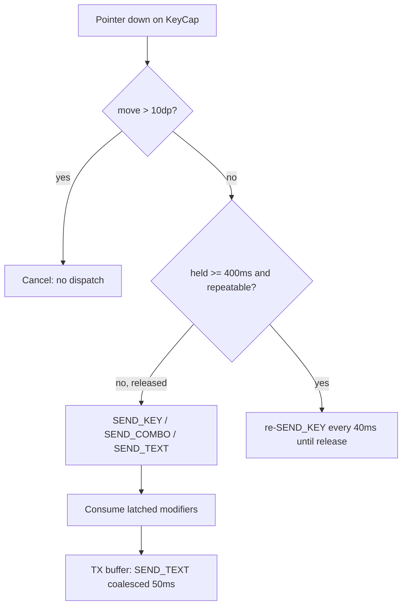

# Doc 37: Full PC Keyboard Sheet

> Part of PotPilot plan-series · Category G · Session 2 Wave 2.A · Flutter App

## 1. Purpose & Scope
**Delivers** `full_keyboard.dart` — a custom dark-themed PC keyboard overlay (bottom sheet) exposing keys a phone IME cannot send: **Esc, Tab, Win, Alt+F4, F1–F12, an arrow cluster**, plus a full QWERTY row set with latched **Shift/Ctrl/Alt** modifiers and **live text input forwarding** (typed characters stream to the focused PC application as they are pressed).

**Out of scope:**
- PC-side `SendInput` Unicode/VK injection and modifier combos → [07_win32_sendinput_keyboard_engine.md](07_win32_sendinput_keyboard_engine.md)
- Sheet theming tokens → [29_flutter_oled_theme_design_system.md](29_flutter_oled_theme_design_system.md); connection/transport → Docs 31/33
- Any deck/scrub controls (36/38), audio/sub sheet (39), monitor drawer (40), blind gestures (41)
- System IME / hardware-keyboard passthrough (see §10)

## 2. File Ownership
**Creates (create-only):**
- `mobile_app/lib/features/keyboard/full_keyboard.dart`

**Reads / integrates (owned by other docs):**
- `mobile_app/lib/network/ws_client.dart` — Doc 31: `WsClient.send("CMD_KEY", action, payload)` + connected flag
- `mobile_app/lib/core/theme/oled_theme.dart` — Doc 29: keycap rest/pressed/latched colors
- `mobile_app/lib/core/haptics/haptic_engine.dart` — Doc 42: `play(microTick)` per key, `play(heavyThud)` on Enter/Esc
- `mobile_app/lib/network/telemetry_provider.dart` — Doc 33: `fileTitle` caption only (shows what the keyboard is driving)
- `mobile_app/pubspec.yaml` — Doc 05: `flutter_riverpod`

## 3. Public Contract
```dart
/// Presenter: opens the modal bottom sheet over the current screen.
Future<void> showFullKeyboardSheet(BuildContext context);

/// Root stateful widget rendering the keyboard from a declarative key map.
class FullKeyboardSheet extends ConsumerStatefulWidget {
  const FullKeyboardSheet({super.key});
}

/// One physical key: printable char or named special key.
enum SpecialKey { esc, tab, win, altF4, backspace, enter, shift, ctrl, alt,
  f1, f2, f3, f4, f5, f6, f7, f8, f9, f10, f11, f12,
  arrowUp, arrowDown, arrowLeft, arrowRight, home, end, pageUp, pageDown }

/// Latched (one-shot) modifier state carried into the next key press.
enum Modifier { shift, ctrl, alt }

/// Owns the outgoing text buffer, latched modifiers, and hold-repeat timers.
class KeyboardController {
  /// Forwards one printable character via `SEND_TEXT` (consumes latched modifiers
  /// by upper-casing / prefixing; see §4.3).
  void tapChar(String ch);
  /// Maps [key] to its Win32 VK code (§5 table) and dispatches `SEND_KEY`
  /// (or `SEND_COMBO` when modifiers are latched / self-contained like Alt+F4).
  void tapSpecial(SpecialKey key);
  /// Toggles a one-shot modifier latch (visual underline until consumed).
  void latchModifier(Modifier m);
  /// Starts hold-repeat: first `SEND_KEY`, then repeated `SEND_KEY` every 40 ms
  /// after a 400 ms delay (Windows typematic feel).
  void startRepeat(SpecialKey key);
  /// Stops auto-repeat for [key]; no dispatch if the press was a tap.
  void stopRepeat(SpecialKey key);
  /// Human-readable latch summary for the status strip, e.g. `Ctrl+Shift` or ``.
  String describeLatched();
}

/// A single keycap in the layout grid (char, special, span, repeatable flag).
class KeySpec {
  const KeySpec({required this.label, this.char, this.special, this.span = 1,
    this.repeatable = false});
}
```

## 4. Internal Design
1. **Declarative layout:** `const List<List<KeySpec>> qwertyRows` plus a dedicated **F-row** (Esc, F1–F12, tabbed secondary page) and a **nav cluster** row (arrows ⍐ + Home/End/PgUp/PgDn). Rendering maps `KeySpec` → `KeyCap` widget; no per-key hand layout.
2. **Sheet presentation:** `showModalBottomSheet` with `backgroundColor: oled.black`, drag-dismissible, ~45 % screen height; top strip = live echo line (last 40 forwarded chars, night-vision amber) + `×` dismiss.
3. **Text forwarding:** printable taps append to `pendingText` and flush immediately (single char = one `SEND_TEXT`); consecutive fast chars within 50 ms coalesce into one `SEND_TEXT` batch via a `Timer(50 ms)`. Latched modifier alters the emitted character (Shift+a → `A`) then unlatches.
4. **Hold-repeat state machine (arrows/backspace/enter):** `pressed → (held ≥ 400 ms) → repeat every 40 ms → released`. The freeze has **no** `KEY_REPEAT` action, so each repeat tick re-dispatches `SEND_KEY {vk}` (≈25 Hz). Pointer-move beyond 10 dp cancels the press (no dispatch). Tap shorter than 400 ms dispatches once via `SEND_KEY`.
5. **Combo keys:** `Alt+F4` is a first-class keycap dispatching `SEND_COMBO {"vk": 115, "modifiers": ["ALT"]}` (F4 VK = 115) — never two separate events. `Win` tap = `SEND_KEY {"vk": 91}` (LWIN, Start menu); holding Win latches it so the next key becomes a `SEND_COMBO` with `modifiers: ["WIN"]` (e.g., Win+D).
6. **Modifier latch:** Shift/Ctrl toggle-latch (amber underline); `Alt` latches too; latches are consumed by the next `tapChar`/`tapSpecial` or cleared on sheet close. `Alt+F4` ignores latches (self-contained).

**Key page map (portrait 360 dp):**

| Page region | Contents |
|---|---|
| F-row (scrollable if needed) | Esc · F1–F12 |
| Row 1 | ` 1 2 3 4 5 6 7 8 9 0 - = ⌫` |
| Row 2 | `Tab q w e r t y u i o p [ ] \` |
| Row 3 | `Shift a s d f g h j k l ; ' Enter` |
| Row 4 | `Ctrl Win Alt _ Space Alt+F4` (space spans 4) |
| Nav cluster | ◀ ▲ ▼ ▶ · Home End PgUp PgDn |

`KeyCap` sizing: 34 × 44 dp default, 44 dp touch height, span-aware width; pressed = Doc 29 accent fill for 80 ms.



## 5. Protocol & Data Compliance
Catalog frozen in [03_websocket_json_schema_spec.md](03_websocket_json_schema_spec.md) §5.4; keyboard uses `CMD_KEY` exclusively. VK codes are the standard Win32 constants (consumed, not invented) — Doc 07 injects them via `KEYBDINPUT`.

| On-screen control | WS `type` | `action` | `payload` |
|---|---|---|---|
| Printable char (a–z, 0–9, symbols) | `CMD_KEY` | `SEND_TEXT` | `{"text": "a"}` (coalesced `{"text":"abc"}`, 1–4096 chars) |
| Esc / Tab / Enter / Backspace | `CMD_KEY` | `SEND_KEY` | `{"vk": 27}` / `{"vk": 9}` / `{"vk": 13}` / `{"vk": 8}` |
| Win (tap) | `CMD_KEY` | `SEND_KEY` | `{"vk": 91}` (VK_LWIN) |
| F1–F12 | `CMD_KEY` | `SEND_KEY` | `{"vk": 112}` … `{"vk": 123}` (VK_F1–VK_F12) |
| Arrow cluster / Home / End / PgUp / PgDn | `CMD_KEY` | `SEND_KEY` (first + each repeat tick) | `{"vk": 38}` ↑ `{"vk": 40}` ↓ `{"vk": 37}` ← `{"vk": 39}` → `{"vk": 36}` `{"vk": 35}` `{"vk": 33}` `{"vk": 34}` |
| Alt+F4 combo key | `CMD_KEY` | `SEND_COMBO` | `{"vk": 115, "modifiers": ["ALT"]}` |
| Latched Shift/Ctrl/Alt + next key | `CMD_KEY` | `SEND_COMBO` | `{"vk": <K's VK>, "modifiers": ["SHIFT"｜"CTRL"｜"ALT"]}` (max 4, no dupes) |
| Held Backspace/Enter/arrow repeat | `CMD_KEY` | `SEND_KEY` ×N (25 Hz) | same `{"vk": …}` envelope re-sent — **no dedicated repeat action exists in the freeze** |

**TELEMETRY_SYNC fields rendered:** `file_title` only (sheet caption). Keyboard is fire-and-forget; no position/speed coupling.

## 6. Dependencies & Integration Points
- **Action catalog:** [03_websocket_json_schema_spec.md](03_websocket_json_schema_spec.md) §5.4 — `SEND_KEY` / `SEND_COMBO` / `SEND_TEXT` subset above
- **Sender:** [31_flutter_websocket_client_reconnect.md](31_flutter_websocket_client_reconnect.md) — `WsClient.send("CMD_KEY", …)` + connection gate
- **PC injection:** [07_win32_sendinput_keyboard_engine.md](07_win32_sendinput_keyboard_engine.md) (`KEYBDINPUT` VK/Unicode) routed by [14_pc_websocket_server_router.md](14_pc_websocket_server_router.md)
- **Telemetry:** [33_flutter_telemetry_state_provider.md](33_flutter_telemetry_state_provider.md) — caption only
- **Haptics:** [42_flutter_haptic_feedback_engine.md](42_flutter_haptic_feedback_engine.md); **Theme:** [29_flutter_oled_theme_design_system.md](29_flutter_oled_theme_design_system.md)
- **External packages:** `flutter_riverpod` only. All timers are `dart:async` (`Timer.periodic`). No keyboard/IME plugin is used.

## 7. Edge Cases & Failure Handling
- **WS disconnect mid-typing:** pending coalesce buffer is flushed on reconnect (Doc 31 backoff) with a "queued N chars" pill (≤4096 chars per Doc 03 `SEND_TEXT` cap — split into multiple envelopes if exceeded); repeat timers are force-stopped; keys render disabled while disconnected.
- **Rapid typing > 50 ms cadence:** chars coalesce into batches (max 64 chars per `SEND_TEXT`) — never dropped, order preserved.
- **Repeat key released after disconnect:** `stopRepeat` runs locally even offline; no queued repeat envelopes fire after reconnect (only the char buffer queues).
- **Latched modifier on sheet close / focus loss:** all latches cleared; no phantom Ctrl stuck on PC (Doc 07 also has a safety key-up sweep — integration point, not owned here).
- **Pointer drag off keycap:** press cancelled, nothing dispatched (prevents stray Esc from scroll gestures).
- **Non-ASCII / emoji input:** printable Unicode is forwarded via `SEND_TEXT` (Doc 07 Unicode injection); emoji outside BMP sent as full code points (Dart strings are UTF-16 — pass `String`, never code-unit slices).
- **Portrait width < 360 dp:** F-row becomes horizontally scrollable; arrows cluster shrinks to 4-key diamond; nothing wraps into double-height rows.
- **Backdrop dismiss during repeat:** sheet `onDismiss` calls `stopRepeat` for every active key before dispose.

## 8. Acceptance Criteria
- [ ] Sheet opens over any tab on pure `#000000`, is drag-dismissible, and shows the live echo line updating per forwarded char.
- [ ] Esc, Tab, Win, F1–F12, Alt+F4, and all four arrows are present and each dispatches exactly one `CMD_KEY` envelope per tap with §5 payloads (VK ints as listed).
- [ ] Alt+F4 arrives at the PC as a single `SEND_COMBO` keystroke (closes the focused window) — verified manually.
- [ ] Holding ArrowUp for 1 s emits ≈25 identical `SEND_KEY {"vk": 38}` envelopes after the 400 ms delay, then stops <50 ms after release.
- [ ] Shift latch: `Shift` then `a` produces a `SEND_COMBO` with `modifiers:["SHIFT"]` (or upper-case `SEND_TEXT` — implementation picks one, test pins it), latch underline clears after consumption.
- [ ] Fast typing coalesces: typing `hello` in <50 ms gaps produces ≤5 `SEND_TEXT` envelopes, total text `hello`, in order.
- [ ] Disconnect: keys grey out immediately; queued chars flush after reconnect without loss or duplication.
- [ ] `flutter analyze` clean; all tests green.

## 9. Test Plan
- **`mobile_app/test/features/keyboard/full_keyboard_test.dart`** (widget): pumps sheet with mock Doc 31 client; asserts captured envelopes for Esc (`vk:27`), F12 (`vk:123`), Win (`vk:91`), Alt+F4 (`SEND_COMBO` `vk:115` + `modifiers:["ALT"]`), arrow tap (`vk:38`); asserts F-row + arrow cluster exist on 360 dp width; asserts disabled visuals when disconnected.
- **`mobile_app/test/features/keyboard/keyboard_controller_test.dart`** (unit): shift-latch consumption; modifier applied to char vs special; Win latch (Win then D → `modifiers:["WIN"]`); buffer coalescing with `fakeAsync` (50 ms flush, 64-char cap, ordering).
- **`mobile_app/test/features/keyboard/keyboard_repeat_test.dart`** (unit, `fakeAsync`): 400 ms delay → 25 Hz cadence of repeated `SEND_KEY` ≈ 25 sends/s; release stops; 10 dp move cancels with zero dispatch.
- **Manual:** open Notepad on PC → type mixed case + Enter + arrows + Esc from phone; Alt+F4 closes Notepad with unsaved dialog (confirms `SEND_COMBO`); toggle airplane mode mid-typing → chars queue and flush on reconnect.

## 10. Assumptions & Open Questions
- **Resolved against the freeze:** Doc 03 §5.4 exposes only `SEND_KEY {vk: int}`, `SEND_COMBO {vk, modifiers[]}`, `SEND_TEXT {text}` — there is **no** `KEY_REPEAT`; hold-repeat is client-driven re-dispatch of `SEND_KEY` at 25 Hz (each treated as discrete `SendInput` by Doc 07).
- **Assumption:** VK codes in §5 are the standard Win32 constants (Esc 27, Tab 9, Enter 13, Backspace 8, LWIN 91, F1–F12 112–123, arrows 37–40, Home 36, End 35, PgUp 33, PgDn 34) — OS-defined, not invented.
- **Assumption:** modifier+letter goes out as `SEND_COMBO` with the letter's VK; Shift+digit punctuation is sent as `SEND_TEXT` with the already-translated character (client-side US-QWERTY layout).
- **Assumption:** Win doubles as tap (Start) and one-shot latch (Win+X combos); arrows/Backspace/Enter are `repeatable`, F-keys are not.
- **Assumption:** `mobile_app/test/...` mirrors `lib/` (Flutter standard); the blueprint only enumerates `lib/` paths.
- **Open:** should the sheet offer a "numpad" secondary page? Deferred — not in the Doc 37 brief; add later as a `KeySpec` page flag without file changes elsewhere.

## 11. Round-6 Addendum — Trackpad Keyboard Trigger Zone (2026-10-18)

Replacement for the removed bed mode (Doc 41 banner) — a lightweight "open the phone keyboard" entry point on the trackpad screen:

- **File:** `mobile_app/lib/features/trackpad/keyboard_trigger_overlay.dart` (`KeyboardTriggerOverlay`, Doc 37 companion), docked in `main.dart`'s `_TrackpadPlaceholder` `Stack` as `Positioned(top: 8, right: 8)` — a **48×48 dp chip** (WCAG-sized target, key `trackpad_keyboard_trigger`) top-right over the trackpad; it is the Stack's only hit-testable child, so chip taps never reach the trackpad underneath (no phantom cursor moves).
- **IME bridge:** tapping the chip focuses a **hidden 1×1 `TextField`** (key `trackpad_keyboard_input`, wrapped in `IgnorePointer`, focus requested programmatically only) so Flutter's `EditableText` owns the phone IME connection (show/hide/composing/reconnect). Tapping the chip again unfocuses (acts as close while the IME is up); the icon flips `keyboard` / `keyboard_hide` and colors track focus (amber) / open (crimson) / disconnected (tertiary).
- **Diff forwarding:** every edit is diffed against the last-sent value (common-prefix): diverged suffix removed → `KeyboardController.tapSpecial(backspace)` → `SEND_KEY {vk: 8}` per char; appended runes → `tapChar` → coalesced `SEND_TEXT` (50 ms / ≤64-char flush, §4.3 unchanged); **submit → `SEND_KEY {vk: 13}`** (Enter) while keeping the field focused. WS-down contract is the existing §7 one: the controller queues text but drops key envelopes.
- **Tests:** `mobile_app/test/features/trackpad/keyboard_trigger_overlay_test.dart` — chip focuses the hidden field (IME gate), typed text flushes as one `SEND_TEXT` after the coalesce window, deletions forward `SEND_KEY {"vk": 8}`, submit forwards `{"vk": 13}`, chip taps never reach the trackpad.
