# Doc 38: Live Scrub Bar & Speed/Volume HUD

> Part of PotPilot plan-series · Category G · Session 2 Wave 2.A · Flutter App

## 1. Purpose & Scope
**Delivers** `scrub_speed_hud.dart` — the two-way interactive movie timeline scrubber rendering `01:24:10 / 02:15:00` (current / total) plus live OSD badges for **playback speed (`1.4x`)** and **volume (`42%`)**. Telemetry drives the thumb when idle; during a drag the phone becomes the source of truth, streaming UDP `0x04` `SCRUB_SEEK` packets for low-latency preview, committing the final position with the frozen WS `SEEK {position_ms}` action (Doc 03 §5.3 — `SEEK` is this doc's scrub-bar action), then settling back onto telemetry.

> **(Round 6, 2026-10-18):** `ScrubTrack` was removed in round 5 (Doc 36 §11) and is now **restored** as the top general seek bar — `features/hud/scrub_track.dart`, rendered by `ScrubSpeedHud` with key `hud_track`, alongside the Doc 36 bottom ruler (this doc's §3 contract is live again). `PotpilotScrubTransport.sendScrub` now `debugPrint`s `ScrubTransport: UDP not ready - preview packet dropped` when the UDP circuit breaker has tripped (see the Doc 30 §7 round-6 correction).

**Out of scope:**
- Discrete deck seek/speed buttons (±5s/±30s, speed step) → [36_flutter_custom_potplayer_deck_ui.md](36_flutter_custom_potplayer_deck_ui.md) (may embed this widget as a header)
- Continuous blind-mode scrubbing gestures → [41_flutter_blind_bed_mode_gestures.md](41_flutter_blind_bed_mode_gestures.md) *(Doc 41 removed in round 6, 2026-10-18)*
- PC-side seek execution → [09_potplayer_wm_command_dispatcher.md](09_potplayer_wm_command_dispatcher.md); telemetry production → [18_pc_telemetry_broadcast_loop.md](18_pc_telemetry_broadcast_loop.md)
- Speed badge is **display-only** (reset lives on the deck, Doc 36)

## 2. File Ownership
**Creates (create-only):**
- `mobile_app/lib/features/hud/scrub_speed_hud.dart`
- `mobile_app/lib/features/hud/scrub_track.dart` — `ScrubTrack` extracted/restored as its own file in round 6, 2026-10-18 (top general seek bar key `hud_track`)

**Reads / integrates (owned by other docs):**
- `mobile_app/lib/network/telemetry_provider.dart` — Doc 33: `TelemetryState` (`positionMs`, `durationMs`, `speed`, `volume`, `fileTitle`, `isConnected`) + staleness clock
- `mobile_app/lib/network/udp_sender.dart` — Doc 30: `UdpSender.sendScrub(int targetSeconds)` fires 8-byte `0x04` `SCRUB_SEEK` packets (auth byte + seq owned there)
- `mobile_app/lib/network/ws_client.dart` — Doc 31: `WsClient.send("CMD_POTPLAYER", "SEEK", {"position_ms": …})` commit + connection state for stall banner
- `mobile_app/lib/core/theme/oled_theme.dart` — Doc 29; `mobile_app/lib/core/haptics/haptic_engine.dart` — Doc 42 (second-boundary tick while dragging)
- `mobile_app/lib/features/deck/potplayer_deck.dart` — Doc 36: hosts `ScrubSpeedHud` as deck header (call-site only)

## 3. Public Contract
```dart
/// Root HUD widget: ScrubBar + SpeedBadge + VolumeBadge over a TelemetryNotifier watch.
class ScrubSpeedHud extends ConsumerStatefulWidget {
  const ScrubSpeedHud({super.key, this.onScrubActiveChanged});
  final ValueChanged<bool>? onScrubActiveChanged; // notifies host (e.g. deck) to mute telemetry-driven UI
}

/// The draggable timeline track with thumb, buffered-time hint, and timecode labels.
class ScrubTrack extends StatefulWidget {
  const ScrubTrack({super.key, required this.dragController, required this.preview});
  final ScrubController dragController;
  final ScrubPreview preview; // immutable {positionMs, durationMs, dragging, settling}
}

/// Read-only OSD pill: speed `1.4x` or volume `42%`; dims + shows `--` when stale.
class OsdBadge extends ConsumerWidget {
  const OsdBadge({super.key, required this.kind});
  final OsdBadgeKind kind; // speed | volume
}

/// Seek-drag state machine (§4): owns throttling, WS commit, and telemetry re-attach.
class ScrubController {
  /// Called from track gestures; begins a drag capturing [startPositionMs].
  void beginDrag(double trackWidth);
  /// Applies pointer delta → preview position; streams throttled UDP 0x04
  /// via `UdpSender.sendScrub(targetSeconds)` (floored seconds, ≥16 ms apart).
  void updateDrag(double dx);
  /// Commits final WS `SEEK {"position_ms": targetMs}` and enters Settling (§4).
  void endDrag();
  /// Aborts the drag (rotation/disconnect) keeping last committed position.
  void cancelDrag();
  /// Accepts a telemetry tick; ignored for position while Dragging.
  void onTelemetry(TelemetryState state);
}

/// Formats ms → `HH:MM:SS` (or `MM:SS` under 1 h); null-safe → `--:--:--`.
String formatTimecode(int? ms);
```

## 4. Internal Design
**Seek-drag loop (the core algorithm):**
1. **Idle:** thumb follows `telemetry.positionMs` each `TELEMETRY_SYNC`; labels show `formatTimecode(position) / formatTimecode(duration)`.
2. **beginDrag:** activated by horizontal drag with vertical hit-slop ±16 dp; captures `dragStartPos = positionMs`, `dragStartTs = now`, freezes displayed position; notifies host (`onScrubActiveChanged(true)`).
3. **updateDrag:** `fraction = clamp((dragStartPx + dx) / trackWidth, 0, 1)`; `targetMs = (fraction * durationMs).round()`. Preview label updates every frame; **throttle:** stream `UdpSender.sendScrub(targetSeconds)` (floored integer seconds) only when (a) ≥16 ms since last send (≈60 Hz cap) **and** (b) the integer second changed. The PC's Doc 09 `seek_absolute(target_seconds)` applies each packet immediately — that is the visible low-latency scrub.
4. **Discard telemetry position while Dragging** (volume/speed badges still update — they are not part of the drag).
5. **endDrag:** send one WS `SEEK {"position_ms": targetMs}` — the frozen Doc 03 commit carrying millisecond precision that UDP seconds cannot; record `commitTs`; state → **Settling**. (The last UDP packet already put PotPlayer within 1 s; `SEEK` snaps it exactly.) **(Round 7, 2026-10-18: on a live WS the final floored-seconds UDP bridge packet is no longer sent — a late UDP packet landing after the ms-precision `SEEK` could drag the PC-side `SeekQueue` chain back up to ~1 s (stale-source rebase → jitter). UDP final commit only when WS is DOWN, as the fallback.)**
6. **Settling:** accept only telemetry frames with `timestamp` newer than the commit frame; when `|snap.positionMs − targetMs| ≤ 1500` → **Idle** (telemetry re-attached). Timeout 750 ms → **Idle** anyway (trust last committed target, log soft warning).
7. **Cancel:** pointer cancelled (rotation, sheet open) → send the WS `SEEK` commit if the preview drifted ≥1 full second, else just drop to Idle (no packet).

```mermaid
stateDiagram-v2
  [*] --> Idle: first frame / settle done
  Idle --> Dragging: beginDrag (slop 16dp)
  Dragging --> Dragging: updateDrag → throttled UDP 0x04
  Dragging --> Settling: endDrag → final UDP 0x04 *(round 7: UDP only if WS down)*
  Dragging --> Idle: cancelDrag (no drift)
  Settling --> Idle: |telemetry - target| <= 1.5s OR 750ms timeout
  note right of Dragging: phone is source of truth; telemetry position ignored; UDP 0x04 stream
  note right of Settling: commit = WS SEEK position_ms; frames older than commit ignored
```



**Component breakdown:** `ScrubSpeedHud` (layout + Riverpod watch) → `ScrubTrack` (`GestureDetector` + `CustomPainter` for rail/thumb/elapsed fill) → `ScrubController` (state machine) → `OsdBadge` ×2 (pure render). Timecode labels are `MonospaceText` from Doc 29 tokens to prevent width jitter.

**Visual spec (portrait 360 dp):**

| Element | Geometry | Style |
|---|---|---|
| Rail | full width − 32 dp margin, 3 dp tall, centered | unfilled: 25 % accent; elapsed: Doc 29 amber accent |
| Thumb | 14 dp circle, 24 dp invisible hit target | accent fill; grows to 18 dp while dragging |
| Timecode row | below rail, `MonospaceText` 12 sp | left = current, right = `duration` (fixed `HH:MM:SS` so `00:00` vs `01:00:00` never shifts width) |
| Speed badge | top-right pill, 20 dp tall | `1.4x` in `%.1fx`; stale → `--` at 45 % opacity |
| Volume badge | top-right, left of speed pill | `42%`; stale → `--` |
| Drag preview | replaces left timecode while dragging | accent color + Doc 42 tick per minute boundary |

**Throttle constants (module-level, test-visible):** `kScrubSendMinInterval = 16 ms`, `kSettleWindow = 1500 ms`, `kSettleTimeout = 750 ms`, `kCommitOvershootGuard = 500 ms`, `kStaleAfter = 1000 ms`.

## 5. Protocol & Data Compliance
8-byte UDP layout frozen in [02_binary_udp_protocol_spec.md](02_binary_udp_protocol_spec.md); WS catalog in [03_websocket_json_schema_spec.md](03_websocket_json_schema_spec.md).

| On-screen control | Transport | Type / Packet / action | Payload |
|---|---|---|---|
| Scrub thumb drag (continuous preview) | UDP :50505 | packet type `0x04` `SCRUB_SEEK` (Doc 02 registry) | `arg1 = target_seconds_high`, `arg2 = target_seconds_low` via Doc 30 `sendScrub` (codec: `splitSeekSeconds`); Byte 1 = XOR auth, `seq` monotonic |
| Scrub release (commit) | WS :50506 | `CMD_POTPLAYER` / `SEEK` (Doc 03 §5.3, this doc's scrub-bar action) | `{"position_ms": <int ≥ 0, ≤ duration_ms>}` |
| Speed badge (`1.4x`) | — | display only | no dispatch |
| Volume badge (`42%`) | — | display only | no dispatch |

**TELEMETRY_SYNC fields rendered (250 ms cadence, wire names per Doc 03 §5.6):** `position_ms` → `TelemetryState.positionMs` (thumb + left label), `duration_ms` (right label + fraction math; −1/0 = none), `speed` (speed badge, format `%.1fx`), `volume` → `TelemetryState.potPlayerVolume` (volume badge, `int%`), `file_title` (optional caption), frame `timestamp` (staleness).

## 6. Dependencies & Integration Points
- **Telemetry state:** [33_flutter_telemetry_state_provider.md](33_flutter_telemetry_state_provider.md) — `TelemetryState` stream + staleness clock
- **UDP preview stream:** [30_flutter_udp_datagram_sender.md](30_flutter_udp_datagram_sender.md) — `sendScrub(int targetSeconds)` (packet build/auth/seq owned there; this doc never hand-assembles bytes)
- **Packet contract:** [02_binary_udp_protocol_spec.md](02_binary_udp_protocol_spec.md) (`SCRUB_SEEK` 0x04, `splitSeekSeconds`); **WS commit contract:** [03_websocket_json_schema_spec.md](03_websocket_json_schema_spec.md) §5.3 `SEEK`; **WS state:** [31_flutter_websocket_client_reconnect.md](31_flutter_websocket_client_reconnect.md)
- **Host embed:** [36_flutter_custom_potplayer_deck_ui.md](36_flutter_custom_potplayer_deck_ui.md); **Haptics:** [42_flutter_haptic_feedback_engine.md](42_flutter_haptic_feedback_engine.md) (`play(minuteTick)` on each 60 s media boundary crossed while dragging)
- **Theme:** [29_flutter_oled_theme_design_system.md](29_flutter_oled_theme_design_system.md)
- **External packages:** `flutter_riverpod` only; gestures/painting use built-in `GestureDetector`/`CustomPainter`.

## 7. Edge Cases & Failure Handling
- **Telemetry stale while idle:** badge + thumb freeze; labels dim to 45 % and suffix `·` appears; if WS reconnects, next frame re-attaches automatically.
- **Telemetry stale while dragging:** irrelevant — the drag is send-only; dragging continues as long as the UDP socket (Doc 30) is open.
- **Zero / unknown duration:** track renders as empty rail, labels `--:--:-- / 00:00:00`; gestures ignored (no packets); badges still live.
- **Duration changes mid-drag** (file switched underneath): current `durationMs` re-read each frame, fraction re-clamped — no out-of-range `SEEK` ever sent (Doc 03 requires `position_ms ≤ duration_ms`).
- **WS down at release:** the WS `SEEK` commit is dropped; the last UDP `0x04` packet (≤16 ms old, within 1 s of the preview) stands as the best-effort commit; UI still enters Settling and times out to Idle after 750 ms. If the UDP socket is also dead, the drag is display-only. **(Round 7, 2026-10-18: `endDrag` now explicitly sends one final floored-seconds UDP `0x04` in this WS-down case — UDP is the fallback commit; on a live WS no final UDP packet is sent at all.)**
- **Commit overshoot:** target clamped to `[0, duration − 500 ms]` so a right-edge throw never seeks past EOF (PotPlayer stop behavior avoided).
- **Out-of-order telemetry:** Doc 33's monotonic `timestamp` guard drops regressing frames; Settling additionally ignores frames older than the commit.
- **Rotation / sheet overlay mid-drag:** `cancelDrag` path (§4.7) — no stuck thumb, host notified `false`.
- **Second pointer during drag:** ignored (single-pointer drag) — prevents pinch ambiguity.

## 8. Acceptance Criteria
- [ ] Idle: thumb + `HH:MM:SS / HH:MM:SS` labels track telemetry within one 250 ms tick; e.g. `01:24:10 / 02:15:00` renders monospaced with no layout shift.
- [ ] Drag: preview label follows the finger 1:1; UDP `0x04` emission ≤ 60 Hz and only on integer-second change (verified by packet log).
- [ ] Release: exactly one WS `SEEK` envelope whose `position_ms` equals the preview target (ms precision); within ≤750 ms the UI re-attaches to telemetry (or times out gracefully, no thumb jump backwards past commit).
- [ ] While dragging, `positionMs` telemetry is ignored for the thumb but speed/volume badges keep updating.
- [ ] Speed badge shows `1.4x`-style values; volume badge `42%`; both dim to `--` when the Doc 33 staleness clock exceeds 1000 ms.
- [ ] Zero-duration media disables drags with `--:--:--`; no packets emitted.
- [ ] One Doc 42 haptic tick per 60 s of media crossed during drag; no ticks when idle.
- [ ] `flutter analyze` clean; tests green.

## 9. Test Plan
- **`mobile_app/test/features/hud/format_timecode_test.dart`** (unit): `0→00:00`, `59_999→00:59`, `3_730_000→01:02:10`, `8_100_000→02:15:00`, `null→--:--:--`, hour rollover.
- **`mobile_app/test/features/hud/scrub_controller_test.dart`** (unit): throttle math (two updates 8 ms apart same second → 1 UDP packet; different second → 2); `SEEK` commit envelope `position_ms` equals preview target; UDP stream uses floored seconds; clamp `[0, duration−500]`; Settling ignores frames older than the commit and converges at Δ≤1500 ms; 750 ms timeout path; telemetry-position ignored during Dragging.
- **`mobile_app/test/features/hud/scrub_speed_hud_test.dart`** (widget): pumps HUD with fake telemetry + mock Doc 30/31 clients; `testGesture` drag across 50 % of track → ≥1 UDP packet + 1 WS `SEEK` on release, labels freeze during drag, resume after settle; stale snapshot → dimmed `--` badges; zero duration → gestures inert.
- **Manual:** drag on phone while movie plays → PotPlayer scrubs live with visible OSD; rotate phone mid-drag → no stuck thumb; disable Wi-Fi mid-drag → banner, drag continues after reconnect; verify `01:24:10 / 02:15:00` exact rendering against PotPlayer's own OSD.

## 10. Assumptions & Open Questions
- **Resolved against the freeze:** Doc 03 §5.3 pins `SEEK {position_ms}` as *this doc's* scrub-bar commit (ms precision, guaranteed delivery); Doc 02 pins UDP `0x04` `SCRUB_SEEK` with `arg1 = high = target_seconds >> 16`, `arg2 = low = target_seconds & 0xFFFF` — consumed via Doc 30's `sendScrub(int targetSeconds)` (`splitSeekSeconds` inside the sender; this doc never packs bytes).
- **Assumption:** the drag streams UDP preview (instant feedback) and the release WS `SEEK` is the single authoritative commit — both channels may briefly overlap (last UDP within 1 s of `SEEK`), which the PC-side seek handler tolerates (same target).
- **Assumption:** telemetry field mapping to Doc 33's Dart names is `position_ms→positionMs`, `duration_ms→durationMs`, `volume→TelemetryState.volume`, `file_title→fileTitle` (Doc 03 §5.6 wire names are final; Doc 33 reads them as-is).
- **Assumption:** speed/volume badges are strictly display-only per brief; speed reset belongs to Doc 36.
- **Open:** should the rail show a hover/seek tooltip naming the target timecode above the thumb? Deferred as a pure-style tweak inside the owned file.
