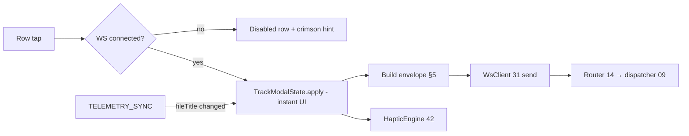

# Doc 39: Audio & Subtitle Sync Modal

> Part of PotPilot plan-series · Category G · Session 2 Wave 2.A · Flutter App

## 1. Purpose & Scope
**Delivers** `audio_sub_modal.dart` — a night-vision bottom sheet with four controls: **Cycle Audio Streams**, **Cycle Subtitle Tracks**, **Subtitles On/Off toggle**, and **Subtitle Sync** nudges (**−0.5s / +0.5s**) with a running offset readout (e.g. `Sync −1.5s`).

**Out of scope:**
- PC-side `WM_COMMAND` cycling and ±500 ms subtitle-delay primitives → [09_potplayer_wm_command_dispatcher.md](09_potplayer_wm_command_dispatcher.md)
- Telemetry parsing → [33_flutter_telemetry_state_provider.md](33_flutter_telemetry_state_provider.md); action catalog → [03_websocket_json_schema_spec.md](03_websocket_json_schema_spec.md)
- Deck (36), keyboard (37), HUD (38), monitor drawer (40), blind gestures (41)

## 2. File Ownership
**Creates (create-only):**
- `mobile_app/lib/features/tracks/audio_sub_modal.dart`

**Reads / integrates (owned by other docs):**
- `mobile_app/lib/network/ws_client.dart` — Doc 31: `WsClient.send("CMD_POTPLAYER", action, payload)` + connected gate
- `mobile_app/lib/network/telemetry_provider.dart` — Doc 33: `TelemetryState.fileTitle` (wire `file_title`) as the reset boundary for local counters. **Confirmed against the freeze:** Doc 03 §5.6 telemetry carries *no* track-identity fields — optimistic local counters are the designed source of truth (§4.3)
- `mobile_app/lib/core/theme/oled_theme.dart` — Doc 29: sheet/switch/slider tokens
- `mobile_app/lib/core/haptics/haptic_engine.dart` — Doc 42: micro-tick per nudge, heavier tick at 0.0s crossing
- `mobile_app/pubspec.yaml` — Doc 05: `flutter_riverpod`

## 3. Public Contract
```dart
/// Presents the modal bottom sheet above the calling surface.
Future<void> showAudioSubtitleModal(BuildContext context);

/// Root sheet widget: 4 control rows over a TelemetryNotifier watch.
class AudioSubModal extends ConsumerStatefulWidget {
  const AudioSubModal({super.key});
}

/// Row action: what a tap on one of the four controls dispatches.
enum TrackAction { cycleAudio, cycleSubs, toggleSubs, syncMinus, syncPlus }

/// Cycles/counter/toggle state local to the current file (see §4.3).
class TrackModalState {
  const TrackModalState({required this.audioIndex, required this.subIndex,
    required this.subsOn, required this.syncOffsetMs, required this.fileTitle});
  /// Returns the next state after [action] (pure, unit-testable).
  TrackModalState apply(TrackAction action);
}

/// The bottom-sheet presenter + dispatch gate.
class AudioSubModalController {
  /// Applies [action] to local state, dispatches WS envelope from §5, fires haptic.
  Future<void> dispatch(TrackAction action, TrackModalState current);
}
```

## 4. Internal Design
1. **Presentation:** `showModalBottomSheet` (drag-to-dismiss, `#000000` background, 12 dp handle), four 56 dp rows: `Audio stream` [`▶ Track 2` ⟳], `Subtitle track` [`▶ Off` ⟳], `Subtitles` [switch], `Subtitle sync` [`−0.5s`][`−1.5s`][`+0.5s`].
2. **Dispatch pipeline (per tap):** gate on Doc 31 connected flag → `TrackModalState.apply(action)` (optimistic, instant UI) → build envelope (§5) → `WsClient.send("CMD_POTPLAYER", action, payload)` → haptic (`play(heavyThud)` at sync zero-crossing, else `play(microTick)`).
3. **Local optimistic model:** Doc 03 §5.6 telemetry reports position/duration/state/volume/speed — **no track identities** (confirmed in the freeze). Therefore:
   - `audioIndex`/`subIndex` are **1-based local counters** starting at 1 per file; each `cycle*` increments visually (`Track n`); wrap returns to 1 at `kMaxOptimisticTracks = 8` (no "Off" state for audio — a file always has ≥1 stream).
   - `subsOn` is a boolean flipped optimistically; the sub-track row label renders `Off` while `subsOn == false`.
   - `syncOffsetMs` accumulates `−500`/`+500` per nudge, clamped to `±10000` ms — exactly the frozen `SUB_SYNC_ADJUST` constraint (multiple of ±500, clamp ±10000); displayed as one decimal (`−1.5s`, `+0.5s`, `0.0s` at rest).
4. **Reset boundary:** when `fileTitle` changes (or becomes null→non-null), all four values reset to defaults (`audioIndex 1`, `subIndex 1`, `subsOn false`, `syncOffsetMs 0`) — the modal never shows stale offsets for the next movie.



**Row visual spec (portrait 360 dp, each row 56 dp):**

| Row | Left label | Right widget | Value rendering |
|---|---|---|---|
| Audio stream | `Audio stream` | ⟳ cycle icon + value | `Track 1`, `Track 2`, … (1-based, local counter) |
| Subtitle track | `Subtitle track` | ⟳ cycle icon + value | `Track n` or `Off` when `subsOn == false` |
| Subtitles | `Subtitles` | Switch (Doc 29 accent when on) | optimistic boolean |
| Subtitle sync | `Subtitle sync` | `−0.5s` \| value \| `+0.5s` | value centered, monospaced, true minus `−` |

**State transition table (`TrackModalState.apply`):**

| Action | audioIndex | subIndex | subsOn | syncOffsetMs |
|---|---|---|---|---|
| `cycleAudio` | +1 (wrap to 1 at `kMaxOptimisticTracks = 8`) | — | — | — |
| `cycleSubs` | — | +1 (wrap to 1) | — | — |
| `toggleSubs` | — | — | flip | — |
| `syncMinus` | — | — | — | −500, clamp ≥ −10000 |
| `syncPlus` | — | — | — | +500, clamp ≤ +10000 |
| file change | 1 | 1 | false | 0 |

## 5. Protocol & Data Compliance
Catalog frozen in [03_websocket_json_schema_spec.md](03_websocket_json_schema_spec.md) §5.3; all four controls use `CMD_POTPLAYER`.

| On-screen control | WS `type` | `action` | `payload` |
|---|---|---|---|
| Cycle Audio Streams ⟳ | `CMD_POTPLAYER` | `CYCLE_AUDIO` | `{}` |
| Cycle Subtitle Tracks ⟳ | `CMD_POTPLAYER` | `CYCLE_SUBS` | `{}` (next subtitle track) |
| Subtitles On/Off switch | `CMD_POTPLAYER` | `SET_SUBS` | `{"enabled": true｜false}` (optimistic desired state) |
| Sync −0.5s | `CMD_POTPLAYER` | `SUB_SYNC_ADJUST` | `{"delta_ms": -500}` |
| Sync +0.5s | `CMD_POTPLAYER` | `SUB_SYNC_ADJUST` | `{"delta_ms": 500}` |

**TELEMETRY_SYNC fields rendered:** `file_title` → `TelemetryState.fileTitle` (reset boundary + sheet caption). No track fields exist in the frozen telemetry schema — the optimistic counters of §4.3 are the sole track UI source.

**Wire examples (uuid + unix seconds abbreviated):**

```json
{"id":"6f1c9a2e-…","type":"CMD_POTPLAYER","action":"CYCLE_SUBS","payload":{},"timestamp":1760500000}
{"id":"a31d77b0-…","type":"CMD_POTPLAYER","action":"SET_SUBS","payload":{"enabled":false},"timestamp":1760500004}
{"id":"bb45e1c8-…","type":"CMD_POTPLAYER","action":"SUB_SYNC_ADJUST","payload":{"delta_ms":-500},"timestamp":1760500009}
```

## 6. Dependencies & Integration Points
- **Action catalog:** [03_websocket_json_schema_spec.md](03_websocket_json_schema_spec.md) §5.3 — `CYCLE_AUDIO`, `CYCLE_SUBS`, `SET_SUBS`, `SUB_SYNC_ADJUST`
- **Sender:** [31_flutter_websocket_client_reconnect.md](31_flutter_websocket_client_reconnect.md) — `WsClient.send("CMD_POTPLAYER", action, payload)`; **Telemetry:** [33_flutter_telemetry_state_provider.md](33_flutter_telemetry_state_provider.md) — `TelemetryState.fileTitle`
- **PC cycle/delay engine:** [09_potplayer_wm_command_dispatcher.md](09_potplayer_wm_command_dispatcher.md) (±500 ms primitive) via [14_pc_websocket_server_router.md](14_pc_websocket_server_router.md)
- **Haptics:** [42_flutter_haptic_feedback_engine.md](42_flutter_haptic_feedback_engine.md); **Theme:** [29_flutter_oled_theme_design_system.md](29_flutter_oled_theme_design_system.md)
- **External packages:** `flutter_riverpod` only; sheet/switch built-ins from Flutter SDK.

## 7. Edge Cases & Failure Handling
- **WS disconnect:** rows render disabled with inline "reconnecting" hint; opening the sheet while offline shows last local state but dispatches nothing.
- **Telemetry stale:** modal keeps local state (it is the fallback source); caption dims; no reset until a *new* `fileTitle` actually arrives (stale ≠ changed).
- **Rapid cycle taps:** no debounce needed (cycling is naturally order-tolerant), but envelopes carry monotonic uuid ids; local counter updates ≤1 per pointer-up (no repeat on long-press).
- **Sync clamp:** at ±10 s the corresponding nudge button disables (no silent clamped dispatch); haptic confirms boundary once.
- **Zero/negative displayed sync:** `0.0s` shows `play(heavyThud)` and neutral color; negatives prefixed with true minus `−` (U+2212) for optical alignment.
- **No media loaded (`fileTitle == null`):** sheet still opens; all rows enabled (agent no-ops) but caption shows `No file` — sync readout forced to `0.0s`.
- **File changes while sheet open:** §4.4 reset fires on `fileTitle` change; in-flight nudge for old file simply becomes irrelevant (harmless no-op at PC).
- **Sheet dismissed mid-dispatch:** dispatch is fire-and-forget; no callback depends on the widget still being mounted (controller is unmounted-safe).

## 8. Acceptance Criteria
- [ ] Sheet opens from its entry point on `#000000`, drag-dismisses, and shows exactly the four specified controls with the specified labels/units.
- [ ] Each control dispatches exactly one envelope with the §5 `type/action/payload` (widget-test asserted).
- [ ] Sync readout steps `0.0s → −0.5s → −1.0s` etc., clamps at ±10.0 s with disabled buttons, never renders `0.30000000000000004`-style floats.
- [ ] `fileTitle` change resets counters/offset/toggle without user action.
- [ ] Toggle switch position updates in the same frame as the tap (optimistic) and matches the dispatched `enabled` value.
- [ ] Disabled-when-offline behaves exactly like Docs 36/37 (consistent sheet UX).
- [ ] `flutter analyze` clean; tests green.

## 9. Test Plan
- **`mobile_app/test/features/tracks/track_modal_state_test.dart`** (unit): `apply()` transitions — audio/sub cycle wrapping, toggle flip, sync accumulate/clamp at ±10000, reset on `fileTitle` change, no reset on staleness alone.
- **`mobile_app/test/features/tracks/audio_sub_modal_test.dart`** (widget): pump with mock Doc 31 client; tap each row → captured envelope matches §5 exactly (esp. `SET_SUBS` and `SUB_SYNC_ADJUST` `delta_ms: ∓500`); offline → zero sends + disabled visuals; switch optimistic state matches payload `enabled`.
- **`mobile_app/test/features/tracks/sync_readout_test.dart`** (unit): formatting `−1.5s`, `+0.5s`, `0.0s`, `−10.0s` edge; zero-crossing triggers exactly one `heavyThud` (mock haptics).
- **Manual:** play a file with 2 audio tracks + SRT → cycle audio (hear language change), cycle subs, toggle off, nudge sync until lip-sync matches; switch movie → readout resets; kill agent → rows grey out.

## 10. Assumptions & Open Questions
- **Resolved against the freeze:** Doc 03 §5.3 pins `CYCLE_AUDIO`, `CYCLE_SUBS`, `SET_SUBS {enabled}` (not a bare toggle), and `SUB_SYNC_ADJUST {delta_ms}` with the constraint "multiple of ±500, clamp ±10000" — which this doc's ±0.5 s nudges and ±10 s UI clamp implement exactly.
- **Assumption:** `CYCLE_*` are stateless "advance to next" commands; the frozen telemetry schema has no track fields, so optimistic local counters (§4.3) are authoritative for display — if a future schema revision adds `audio_track_index`/`subtitle_track_index`, `TrackModalState` gains an optional merge path with no public API change.
- **Assumption:** `SET_SUBS {"enabled": false}` while a track is selected is the freeze-sanctioned way to hide subtitles (PotPlayer keeps the track selection); no separate "disable via cycle" trickery.
- **Assumption:** subtitle delay clamps at ±10 s (matches the frozen ±10000 ms bound); one nudge = one dispatch.
- **Open:** none blocking implementation.
