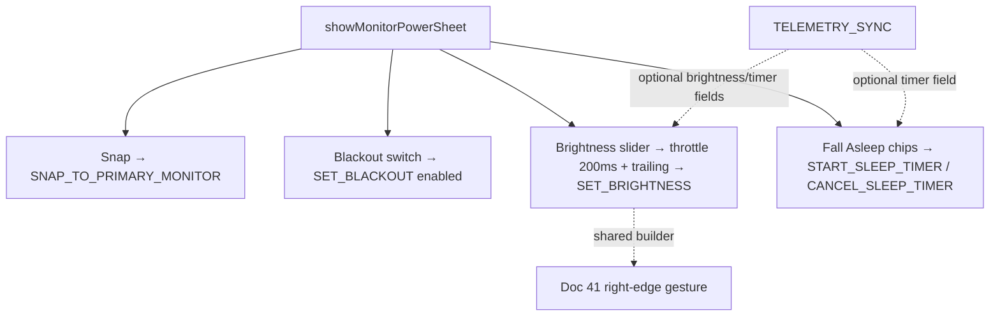

# Doc 40: Multi-Monitor & Power Quick-Control Sheet

> Part of PotPilot plan-series · Category G · Session 2 Wave 2.A · Flutter App

## 1. Purpose & Scope
**Delivers** `monitor_power_sheet.dart` — a quick-control drawer for the bedroom environment: **"Snap PotPlayer to Main Screen"** one-shot button, **"Blackout Other Monitors"** toggle, a **DDC/CI Monitor Brightness slider (0–100 %)**, and the **"Fall Asleep" shutdown timer** (preset minutes → PC sleeps/hibernates when fired, cancellable).

**Out of scope:**
- PC-side execution: monitor snapper (11), blackout overlay (12), DDC/CI (19), sleep manager (22)
- Any PotPlayer playback controls (36–39), blind gestures (41)
- Tray/daemon toggles → [25_pc_pystray_background_daemon.md](25_pc_pystray_background_daemon.md); dashboard mirrors → [24_pc_customtkinter_dashboard_ui.md](24_pc_customtkinter_dashboard_ui.md)

## 2. File Ownership
**Creates (create-only):**
- `mobile_app/lib/features/display/monitor_power_sheet.dart`

**Reads / integrates (owned by other docs):**
- `mobile_app/lib/network/ws_client.dart` — Doc 31: dispatch + connection gate
- `mobile_app/lib/network/telemetry_provider.dart` — Doc 33; the frozen Doc 03 §5.6 frame carries `brightness` (int|null), `blackout_active`, and the flat `sleep_timer_active` / `sleep_timer_mode` / `sleep_timer_remaining_s` keys — this doc reads them via Doc 33's raw-frame hook (or a thin extension provider) since Doc 33's core `TelemetryState` fields are position/speed/volume only; staleness clock from Doc 33
- `mobile_app/lib/core/storage/connection_cache.dart` — Doc 34: last-known brightness for slider warm-start
- `mobile_app/lib/core/theme/oled_theme.dart` — Doc 29; `mobile_app/lib/core/haptics/haptic_engine.dart` — Doc 42 (slider detent ticks every 5 %, timer-armed thud)
- `mobile_app/lib/features/bed_mode/blind_gesture_pad.dart` — Doc 41: right-edge brightness gesture reuses the same `BrightnessCommandBuilder` exported here (contract in §3) **(file removed with bed mode in round 6, 2026-10-18 — no remaining caller outside this sheet)**

## 3. Public Contract
```dart
/// Presents the quick-control drawer (end-aligned modal sheet, drag-dismissible).
Future<void> showMonitorPowerSheet(BuildContext context);

/// Root drawer widget: snap button, blackout toggle, brightness slider, sleep-timer block.
class MonitorPowerSheet extends ConsumerStatefulWidget {
  const MonitorPowerSheet({super.key});
}

/// Pure builders for the two throttled system envelopes (shared with Doc 41).
class SystemCommandBuilder {
  /// `{"type":"CMD_SYSTEM","action":"SET_BRIGHTNESS","payload":{"percent":P}}`
  static Map<String, Object?> brightness(int percent);
  /// Frozen `START_SLEEP_TIMER` COUNTDOWN form: `{"mode":"COUNTDOWN","target":T,"minutes":M}`.
  static Map<String, Object?> sleepTimerCountdown({required String target, required int minutes});
  /// Frozen MOVIE_PROGRESS form: `{"mode":"MOVIE_PROGRESS","target":T,"progress_pct":P}` (P=99 default).
  static Map<String, Object?> sleepTimerOnMovieEnd({required String target, int progressPct = 99});
}

/// Throttle + optimistic bookkeeping for continuous/rapid system commands.
class SystemCommandController {
  /// Sends SET_BRIGHTNESS at most every 200 ms (latest value wins); trailing send on release.
  void setBrightness(int percent);
  /// Arms the sleep timer (target ∈ SLEEP|HIBERNATE|SHUTDOWN) and tracks remaining minutes locally.
  Future<void> armTimer({required String target, int? minutes, bool onMovieEnd = false});
  /// Dispatches CANCEL_SLEEP_TIMER {} and clears the local countdown.
  Future<void> cancelTimer();
  /// True while a timer is armed (drives the countdown pill).
  bool get timerArmed;
}

/// Sleep-timer preset row model: label + minutes (15/30/45/60) or end-of-movie sentinel.
class SleepPreset {
  const SleepPreset({required this.label, this.minutes, this.onMovieEnd});
}
```

## 4. Internal Design
1. **Drawer presentation:** end-aligned `showModalBottomSheet` (`#000000`, 12 dp handle, drag-to-dismiss), four stacked sections separated by 1 px hairlines from Doc 29 tokens.
2. **Snap section:** full-width button → `SNAP_TO_PRIMARY_MONITOR` (fire-and-forget); on send, button shows a 700 ms check animation (no telemetry confirmation assumed — see §10).
3. **Blackout section:** Switch bound to optimistic `blackoutOn`; flip dispatches `SET_BLACKOUT` with `{"enabled": bool}`; the same Doc 34 cache key restores state across app restarts, and the confirmed telemetry field `blackout_active` (Doc 03 §5.6) reconciles the switch on every frame while connected.
4. **Brightness section:** `Slider(0–100, divisions: 100)`; `SystemCommandController.setBrightness` throttles to **200 ms** (DDC/CI is slow, ~one I²C transaction per change — Doc 19) with a **trailing send** on `onChangeEnd` so the finger-lifted value always lands. Slider warm-starts from Doc 34 cache, then snaps to telemetry `brightness` (int or `null` when DDC/CI unsupported) on the first frame that carries it. Every 5 % crossed → Doc 42 `play(HapticPattern.volumeTick)`.
5. **Fall Asleep section:** a power-target selector (`Sleep` default / `Hibernate` / `Shutdown` chips → frozen `target` field) + preset chips `15 / 30 / 45 / 60 min` + `End of movie` + a `Cancel` (shown only when armed). Arming dispatches `START_SLEEP_TIMER` (`COUNTDOWN` or `MOVIE_PROGRESS` per §5) and starts a **local countdown ticker** (`Timer.periodic` 1 min ticks for the pill) rendering `Fall asleep in 29 min`; if telemetry `sleep_timer_active` is true, `sleep_timer_remaining_s` (int|null) wins over the local ticker (convert s→min for the pill). Cancel dispatches `CANCEL_SLEEP_TIMER` and clears the pill.
6. **Disconnect gate:** every dispatch gated on Doc 31 `connected`; whole drawer dims + shows a reconnect strip exactly like Docs 36/37/39.



**Section visual spec (portrait 360 dp, stacked, 16 dp side padding):**

| Section | Widgets | Notes |
|---|---|---|
| Snap | 52 dp button, `Snap to Main Screen` + `⛶` glyph | 700 ms check pulse after dispatch |
| Blackout | label + Switch (Doc 29 accent) | state text `On`/`Off` beside label |
| Brightness | `☀` glyph + `Slider(0–100, divisions: 100)` + `NN%` readout | readout monospaced; `Not supported` hint line below on error |
| Fall Asleep | chips `15` `30` `45` `60` min + `End of movie` + `Cancel` (armed only) | armed chips render accent-filled; countdown pill `mm:ss` replaces chip row header |

**Local cache keys (namespaced, written via Doc 34 wrapper):** `display.blackout_enabled` (bool), `display.last_brightness_pct` (int). Warm-start reads happen once in `initState`.

## 5. Protocol & Data Compliance
Catalog frozen in [03_websocket_json_schema_spec.md](03_websocket_json_schema_spec.md) §5.5; all controls use `CMD_SYSTEM`.

| On-screen control | WS `type` | `action` | `payload` |
|---|---|---|---|
| Snap PotPlayer to Main Screen | `CMD_SYSTEM` | `SNAP_TO_PRIMARY_MONITOR` | `{}` |
| Blackout Other Monitors (on/off) | `CMD_SYSTEM` | `SET_BLACKOUT` | `{"enabled": true｜false}` |
| Monitor Brightness slider (live) | `CMD_SYSTEM` | `SET_BRIGHTNESS` | `{"percent": 0–100 int}` (throttled 200 ms + trailing; `_ERROR 4006` if no DDC/CI monitor) |
| Fall Asleep preset 15/30/45/60 (target selected) | `CMD_SYSTEM` | `START_SLEEP_TIMER` | `{"mode": "COUNTDOWN", "target": "SLEEP"｜"HIBERNATE"｜"SHUTDOWN", "minutes": 15｜30｜45｜60}` |
| Fall Asleep → End of movie | `CMD_SYSTEM` | `START_SLEEP_TIMER` | `{"mode": "MOVIE_PROGRESS", "target": "…", "progress_pct": 99}` |
| Cancel armed timer | `CMD_SYSTEM` | `CANCEL_SLEEP_TIMER` | `{}` |

**TELEMETRY_SYNC fields rendered (confirmed in Doc 03 §5.6):** `brightness` (int 0–100 or `null` = unsupported → slider disabled with hint), `blackout_active` (switch truth), `sleep_timer_active`, `sleep_timer_mode`, `sleep_timer_remaining_s` (countdown pill truth), frame `timestamp` (Doc 33 staleness clock). Cache/local fallbacks apply only when the frame omits them.

**Wire examples (uuid + unix seconds abbreviated):**

```json
{"id":"c0ffee12-…","type":"CMD_SYSTEM","action":"SET_BLACKOUT","payload":{"enabled":true},"timestamp":1760500000}
{"id":"d15ea5e0-…","type":"CMD_SYSTEM","action":"SET_BRIGHTNESS","payload":{"percent":35},"timestamp":1760500002}
{"id":"ee71a8e4-…","type":"CMD_SYSTEM","action":"START_SLEEP_TIMER","payload":{"mode":"COUNTDOWN","target":"SLEEP","minutes":30},"timestamp":1760500007}
```

## 6. Dependencies & Integration Points
- **Action catalog:** [03_websocket_json_schema_spec.md](03_websocket_json_schema_spec.md) §5.5 (envelope/ports freeze WS :50506); this doc consumes the six actions in §5 verbatim
- **Sender:** [31_flutter_websocket_client_reconnect.md](31_flutter_websocket_client_reconnect.md) — `WsClient.send("CMD_SYSTEM", action, payload)`; **Telemetry:** [33_flutter_telemetry_state_provider.md](33_flutter_telemetry_state_provider.md)
- **Cache:** [34_flutter_local_storage_connection_cache.dart](34_flutter_local_storage_connection_cache.md) — brightness + blackout warm-start keys (namespaced `display.*`)
- **PC handlers:** [11_multi_monitor_window_snapper.md](11_multi_monitor_window_snapper.md), [12_secondary_monitor_blackout_overlay.md](12_secondary_monitor_blackout_overlay.md), [19_pc_ddcci_monitor_brightness.md](19_pc_ddcci_monitor_brightness.md), [22_pc_sleep_timer_power_manager.md](22_pc_sleep_timer_power_manager.md), routed by [14_pc_websocket_server_router.md](14_pc_websocket_server_router.md)
- **Shared with Doc 41:** `SystemCommandBuilder.brightness` (same throttled envelope builder used by the right-edge gesture)
- **Haptics:** [42_flutter_haptic_feedback_engine.md](42_flutter_haptic_feedback_engine.md); **Theme:** [29_flutter_oled_theme_design_system.md](29_flutter_oled_theme_design_system.md)
- **External packages:** `flutter_riverpod`, `shared_preferences` (via Doc 34 wrapper only — this doc never touches prefs directly).

## 7. Edge Cases & Failure Handling
- **DDC/CI unsupported monitor:** telemetry carries `brightness: null` → slider disabled with a persistent `Not supported` hint; separately, a `SET_BRIGHTNESS_ERROR` reply (Doc 03 §5.8 code **4006**, confirmed in the freeze) reverts the slider to the last accepted value and shows the hint for 2 s.
- **Brightness telemetry vs finger fight:** while the slider is actively dragged, incoming `brightness` is ignored; after release, telemetry wins (debounced 500 ms).
- **Slider storm:** throttle guarantees ≤5 packets/s during drag; trailing send is the only guaranteed-final packet.
- **Reconnect after blackout toggle elsewhere (tray/GUI):** on reconnect, drawer re-reads Doc 34 cache and any Doc 18 system-state frame; no duplicate dispatch on open (open is read-only).
- **Sleep timer armed, then phone sleeps/app killed:** timer is PC-side truth — countdown continues on PC; reopening the drawer re-arms its local countdown from telemetry `sleep_timer_remaining_s` (int|null, convert s→min) when `sleep_timer_active`, else shows `Armed` without a live number (never a wrong countdown).
- **Arming twice / changing target:** second arm overwrites on the agent; UI restarts the local countdown and updates the target label — no queued duplicates.
- **Stale telemetry (>1000 ms):** drawer stays interactive (system commands don't depend on telemetry) but dims optional readouts to `--`.
- **Mid-drag sheet dismiss:** slider `onChangeEnd` trailing send still fires (controller is unmounted-safe).
- **Minutes presets vs power policy:** agent may refuse shutdown (Doc 22) — UI treats timer as fire-and-forget; cancellation always best-effort.

## 8. Acceptance Criteria
- [ ] Drawer opens end-aligned on `#000000` and exposes exactly: Snap button, Blackout toggle, Brightness slider 0–100, Fall Asleep chips + Cancel.
- [ ] Each control dispatches the exact §5 envelope (widget-test asserted), incl. `{"mode":"MOVIE_PROGRESS","target":"…","progress_pct":99}` for End-of-movie and the selected `target` in every COUNTDOWN arm.
- [ ] Brightness drag emits ≤5 packets/s and the final finger-lifted value is always the last packet sent.
- [ ] Armed timer shows a live countdown pill (`NN min`); cancel clears it and dispatches `CANCEL_SLEEP_TIMER`.
- [ ] Offline: all controls disabled with reconnect strip; opening offline dispatches nothing.
- [ ] Brightness slider warm-starts from Doc 34 cache within one frame of open.
- [ ] `flutter analyze` clean; tests green.

## 9. Test Plan
- **`mobile_app/test/features/display/system_command_builder_test.dart`** (unit): exact envelope maps for `brightness(42)`, `sleepTimerCountdown(target: "SLEEP", minutes: 30)`, `sleepTimerOnMovieEnd(target: "SHUTDOWN")` (defaults `progress_pct: 99`); percent clamped 0–100.
- **`mobile_app/test/features/display/system_command_controller_test.dart`** (unit, `fakeAsync`): 200 ms throttle (5 drags in 100 ms → 1 packet with latest value), trailing send on release is the final packet; local countdown decrements and survives a missing telemetry field.
- **`mobile_app/test/features/display/monitor_power_sheet_test.dart`** (widget): snap/blackout/timer/cancel taps → captured envelopes match §5; offline → zero sends; slider drag + release → last packet equals released value; active-drag telemetry brightness ignored.
- **Manual:** blackout on → secondary monitors go pure black while video keeps playing on primary; brightness slider → monitor OSD shows real hardware luminance change; arm 15-min timer → PC hibernates at 0:00; cancel restores; tray toggle (Doc 25) flips blackout — reopening drawer shows consistent state.

## 10. Assumptions & Open Questions
- **Resolved against the freeze:** Doc 03 §5.5 pins `SNAP_TO_PRIMARY_MONITOR` `{}`, `SET_BLACKOUT {enabled}` (the overview's illustrative blackout action name is superseded by the frozen registry), `SET_BRIGHTNESS {percent}` with error **4006** for no-DDC/CI, `START_SLEEP_TIMER {mode, target, minutes|progress_pct}`, `CANCEL_SLEEP_TIMER {}` — all consumed verbatim; telemetry fields `brightness`, `blackout_active`, `sleep_timer_active`, `sleep_timer_mode`, `sleep_timer_remaining_s` are confirmed present (flat keys) in §5.6.
- **Assumption:** the frozen `target` field forces a Sleep/Hibernate/Shutdown selector (default `SLEEP`); the batch brief's "Shutdown Timer" is satisfied by offering `SHUTDOWN` as a one-tap choice alongside the gentler bedroom-appropriate defaults (Doc 22 implements all three).
- **Assumption:** End-of-movie uses `progress_pct: 99` (Doc 22's "99 % completion" semantics from the overview).
- **Assumption:** 200 ms brightness throttle suits DDC/CI latency; 5 % `volumeTick` detents.
- **Open:** none blocking implementation.
