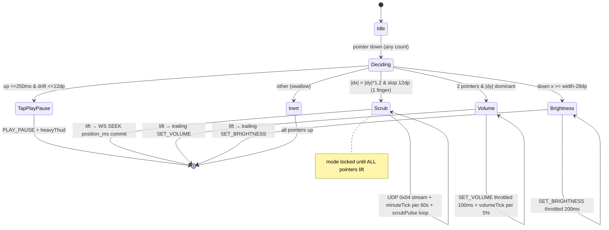

# Doc 41: Blind Bed Mode Gesture Canvas

> Part of PotPilot plan-series · Category H · Session 2 Wave 2.B · Flutter App

## 1. Purpose & Scope
**Delivers** `blind_gesture_pad.dart` — the eyes-free full-screen gesture canvas for operating the PC from bed without looking: **single tap = Play/Pause**, **horizontal swipe/hold = scrubbing with 60-second haptic minute ticks**, **two-finger vertical slide = Volume**, **right-edge slide = Monitor DDC/CI Brightness**. Every gesture gives differentiated haptics (Doc 42) so state is felt, not seen.

**Out of scope:**
- Haptic pattern library → [42_flutter_haptic_feedback_engine.md](42_flutter_haptic_feedback_engine.md) (consumed)
- Hardware volume-button hijacking (parallel ergonomics path) → [43_flutter_hardware_volume_button_hijack.md](43_flutter_hardware_volume_button_hijack.md)
- Incoming-call auto-pause → [44_flutter_incoming_call_autopause_hook.md](44_flutter_incoming_call_autopause_hook.md)
- Visible HUD chrome (scrub bar/badges) → [38_flutter_live_scrub_bar_speed_hud.md](38_flutter_live_scrub_bar_speed_hud.md) — Doc 41 renders only transient minimal OSD text inside its own file
- Envelope/packet building details → Docs 30/31 (this doc consumes their APIs)

## 2. File Ownership
**Creates (create-only):**
- `mobile_app/lib/features/bed_mode/blind_gesture_pad.dart`

**Reads / integrates (owned by other docs):**
- `mobile_app/lib/network/telemetry_provider.dart` — Doc 33: `TelemetryState` (`positionMs`, `durationMs`, `volume`, `isPlaying`, staleness clock) for scrub base + OSD
- `mobile_app/lib/network/udp_sender.dart` — Doc 30: `UdpSender.sendScrub(int targetSeconds)` (8-byte `0x04` `SCRUB_SEEK`)
- `mobile_app/lib/network/ws_client.dart` — Doc 31: `WsClient.send(type, action, payload)` for `PLAY_PAUSE`, `SEEK` (scrub commit), `SET_VOLUME`, `SET_BRIGHTNESS`
- `mobile_app/lib/core/haptics/haptic_engine.dart` — Doc 42: `play(heavyThud)` (tap), `play(minuteTick)` (60 s scrub boundary — purpose-built for this doc), `play(volumeTick)` (volume step), `play(microTick)` (brightness detent / refusal cue), `startScrubPulse()`/`stopScrubPulse()` (drag heartbeat)
- `mobile_app/lib/features/display/monitor_power_sheet.dart` — Doc 40: `SystemCommandBuilder.brightness` (shared envelope builder)
- `mobile_app/lib/core/theme/oled_theme.dart` — Doc 29: OSD text tokens; `mobile_app/lib/main.dart` — mounted as a full-screen tab by Session 3 wiring

## 3. Public Contract
```dart
/// Full-screen eyes-free gesture surface; hosts the recognizer + minimal OSD layer.
class BlindGesturePad extends ConsumerStatefulWidget {
  const BlindGesturePad({super.key, this.sensitivity = 1.0});
  final double sensitivity; // media-seconds per dp multiplier (see §4.3)
}

/// The four mutually-exclusive gesture domains decided at gesture start (§4.2).
enum GestureMode { none, tapPlayPause, horizontalScrub, twoFingerVolume, edgeBrightness }

/// Immutable per-gesture-session bookkeeping (start state + accumulators).
class GestureSession {
  const GestureSession({required this.mode, required this.startX, required this.startY,
    required this.startPositionMs, required this.startVolume, required this.startBrightness});
  final GestureMode mode; final double startX, startY;
  final int? startPositionMs; final int startVolume; final int startBrightness;
}

/// Recognizer state machine: feeds raw pointer events, emits commands + haptic cues.
class GestureRecognizer {
  /// Called on every pointer down/move/up; returns the current OSD text (or null).
  String? feed(PointerEvent e, {required Size canvasSize, required bool twoFinger});
  /// Active domain once decided; `none` until thresholds met (§4.2).
  GestureMode get mode;
  /// Accumulated scrub preview `+MM:SS` / `−MM:SS` while scrubbing.
  String? get scrubPreview;
}

/// Commit/apply layer: converts gestures into Doc 30/31 dispatches.
class GestureCommandSink {
  /// Streams throttled UDP 0x04 `sendScrub(targetSeconds)` while scrubbing (§4.3).
  void streamScrub(int targetSeconds);
  /// Sends the final WS `SEEK {"position_ms": targetMs}` = startPositionMs +
  /// accumulated delta (clamped to [0, duration − 500]) on finger lift.
  void commitScrub(GestureSession s, int targetMs);
  /// Sends throttled CMD_POTPLAYER SET_VOLUME {"percent": int} (100 ms).
  void setVolume(int percent);
  /// Sends CMD_SYSTEM SET_BRIGHTNESS {"percent": int} via Doc 40 builder (200 ms).
  void setBrightness(int percent);
  /// Sends CMD_POTPLAYER PLAY_PAUSE {}.
  void togglePlayPause();
}
```

## 4. Internal Design
1. **Canvas:** full-screen `Listener` (raw pointers, not `GestureDetector`) over `#000000`; a centered transient OSD (`MonospaceText`, auto-hides 1.2 s after last event) shows `▶/⏸`, `+MM:SS`, `Vol 42%`, or `Bright 60%` so eyes-open users aren't left out. A faint 1 dp border marks the right-edge zone for discoverability.

2. **Mode discrimination (per gesture session, decided once):** evaluated on the first pointer move past slop; the mode is locked until **all** pointers lift.

   | Priority | Trigger at decision point | Mode |
   |---|---|---|
   | 1 | pointer-down `x ≥ width − 28dp` (any direction) | `edgeBrightness` |
   | 2 | second pointer down, then net `\|dy\| > \|dx\|` past 12 dp | `twoFingerVolume` |
   | 3 | single pointer, net `\|dx\| > \|dy\| × 1.2` past 12 dp | `horizontalScrub` |
   | 4 | down→up within **250 ms** and ≤ 12 dp drift | `tapPlayPause` |
   | — | anything else (incl. single-finger vertical) | `none` (inert, swallow) |

   "Swipe **or** hold-then-drag" is the same path: mode 3 activates the moment horizontal motion passes the slop — a finger that rests 3 s then drags left still scrubs.

3. **Scrub math:** relative, position-blind: `deltaMs = dx × 1000 × sensitivity` (default `sensitivity = 1.0` → 1 dp ≈ 1 s; Doc 34 sensitivity curve multiplies it). Preview = `startPositionMs + Σ deltaMs`, clamped `[0, duration − 500]`. **While scrubbing:** stream UDP `0x04` via `sendScrub(targetSeconds)` (floored seconds, ≥16 ms apart, only on integer-second change — same throttle as Doc 38) so PotPlayer tracks the blind drag live; Doc 42 `startScrubPulse()` fires at drag start and `stopScrubPulse()` on lift. **On lift:** one WS `SEEK {"position_ms": previewMs}` — the frozen Doc 03 commit with millisecond precision (guaranteed delivery; the last UDP packet already put PotPlayer within 1 s).

4. **Minute ticks:** accumulate `crossed = floor(|Δpreview| / 60000)`; each new boundary → Doc 42 `play(HapticPattern.minuteTick)` (the pattern Doc 42 defines specifically for this doc); a 5-minute boundary → `play(heavyThud)`. Direction change resets nothing (ticks track absolute elapsed media distance).

5. **Volume (two-finger vertical):** `percent = clamp(startVolume − dy × 0.5, 0, 100)` (drag down = quieter); throttled `WsClient.send("CMD_POTPLAYER", "SET_VOLUME", {"percent": p})` every ≥100 ms; `play(volumeTick)` every 5 % crossed; one trailing send on lift guarantees the final value.

6. **Brightness (right-edge vertical):** `percent = clamp(startBrightness − dy × 0.5, 0, 100)` where `startBrightness` = telemetry `brightness` (frozen Doc 03 §5.6 field, int or `null` when DDC/CI unsupported) falling back to Doc 34 cache; throttled `SET_BRIGHTNESS` every ≥200 ms via the shared Doc 40 builder; trailing send on lift; `play(microTick)` every 10 %.

7. **Telemetry coupling:** scrub **preview** reads `startPositionMs` only at session start (stale-safe); volume/brightness previews read the latest cached values; after any commit, the next `TELEMETRY_SYNC` (250 ms) reconciles the OSD.



## 5. Protocol & Data Compliance
Packet layout: [02_binary_udp_protocol_spec.md](02_binary_udp_protocol_spec.md) (`SCRUB_SEEK 0x04`); WS catalog: [03_websocket_json_schema_spec.md](03_websocket_json_schema_spec.md) §5.3.

| Gesture (on-screen control) | Transport | `type` / packet | action / payload |
|---|---|---|---|
| Single tap | WS :50506 | `CMD_POTPLAYER` | `PLAY_PAUSE`, `payload {}` |
| Horizontal scrub (continuous) | UDP :50505 | packet `0x04` `SCRUB_SEEK` | `UdpSender.sendScrub(targetSeconds)` ≥16 ms apart, integer-second change only |
| Horizontal scrub (release/commit) | WS :50506 | `CMD_POTPLAYER` | `SEEK`, `{"position_ms": int}` (frozen Doc 03 scrub-bar commit) |
| Two-finger vertical (volume) | WS :50506 | `CMD_POTPLAYER` | `SET_VOLUME`, `{"percent": 0–100}` (throttle 100 ms + trailing) |
| Right-edge vertical (brightness) | WS :50506 | `CMD_SYSTEM` | `SET_BRIGHTNESS`, `{"percent": 0–100}` (throttle 200 ms + trailing) |

**TELEMETRY_SYNC fields consumed (wire names, Doc 03 §5.6):** `position_ms`/`duration_ms` (scrub base + clamp), `volume` → `TelemetryState.volume` (volume base), `brightness` (brightness base; `null` = DDC/CI unsupported → edge gesture refuses with a `doubleTick`), `is_playing` (tap OSD glyph), `timestamp` (staleness; stale → OSD prefixed `?`).

## 6. Dependencies & Integration Points
- **Telemetry state:** [33_flutter_telemetry_state_provider.md](33_flutter_telemetry_state_provider.md)
- **UDP commit:** [30_flutter_udp_datagram_sender.md](30_flutter_udp_datagram_sender.md) — `sendScrub(int targetSeconds)` (packet build/auth/seq owned there); **WS:** [31_flutter_websocket_client_reconnect.md](31_flutter_websocket_client_reconnect.md) — `WsClient.send("CMD_POTPLAYER"|"CMD_SYSTEM", …)`
- **Haptics:** [42_flutter_haptic_feedback_engine.md](42_flutter_haptic_feedback_engine.md) — the pad's primary feedback channel
- **Shared builder + cache:** [40_flutter_multi_monitor_power_sheet.md](40_flutter_multi_monitor_power_sheet.md) (`SystemCommandBuilder.brightness`), [34_flutter_local_storage_connection_cache.md](34_flutter_local_storage_connection_cache.md) (brightness fallback)
- **Action catalog / packet truth:** [03_websocket_json_schema_spec.md](03_websocket_json_schema_spec.md), [02_binary_udp_protocol_spec.md](02_binary_udp_protocol_spec.md)
- **External packages:** `flutter_riverpod`; raw `Listener`/`PointerEvent` (no gesture package). `vibration` only via Doc 42.

## 7. Edge Cases & Failure Handling
- **Telemetry stale at scrub start:** `startPositionMs == null` → scrub refuses with a `play(doubleTick)` cue (a blind commit to an unknown position is worse than refusing); tap/volume still work (volume uses cache; tap needs nothing).
- **Zero-duration media:** scrub refuses (same as stale) with the doubleTick cue; tap/volume/brightness unaffected.
- **Disconnect mid-gesture:** current gesture completes locally (OSD shows `!`); WS commands are dropped (Doc 31 fire semantics — no queue), UDP stream continues if the socket lives; `play(doubleTick)` on lift signals the miss; no crash.
- **Brightness unsupported (`brightness: null` telemetry):** edge gesture refuses immediately with `play(doubleTick)` instead of sending doomed `SET_BRIGHTNESS` calls.
- **Third finger lands mid-volume:** first two pointers keep the session; extra pointers ignored until all lift (mode locked).
- **Edge-zone conflict with Android system back gesture:** canvas reserves the 28 dp edge zone only for vertical brightness drags; a horizontal back-swipe starting in-zone is forwarded to the system (back pill still works) — brightness mode only locks on vertical intent (|dy| dominant within 20 px).
- **Rotation/resize mid-session:** `MediaQuery` size change cancels the session (like `cancelDrag`) — no phantom commit, `stopScrubPulse()` called.
- **Volume/brightness clamp:** 0–100 int; at a bound, throttled sends stop and one `play(doubleTick)` confirms the wall (no clamped no-op packets).
- **Phone call arrives mid-scrub (Doc 44 pauses PC):** the in-flight gesture is cancelled on `OFFHOOK` via a cancel-listener hook Doc 44 triggers; no seek lands on a paused/ended call.
- **Screen off / app backgrounded:** active session cancelled; no background timers leak.

## 8. Acceptance Criteria
- [ ] Single tap anywhere (outside 28 dp edge) → exactly one `PLAY_PAUSE` envelope + Doc 42 `play(heavyThud)`; glyph OSD flashes.
- [ ] Horizontal drag in blind darkness → UDP `0x04` stream ≤60 Hz (integer-second changes only, verified by packet log); lift → exactly one WS `SEEK` whose `position_ms` equals `start + dx×1000×sensitivity` clamped to `[0, duration−500]`.
- [ ] Crossing each 60 s media boundary during a drag emits exactly one `play(minuteTick)`; 5-minute boundaries a `play(heavyThud)`; Doc 42 `startScrubPulse()` active for the whole drag and stopped on lift.
- [ ] Two-finger vertical slide changes PotPlayer volume within ≤100 ms of movement, one trailing packet on lift, `play(volumeTick)` per 5 %.
- [ ] Right-edge vertical slide changes physical monitor luminance ≤200 ms cadence (monitor OSD visible in manual test).
- [ ] Mode lock holds: mid-scrub second finger does NOT switch to volume; only a full lift re-arms the pad.
- [ ] Single-finger vertical swipes are inert (no accidental commands in bed).
- [ ] All four domains feel distinct through haptics alone — verified in a no-look manual pass.
- [ ] `flutter analyze` clean; tests green.

## 9. Test Plan
- **`mobile_app/test/features/bed_mode/gesture_recognizer_test.dart`** (unit): pure `GestureRecognizer.feed()` traces — tap (100 ms, 3 dp) → `tapPlayPause`; slow 3 s hold then drag → `horizontalScrub` (hold-then-drag path); 12 dp exact boundary; right-edge down → brightness even for horizontal motion; two-pointer vertical → volume; single vertical → `none`; mode lock until all pointers up; rotation cancel.
- **`mobile_app/test/features/bed_mode/gesture_scrub_math_test.dart`** (unit): delta accumulation, sensitivity multiplier, clamps `[0, duration−500]`, minute-tick counting (incl. direction reversals), floored `targetSeconds` for the UDP stream vs exact `position_ms` for the `SEEK` commit.
- **`mobile_app/test/features/bed_mode/blind_gesture_pad_test.dart`** (widget): pumps pad with mock Doc 30/31/42 sinks — tap → one `PLAY_PAUSE` + `heavyThud`; drag → ≥1 `sendScrub` during drag + exactly one WS `SEEK` on lift; volume gesture → throttled `SET_VOLUME` with trailing final; stale telemetry → scrub refused with `doubleTick`, zero packets; OSD text updates/hides after 1.2 s.
- **Manual (eyes closed, phone flat on bed):** play a movie; tap to pause/resume by feel; drag right 30 s and confirm the movie actually lands ~30 s later; two-finger slide to a comfortable volume using only 5 % ticks; dim the monitor to sleep-friendly level from the right edge; do all four without a single glance — no wrong commands fired.

## 10. Assumptions & Open Questions
- **Assumption:** scrub is **relative** (dx → media-seconds), not an absolute rail — blind users cannot aim a rail; sensitivity default 1.0 dp = 1 s, user-tunable via Doc 34 curve.
- **Assumption:** "swipe/hold" means both a fast flick and a resting-then-dragging finger scrub; there is no separate flick-to-jump mode.
- **Resolved against the freeze:** the drag streams UDP `0x04` `SCRUB_SEEK` (Doc 02 routing: → Doc 09 `seek_absolute`) and the lift commits with the frozen WS `SEEK {position_ms}` — the same dual-channel pattern as Doc 38, matching Doc 42's `startScrubPulse`/`0x04`-stream mapping table; `SET_VOLUME {percent}` is Doc 03-confirmed as *PotPlayer internal volume, blind-mode slide (this doc)*; `brightness` telemetry confirmed Doc 03 §5.6 (int|null).
- **Assumption:** right-edge zone = 28 dp, locked only on vertical intent so Android's system back swipe keeps working.
- **Assumption:** refusal/failure cues use `play(doubleTick)` — Doc 42 defines no error pattern; a dedicated `errorBuzz` would require a Doc 42 change (out of this doc's ownership).
- **Assumption:** Doc 14 routes `CMD_SYSTEM`/`SET_BRIGHTNESS` from this pad identically to the Doc 40 sheet (shared `SystemCommandBuilder` guarantees byte-identical envelopes).
- **Open:** should a three-finger tap map to anything (e.g., mute)? Out of the brief — left unbound; add later inside this file without contract changes.
