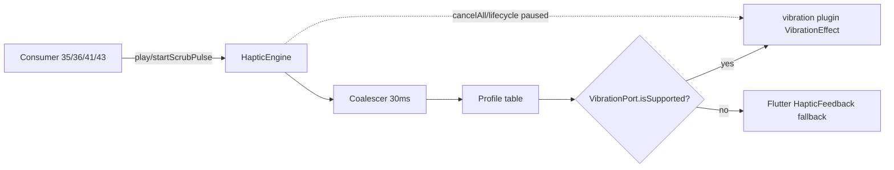

# Doc 42: Flutter Haptic Feedback Engine

> Part of PotPilot plan-series · Category H · Session 2 Wave 2.A · Flutter App

## 1. Purpose & Scope

Delivers a **standalone tactile feedback service** (`HapticEngine`) that exposes named, pre-tuned vibration patterns so every remote interaction is confirmable **without looking at the screen** — the core of bedroom ergonomics.

**In scope**
- Named pattern catalog: `microTick` (sharp, 5s seek), `heavyThud` (Play/Pause), `scrubPulse` (rhythmic loop during continuous scrubbing), `doubleTick` (1.0x speed reset), plus two shared convenience patterns (see §10).
- Amplitude/duration tuning profiles, one-shot and repeating playback, coalescing/rate-limiting, lifecycle-safe cancellation, silent fallback on devices without a vibrator.
- A single Riverpod provider so consumers (Docs 35, 36, 41, and optionally 43/44) inject one shared instance.

**Out of scope**
- Deciding *when* patterns fire (each consumer owns its UX mapping — see §5).
- Audio/visual feedback, notification vibration, iOS support, custom Kotlin/platform-channel code, per-user pattern editors, any network traffic (haptics are 100% local to the phone).

## 2. File Ownership

**Creates (create-only, exact path per overview Section 3):**
- `mobile_app/lib/core/haptics/haptic_engine.dart`

**Reads/touches owned by other docs:**
- `mobile_app/pubspec.yaml` (Doc [05_flutter_app_boilerplate_deps.md](05_flutter_app_boilerplate_deps.md)) — consumes the already-declared `vibration` dependency; this doc does **not** edit it.
- `mobile_app/android/.../AndroidManifest.xml` (scaffolded by Doc 05) — requires `android.permission.VIBRATE`; flagged as an integration note only.
- Call sites (written by their owners, never edited by this doc): `features/trackpad/virtual_trackpad.dart` (35), `features/deck/potplayer_deck.dart` (36), `features/bed_mode/blind_gesture_pad.dart` (41), `hardware_hooks/volume_button_hijack.dart` (43).

## 3. Public Contract

```dart
/// Named tactile catalog; each value maps to a tuned amplitude/time profile.
enum HapticPattern { microTick, heavyThud, doubleTick, scrubPulse, volumeTick, minuteTick }

/// Standalone haptic service. Fire-and-forget, main-isolate safe, network-free.
class HapticEngine {
  /// Plays a one-shot pattern; [repeat] stacks identical pulses (doubleTick = 2).
  Future<void> play(HapticPattern pattern, {int repeat = 1});
  /// Starts the rhythmic scrubbing pulse; idempotent (repeated calls no-op).
  void startScrubPulse({Duration interval = const Duration(milliseconds: 120)});
  /// Stops the scrubbing pulse; safe to call when not running.
  void stopScrubPulse();
  /// Cancels any active vibration (app pause, incoming call, route change).
  Future<void> cancelAll();
  /// True when the device exposes a usable vibrator at runtime.
  bool get isSupported;
  /// Globally mutes haptics (persisted bedroom "silent mode" toggle).
  set enabled(bool value);
}

/// Riverpod provider exposing the process-wide singleton engine.
final hapticEngineProvider = Provider<HapticEngine>((ref) => throw /* wired in main */);
```

One-line doc-strings only per the template; bodies are omitted deliberately.

## 4. Internal Design

**4.1 Component breakdown**
1. **Profile table** — static `Map<HapticPattern, VibrationProfile>` where `VibrationProfile = { List<int> timingsMs, List<int> amplitudes (0–255), bool repeating }`.
2. **Dispatch core** — maps a pattern → profile → `Vibration.vibrate` (`VibrationEffect.compose`/`WaveEffect` on Android 26+; `VibrationEffect.createOneShot` fallback; plain `vibrate(ms)` as last resort).
3. **Scrub loop** — a single-periodic-timer driver that re-fires `scrubPulse` every `interval` until `stopScrubPulse()`.
4. **Coalescer** — drops requests arriving < 30 ms after the last emitted pulse, except `heavyThud` (always delivered).
5. **Output seam** — private `VibrationPort` interface; production impl wraps the `vibration` plugin, tests inject a fake (see §9).

**4.2 Pattern tuning (starting values, hardware-tunable — see §10)**

| Pattern | Duration | Amplitude | Gap | Feel |
|---|---|---|---|---|
| `microTick` | 10 ms | 96/255 | — | sharp, thin tick (±5s seek) |
| `heavyThud` | 55 ms | 255/255 + 25 ms tail @ 128 | 40 ms | weighty confirmation (Play/Pause) |
| `doubleTick` | 2 × 15 ms | 160/255 | 60 ms apart | reset marker (1.0x speed) |
| `scrubPulse` | 25 ms | 140/255 | every 120 ms (loop) | rhythmic scrubbing heartbeat |
| `volumeTick` | 12 ms | 110/255 | — | volume step confirmation (43) |
| `minuteTick` | 18 ms | 180/255 | — | coarse minute boundary (41) |

**4.3 Flow**



**4.4 Algorithm steps (one-shot play)**
1. If `enabled == false` or a `cancelAll()` arrived within the last 50 ms → return.
2. Resolve profile; apply `repeat` by repeating the timing array.
3. Coalesce unless pattern is `heavyThud`.
4. If vibrator supported → emit via `VibrationPort`; else → nearest `HapticFeedback.*Impact` fallback (light/medium/heavy mapped from mean amplitude).
5. Fire-and-forget: never await plugin latency on the UI isolate beyond the returned `Future`.

## 5. Protocol & Data Compliance

The engine **emits zero wire traffic** (no WS envelope, no UDP datagram) — Doc 46's wiring test asserts the haptic layer opens no sockets. It is a *side channel* bound to dispatches that already follow the frozen contracts:

| Consumer | Trigger (owned by) | Wire action already defined | Haptic pattern |
|---|---|---|---|
| 36 Deck | Play/Pause tap | WS `CMD_POTPLAYER` / `PLAY_PAUSE` | `heavyThud` |
| 36 Deck | `-5s / +5s` tap | WS seek actions (Doc 03 registry) | `microTick` |
| 36 Deck | Speed Reset `1.0x` | WS `CMD_POTPLAYER` / `SET_SPEED` `{multiplier:1.0}` | `doubleTick` |
| 35 Trackpad | tap-to-click | UDP `0x03` button packet | `microTick` |
| 35/41 | continuous horizontal scrub | UDP `0x04` scrub packets (stream) | `startScrubPulse()` on drag start, `stopScrubPulse()` on release |
| 41 Bed mode | minute tick crossed during hold-scrub | (position from `TELEMETRY_SYNC`) | `minuteTick` |
| 41 Bed mode | single tap Play/Pause | WS `PLAY_PAUSE` | `heavyThud` |
| 41 Bed mode | two-finger volume slide step | WS volume action (Doc 43 registry) | `volumeTick` |

**Scrub-pulse lifecycle rule:** the pulse must start/stop in the *same* code path that starts/stops the `0x04` scrub packet stream, so tactile rhythm and wire cadence cannot drift apart.

## 6. Dependencies & Integration Points

**Internal**
- Producer scaffold: [05_flutter_app_boilerplate_deps.md](05_flutter_app_boilerplate_deps.md) (`vibration` in `pubspec.yaml`).
- Consumers: [35_flutter_120hz_virtual_trackpad.md](35_flutter_120hz_virtual_trackpad.md), [36_flutter_custom_potplayer_deck_ui.md](36_flutter_custom_potplayer_deck_ui.md), [41_flutter_blind_bed_mode_gestures.md](41_flutter_blind_bed_mode_gestures.md), [43_flutter_hardware_volume_button_hijack.md](43_flutter_hardware_volume_button_hijack.md).
- Provider wiring in `mobile_app/lib/main.dart` (Session 3 master shell, overview Wave 3.A Subagent 3).

**External**
- `vibration` (pub, declared by Doc 05) — amplitude-controlled Android `VibrationEffect` access.
- `flutter/services` (`HapticFeedback`) — platform-agnostic fallback when no vibrator exists.
- `flutter_riverpod` — `hapticEngineProvider` injection.

## 7. Edge Cases & Failure Handling

- **No vibrator (emulator, budget device)** → `isSupported == false`; every pattern degrades to `HapticFeedback` impact matched by amplitude; never throws.
- **`VIBRATE` permission missing** → plugin call fails silently → caught, logged once via `debugPrint`, degrade to fallback; no crash loop.
- **Rapid repeated taps** → coalescer drops sub-30 ms repeats (except `heavyThud`); user still feels discrete events, not a mush.
- **Consumer forgets `stopScrubPulse()`** → engine registers a `WidgetsBindingObserver`; on `paused/inactive` it calls `cancelAll()` + stops the loop; a 5 s watchdog also kills an orphaned loop.
- **Incoming call while scrubbing (Doc 44)** → `cancelAll()` runs on `RINGING` so the phone's own ring vibration isn't fought.
- **Android "Do Not Disturb"/silent mode suppresses vibration** → plugin no-ops; engine treats it as success (no error surfaced to UI).
- **`enabled == false` (silent mode)** → all calls short-circuit at step 1 of §4.4; state survives restart via `shared_preferences` (key owned by this doc, see §10).
- **Pattern invoked before provider wired** → provider throws a descriptive error in debug, returns a no-op engine in release (guard via `kReleaseMode`).

## 8. Acceptance Criteria

- [ ] All four required patterns exist as named enum values and are audibly/feel-wise distinguishable on a physical Android device per the §4.2 table (manual 10-second rubric: tap 5s seek → sharp; Play/Pause → heavy; hold scrub → steady rhythm; speed reset → two ticks).
- [ ] `startScrubPulse()` called twice does not double the pulse rate; `stopScrubPulse()` when idle does not throw.
- [ ] `cancelAll()` halts an active `scrubPulse` within one interval.
- [ ] With haptics disabled in settings, zero vibrations occur across all consumers.
- [ ] Engine source contains **no** imports from `lib/network/**` and opens no sockets (grep-clean).
- [ ] `flutter analyze` reports zero errors/warnings for `haptic_engine.dart` and its test.
- [ ] Consumers 35/36/41 can obtain the engine solely via `hapticEngineProvider` (no direct `Vibration` import outside this file).

## 9. Test Plan

**Automated — `mobile_app/test/haptic_engine_test.dart`**
- Injects a fake `VibrationPort`; asserts, per pattern, the exact timings/amplitude arrays emitted (table-driven test over the §4.2 profile map).
- `repeat: 2` on `doubleTick` produces exactly two pulses with the 60 ms gap.
- Coalescing: two `microTick` calls 10 ms apart → one emission; two `heavyThud` 10 ms apart → two emissions.
- `startScrubPulse()` idempotency and `stopScrubPulse()`/`cancelAll()` timer teardown (uses `fake_async`; asserts no pending timers after stop).
- `enabled == false` and unsupported-vibrator paths emit nothing and never throw.

**Manual (physical device, automation impractical)**
1. Deck Play/Pause press → distinctly heavier than a ±5s press.
2. Hold horizontal scrub on trackpad → continuous even rhythm, stops exactly on finger lift.
3. Speed reset → clearly two ticks, not one smeared buzz.
4. Toggle silent mode → all four triggers now silent; restart app → still silent (persistence check).

## 10. Assumptions & Open Questions

**Assumptions (recorded, resolved myself)**
- `volumeTick` and `minuteTick` are additive convenience patterns beyond the four required ones, because Docs 41/43 need distinct non-colliding feedback; catalog remains a closed enum.
- Amplitude/duration values in §4.2 are engineering starting points; final tuning is a device rubric (§8), not a spec constant.
- Silent-mode flag persisted under a `haptics_enabled` `shared_preferences` key owned by this doc (Doc 34 owns pairing/auth/sensitivity keys only — no conflict).
- `android.permission.VIBRATE` is present in the Doc 05 manifest scaffold; if absent, Doc 05 must add it (integration note, not an edit by this doc).
- Android-only target (app is a bedroom Android remote); iOS never hits these code paths.

**Open questions**
- Should `heavyThud` expose a second, stronger "double thud" variant for destructive actions (shutdown timer confirm in Doc 40)? Deferred until Doc 40 UX exists.
