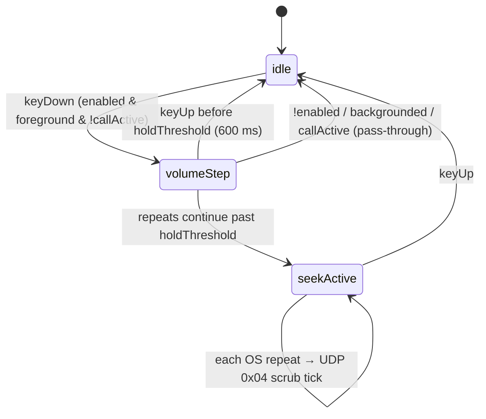

# Doc 43: Flutter Hardware Volume Button Hijack

> Part of PotPilot plan-series · Category H · Session 2 Wave 2.B · Flutter App

## 1. Purpose & Scope

Intercepts the phone's **physical Volume Up/Down key events while PotPilot is foregrounded** and redirects them to the PC: short press adjusts PC/PotPlayer volume, **long-press switches to timeline seeking** — enabling eyes-free volume/seek control from bed without touching or looking at the screen.

**In scope**
- Foreground-only key interception of `LogicalKeyboardKey.audioVolumeUp / audioVolumeDown` (no Kotlin plugin; pure Dart key handler — see §4 and §10).
- Short-press volume stepping (absolute targets computed client-side), long-press → seek mode state machine, hold-timing thresholds, repeat-event accumulation.
- Automatic target routing: PotPlayer internal volume (`CMD_POTPLAYER SET_VOLUME`) when telemetry `potplayer_found`, otherwise Windows master volume (`CMD_SYSTEM SET_SYSTEM_VOLUME`) — no user setting.
- Haptic ticks per step (consumes Doc 42), transient on-screen HUD badge, persisted settings.

**Out of scope**
- Background/system-wide interception (home-screen volume keys stay system-owned), Android accessibility services, on-screen volume slider UI (Doc 40/38), call audio routing (system owns it during calls), modifying Android's media volume directly.

## 2. File Ownership

**Creates (create-only, exact path per overview Section 3):**
- `mobile_app/lib/hardware_hooks/volume_button_hijack.dart`

**Reads/touches owned by other docs (never edited here):**
- `lib/network/udp_sender.dart` (Doc [30_flutter_udp_datagram_sender.md](30_flutter_udp_datagram_sender.md)) — capability: pack+send a `0x04` scrub datagram with its monotonic sequence counter.
- `lib/network/ws_client.dart` (Doc [31_flutter_websocket_client_reconnect.md](31_flutter_websocket_client_reconnect.md)) — sends volume envelopes, exposes `isConnected`.
- `lib/network/telemetry_provider.dart` (Doc [33_flutter_telemetry_state_provider.md](33_flutter_telemetry_state_provider.md)) — current position (for seek targets), `volume` / `sys_volume` (step bases), `potplayer_found` (target routing).
- `lib/core/haptics/haptic_engine.dart` (Doc [42_flutter_haptic_feedback_engine.md](42_flutter_haptic_feedback_engine.md)) — `volumeTick` / `minuteTick`.
- `lib/hardware_hooks/call_autopause_hook.dart` (Doc [44_flutter_incoming_call_autopause_hook.md](44_flutter_incoming_call_autopause_hook.md)) — `callActive` gate.
- Settings persistence via `shared_preferences` (package from Doc 05; keys owned by this doc, see §10).

## 3. Public Contract

```dart
/// Hijack lifecycle phase (mirrors the state machine in §4.1).
enum VolumeHijackPhase { idle, volumeStep, seekActive }

/// Immutable persisted settings for the hijack.
class VolumeHijackSettings {
  final bool enabled;
  final int stepPct;          // % per short press (default 5)
  final Duration holdThreshold; // default 600 ms
  final int seekStepSec;      // seconds per seek tick (default 30)
}
```

```dart
/// Foreground interceptor for hardware volume keys.
class VolumeButtonHijack {
  VolumeButtonHijack({required /*WsClient*/ ws, required /*UdpSender*/ udp,
      required /*TelemetryState*/ telemetry, required /*HapticEngine*/ haptics});
  /// Registers the global key handler; returns false if already attached.
  bool attach();
  /// Unregisters the handler and resets the state machine.
  void detach();
  /// Current phase, for HUD rendering.
  VolumeHijackPhase get phase;
  /// Last emitted step value (0–100) for the transient HUD badge.
  ValueNotifier<int?> get hudValue;
}
/// Riverpod provider for the process-wide hijack instance.
final volumeHijackProvider = Provider<VolumeButtonHijack>((ref) => /* wired */);
```

## 4. Internal Design

**4.1 State machine (long-press timing)**



**4.2 Algorithm steps**
1. App root registers one handler via `HardwareKeyboard.instance.addHandler` in `main.dart` wiring (Session 3 shell); handler inspects `KeyEvent.logicalKey`.
2. **Gate filter** (any fails → return `false`, letting the system handle the key normally): handler attached; app lifecycle `resumed`; `settings.enabled`; PC paired **or** seek data available; Doc 44 `callActive == false` (during `OFFHOOK` the phone must control *call* volume).
3. **keyDown** → phase `volumeStep`, start hold timer, compute and apply one absolute volume target immediately (zero-latency first press).
4. **Short press (keyUp < 600 ms)** → dispatch the absolute-target envelope (§5), fire `volumeTick`, show HUD badge for 700 ms, back to `idle`.
5. **Held past 600 ms** → phase `seekActive`: compute `targetSec = clamp(telemetry.positionSec + direction * seekStepSec * repeatIndex, 0, durationSec)` and fire UDP `0x04`; every subsequent OS key-repeat advances `repeatIndex` and fires another scrub packet; fire `minuteTick` per tick. **(Round 7, 2026-10-18 — hold anchor: the `telemetry.positionSec` base is read only on the hold's first successful scrub and captured in `_seekAnchorSec`; every repeat computes `raw = anchor + direction * seekStepSec * repeatIndex` (clamped) — the live telemetry position must never re-base mid-hold, since a 250 ms poll update arriving between repeats double-counted the step and skipped ahead ("goes here and there"). `_seekAnchorSec` resets in `_beginHold`/`_release`/`_resetMachine`.)**
6. **keyUp / detach / lifecycle paused** → reset `repeatIndex`, phase `idle`, clear HUD.
7. Volume math: `base` = last telemetry `volume` (PotPlayer route) or `sys_volume` (master route) per `potplayer_found`, Doc 34 cache as cold-start fallback; `target = clamp(base ± stepPct, 0, 100)`; at a bound, swallow the step and fire a single `microTick` as "wall" feedback.

**4.3 Component breakdown** — key handler + gate filter; hold-timer/accumulator; envelope builder (WS); scrub target calculator (telemetry + UDP); HUD `ValueNotifier`; settings repository (`shared_preferences`).

## 5. Protocol & Data Compliance

**Short press → volume (absolute targets; frozen actions from Doc 03 §5.3/§5.5):**

```json
{"id":"<uuid-v4>","type":"CMD_POTPLAYER","action":"SET_VOLUME",
 "payload":{"percent":47},"timestamp":1760500000}
{"id":"<uuid-v4>","type":"CMD_SYSTEM","action":"SET_SYSTEM_VOLUME",
 "payload":{"percent":47},"timestamp":1760500001}
```
- Compute client-side: `base = potplayer_found ? telemetry volume : telemetry sys_volume`; Up → `base + stepPct`, Down → `base − stepPct`; clamp 0–100.
- `potplayer_found == true` → `CMD_POTPLAYER` / `SET_VOLUME {percent}` — bedroom default: PotPlayer internal volume (matches blind-mode semantics, Doc 41).
- `potplayer_found == false` → `CMD_SYSTEM` / `SET_SYSTEM_VOLUME {percent}` (base `sys_volume`) — works even when PotPlayer is closed.
- No new envelope fields; `payload` is exactly `{"percent": int}` per the frozen registry (step default ±5 %, configurable via Doc 34 cache).

**Long-press seek → UDP (exact 8-byte `<BBhhH>`, little-endian, from overview §4.1):**

| Field | Value |
|---|---|
| Byte 0 | `0x04` (Fast Scrubbing Seek) |
| Byte 1 | auth XOR checksum byte of the 128-bit pairing token (Doc 15 algorithm) |
| Bytes 2–3 | `arg1 = target_seconds_high` (`seconds >> 16`, split per [02_binary_udp_protocol_spec.md](02_binary_udp_protocol_spec.md)) |
| Bytes 4–5 | `arg2 = target_seconds_low` (`seconds & 0xFFFF`) |
| Bytes 6–7 | `uint16` sequence from Doc 30's monotonic counter |

- Timestamps: envelope `timestamp` = unix seconds; never invented fields beyond `{id,type,action,payload,timestamp}`.
- Telemetry consumption: `TELEMETRY_SYNC` (250 ms cadence) supplies `position_ms`/`duration_ms` (seek), `volume`/`sys_volume` (step bases), `potplayer_found` (routing); seek is **not** sent when position data is stale > 1 s (volume still works).

## 6. Dependencies & Integration Points

**Internal**
- [30_flutter_udp_datagram_sender.md](30_flutter_udp_datagram_sender.md) — scrub datagram send path + sequence numbers.
- [31_flutter_websocket_client_reconnect.md](31_flutter_websocket_client_reconnect.md) — volume envelope transport.
- [33_flutter_telemetry_state_provider.md](33_flutter_telemetry_state_provider.md) — position/volume source.
- [42_flutter_haptic_feedback_engine.md](42_flutter_haptic_feedback_engine.md) — `volumeTick`, `minuteTick`, `microTick`.
- [44_flutter_incoming_call_autopause_hook.md](44_flutter_incoming_call_autopause_hook.md) — `callActive` pass-through gate.
- [02_binary_udp_protocol_spec.md](02_binary_udp_protocol_spec.md), [03_websocket_json_schema_spec.md](03_websocket_json_schema_spec.md) — frozen wire sources of truth.
- Root wiring: `mobile_app/lib/main.dart` (Session 3 master shell).

**External**
- Flutter `services` (`HardwareKeyboard`, `LogicalKeyboardKey`, `WidgetsBindingObserver`) — key capture & lifecycle.
- `shared_preferences` (Doc 05 pubspec) — settings persistence.
- `flutter_riverpod` — provider.

## 7. Edge Cases & Failure Handling

- **Permission model** — no runtime permission is required for in-app key events; if the OS/ROM swallows volume keys before Flutter sees them (some OEM launchers), the key handler simply never fires → HUD shows a one-time "volume hijack unavailable" notice; contingency: `MainActivity.onKeyDown` override via MethodChannel (§10).
- **App backgrounded** (`paused`) → `detach()`-equivalent gate: keys fall through to the system (brief requires foreground-only).
- **Active phone call (`OFFHOOK`, Doc 44)** → pass-through so the user adjusts *call* volume; hook re-arms on `IDLE`.
- **WS disconnected** → volume steps are **dropped** (not queued — stale volume values are harmful); HUD badge turns dim crimson "PC offline"; seek likewise suppressed but `scrubPulse`-style haptics still tick as local feedback.
- **Telemetry stale / never received** → seek mode disabled (no target seconds computable); volume mode uses the Doc 34 cached base; HUD shows "—" for position.
- **Volume already at 0 / 100** → step swallowed with `microTick` wall feedback, no wire traffic.
- **Paired but PC IP changed mid-hold** → Doc 31 reconnect resolves; in-flight steps during the gap drop as above.
- **Text field focused (keyboard sheet, Doc 37)** → still hijacked (volume keys never produce text); no special casing.
- **Tablet/emulator without volume keys** → handler inert; nothing crashes.
- **Extremely fast double presses (< 50 ms apart)** → each keyDown/Up pair processed; coalescer only suppresses duplicate keyDown repeats for the same hold.

## 8. Acceptance Criteria

- [ ] With app foregrounded, paired, hijack enabled: pressing hardware Volume Up moves the routed target (telemetry `volume` when PotPlayer found, else `sys_volume`) by exactly `stepPct`, and the phone's own system volume OSD **never** appears.
- [ ] Target routing: PotPlayer open → `CMD_POTPLAYER SET_VOLUME {percent}` (PotPlayer-internal volume moves); PotPlayer closed (`potplayer_found` false) → `CMD_SYSTEM SET_SYSTEM_VOLUME {percent}` (Windows master moves) — both without any setting toggle.
- [ ] Holding a volume key ≥ 600 ms enters seek mode; each repeat sends a correct `0x04` packet whose bytes decode per the frozen `<BBhhH>` layout (captured by Doc 46 harness) and seeks ±`seekStepSec` from the telemetry position *(round 7, 2026-10-18: from the hold's `_seekAnchorSec` — the telemetry position at the first scrub — never the live position mid-hold)*.
- [ ] Key release before 600 ms never sends a scrub packet; key release after seek-mode entry stops packets immediately.
- [ ] During an active phone call, keys adjust the phone's call volume (pass-through) — verified manually.
- [ ] When app is backgrounded, system volume behaves stock.
- [ ] Settings (enabled/step/threshold) persist across app restart.
- [ ] HUD badge reflects the last applied step and hides after 700 ms.
- [ ] `flutter analyze` zero errors; no UDP/WS sends occur when `isConnected == false`.

## 9. Test Plan

**Automated — `mobile_app/test/volume_button_hijack_test.dart`**
- Fake key events (`simulateKeyDownEvent`/`simulateKeyUpEvent` with `LogicalKeyboardKey.audioVolumeUp`) against mocked `ws`/`udp`/`telemetry`; assert envelope JSON exactly matches §5 (`type`, `action`, `payload.percent` computed from the base, uuid + timestamp fields present) for both routes: `potplayer_found` true → `CMD_POTPLAYER SET_VOLUME`, false → `CMD_SYSTEM SET_SYSTEM_VOLUME` with base `sys_volume`.
- State machine with `fake_async`: tap → one step; hold 700 ms with repeats → first seek at threshold, N repeats → N scrub sends with monotonic increasing targets; `keyUp` → no further sends.
- Gate matrix: backgrounded / `callActive` / `enabled=false` / disconnected → handler returns `false` (pass-through) and zero sends.
- Clamp: at volume 100, Up press → no WS send, `microTick` fired (fake haptic port); base ± step clamped 0–100 for both routes.
- Direction & accumulation: Down-long-press produces decreasing targets; `repeatIndex` math vs `durationSec` upper clamp.
- **Round 7, 2026-10-18:** "mid-hold telemetry updates never re-base the seek anchor" — telemetry jumping to 150 s mid-hold still yields `[150, 180, 210]` (anchor 120 s + 30 s × index), not the old `150 + 30×2 = 210`-style skip; anchor resets on `_beginHold`/`_release`/`_resetMachine`.

**Manual (physical device)**
1. Foreground + paired → volume keys move PotPlayer-internal volume while a video plays; close PotPlayer → same keys move Windows master volume; verify system OSD absent.
2. Hold 3 s → timeline jumps ~30 s per repeat on the PC (watch Doc 38 scrub bar).
3. Start an outgoing call → volume keys control call audio; after hangup, hijack re-arms.
4. Disable hijack in settings → stock behavior instantly, no app restart needed.

## 10. Assumptions & Open Questions

**Assumptions (recorded, resolved myself)**
- **Design decision (frozen actions, Doc 03):** no delta-style action exists — short presses compute an absolute `percent` client-side (base = telemetry `volume` or `sys_volume`, ± step, clamped 0–100) and send `SET_VOLUME` when `potplayer_found` else `SET_SYSTEM_VOLUME`; target = PotPlayer-internal when found, Windows master otherwise; step ±5 % configurable via Doc 34 cache.
- Pure-Dart interception works because `FlutterActivity` forwards unhandled volume key events into the Flutter key system; if a device/ROM pre-consumes them, fall back to overriding `onKeyDown` in `MainActivity.kt` + a MethodChannel (contingency, requires a Doc 05 scaffold addition).
- Defaults: `stepPct = 5`, `holdThreshold = 600 ms`, `seekStepSec = 30` (matches deck's ±30s in Doc 36); routing is automatic from `potplayer_found` (no stored target).
- `shared_preferences` keys `hijack_enabled`, `hijack_step_pct`, `hijack_hold_ms`, `hijack_seek_sec` are owned by this doc (persisted via Doc 34's cache wrapper; Doc 34 owns pairing/auth/sensitivity only).
- One seek tick per OS key-repeat; repeat rate is OS-controlled (typically 50 ms after a ~500 ms initial delay) — effective seek speed ~600 s/s, intentional for jumping across long movies.

**Open questions**
- Should long-press seek use acceleration (slow → fast over 2 s) instead of constant rate? Deferred to on-device UX polish; state machine supports it by scaling `repeatIndex` with hold time.
- Optional per-key inversion (swap Up/Down for under-pillow reach) — pending ergonomic testing.
