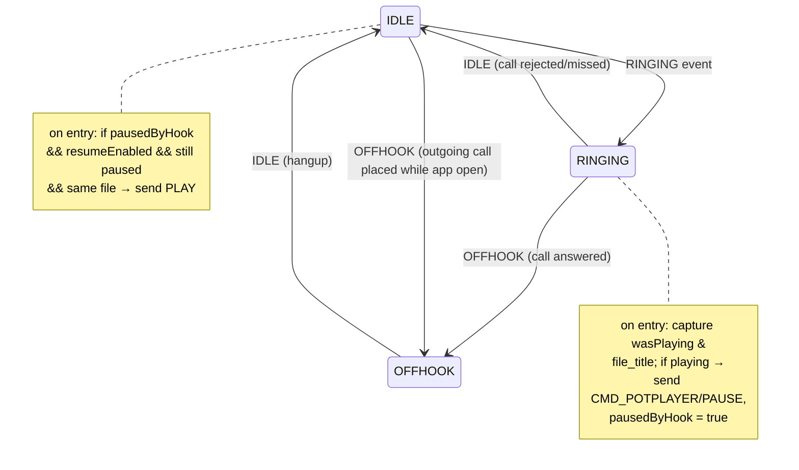

# Doc 44: Flutter Incoming Call Auto-Pause Hook

> Part of PotPilot plan-series · Category H · Session 2 Wave 2.B · Flutter App

## 1. Purpose & Scope

Listens to Android telephony state (`RINGING` → `OFFHOOK` → `IDLE`) via the `phone_state` package and **automatically dispatches `PAUSE` to PotPlayer when a call arrives**, so a ringing phone never fights movie audio in the bedroom. Optionally dispatches `PLAY` to resume after hangup — but **only if this hook was the thing that paused playback**.

**In scope**
- Foreground-and-background telephony observation (the WS client keeps running while the app is backgrounded — Doc 31 owns reconnects).
- Pause-on-ring / pause-on-offhook decision table, guarded optional auto-resume, `callActive` flag consumed by Doc 43.
- Runtime permission flow for `READ_PHONE_STATE`, persisted resume preference, transient status banner.

**Out of scope**
- WhatsApp/Telegram-style VoIP call detection (does not touch Android telephony state — see §10), muting the phone's ringer, call recording/answering UI, DND scheduling, any PC-side changes, notification-listener integrations.

## 2. File Ownership

**Creates (create-only, exact path per overview Section 3):**
- `mobile_app/lib/hardware_hooks/call_autopause_hook.dart`

**Reads/touches owned by other docs (never edited here):**
- `lib/network/ws_client.dart` (Doc [31_flutter_websocket_client_reconnect.md](31_flutter_websocket_client_reconnect.md)) — sends `PAUSE`/`PLAY`, exposes `isConnected`.
- `lib/network/telemetry_provider.dart` (Doc [33_flutter_telemetry_state_provider.md](33_flutter_telemetry_state_provider.md)) — `play_state`, `file_title` for resume gating.
- `lib/core/haptics/haptic_engine.dart` (Doc [42_flutter_haptic_feedback_engine.md](42_flutter_haptic_feedback_engine.md)) — optional soft `heavyThud` when a movie was paused by hook (local-only confirmation).
- `lib/hardware_hooks/volume_button_hijack.dart` (Doc [43_flutter_hardware_volume_button_hijack.md](43_flutter_hardware_volume_button_hijack.md)) — reads `callActive` (no edits).
- `mobile_app/pubspec.yaml` (Doc [05_flutter_app_boilerplate_deps.md](05_flutter_app_boilerplate_deps.md)) — consumes the declared `phone_state` dependency.
- Settings persistence via `shared_preferences` (package from Doc 05; keys owned by this doc, §10).

## 3. Public Contract

```dart
/// Mirrors the Android telephony states surfaced by phone_state.
enum CallPhase { idle, ringing, offhook }

/// Immutable snapshot of the hook's decision state (for HUD/settings UI).
class CallAutopauseState {
  final CallPhase phase;
  final bool permissionGranted;
  final bool pausedByHook;        // hook dispatched PAUSE for this call
  final String? pausedFileTitle;  // title captured at pause time (resume gate)
}
```

```dart
/// Telephony observer that pauses/resumes PotPlayer across incoming calls.
class CallAutopauseHook {
  CallAutopauseHook({required /*WsClient*/ ws, required /*TelemetryState*/ telemetry,
      required Stream<CallPhase> /* injectable seam */ phoneStates});
  /// Requests permission and subscribes to the phone-state stream.
  Future<void> start();
  /// Unsubscribes and resets state (app dispose / manual disable).
  void stop();
  /// True while RINGING or OFFHOOK — gates Doc 43 volume-key pass-through.
  bool get callActive;
  /// Live state for settings banner.
  ValueNotifier<CallAutopauseState> get state;
}
/// Riverpod provider for the process-wide hook.
final callAutopauseHookProvider = Provider<CallAutopauseHook>((ref) => /* wired */);
```

## 4. Internal Design

**4.1 Call-state machine**



**4.2 Algorithm steps**
1. `start()`: request `READ_PHONE_STATE` permission (via `phone_state`'s permission API — see §10); on denial → enter `disabled` state, surface persistent amber notice, do nothing further (no crash, no retry loop beyond a single re-ask on next app start).
2. Subscribe to the phone-state stream; map raw status strings → `CallPhase`; **ignore consecutive duplicates** (telephony streams re-emit).
3. On `RINGING` (or `IDLE→OFFHOOK` for outgoing calls): snapshot `wasPlaying = telemetry.playState == playing` and `fileTitle = telemetry.fileTitle`; if playing → dispatch `PAUSE`, set `pausedByHook = true`, optional soft haptic + banner "Paused for call".
4. On `RINGING→OFFHOOK`: no wire action (already paused); keep `pausedByHook`.
5. On any → `IDLE` (call ended/rejected): evaluate resume gate — send `PLAY` iff all of: `pausedByHook == true`, `autoResumeOnHangup == true` (setting), telemetry still shows `paused`, and `telemetry.fileTitle == pausedFileTitle` (user didn't manually switch/stop the movie mid-call); then clear `pausedByHook`.
6. Every transition updates the `ValueNotifier` state and the `callActive` getter (true for `ringing | offhook`).
7. `stop()`: cancel subscription; `callActive` returns false.

## 5. Protocol & Data Compliance

**Exact WS envelopes dispatched** (frozen envelope shape from overview §4.2):

| Trigger | Envelope |
|---|---|
| `RINGING` (and `IDLE→OFFHOOK` outgoing) while playing | `{"id":"<uuid-v4>","type":"CMD_POTPLAYER","action":"PAUSE","payload":{},"timestamp":<unix>}` |
| Call ended + resume gate passes | `{"id":"<uuid-v4>","type":"CMD_POTPLAYER","action":"PLAY","payload":{},"timestamp":<unix>}` |

- PC side: Doc 14 routes `CMD_POTPLAYER` → Doc 09 `wm_dispatcher` → background `WM_COMMAND` pause/play on the PotPlayer64 window (zero focus loss, per the frozen architecture).
- **Consumed** (never produced): `TELEMETRY_SYNC` (250 ms cadence) for `play_state` and `file_title` gating.
- No UDP traffic; no new envelope fields; `payload` remains `{}` (open object per frozen schema).
- Timing target: `PAUSE` dispatch begins < 250 ms after the `RINGING` event is delivered by Android (one telemetry cadence), typically immediate.

## 6. Dependencies & Integration Points

**Internal**
- [05_flutter_app_boilerplate_deps.md](05_flutter_app_boilerplate_deps.md) — `phone_state` in `pubspec.yaml`.
- [03_websocket_json_schema_spec.md](03_websocket_json_schema_spec.md) — envelope + action registry (`PAUSE`/`PLAY` registered there).
- [31_flutter_websocket_client_reconnect.md](31_flutter_websocket_client_reconnect.md) — transport; hook tolerates background disconnects via reconnect.
- [33_flutter_telemetry_state_provider.md](33_flutter_telemetry_state_provider.md) — play state/file title.
- [42_flutter_haptic_feedback_engine.md](42_flutter_haptic_feedback_engine.md) — optional pause confirmation haptic.
- [43_flutter_hardware_volume_button_hijack.md](43_flutter_hardware_volume_button_hijack.md) — reciprocal integration: 43 reads `callActive`.
- Root wiring: `mobile_app/lib/main.dart` (Session 3 master shell, Wave 3.A Subagent 3).

**External**
- `phone_state` (pub, Doc 05) — `RINGING/OFFHOOK/IDLE` stream.
- `shared_preferences` (Doc 05) — `call_autopause_enabled`, `call_auto_resume` flags.
- `flutter_riverpod` — provider; Flutter `services` for lifecycle observer.

## 7. Edge Cases & Failure Handling

- **Permission denied** → hook disabled with a persistent amber "Call auto-pause needs Phone permission" notice in the settings surface; rest of the app unaffected; one gentle re-prompt on next cold start.
- **PC disconnected / WS down at `RINGING`** → skip the PAUSE send (no queueing — a late pause after the call would be wrong), banner shows "PC offline"; resume gate naturally fails later since `pausedByHook` never set.
- **WS reconnects mid-call** → no retroactive actions; state machine is edge-driven, not reconciled.
- **App backgrounded during the call** → Android may kill the WS socket; Doc 31 reconnects; on `IDLE` after reconnect, resume is attempted once only if the gate (§4.2 step 5) still passes within the same call session (guard: hook instance still holding `pausedByHook`).
- **User manually plays the movie during the call** → telemetry shows `playing` at `IDLE`; resume gate's "still paused" condition fails → no second `PLAY` (harmless duplicate avoided) and no re-pause ever occurs (we only pause on ring/offhook entry).
- **User manually switches files during the call** → `fileTitle` mismatch blocks auto-resume.
- **Outgoing call placed from the phone while movie plays** → `IDLE→OFFHOOK` also pauses (assumption, §10) — desired: speakerphone conflicts avoided.
- **WhatsApp/Telegram VoIP calls** → no telephony state change; hook silent (documented limitation, §10).
- **Android kills the app process during a call** → hook state lost; on next launch it re-subscribes in `IDLE`; no spurious PLAY.
- **Duplicate stream events** → consecutive-same-phase filter drops them.
- **Dual-SIM / call-waiting second call** → phases remain `offhook`; no extra dispatches.

## 8. Acceptance Criteria

- [ ] Incoming cellular call while movie plays → PotPlayer pauses within ~500 ms of `RINGING` (verified against Doc 46 mock harness receiving the `WM_COMMAND` pause code).
- [ ] No `PAUSE` is sent when telemetry already reports paused/stopped (gating works).
- [ ] Rejected call (never answered) → auto-resume fires iff `call_auto_resume == true` and all gates pass; otherwise stays paused.
- [ ] Accepted call, hangup after 3 min → same resume logic; if user paused/switched movie mid-call, no auto-resume.
- [ ] Outgoing call while movie plays → movie pauses; resumes on hangup per same gate.
- [ ] With permission denied: app runs normally, amber notice visible, zero WS calls from the hook.
- [ ] During `OFFHOOK`, Doc 43 volume keys pass through to the system (integration check with 43).
- [ ] Settings toggles (`enabled`, `autoResume`) persist across restarts.
- [ ] `flutter analyze` zero errors; no UDP traffic ever emitted by this file.

## 9. Test Plan

**Automated — `mobile_app/test/call_autopause_hook_test.dart`**
- Injectable `Stream<CallPhase>` (controller-driven) + mocked `ws`/`telemetry`; table-driven transition test asserting the exact envelope (`type`, `action`, `payload == {}`, `id`/`timestamp` present) for every row of the §4.1 machine: ring→pause, answer→noop, reject→resume, outgoing→pause, hangup→resume.
- Resume-gate matrix: resumeEnabled on/off × wasPlaying × still-paused × title-mismatch → expected send/no-send.
- Duplicate-event filter: two consecutive `ringing` events → one PAUSE.
- Disconnected-at-ring: `ws.isConnected == false` → zero sends, `pausedByHook` stays false.
- Permission-denied seam: start() resolves denied → `stop()` semantics, no exception, state flag set.
- `callActive` getter truth table across phases (consumed by Doc 43's tests).

**Manual (physical SIM device — automation impractical)**
1. Play a movie on the PC, incoming call from a second phone → PC audio pauses; accept, talk, hang up → resumes (setting on).
2. Reject the call immediately → resumes within ~1 s.
3. Deny the phone permission → amber notice; calls no longer affect playback.
4. Airplane-mode + Wi-Fi only → no telephony events, zero logs from hook.

## 10. Assumptions & Open Questions

**Assumptions (recorded, resolved myself)**
- `PAUSE` and `PLAY` are registered action names within `CMD_POTPLAYER` (consistent with Doc 03's open action registry; the overview's example `PLAY_PAUSE` covers button UI — discrete PAUSE/PLAY are needed for programmatic gates).
- `autoResumeOnHangup` defaults to **true**, but resume only ever happens when the hook itself paused and all §4.2 step-5 gates pass — safe by construction.
- Outgoing calls (`IDLE→OFFHOOK`) pause playback, same as incoming (bedroom ergonomics symmetry).
- `phone_state` exposes a status stream and a permission-request API; exact method names verified against the installed package version at implementation time (fallback: add `permission_handler` to Doc 05's pubspec as a documented amendment).
- `shared_preferences` keys `call_autopause_enabled` (default true) and `call_auto_resume` (default true) are owned by this doc.
- Android telephony is the only call signal source (VoIP apps excluded — see open question).

**Open questions**
- WhatsApp/Telegram call auto-pause would require a `NotificationListenerService` (new package + permission outside Doc 05's frozen pubspec list) — explicitly deferred; add as a Phase 4 candidate if desired.
- Should a missed call (ringing → idle with no answer) resume at a different volume (ramp-up)? Deferred to on-device UX polish.
