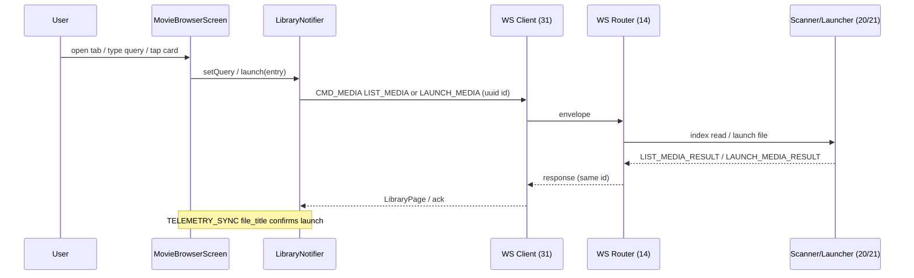

# Doc 45: Flutter In-App Movie Library Browser

> Part of PotPilot plan-series · Category H · Session 2 Wave 2.B · Flutter App

## 1. Purpose & Scope

Builds the searchable **"Netflix-style" local file browser** that queries the PC's indexed movie folders (Doc 20's scanner index) and **launches any video into PotPlayer with a single tap** (Doc 21's launcher) — pick a movie from bed, watch it fullscreen, never touch the PC.

**In scope**
- Library screen: search field (instant client-side filtering), sort chips, title cards (size/date/SRT badge), pull-to-refresh, "now playing" highlight from live telemetry.
- Full-index fetch with paging, empty/offline/no-match states, optimistic launch feedback, launch-failure snackbar.
- WS `CMD_MEDIA` envelopes for querying the index and launching files.

**Out of scope**
- Poster/thumbnail art (Doc 20 extracts no artwork — see §10), on-phone playback, file management (delete/rename/move), choosing watched folders (Doc 24's PC dashboard), subtitle/audio track picking at launch (Docs 39/09), progress bars per file (no resume-position contract exists — §10).

## 2. File Ownership

**Creates (create-only, exact path per overview Section 3):**
- `mobile_app/lib/features/library/movie_browser.dart` (single module: screen widget + Riverpod notifier + models — isolated per blueprint ownership rules)

**Reads/touches owned by other docs (never edited here):**
- `lib/network/ws_client.dart` (Doc [31_flutter_websocket_client_reconnect.md](31_flutter_websocket_client_reconnect.md)) — all `CMD_MEDIA` transport.
- `lib/network/telemetry_provider.dart` (Doc [33_flutter_telemetry_state_provider.md](33_flutter_telemetry_state_provider.md)) — `file_title` for the now-playing highlight and post-launch confirmation.
- `lib/core/theme/oled_theme.dart` (Doc [29_flutter_oled_theme_design_system.md](29_flutter_oled_theme_design_system.md)) — pure-black surfaces, dim amber/crimson accents, card typography.
- PC side (server behavior owned elsewhere, read-only here): [20_pc_local_media_scanner_service.md](20_pc_local_media_scanner_service.md) index, [21_pc_potplayer_file_launcher.md](21_pc_potplayer_file_launcher.md) launch, [14_pc_websocket_server_router.md](14_pc_websocket_server_router.md) action registry.

## 3. Public Contract

```dart
/// Sort modes for the browser (client-side reorder only; no wire `sort` field).
enum LibrarySort { titleAsc, sizeDesc, recentDesc }

/// One indexed movie row (mirrors Doc 20's scanner record).
class MovieEntry {
  final String path;      // absolute PC path, e.g. D:\Movies\Inception (2010).mkv
  final String title;     // filename minus extension
  final int sizeBytes;    // file size from Doc 20 index
  final DateTime modified;// last-modified from Doc 20 index
  final bool hasSrt;      // companion .srt presence flag from Doc 20
}
/// One page of results for a LIST_MEDIA request.
class LibraryPage { final List<MovieEntry> items; final int total; final int offset; }
```

```dart
/// Riverpod notifier: fetches, caches, filters and launches library entries.
class LibraryNotifier extends AsyncNotifier<List<MovieEntry>> {
  /// Re-fetches the full index from the PC (also used by pull-to-refresh).
  Future<void> refresh({bool force = false});
  /// Sets the local search query; filtering is instant, no PC round-trip.
  void setQuery(String query);
  /// Sets the active sort mode (client-side reorder, no round-trip).
  void setSort(LibrarySort sort);
  /// Launches [entry] on the PC via CMD_MEDIA/LAUNCH_MEDIA; returns false if offline.
  Future<bool> launch(MovieEntry entry);
}
/// Provider consumed by the Movie Library tab of the root shell.
final libraryProvider =
    AsyncNotifierProvider<LibraryNotifier, List<MovieEntry>>(/* wired */);
/// The browser screen widget (search bar + sort chips + grid + states).
class MovieBrowserScreen extends ConsumerWidget { /* build per §4.4 */ }
```

## 4. Internal Design

**4.1 Component breakdown**
1. **Models** — `MovieEntry`, `LibraryPage`, JSON `fromJson` matching Doc 20's record keys (§5).
2. **LibraryNotifier** — owns full-index cache, query/sort state, paged fetch loop, launch flow.
3. **Screen** — debounced `TextField`, sort-chip row, `GridView` (2 columns, `ListView.builder` semantics for virtualization), state branches.
4. **Correlation guard** — every fetch carries the envelope `id`; late/duplicate responses for superseded ids are dropped (latest-wins).

**4.2 Fetch strategy (hybrid, instant search)**
1. On first open: page through `LIST_MEDIA` (`limit: 200`, `offset: 0,200,…`) until `offset >= total` → build in-memory cache.
2. Typing/debounced 200 ms → **client-side** case-insensitive substring filter over the cache (zero-latency Netflix feel, no PC round-trip per keystroke) → sorted per chip.
3. If the server reports `total > 5000` (§10), switch to **server-side query mode**: each debounced query re-fetches with `payload.query` set (keeps phone memory and WS payload bounded).
4. Pull-to-refresh → `RESCAN_MEDIA` → show queued state from `RESCAN_MEDIA_RESULT {"ok":true,"queued":true}` → after ~2 s re-run the paged `LIST_MEDIA` fetch.

**4.3 Launch flow**
1. Tap card → optimistic UI: card shows "Launching…" spinner; `launch()` sends `LAUNCH_MEDIA` (`{path}` only).
2. Doc 14 routes to Doc 21 → `PotPlayer64.exe` opens the file fullscreen + snaps the primary monitor.
3. Confirmation: next `TELEMETRY_SYNC` (≤ 250 ms) `file_title` matches the entry → card becomes "Now Playing" (dim amber ring); mismatch/timeout 2 s → error snackbar, card reverts.



**4.4 UI structure** — pure `#000000` scaffold (Doc 29 tokens): app bar with title + refresh icon; search field (amber cursor); sort chips (`Title A–Z` / `Biggest` / `Newest`); card grid — each card: monospace-truncated title (ellipsis, max 2 lines), `12.4 GB · 2010-07-16` subtitle, `SRT` badge top-right when `hasSrt`; states: skeleton loaders (first fetch), "no folders watched", "no match", "PC offline — Retry".

## 5. Protocol & Data Compliance

All envelopes use the frozen shape `{"id":"uuid-v4","type":"CMD_MEDIA","action":"...","payload":{},"timestamp":unix}`:

| Direction | Action | Payload | Notes |
|---|---|---|---|
| Phone → PC | `LIST_MEDIA` | `{"query":"","offset":0,"limit":200}` | `path`/`query` optional; `limit` 1–200 (default 50); sort chips are client-side |
| PC → Phone | `LIST_MEDIA_RESULT` | `{"folders":[],"total":1234,"offset":0,"limit":200,"items":[{"name":"…","path":"…","size_bytes":123,"modified_at":1760500000,"has_subs":true}]}` | response echoes request `id` |
| Phone → PC | `RESCAN_MEDIA` | `{}` | queues Doc 20 folder re-scan |
| PC → Phone | `RESCAN_MEDIA_RESULT` | `{"ok":true,"queued":true}` | ack; client re-queries `LIST_MEDIA` after ~2 s |
| Phone → PC | `LAUNCH_MEDIA` | `{"path":"D:\\Movies\\Inception (2010).mkv"}` | Doc 21 launches fullscreen + snaps primary (implicit) |
| PC → Phone | (response/`ERROR`) | Doc 03 error envelope | launch failed (file missing, PotPlayer closed) |

- `TELEMETRY_SYNC` is **consumed only** (file-title highlight); no custom telemetry is produced.
- Windows paths stay backslash-escaped inside JSON strings; unicode titles pass through unmodified (UTF-8 assumed per Doc 03).
- Field names mirror Doc 20's frozen wire record (`name`, `path`, `size_bytes`, `modified_at`, `has_subs` — Doc 20 serializes internal `title`/`has_srt` to `name`/`has_subs`) — no parallel schema invented here.

## 6. Dependencies & Integration Points

**Internal**
- [03_websocket_json_schema_spec.md](03_websocket_json_schema_spec.md) — envelope + action registry (consumes the frozen `LIST_MEDIA`/`RESCAN_MEDIA`/`LAUNCH_MEDIA` actions of §5.5 there).
- [14_pc_websocket_server_router.md](14_pc_websocket_server_router.md) — dispatches `CMD_MEDIA` to handlers.
- [20_pc_local_media_scanner_service.md](20_pc_local_media_scanner_service.md) — the index this browser queries.
- [21_pc_potplayer_file_launcher.md](21_pc_potplayer_file_launcher.md) — single-tap launch executor.
- [29_flutter_oled_theme_design_system.md](29_flutter_oled_theme_design_system.md) — visual tokens.
- [31_flutter_websocket_client_reconnect.md](31_flutter_websocket_client_reconnect.md) — transport + reconnect (browser listens for `isConnected` to auto-retry).
- [33_flutter_telemetry_state_provider.md](33_flutter_telemetry_state_provider.md) — now-playing confirmation.
- Root tab registration: `mobile_app/lib/main.dart` (Session 3 master shell, Wave 3.A Subagent 3 — "Movie Library" nav tab).

**External**
- `flutter_riverpod` — notifier/provider state; `web_socket_channel` (via Doc 31); `shared_preferences` (persist last sort chip only — key owned by this doc, §10). No new pub packages beyond Doc 05's frozen list.

## 7. Edge Cases & Failure Handling

- **Empty index (no folders watched / folders empty)** → dedicated empty state: "No movie folders yet — set them in the PotPilot PC dashboard" + Refresh button; never a blank grid.
- **PC offline / WS reconnecting** → last-known list kept if loaded (session-local cache); banner "Offline — retrying…"; `launch()` returns `false` immediately with snackbar; auto-refetch on reconnect event from Doc 31.
- **Query matches nothing** → "No titles match '<query>'" state with one-tap clear.
- **Refresh while typing** → in-flight fetches for superseded envelope ids are dropped (correlation guard §4.1); cache swap is atomic (no flicker between pages).
- **File deleted between index and tap** → Doc 21 returns error → `ERROR` envelope → snackbar "File not found on PC" + auto `refresh({force:true})`.
- **PotPlayer not running / closed mid-launch** → Doc 21 cold-starts it (its own contract); browser just shows spinner→confirm.
- **Launch while something already plays** → single tap still launches directly (product requirement — no confirm dialog); current movie is replaced by PotPlayer's own open semantics.
- **Huge titles / unicode / emoji / quotes in filenames** → ellipsis truncation; strings pass through JSON untouched; no path re-encoding on the phone.
- **10k+ file libraries** → paging (200/page) + `GridDelegate` virtualization; > 5000 entries flips to server-side query mode (§4.2).
- **Duplicate titles** → cards disambiguated by size + modified date subtitle.
- **Double-tap on card** → second `LAUNCH_MEDIA` for same path coalesced (1 s guard) to avoid double relaunch.

## 8. Acceptance Criteria

- [ ] Opening the Movie Library tab shows the full index within ~1 s on LAN for a 500-file library (paged fetch verified in test).
- [ ] Typing filters results **without any PC round-trip** (< 50 ms after the 200 ms debounce) in normal mode.
- [ ] Sort chips reorder client-side; state survives tab switches (provider is app-scoped).
- [ ] Single tap on any card launches that exact file in PotPlayer **fullscreen on the primary monitor** within ~1 s on LAN (manual check on PC).
- [ ] Within 250 ms after launch, the tapped card shows "Now Playing" (driven by telemetry `file_title`, not optimistic guesswork).
- [ ] All six WS envelopes in §5 match the frozen envelope shape (validated in tests against Doc 03's schema).
- [ ] Empty index, no-match, and offline states render distinctly with working actions (Refresh/Retry/Clear).
- [ ] Pull-to-refresh sends a real `RESCAN_MEDIA` round-trip (queued ack) and, after the re-query, shows new files added on the PC.
- [ ] `flutter analyze` zero errors; unicode filename (e.g. `Amélie (2001).mkv`) launches correctly.

## 9. Test Plan

**Automated — `mobile_app/test/movie_browser_test.dart`**
- Fake WS client; assert exact envelope JSON for `LIST_MEDIA` (paging offsets 0/200/…), `RESCAN_MEDIA` → `RESCAN_MEDIA_RESULT {"ok":true,"queued":true}` → re-query, `LAUNCH_MEDIA` (path only), and correlation-guard drops of superseded ids.
- `fake_async`: 200 ms search debounce (3 fast keystrokes → one filter pass, zero PC calls); launch-confirm flow driven by injecting a `TELEMETRY_SYNC` state update; 2 s launch-timeout snackbar.
- State rendering: empty index / no-match / offline-retry via pumped widget tests (OLED theme applied).
- Filter+sort matrix on a fixture of 30 `MovieEntry`s (substring case-insensitivity, three sorts, SRT badge flag).
- Double-tap coalescing: two taps < 1 s → one `LAUNCH_MEDIA`.

**Manual (real PC + phone)**
1. Configure two watched folders on the PC dashboard; add a file while app open → pull-to-refresh shows it.
2. Tap a title → PotPlayer opens fullscreen, monitor snaps, card rings amber.
3. Turn PC Wi-Fi off → offline banner; tap → snackbar; Wi-Fi back → auto-reconnect + list restored.
4. Library with 1 000+ files → scroll stays smooth (no jank > 1 frame during fling).

## 10. Assumptions & Open Questions

**Assumptions (recorded, resolved myself)**
- **Resolved against Doc 03 §5.5:** the frozen `CMD_MEDIA` actions are `LIST_MEDIA` (paged query), `RESCAN_MEDIA` (`_RESULT {"ok":true,"queued":true}`) and `LAUNCH_MEDIA` (`{path}` → `_RESULT {"ok":true}`) — consumed verbatim here; nothing left to register (there is no unsolicited page/refresh push frame).
- `_RESULT` replies echo the request's `id` for correlation (Doc 03 §5.8 convention).
- No thumbnails: Doc 20's contract extracts only size/modified/SRT — cards are typographic (consistent with the OLED night theme).
- Client-side filtering with full-index cache; server-side query fallback above 5 000 entries.
- Sort chips persisted under `library_sort` `shared_preferences` key owned by this doc (Doc 34 owns pairing/auth/sensitivity/startup-tab keys only).
- Launch confirmation window is 2 s; fullscreen + primary snap are implicit `LAUNCH_MEDIA` side effects (no wire flags).

**Open questions**
- Per-file resume-position ("continue watching") would need a PotPlayer-bookmark contract between Docs 10/09 — deferred, not part of the frozen telemetry schema.
- Folder/sub-folder grouping UI once Doc 20 exposes directory grouping (currently a flat index).
