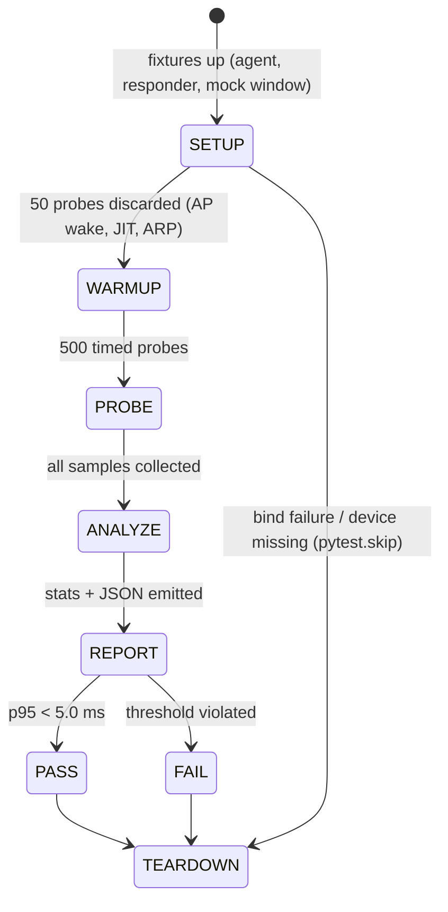

# Doc 46: E2E Latency Benchmark & QA Suite

> Part of PotPilot plan-series · Category I · Session 3 Wave 3.A · Shared

## 1. Purpose & Scope

The **master QA gate** for PotPilot. Delivers (a) an automated **UDP round-trip latency benchmark** proving the `< 5 ms` LAN target from phone to PC and back, (b) a **PotPlayer mock window harness** (a real Win32 window with class `PotPlayer64`) that lets CI verify `WM_COMMAND`/`WM_USER` behavior without the real player, and (c) the **final wiring verification checklist** covering every milestone of Sessions 1–3 from overview Section 7.

**In scope**
- Python-side pytest harness (echo responder, mock window, orchestration, threshold evaluation) and Dart-side on-device latency driver (`integration_test`).
- Serialization-overhead micro-benchmark (`< 2 ms` budget per the frozen spec), WS→`WM_COMMAND` background-dispatch verification, telemetry cadence (`250 ms`) and scrub-bar sync verification.
- The full human+automated checklist that gates release.

**Out of scope**
- Building artifacts (PyInstaller/InnoSetup/APK are verified by checklist only — owned by Docs 27/28 and Wave 3.A Subagent 3), security/fuzz testing, multi-client load testing, DDC/CI hardware validation, real-PotPlayer functional testing (manual smoke only), fixing any bug the suite exposes.

## 2. File Ownership

**Creates (create-only). These paths are NOT in overview Section 3's source blueprint — conventional QA locations recorded as assumptions in §10:**
- `pc_agent/tests/conftest.py` — shared fixtures: agent lifecycle, echo responder, mock window, WS test client.
- `pc_agent/tests/harness/udp_echo_responder.py` — verbatim 8-byte echo server (benchmark target).
- `pc_agent/tests/harness/mock_potplayer_window.py` — fake `PotPlayer64` Win32 window.
- `pc_agent/tests/test_serialization_overhead.py` — pack/unpack micro-benchmark.
- `pc_agent/tests/test_udp_latency_benchmark.py` — LAN RTT orchestration + thresholds.
- `pc_agent/tests/test_ws_dispatch_and_telemetry.py` — background WM_COMMAND + 250 ms cadence checks.
- `mobile_app/integration_test/udp_latency_bench_test.dart` — on-device probe sender (RTT initiator).
- `mobile_app/integration_test/wiring_smoke_test.dart` — app-launch/pairing/telemetry smoke on device.

**Reads/touches owned by other docs (strictly read-only — this doc edits nothing):**
- `shared_specs/udp_packet_layout.json` + [02_binary_udp_protocol_spec.md](02_binary_udp_protocol_spec.md) (byte layout source of truth), `shared_specs/ws_command_schema.json` + [03_websocket_json_schema_spec.md](03_websocket_json_schema_spec.md) (envelope validation).
- PC runtime: `main.py` (Wave 3.A Subagent 1 wiring), `network/udp_server.py` (13), `network/ws_server_router.py` (14), `core/auth_middleware.py` (15), `network/telemetry_broadcaster.py` (18), `potplayer/wm_dispatcher.py` (09), `potplayer/telemetry_poller.py` (10).
- Mobile runtime: `network/udp_sender.dart` (30), `network/ws_client.dart` (31), `network/pairing_scanner.dart` (32).

## 3. Public Contract

```python
# pc_agent/tests/harness/udp_echo_responder.py
class UdpEchoResponder:
    """Bind UDP 50505, validate the auth XOR byte (Doc 15), echo every valid 8-byte probe verbatim."""
    def __init__(self, host: str, port: int, auth_byte: int) -> None: ...
    def start(self) -> None: ...
    def stop(self) -> None: ...
    @property
    def probe_count(self) -> int: ...

# pc_agent/tests/harness/mock_potplayer_window.py
class MockPotPlayerWindow:
    """Register a hidden Win32 window with class name 'PotPlayer64' and pump messages on a thread."""
    def start(self) -> None: ...
    def stop(self) -> None: ...
    @property
    def received_commands(self) -> list[int]: ...   # WM_COMMAND wparam log
    @property
    def received_user_msgs(self) -> list[tuple[int, int]]: ...  # (msg, wparam) log
    def set_position_ms(self, ms: int) -> None: ...  # value returned by WM_USER getters
```

```python
# pc_agent/tests (result types)
@dataclass(frozen=True)
class LatencyStats:
    """Immutable RTT summary in milliseconds: samples, min, mean, p50, p95, p99, max."""
    samples_ms: list[float]; min: float; mean: float; p50: float; p95: float; p99: float; max: float
def evaluate(stats: LatencyStats, threshold_ms: float = 5.0, *, percentile: str = "p95") -> bool: ...
```

```dart
// mobile_app/integration_test/udp_latency_bench_test.dart
/// Sends [samples] 8-byte auth-valid probes to the PC echo responder and measures RTT
/// with Stopwatch (microsecond resolution); prints a single parseable
/// "BENCH_RESULT:{json}" line for the pytest orchestrator.
Future<BenchResult> measureRtt({required String host, int port = 50505,
    int samples = 500, int warmup = 50});
class BenchResult { final double p50Ms, p95Ms, p99Ms, meanMs, maxMs; int get sampleCount; }
```

## 4. Internal Design

**4.1 Benchmark phase state machine** (drives both pytest orchestration and the Dart driver)



**4.2 Echo responder algorithm**
1. `socket.bind((host, 50505))` — exclusive; fail fast with "stop the agent first" if `OSError`.
2. Per datagram: length must be exactly 8; byte 1 must equal the auth XOR checksum of the pairing token (reuse Doc 15's pure function); else drop + count `rejected`.
3. Valid probe → echo the same 8 bytes verbatim back to the sender, increment `probe_count`. **No new packet type is invented** — reflection only.

**4.3 Mock PotPlayer window algorithm**
1. `win32gui.RegisterClass` with `className="PotPlayer64"` (matches Doc 8's `FindWindow("PotPlayer64", None)`); before registering, `FindWindow` again — if a real PotPlayer is open, **abort with a clear instruction** (no class collision).
2. Create a hidden (0×0) top-level window; run `GetMessagePump` on a daemon thread.
3. `WM_COMMAND` → append `wparam` to log, toggle a fake play-state bit. `WM_USER` getters (position/duration/state/volume/speed per Doc 10's op-code table in `potplayer_wm_codes.json`) → reply from a monotonic-clock model (position advances in real time); `WM_USER` setters (speed/volume) → update model.
4. Never call `SetForegroundWindow` — background execution is the point; the test snapshots `GetForegroundWindow()` before/after each dispatch and asserts identity.

**4.4 Orchestration flow**
1. pytest fixture starts `MockPotPlayerWindow` → starts the real agent (`main.py` in-process or subprocess) against it → optionally starts `UdpEchoResponder` (mutually exclusive with the agent's UDP bind: RTT run and agent-integrated runs are *separate* test groups — see §7).
2. pytest resolves the phone path: `flutter devices` JSON → if no Android device, RTT test is `pytest.skip("no device")`; PC-local loopback RTT still runs as informational.
3. pytest launches `flutter test integration_test/udp_latency_bench_test.dart -d <device> --dart-define=PC_HOST=<lan-ip>`, parses the `BENCH_RESULT:{...}` stdout line, wraps it in `LatencyStats`, applies `evaluate()`.
4. WS/telemetry tests use a `websockets` test client against port 50506 with the pairing token handshake (Doc 15 / Doc 03).

## 5. Protocol & Data Compliance

**Wire formats under test are frozen** — every harness send/parse uses exactly: UDP 8-byte little-endian `<BBhhH>` (types `0x01–0x04`, auth XOR byte, `uint16` sequence) per [02_binary_udp_protocol_spec.md](02_binary_udp_protocol_spec.md); WS envelope `{"id","type","action","payload","timestamp"}` per [03_websocket_json_schema_spec.md](03_websocket_json_schema_spec.md), validated against `shared_specs/ws_command_schema.json` before every test send.

**Metric definitions, sample counts & pass/fail thresholds**

| # | Metric | Method | Samples | Threshold | Verdict |
|---|---|---|---|---|---|
| M1 | Serialization overhead | pack+unpack one `<BBhhH>` packet, `perf_counter_ns` | 100 000 (1 000 discarded warm-up) | p99 < **2.0 ms** (expected µs-range) | **Blocking** |
| M2 | UDP LAN round-trip | Dart probe → PC echo responder → Dart receive; RTT per probe | 500 timed (50 warm-up) | p95 < **5.0 ms** | **Blocking** |
| M3 | UDP auth rejection | 20 probes with wrong auth byte | 20 | 0 echoed, 0 agent side-effects | **Blocking** |
| M4 | WS → `WM_COMMAND` background dispatch | send `CMD_POTPLAYER`/`PLAY_PAUSE` etc.; mock window logs `WM_COMMAND`; foreground window unchanged | 30 commands (10 distinct actions × 3) | 100% delivered, foreground HWND identical before/after, p95 dispatch-to-log < **100 ms** | **Blocking** |
| M5 | Telemetry cadence | timestamp 60 s of `TELEMETRY_SYNC` arrivals on WS | 240 expected frames | inter-arrival p95 within 250 ms ± 10 % (225–275 ms); count in [216, 264] | **Blocking** |
| M6 | Scrub-bar sync | drive mock position; phone-side provider reflects new position | 20 steps × 250 ms | phone position within **±250 ms** of mock position on every step | **Blocking** |
| M7 | mDNS discoverability | `_potpilot._tcp.local.` browse until service found | 1 lookup (10 s window) | resolves within 10 s | **Blocking** |
| M8 | RTT stability (informational) | min / mean / p50 / p99 / max from M2 | — | report-only, no threshold | Report |
| M9 | PC-local loopback RTT (informational, no phone) | Python client ↔ responder on 127.0.0.1 | 1 000 | report-only (CI without device) | Report |

**WS actions exercised (all pre-registered in Doc 03/14):** `PLAY_PAUSE`, `PAUSE`, `PLAY`, `SET_SPEED`, `LIST_MEDIA`, `LAUNCH_MEDIA`, `SET_VOLUME` — the harness asserts each sent envelope validates against `ws_command_schema.json` before dispatch.

## 6. Dependencies & Integration Points

**Internal (read-only consumers)**
- [02_binary_udp_protocol_spec.md](02_binary_udp_protocol_spec.md), [03_websocket_json_schema_spec.md](03_websocket_json_schema_spec.md) — frozen contracts + `shared_specs/*.json`.
- Session-1 PC core under test: [13_pc_asyncio_udp_receiver.md](13_pc_asyncio_udp_receiver.md), [14_pc_websocket_server_router.md](14_pc_websocket_server_router.md), [15_pc_token_auth_middleware.md](15_pc_token_auth_middleware.md), [16_pc_zeroconf_mdns_broadcaster.md](16_pc_zeroconf_mdns_broadcaster.md), [08_potplayer_hwnd_locator.md](08_potplayer_hwnd_locator.md), [09_potplayer_wm_command_dispatcher.md](09_potplayer_wm_command_dispatcher.md), [10_potplayer_wm_user_telemetry_poller.md](10_potplayer_wm_user_telemetry_poller.md), [18_pc_telemetry_broadcast_loop.md](18_pc_telemetry_broadcast_loop.md).
- Session-1 mobile core under test: [30_flutter_udp_datagram_sender.md](30_flutter_udp_datagram_sender.md), [31_flutter_websocket_client_reconnect.md](31_flutter_websocket_client_reconnect.md), [32_flutter_qr_scanner_mdns_pairing.md](32_flutter_qr_scanner_mdns_pairing.md), [33_flutter_telemetry_state_provider.md](33_flutter_telemetry_state_provider.md).
- Session-2 features spot-checked via checklist: [43](43_flutter_hardware_volume_button_hijack.md), [44](44_flutter_incoming_call_autopause_hook.md), [45](45_flutter_in_app_movie_library_browser.md), plus [42](42_flutter_haptic_feedback_engine.md).
- Session milestones verbatim from overview **Section 7** — reproduced as the checklist in §8.

**External tooling**
- Python: `pytest`, `pytest-asyncio` (async agent/WS fixtures), `pywin32` (mock window), `websockets` (test client), stdlib `struct`/`statistics`/`time.perf_counter_ns`.
- Dart/Flutter: `flutter_test`, `integration_test` (SDK), `web_socket_channel` (via Doc 31 client), USB-connected Android device.
- Environment: Windows PC + phone on same LAN/Wi-Fi AP; `flutter` and `pytest` on `PATH`.

## 7. Edge Cases & Failure Handling

- **No Android device attached** → M2/M6/M8 skip via `pytest.skip` (CI-safe); M1/M3/M4/M5/M7 + all unit-level tests still gate; checklist marks device items "pending hardware".
- **Agent already running / port 50505 busy** → responder bind raises → fixture fails with explicit "stop PotPilot agent before RTT run" message (never silently coexists).
- **Real PotPlayer running during mock-window registration** → class-name collision detected → abort with "close PotPlayer64 for harness runs".
- **Flaky Wi-Fi (roaming neighbor, power save)** → warm-up absorbs ARP/AP wake; if M2 fails, suite allows **one** re-run and requires both runs' p95 < 5 ms to pass (assumption §10); docs recommend disabling AP power-save for the official gate.
- **Wrong/missing pairing token** → M3 proves rejection; every other test fails closed at the WS handshake with a readable error.
- **Phone sleeps mid-bench** → Dart driver holds a `wakelock`-equivalent (keep screen on via test runner flags); bench aborts with explicit "screen off" failure otherwise.
- **`GetForegroundWindow` races with user input on the test PC** → harness runs on a locked/idle session; foreground assertion tolerates a pre-warmed window but fails if it *changes* during dispatch.
- **Telemetry gap during M5** (e.g. PotPlayer closed) → mock window supplies telemetry; if the real agent can't reach any player, test fails with "start mock window first".
- **Clock resolution** → all timings use `perf_counter_ns`/Dart `Stopwatch` (µs-class); no `datetime.now()` deltas.
- **CI timeouts** → whole suite bounded at 10 min; per-test 60 s; Dart bench 120 s.

## 8. Acceptance Criteria — Final Wiring Verification Checklist

Reproduces every milestone of overview Section 7; the suite is only "green" when all boxes are checked.

**Phase 0 — Plan**
- [ ] All 46 micro-docs exist in `plan-series/` (this batch completes 42–46).

**Phase 1 — Session 1 (Foundation & Transport)**
- [ ] Wave 1.A: monorepo tree, `shared_specs/*.json` (3 files), Python venv, Flutter project initialized.
- [ ] Wave 1.B PC: SendInput mouse/keyboard, HWND locator + WM dispatcher + 250 ms telemetry poller, UDP 50505 server, WS 50506 server, auth middleware, mDNS broadcaster, QR generator all importable (`pytest --collect-only` clean).
- [ ] Wave 1.B Mobile: Dart UDP sender, reconnecting WS client, QR/mDNS pairing, Riverpod telemetry state — `flutter analyze` clean.
- [ ] **Milestone:** mock 8-byte UDP packet moves the Windows cursor in `< 2ms` (manual timing, agent + harness).
- [ ] Automated: **M1** serialization p99 < 2 ms; **M2** RTT p95 < 5 ms; **M3** auth rejection; **M7** mDNS resolves.

**Phase 2 — Session 2 (Features & Ergonomics)**
- [ ] Wave 2.A: monitor snapper, blackout overlay, DDC/CI brightness, media scanner/launcher/sleep-timer/audio, 120 Hz trackpad + haptics (42), deck + scrub HUD, keyboard, modals — present and analyze-clean.
- [ ] Wave 2.B: blind bed-mode gestures (41), volume hijack (43) + call auto-pause (44), movie browser (45), CustomTkinter QR dashboard (24), tray daemon (25) — present and analyze-clean.
- [ ] **Milestone:** all Python modules pass `pytest`; all Dart widgets pass `flutter analyze` with zero errors.
- [ ] Spot checks (manual, §9): haptic differentiation (42), volume-key hijack (43), call auto-pause (44), single-tap launch (45).

**Phase 3 — Session 3 (Integration & Release)**
- [ ] PC agent wired (`main.py` boots all routers/daemons) & `pyinstaller potpilot_agent.spec` → clean console-free `dist/PotPilotAgent/`.
- [ ] `ISCC.exe pc_agent/installer/setup.iss` → `PotPilot_Setup.exe` with firewall rule registration.
- [ ] `flutter build apk --release` → production APK.
- [ ] **E2E milestone:** **M2** `< 5 ms` UDP trackpad latency; **M4** background `WM_COMMAND` execution (foreground HWND unchanged); **M5/M6** 250 ms telemetry cadence + live scrub-bar sync.

## 9. Test Plan

**Automated (paths from §2)**
- `test_serialization_overhead.py` — asserts **M1**; validates round-trip byte-equality against `udp_packet_layout.json`.
- `test_udp_latency_benchmark.py` — orchestrates device bench (§4.4), asserts **M2/M8**; skips cleanly without a device; runs **M9** locally always.
- `test_ws_dispatch_and_telemetry.py` — against agent + mock window: asserts **M3/M4/M5/M6** and envelope schema conformance of every action listed in §5. *(Round 7, 2026-10-18: its §8 file-presence checklist entry for Wave 2.B now points at `mobile_app/lib/features/trackpad/keyboard_trigger_overlay.dart` — the previous `bed_mode/blind_gesture_pad.dart` was deleted in round 6 with the bed-mode feature.)*
- `mobile_app/integration_test/udp_latency_bench_test.dart` — produces `BENCH_RESULT` JSON (p50/p95/p99/mean/max + count) for pytest.
- `mobile_app/integration_test/wiring_smoke_test.dart` — cold app start → pairing from cached host (Doc 34) → telemetry frame received within 2 s → root tabs (Deck/Bed/Trackpad/Library) all render.

**Manual (automation impractical)**
1. Session-1 cursor check (Phase 1 milestone): move trackpad on phone, time cursor response on PC.
2. Real-PotPlayer smoke: with real PotPlayer64 running, Play/Pause + 5s seek from deck (background, window unfocused).
3. Ergonomics spot checks for Docs 42–45 per their §9 manuals (one pass each).
4. Installer smoke: run `PotPilot_Setup.exe` on a clean VM, firewall rules present, agent starts at boot.
5. Phone off Wi-Fi for 30 s → reconnect path (Doc 31) restores control without app restart.

## 10. Assumptions & Open Questions

**Assumptions (recorded, resolved myself)**
- Test/QA directories (`pc_agent/tests/`, `mobile_app/integration_test/`) are conventional locations **outside** overview Section 3's source blueprint; no production file is created or edited by this doc.
- Echo mode reuses the frozen 8-byte packet by verbatim reflection — no new packet type, port, or schema is introduced.
- `< 5 ms` is interpreted as **p95** RTT (max is report-only; Wi-Fi tails would otherwise flake); `< 2 ms` serialization as p99 of pack+unpack.
- M5's ±10 % tolerance and frame-count band derive from the frozen 250 ms cadence with normal scheduler jitter.
- Flutter→pytest result handoff is a single stdout line (`BENCH_RESULT:{json}`), avoiding device file-transfer plumbing.
- RTT re-run policy: one retry allowed; both p95s must pass.
- WS actions listed in §5 assume the registry names proposed by Docs 43/44/45; harness reads the authoritative names from `ws_command_schema.json` at run time if they differ.

**Open questions**
- Should M2 also run over a congested-network profile (traffic shaper) to publish a worst-case figure? Deferred — needs tooling outside the frozen dependency list.
- Long-run soak (24 h telemetry/heartbeat stability) — candidate Phase 4 item, not required by overview Section 7.
